

  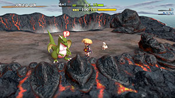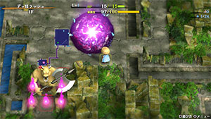

# Overview

<table class="dungeonOverview">
  <tr>
    <th>Unlock</th>
    <td class="highlightYellow">Clear Serpentcoil Island → Go to Firespew Mountain Summit.</td>
  </tr>
  <tr>
    <th>Entrance</th>
    <td class="highlightYellow">Firespew Mountain Summit (Talk to the Dragon)</td>
  </tr>
</table>

<table class="dungeonTable">
  <tr>
    <th>Floors</th>
    <td colspan="3">30F / 99F (Sacred Tree)</td>
  </tr>
  <tr>
    <th>Bring Items</th>
    <td>No</td>
    <th>Stairs</th>
    <td>Ascending</td>
  </tr>
  <tr>
    <th>Companions</th>
    <td>No</td>
    <th>Roamers</th>
    <td>No</td>
  </tr>
  <tr>
    <th>Rescues</th>
    <td>0</td>
    <th>Starting Level</th>
    <td>Lv1</td>
  </tr>
  <tr>
    <th>Starting Item</th>
    <td colspan="3">Large Onigiri</td>
  </tr>
  <tr>
    <th>Unidentified</th>
    <td colspan="3">Equipment, Grass, Staves, Scrolls, Pots</td>
  </tr>
  <tr>
    <th>Shops</th>
    <td>No</td>
    <th>Monster Houses</th>
    <td>No</td>
  </tr>
  <tr>
    <th>Behemoths</th>
    <td>Yes</td>
    <th>Wishing Shrines</th>
    <td>No</td>
  </tr>
  <tr>
    <th>Kron's Challenge</th>
    <td>No</td>
    <th>Fever Time</th>
    <td>Yes</td>
  </tr>
  <tr>
    <th>Initial Enemies</th>
    <td>-</td>
    <th>Spawn Rate</th>
    <td>-</td>
  </tr>
  <tr>
    <th>Wind (1st Gust)</th>
    <td>900 Turns</td>
    <th>Reward</th>
    <td>Auspicious Kumade (Gold)</td>
  </tr>
</table>

Postgame dungeon where a Behemoth Gate appears on all floors, and normal monsters don't spawn. However, Bashagga and Gigataur can appear as penalty monsters under special circumstances. None of the 1st clear floors have dark hallways, but expect to collapse if you get hit by an attack. Overall, it serves as extended training ground for Behemoth Monster mechanics.

# Navigation

<ul class="quickLinksUL">
  <li><a href="#strategy">Strategy</a>
    <ul>
      <li><a href="#general-advice-(first-clear-&-sacred-tree-extension)">General Advice (First Clear & Sacred Tree Extension)</a></li>
      <li><a href="#important-items-(first-clear-&-sacred-tree-extension)">Important Items (First Clear & Sacred Tree Extension)</a></li>
      <li><a href="#farming-techniques">Farming Techniques</a></li>
    </ul>
  </li>
  <li><a href="#floor-guide">Floor Guide</a>
    <ul>
      <li><a href="#first-clear">First Clear</a>
        <ul>
          <li><a href="#1-10f">1-10F</a></li>
          <li><a href="#11-20f">11-20F</a></li>
          <li><a href="#21-30f">21-30F</a></li>
        </ul>
      </li>
      <li><a href="#sacred-tree-extension">Sacred Tree Extension</a>
        <ul>
          <li><a href="#1-30f">1-30F</a></li>
          <li><a href="#31-50f">31-50F</a></li>
          <li><a href="#51-59f">51-59F</a></li>
          <li><a href="#60-80f">60-80F</a></li>
          <li><a href="#81-99f">81-99F</a></li>
        </ul>
      </li>
    </ul>
  </li>
  <li><a href="#monsters">Monsters</a></li>
  <li><a href="#behemoths">Behemoths</a></li>
  <li><a href="#items">Items</a>
    <ul>
      <li><a href="#weapon">Weapon</a></li>
      <li><a href="#shield">Shield</a></li>
      <li><a href="#bracelet">Bracelet</a></li>
      <li><a href="#projectile">Projectile</a></li>
      <li><a href="#food-(items)">Food</a></li>
      <li><a href="#grass">Grass</a></li>
      <li><a href="#scroll">Scroll</a></li>
      <li><a href="#stave">Staff</a></li>
      <li><a href="#pot">Pot</a></li>
      <li><a href="#incense">Incense</a></li>
    </ul>
  </li>
</ul>

# Strategy

<h3 id="general-advice-(first-clear-&-sacred-tree-extension)" class="heading3Yellow">General Advice (First Clear & Sacred Tree Extension)</h3>

The first clear is 30 floors, while the Sacred Tree Extension is 99 floors. Hallways are fully visible on 1-30F, then alternate between visible and dark on 31-99F. A Behemoth Gate is generated on all floors, and regular monsters generally don't spawn. The basic strategy is to collect items until about 10F, then switch to rushing to the stairs. For the Sacred Tree Extension, the item collection range can be extended to 59F or so.

If you find a Bouncy Wall room, prioritize duplicating items like Revival Grass or Blank Scroll, and check to make sure Far-throwing Bracelet isn't equipped before throwing an item. Floor layouts become more complex with depth, so save Pickaxes and Burrowing Staves. Items that replenish Fullness are also quite important, since floors are generally large. Lastly, Fever Time should probably be ignored unless you're desperate for items.

<h4 id="behemoth-monsters" class="heading4Yellow"> Behemoth Monsters</h4>

Most Behemoths have Slow speed since action speed for Behemoths is reduced by 1 stage, but the Sacred Tree Extension features select Normal or Swift 1 speed Behemoths later on. Pumphantasm attacks through walls, and ranged attackers like Bowboy one-shot you from afar, so keep track of turn order and consider running away before you become cornered.

Behemoths can be instantly defeated by projectiles (rocks, arrows, thrown items) or cannons, but the player must aim for a spot that isn't protected by a Behemoth Barrier to deal damage. Rocks or Far-throwing Bracelet (or Silver Arrow) can be used to bypass a Behemoth Barrier. Slaying every Behemoth you encounter ensures safety of course, but don't run out of items. It's also possible to slay a Behemoth with a normal attack or such by striking it from behind, which makes Switching Staff (effective even against barriers) an option when cornered.

<h4 id="effectiveness-changes-vs.-behemoths" class="heading4Yellow"> Effectiveness Changes vs. Behemoths</h4>

- Staves
    - Always immune
        - Peach, Disguising, Knockback
    - Effective even against barrier-protected tiles
        - Switching, Vaulting, Narrow-escape (× Paralyzed), Skull Mage's (warp), Unlucky, Fortune
    - Effective only against non-barrier tiles
        - All other status condition or damage inflicting staves.
    - Earthmound Staff Note
        - Breakable wall tiles can't be used to block a Behemoth's pursuit.
- Scrolls
    - Gathering Scroll doesn't attract Behemoth Monsters.
    - Behemoths are immune to Fixer Scroll's Paralyzed status effect.
    - Windblade Scroll isn't effective in hallways, but is effective in rooms.
    - Sanctuary Scroll still prevents adjacent Behemoths from using normal attacks.
    - Eradication Scroll slays a Behemoth, but doesn't prevent it from spawning again.
- Peach Buns
    - Behemoths are completely immune to a thrown Peach Bun's morphing effect.
- Cannons
    - Every cannon type except for  Peach Bun Cannon is effective.
    - The  Piercing Cannon series can slay Behemoths from any direction.
    - The  Cannon series must be fired in a way where the blast hits a non-barrier tile.
    - Cannon objects can be pushed onto a room entrance tile to block a Behemoth's pursuit.
    - Behemoth Monsters never operate cannon objects.

<h4 id="behemoth-spawns" class="heading4Yellow"> Behemoth Spawns</h4>

Behemoths despawn over time, but the deeper you go the longer they linger before vanishing. You might only see 2 spawn early on, but by the end upwards of 5\~10 can spawn at once. The Behemoth Gate also seems to change locations faster on certain floors in this dungeon, so Behemoth Monsters can be surprisingly spread out instead of clustering in one spot.

The Behemoth Gate vanishes and leaves behind an item after you enter every room on the floor. This is a nice way to obtain useful items during early\~mid game since maps are simpler at first. All Behemoth Monsters present on the floor vanish when the Behemoth Gate vanishes. The best time to identify items is after you've made the Behemoth Gate vanish on the floor. Synthesis Pot seems to be a Behemoth Gate vanishing reward exclusive item here.

<h4 id="non-behemoth-spawns" class="heading4Yellow">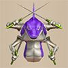 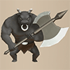 Non-Behemoth Spawns</h4>

Bashagga and Gigataur don't spawn as turns elapse, but can be hidden in breakable wall tiles. They also appear when a Monster Pot, Monstercall Scroll, or Schubell family ability gets used, so it's best to avoid hitting sparkling walls or pillars, and don't use the listed items. Schubell types use their ability even from a distance if the player is within view.

<h3 id="important-items-(first-clear-&-sacred-tree-extension)" class="heading3Purple">Important Items (First Clear & Sacred Tree Extension)</h3>

<h4 id="weapon-&-shield-(sacred-tree-extension)" class="heading4Purple">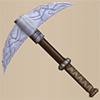 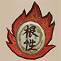 Weapon & Shield</h4>

<b><u>Pickaxe</u></b> Escape from a dead end when you're at risk of being cornered. Can be easier to utilize if you also have a Waterwalk Bracelet equipped.

<b><u>Kama Itachi</u></b> Attack 3 forward directions at the same time. Useful when hunting Bashagga & Gigataur using Monstercall Scroll + Sanctuary Scroll.

<b><u>Shield of Sating</u></b> Low defense, but doubles the number of turns you can act before starving. It's fine to main this shield during the 1st clear, but synthesize it during the 2nd clear.

<b><u>Watchful Shield, Kappa's Dish, Gusty Shield</u></b> Chance-based defensive shields that potentially let you conserve Revival Grass. Gusty Shield (Guts rune) grants a 30% chance to survive a fatal hit with 1 HP remaining, and considering most attacks one-shot you here, it's fantastic in this dungeon.

<h4 id="weapon-runes-(sacred-tree-extension)" class="heading4Purple"> Weapon Runes</h4>

No runes - Synthesis Pot is rare, and should be exclusively saved for shield runes in this dungeon.

<h4 id="shield-runes-(sacred-tree-extension)" class="heading4Purple"> Shield Runes</h4>

|Rune|Source|Notes|Clears|
|-|-|-|-|
| Guts|Gutsy Shield|30% chance to endure a fatal hit with 1 HP remaining. Never activates when the player's current HP is 1.|Both|
| Keen|Watchful Shield|Roughly 23% chance to evade enemy normal attacks. Nice for Pumphantasm family and Swift 1 (ex: Soul Reaper) foes.|Both|
| Projectileproof|Kappa's Dish|Roughly 39% chance to dodge enemy projectiles. Sleep Radish (60-80F), Frenzy Radish (81-99F), Mini Tank (81-99F), Atrocious Kappa (81-99F), Porkon (60-80F), Porgon (81-99F), etc. Helps against lots of dangerous projectile-based monsters.|Both|
| Sating|Shield of Sating|Halves hunger rate (1 Fullness / 20 Turns) Doubles the number of turns you can spend on actions before starving.|Both|
| Anti-Dragon|Dragon Shield|Reduces normal attack and fire damage by 50% from Dragon types. Sky Dragon (31-50F), Archdragon (60-80F), Abyss Dragon (81-99F), etc. Mostly for Lv2-4 Dragon family's flame, and Firepuff family's fire.|2nd|
| Hypnosisproof|Gazer Shield|Protects against Gazer's hypnosis. Super Gazer (31-50F), Hyper Gazer (60-80F), Ultra Gazer (81-99F), etc. Mainly just for Ultra Gazer.|2nd|
| Magic Cancel|Shield of Negation|Nullifies magic bullets aimed at you. Skull Wizard (31-50F), Skullmancer (60-80F), Skull Lord (81-99F), etc. Pretty much used as a counter for Lv2-4 Skull Mage monsters.|2nd|
| Anti-Blast|Blast Shield|Reduces damage from explosions by 50%. Ornery Tank (31-50F, 60-80F), Adamant Tank (81-99F), etc. Halves Pop Tank family's fixed damage, and Explochin family's blast.|2nd|

<h4 id="offensive-items" class="heading4Purple"> Offensive Items</h4>

<b><u>Rock</u></b> / <b><u>Porky's Rock</u></b> / <b><u>Silver Arrow</u></b> Items that can be used to defeat a Behemoth Monster from the front. Keep in mind that they can miss, and save them for later floors if possible.

<b><u>Far-throwing Bracelet</u></b> Shoot or throw non-silver arrows, equipment, or Gitan to slay Behemoths from the front. The item can't be reclaimed if you miss, so you'll burn through more items while it's equipped. Even more effective if you make it a point to collect lots of arrows from various arrow traps. Throw unneeded items outside the map when Bored Kappa family Behemoths are around. Don't forget to unequip it when throwing an item at a Bouncy Wall.

<h4 id="movement-items" class="heading4Purple"> Exploration Items</h4>

<b><u>Monster-find Bracelet</u></b> Makes it safer to explore rooms by revealing monster positions. Particularly nice to have for floors where B-Pumphantasm types spawn (1-10, 21-30F, 50-99F).

<b><u>Waterwalk Bracelet</u></b> Avoid having to take long detours due to waterways. Food in your inventory that's outside of a pot will rot while walking on water.

<b><u>Water-drain Scroll</u></b> Avoid having to take long detours due to waterways.

<b><u>Burrowing Staff</u></b> Create alternate paths to rooms, or escape from a dead end.

<b><u>Vaulting Staff</u></b> Escape from a dangerous situation, or skip across waterways.

<b><u>Switching Staff</u></b> Switch positions with a Behemoth Monster while in a hallway, then shoot them from behind.

<b><u>Guiding Staff</u></b> Reveals the location of the stairs on the map. Can be used alongside Blurry Incense to safely rush stairs near the end.

<b><u>Mapping Scroll</u></b> Use these closer to the end where floors become generally larger and more complex.

<h4 id="survival-/-other-items" class="heading4Purple"> Survival / Other Items</h4>

<b><u>Preservation Pot</u></b> Great to have to prevent onigiri from rotting. Especially nice if you happen to obtain a Sumo Onigiri from a Behemoth Gate.

<b><u>Sumo Onigiri</u></b> Counters Starvation Traps that reduce Max Fullness by 25 per activation. Beware that you can't use movement staves like Vaulting Staff during Sumo status. Only obtainable by making a Behemoth Gate vanish.

<b><u>Special Onigiri</u></b> Eat it at the start of a floor to try for Satiated status, or before descending for Knowledgeable status. Don't forget to regen HP until full beforehand, or else you'll just get the HP restoring effect.

<b><u>Leaping Grass</u></b> Escape from a dead end situation, but doesn't work during Sumo status. It's probably best to try and keep at least 1 on hand at all times.

<b><u>Invincible Grass, Revival Grass</u></b> Revival Grass counters unexpected hits and starvation, Invincible Grass helps when sandwiched. Either of these grasses are occasionally obtained when making a Behemoth Gate vanish, and should be considered for duplication when you see a Bouncy Wall Room.

<b><u>Wall-less Scroll</u></b> Immediately makes the Behemoth Gate vanish due to the floor changing to a single room. However, Bashaggas and Gigataurs can be hidden inside walls as penalty monsters. It's best to pair it with movement related staves to evade said enemies.

<b><u>Blank Scroll</u></b> Can be found on the floor, and also obtained by making a Behemoth Gate vanish. Good writing options: Mapping, Wall-less (erase Behemoth Gate), Fixer (replenish Fullness), etc. Always keep 1 on hand for Bouncy Wall Room duplication purposes.

<b><u>Blurry Incense</u></b> The player can still detect nearby Behemoth Monsters during this incense's effect. However, keep in mind that it makes it harder to locate the stairs.

<b><u>Earthmound Staff</u></b> Swing it while facing a water tile to create a pillar → break the pillar to turn it into dry ground. Behemoth Monsters destroy pillars, so this can't be used to block their pursuit.

<b><u>Monster Pot</u></b> Extremely dangerous, since you'll become surrounded by Bashaggas and Gigataurs. Always use Tap type pots while standing on the stairs until this is identified, unless the pot was obtained by making a Behemoth Gate vanish.

<b><u>Far-throwing Trap</u></b> Shoot or throw non-silver arrows, equipment, or Gitan to slay Behemoths from the front. The item can't be reclaimed if you miss, so you'll burn through more items with this effect. You also won't be able to duplicate items using a Bouncy Wall with this status.

<h3 id="farming-techniques" class="heading3Green">Farming Techniques</h3>

<h4 id="leveling-up" class="heading4Green"> Leveling Up</h4>

If you find a cannon in a room early on, use it to hunt some Behemoth Monsters to level up. 11-20F can spawn Behemoths that deal a fixed 20 damage, so 21, 41, or 61+ Max HP is safer. Also, Archdragon (60-80F) deals 30 damage, and Abyss Dragon (81-99F) deals 40 damage, so aim to reach at least 31+ Max HP by 60F, and 41+ Max HP by 81F for the 2nd clear.

Some players like to hunt Bashagga or Gigataur for experience points using specific items. This is more useful for the 2nd clear since Abyss Dragon can spawn, but it's not mandatory. Gigataur has 235 HP and grants 1,790 exp, while Bashagga has 154 HP and grants 950 exp. You'll need 2 Blank Scrolls (Monstercall Scroll + Sanctuary Scroll) to ensure safety, and be careful not to get sent outside of the dungeon by wind (900 Turns).

<h4 id="duplicate-items-using-bouncy-walls" class="heading4Green"> Duplicate Items Using Bouncy Walls</h4>

Bouncy Wall Rooms are rooms containing blue walls that reflect thrown items back at the player. Throw an item at a wall diagonally and have it bounce off of all 4 sides to duplicate the item. The walls have a decent chance to break each time an item is successfully duplicated, and are guaranteed to break after 10 successful item duplications on the current floor. The duplicated item is a plain (non-upgraded/sacred/blessed) version of the thrown item, and the item's capacity or quantity is within standard range of what you'd find on the ground. Some Bouncy Wall room layouts are unsolvable.

# Floor Guide

<h3 id="first-clear" class="heading3Yellow">First Clear</h3>

### General Advice

See [General Advice (First Clear & Sacred Tree Extension)](#general-advice-(first-clear-&-sacred-tree-extension)) for an overview. The basics are Explore without being detected and Pierce barriers to slay Behemoths. The former is self-explanatory, but avoiding detection by behemoths helps with survivability. However, the Pumphantasm family detects you from anywhere on the floor even as Behemoths. The latter means find ways to pierce or bypass barriers to slay a Behemoth from any direction, which primarily include using items like Rocks, Silver Arrows, and Far-throwing Bracelet. Switching Staff can be used to get behind a Behemoth that's facing you for a back-strike, but always keep track of turn order and remember that normal attacks can miss.

### 1-10F

Beware of B-Pumphantasm since it has the ability to pass through walls. If you find a cannon in a room, use it to hunt Behemoths to level up (aim for 21+ Max HP). It's good to step into all rooms to make the Behemoth Gate vanish for an item drop early on, but weigh the risk of starvation if you step on a Hunger Trap or begin to run low on food. Fixer Scroll (read when starving) or Revival Grass (revive) can replenish Fullness if needed, so consider duplicating these (or a Large Onigiri) in a Bouncy Wall Room when starting out.

The only useful weapon in this dungeon is Pickaxe, so feel free to discard other weapons. The best time to identify items is after you've made the Behemoth Gate vanish on the floor. Always use Tap type pots while standing on the stairs until Monster Pot is identified. Swing unidentified staves at a wall in a safe room until Vaulting Staff is identified, after which you can identify staves by swinging them at Behemoth Monsters.

<h4 id="behemoths-(1-10f)" class="heading4Purple">Behemoths (1-10F)</h4>

|Floor|Monster|Range|Ability/Notes|
|-|-|-|-|
|1-10|Mamel|Adjacent|-|
|1-10|Chintala|Adjacent|-|
|1-10|Spearfish|Adjacent|-|
|1-10|Pumphantasm|Adjacent|Wallpass|
|1-10|Firepuff|Adjacent|Flame = 10 damage|
|1-10|Armordillo|Adjacent|Trips you (drop items)|
|1-10|Taur|Adjacent|Chance for critical hit|
|1-10|Shagga|Adjacent|-|

### 11-20F

Aim for 21+ Max HP since B-Pop Tank, B-Porky, and B-Dragon deal 20 damage from afar. Use the Look Around command often, as B-Crossbowboy can one-shot you with an arrow. Don't linger in rooms - B-Schubell summons 1 Bashagga or Gigataur even from a distance. B-Bored Kappa and B-Hoppin' Batter are immune to projectiles without Far-throwing status. Starting from 10F, even number floors often have a room split by a waterway (ex: 10F, 12F...).

<h4 id="behemoths-(11-20f)" class="heading4Purple">Behemoths (11-20F)</h4>

|Floor|Monster|Range|Ability/Notes|
|-|-|-|-|
|11-20|Crossbowboy|10 Line|Shoots Iron Arrow|
|11-20|Pop Tank|∞ Line|Cannonball = 20 damage|
|11-20|Bored Kappa|Adjacent|Projectile immune|
|11-20|Porky|3 Radius|Rock = 20 damage|
|11-20|Dragon|∞ Line|Flame = 20 damage|
|11-20|Ghost Radish|2 Line|Throws Poison Grass|
|11-20|Skull Mage|∞ Line|Shoots low level magic|
|11-20|Gazer|Adjacent|Hypnosis (adjacent)|
|11-20|Twisty Hani|Adjacent|Level -1|
|11-20|Scorpion|Adjacent|Current strength -1|
|11-20|Field Knave|10 Line|Weeds = 2 damage|
|11-20|Nigiri Baby|Adjacent|Morphs an item into onigiri|
|11-20|Hat Urchin|Adjacent|Steals a staff|
|11-20|Curse Girl|Adjacent|Curses equipped shield|
|11-20|Swordsman|Adjacent|Disarms equipped shield|
|11-20|Explochin|Adjacent|Big explosion after 2 damage|
|11-20|Hoppin' Batter|Adjacent|Projectile immune|
|11-20|Zapdon|Adjacent|Lightning = 25 damage|
|11-20|Schubell|Adjacent|Summons 1 foe even from afar|

### 21-30F

The lineup of Behemoths is similar to 1-10F, but each Behemoth lingers for a long time. Use Mapping Scrolls, movement related staves, and rocks as needed to reach the goal. B-Pumpanshee passes through walls, and B-Flamepuff's fire deals 20 damage.

<h4 id="behemoths-(21-30f)" class="heading4Purple">Behemoths (21-30F)</h4>

|Floor|Monster|Range|Ability/Notes|
|-|-|-|-|
|21-30|Pit Mamel|Adjacent|-|
|21-30|Mid Chintala|Adjacent|-|
|21-30|Lt. Spearfish|Adjacent|Flees to water at low HP|
|21-30|Pumpanshee|Adjacent|Wallpass|
|21-30|Flamepuff|Adjacent|Flame = 20 damage|
|21-30|Brodillo|Adjacent|Trips you (drop items)|
|21-30|Minotaur|Adjacent|Chance for critical hit|

<h3 id="sacred-tree-extension" class="heading3Pink">Sacred Tree Extension</h3>

<h3 id="general-advice-(sacred-tree-extension)" class="heading3Red">General Advice</h3>

The basics Explore without being detected and Pierce barriers to slay Behemoths still apply. Far-throwing Bracelet greatly expands options for slaying Behemoths, so take good care of it. Remember to unequip Far-throwing Bracelet before throwing items if you spot a Bouncy Wall. The Behemoth monster table is far more manageable between 1-59F compared to 60-99F, so finish all preparations by the end of 59F, then switch to rushing stairs until the end. Behemoths like B-Frenzy Radish, B-Ultra Gazer, B-Soul Reaper, and B-Mini Tank spawn, so even a single quick mistake can cost you a Revival Grass or the run itself.

In addition to the above, it'd be good to keep the following 3 things in mind:

<h4 id="synthesize-shields-for-defensive-runes" class="heading4Red"> Synthesize shields for defensive runes</h4>

- Synthesis Pot can randomly be obtained from making a Behemoth Gate vanish.
- Top priority =  Sating,  Guts,  Projectileproof,  Anti-Dragon
- High priority =  Keen,  Hypnosisproof,  Magic Cancel
- Medium & Low priority =  Anti-Blast (Medium),  Retribution (Low)

<h4 id="hunt-bashagga-or-gigataur-to-level-up" class="heading4Red">  Hunt Bashagga or Gigataur to level up</h4>

- These 2 monsters can spawn via a Monster House (Monstercall Scroll), Monster Pot, or shiny wall.
- Reaching Lv20+ hastens HP regen speed to +3 HP / Turn, making it easier to deal with fixed damage.
- Be careful not to get blown away by wind, maybe wait until you have a weapon to hunt these foes, and consider doing 2 sessions on different floors instead of cramming it into a single floor.
- Steps for Monster House Method:
    1. Prepare Monstercall Scroll (Blank Scroll) + Sanctuary Scroll → find a room with 2 entrances.
    2. Place the Sanctuary Scroll near one of the entrances → read Monstercall Scroll.
    3. Equip a Pickaxe and hunt Bashaggas → Gigataurs until the 1st\~2nd wind gust occurs.
    4. Exit the room from the side where foes can't pursue → wait until foes leave the room.
    5. Enter the room and claim items → rush to the stairs.

<h4 id="warp-using-water-or-air-tiles" class="heading4Red"> Warp using water or air tiles</h4>

- Use a Vaulting Staff to land on a water or air tile to instantly warp to a random room.
- You can also unequip a Waterwalk Bracelet while standing on a water tile to warp.
    - This can be done even during Sumo status, unlike the Vaulting Staff method.
- Tatsumi Shiren can use an ability to replicate the Vaulting Staff effect.

<h3 id="1-30f" class="heading3Red">1-30F</h3>

The same strategy that was used for the [first clear](#first-clear) can generally be used for this floor range. Exploring to make Behemoth Gates vanish for reward items is more important in the 2nd clear, so watch for Shield of Sating, and duplicate Fullness replenishing items with Bouncy Walls early on. Don't forget that Revival Grass (revive) and Fixer Scroll (read when starving) can replenish Fullness. Behemoths that appear on 1-10F, 21-30F, and 51-59F lean toward being close-ranged attackers, meaning those floor ranges are the easiest in terms of making Behemoth Gates vanish.

If you get an unidentified grass from a Behemoth Gate, consider saving it in case it's Revival Grass. Far-throwing and Waterwalk bracelets both significantly reduce the difficulty of this dungeon. Synthesis Pot is great for the 2nd clear, and can only be obtained from Behemoth Gates. The priority for identifying item categories should probably be: Bracelets &gt; Pots &gt; Grass.

<h4 id="behemoths-(1-30f)" class="heading4Purple">Behemoths (1-30F)</h4>

|Floor|Monster|Range|Ability/Notes|
|-|-|-|-|
|1-10|Mamel|Adjacent|-|
|1-10|Chintala|Adjacent|-|
|1-10|Spearfish|Adjacent|-|
|1-10|Pumphantasm|Adjacent|Wallpass|
|1-10|Firepuff|Adjacent|Flame = 10 damage|
|1-10|Armordillo|Adjacent|Trips you (drop items)|
|1-10|Taur|Adjacent|Chance for critical hit|
|1-10|Shagga|Adjacent|-|
|11-20|Crossbowboy|10 Line|Shoots Iron Arrow|
|11-20|Pop Tank|∞ Line|Cannonball = 20 damage|
|11-20|Bored Kappa|Adjacent|Projectile immune|
|11-20|Porky|3 Radius|Rock = 20 damage|
|11-20|Dragon|∞ Line|Flame = 20 damage|
|11-20|Ghost Radish|2 Line|Throws Poison Grass|
|11-20|Skull Mage|∞ Line|Shoots low level magic|
|11-20|Gazer|Adjacent|Hypnosis (adjacent)|
|11-20|Twisty Hani|Adjacent|Level -1|
|11-20|Scorpion|Adjacent|Current strength -1|
|11-20|Field Knave|10 Line|Weeds = 2 damage|
|11-20|Nigiri Baby|Adjacent|Morphs an item into onigiri|
|11-20|Hat Urchin|Adjacent|Steals a staff|
|11-20|Curse Girl|Adjacent|Curses equipped shield|
|11-20|Swordsman|Adjacent|Disarms equipped shield|
|11-20|Explochin|Adjacent|Big explosion after 2 damage|
|11-20|Hoppin' Batter|Adjacent|Projectile immune|
|11-20|Zapdon|Adjacent|Lightning = 25 damage|
|11-20|Schubell|Adjacent|Summons 1 foe even from afar|
|21-30|Pit Mamel|Adjacent|-|
|21-30|Mid Chintala|Adjacent|-|
|21-30|Lt. Spearfish|Adjacent|Flees to water at low HP|
|21-30|Pumpanshee|Adjacent|Wallpass|
|21-30|Flamepuff|Adjacent|Flame = 20 damage|
|21-30|Brodillo|Adjacent|Trips you (drop items)|
|21-30|Minotaur|Adjacent|Chance for critical hit|

<h3 id="31-50f" class="heading3Red">31-50F</h3>

The Behemoth table is similar to 11-20F, but most monsters are their Lv2 counterparts. Visibility wise, hallways are dark on 31-35F, 40-43F, and 48-50F in this floor range, but Behemoth Monsters are displayed on the map regardless when you get near them. A number of ranged attackers can spawn, but there aren't any extreme floor-wide threats yet, so it'd be good to continue to explore for items while the Behemoth table isn't super awful. B-Ornery Tank (31-50F) deals 30 damage per blast, so aim for 31+ Max HP at this point.

B-Pesky Kappa (31-50F) and B-Hoppin' Hitter (31-50F) are both immune to projectiles, but can be slain by arrows or thrown items if you have a Far-throwing Bracelet equipped. B-Pesky Kappa stands on top of an item and throws it at you when you get within 5 tiles, which can deal 100+ damage if it's a weapon (Lv3-4 Bored Kappas only), shield, or arrow. Dispose of said item categories by throwing them onto air tiles or into hallway waterways, or throw the unneeded item into the corner of a dead-end room you won't visit again.

B-Soul Reaper has Swift 1 speed + Wallpass, so rush stairs on 50F, 60F, 70F, and 80F. It's easy to deal with them if you have a Far-throwing Bracelet, but otherwise it can be tricky. Invincible Grass and Wall-less Scroll are nice, and don't dash on Lv3-4 Death Reaper floors.

<h4 id="behemoths-(31-50f)" class="heading4Purple">Behemoths (31-50F)</h4>

|Floor|Monster|Range|Ability/Notes|
|-|-|-|-|
|31-50|Ornery Tank|∞ Line|Cannonball = 30 damage|
|31-50|Pesky Kappa|Adjacent|Projectile immune, Throws items (5 Radius)|
|31-50|Porko|5 Radius|Rock = 20 damage|
|31-50|Sky Dragon|Room|Flame = 20 damage|
|31-50|Daze Radish|2 Radius|Throws Confusion Grass|
|31-50|Skull Wizard|∞ Line|Shoots mid level magic|
|31-50|Super Gazer|Adjacent|Hypnosis (adjacent)|
|31-50|Floppy Hani|Adjacent|Level -1|
|31-50|Vile Scorpion|Adjacent|Current strength -2|
|31-50|Pot Knave|10 Line|Throws Weeds into pots|
|31-50|Nigiri Morph|Adjacent|Morphs an item into onigiri|
|31-50|Hat Prankster|Adjacent|Steals a staff or grass|
|31-50|Cursister|Adjacent|Curses equipped weapon or shield|
|31-50|Fencer|Adjacent|Disarms equipped weapon or shield|
|31-50|Concusschin|Adjacent|Big explosion after 2 damage|
|31-50|Hoppin' Hitter|Adjacent|Projectile immune|
|31-50|Rumbledon|Adjacent|Lightning = 30 damage|
|31-50|Menbell|Adjacent|Summons 1-2 foes even from afar|
|50,60,70,80|Soul Reaper|Adjacent|Swift 1 speed, Wallpass|
|50-80|Popdillo|Adjacent|Trips you (drop items)|
|50-80|Pumplich|Adjacent|Wallpass|
|50-80|Megataur|Adjacent|Chance for critical hit|
|50-80|Blazepuff|Adjacent|Flame = 30 damage|
|50-80|Big Chintala|Adjacent|-|
|50-80|Cave Mamel|Adjacent|-|
|50-80|Capt. Spearfish|Adjacent|Flees to water at low HP Water shot = 15 damage|

<h3 id="51-59f" class="heading3Red">51-59F</h3>

Only close-range Behemoth Monsters appear, making this a relatively safer floor range. Just be careful not to get cornered by B-Pumplich (50-80F) which can approach through walls, and beware of B-Blazepuff (50-80F)'s 30 damage flame which cuts through corners. Hallways are dark on 50-51F and 56-59F in this floor range.

<h4 id="behemoths-(51-59f)" class="heading4Purple">Behemoths (51-59F)</h4>

|Floor|Monster|Range|Ability/Notes|
|-|-|-|-|
|50-80|Popdillo|Adjacent|Trips you (drop items)|
|50-80|Pumplich|Adjacent|Wallpass|
|50-80|Megataur|Adjacent|Chance for critical hit|
|50-80|Blazepuff|Adjacent|Flame = 30 damage|
|50-80|Big Chintala|Adjacent|-|
|50-80|Cave Mamel|Adjacent|-|
|50-80|Capt. Spearfish|Adjacent|Flees to water at low HP Water shot = 15 damage|

<h3 id="60-80f" class="heading3Red">60-80F</h3>

Behemoths are a mix of close and long-range, and most foes are their Lv3 counterparts. B-Great Hen & B-Baby Tank (60-80F) are Normal speed, and the latter shoots arrows in hallways. This is because B-Baby Tank's barrier tiles are counted as non-adjacent despite detecting you. Use the Look Around command a lot, and act carefully when you spot a B-Baby Tank. B-Lashagga (60-80F)'s 3 attacks and B-Skullmancer (60-80F)'s magic can also one-shot you. Don't dash, and consider swinging your weapon to check for traps for consistency.

B-Vexing Kappa (60-80F) is easier to handle if you have a Far-throwing Bracelet + arrows, but otherwise you might want to place unneeded and harmless items down as a distraction. B-Archdragon (60-80F) has Slow speed but is always awake, so expect 3-4 flames per spawn. Being Lv20 with 100+ Max HP is a big help, and read a Wall-less Scroll if too many spawn at once, though watch out for hidden penalty monsters (Bashagga and Gigataur) being revealed.

B-Sleep Radish (60-80F)'s 3 tile throwing radius begins at its Behemoth Barrier, not its center, so it's best to use Silver Arrows (or Far-throwing Bracelet) against it - NOT Porky's Rocks. B-Bellthoven can summon 1-3 monsters at once even at a distance, so avoid letting it act. The Swift 1 B-Soul Reaper appears again on 60F, 70F, and 80F, so rush stairs on those floors. Hallways are dark on 60-63F, 68-71, and 80F in this floor range.

<h4 id="behemoths-(60-80f)" class="heading4Purple">Behemoths (60-80F)</h4>

|Floor|Monster|Range|Ability/Notes|
|-|-|-|-|
|50,60,70,80|Soul Reaper|Adjacent|Swift 1 speed, Wallpass|
|50-80|Popdillo|Adjacent|Trips you (drop items)|
|50-80|Pumplich|Adjacent|Wallpass|
|50-80|Megataur|Adjacent|Chance for critical hit|
|50-80|Blazepuff|Adjacent|Flame = 30 damage|
|50-80|Big Chintala|Adjacent|-|
|50-80|Cave Mamel|Adjacent|-|
|50-80|Capt. Spearfish|Adjacent|Flees to water at low HP Water shot = 15 damage|
|60-80|Great Hen|Adjacent|Normal speed|
|60-80|Lashagga|Adjacent|Attacks 3 times|
|60-80|Baby Tank|10 Line|Normal speed, Shoots Iron Arrow|
|60-80|Ornery Tank|∞ Line|Cannonball = 30 damage|
|60-80|Vexing Kappa|Adjacent|Projectile immune, Throws items (10 Radius)|
|60-80|Porko|8 Radius|Rock = 20 damage|
|60-80|Archdragon|Floor|Flame = 30 damage|
|60-80|Sleep Radish|3 Radius|Throws Sedating Grass|
|60-80|Skullmancer|∞ Line|Shoots high level magic|
|60-80|Hyper Gazer|Adjacent|Hypnosis (adjacent)|
|60-80|Droopy Hani|Adjacent|Level -1|
|60-80|Terror Scorpion|Adjacent|Max strength -1|
|60-80|Bag Knave|10 Line|Parries an item|
|60-80|Nigiri Boss|Adjacent|Inflicts Onigiri status|
|60-80|Hat Brat|Adjacent|Steals a staff, grass, or food|
|60-80|Curse Matron|Adjacent|Curses any 2 equipped items|
|60-80|Battler|Adjacent|Disarms any equipped item|
|60-80|Fulminachin|Adjacent|Big explosion after 2 damage|
|60-80|Hoppin' Slugger|Adjacent|Projectile immune|
|60-80|Clapdon|Adjacent|Lightning = 35 damage|
|60-80|Bellthoven|Adjacent|Summons 1-3 foes even from afar|

<h3 id="81-99f" class="heading3Red">81-99F</h3>

Essentially the same Behemoth lineup as 60-80F, but foes are their Lv4 counterparts. Rush to the stairs - ranged attackers and monsters with powerful abilities appear. Projectiles are key to slaying Behemoths, so use Heat-ban Incense instead of Evasive Incense when trying to reduce HP loss from fixed-damage threats like B-Abyss Dragon and B-Porgon. Hallways are dark on 81-99F in this floor range.

<b><u>Notable threats</u></b>:

- B-Nimble Knave
    - Can wreck inventory items when lined up, and acts at Normal speed.
- B-Gitan Mamel / B-Miracle Hen / B-King Reaper
    - Close-ranged Swift 1 speed Behemoths.
    - B-King Reaper passes through walls and detects you from anywhere on the floor.
- B-Mini Tank / B-Adamant Tank
    - Long-ranged Normal speed attackers.
    - B-Mini Tank can potentially one-shot you by shooting a Silver Arrow when lined up.
    - B-Adamant Tank's cannonballs only deal 30 damage, so it's not as bad.
- B-Skull Lord
    - Magic bullet randomly inflicts Asleep status, Blind status, Level -3, or 40 damage.
- B-Bashagga
    - Attacks 4 times, basically ensuring a collapse even if you have a Watchful Shield.
- B-Ultra Gazer
    - Room-wide hypnosis, which wastes turns and items if you lack a Gazer Shield.
- B-Showpin
    - Spawns 2-3 Bashaggas or Gigataurs, which can't be managed just with Revival Grass.
    - Schubell family can use its ability even when not adjacent in this game.
- B-Abyss Dragon / B-Porgon
    - B-Abyss Dragon spews a floor-wide 40 damage flame.
        - There's risk of instantly collapsing if you step on an Onigiri or Explosion trap.
    - B-Porgon throws 20 damage Porky's Rocks within a 10 tile radius.
- B-Frenzy Radish / B-Atrocious Kappa
    - Advice comes down to Stock up on Revival Grass and hope you don't encounter them.
    - B-Frenzy Radish throws Rage Grass within a 5 tile radius starting from its barrier.
    - B-Atrocious Kappa throws any item it finds on the ground from anywhere on the floor.
        - It also throws any projectile that lacks piercing properties back at the player.

<h4 id="behemoths-(81-99f)" class="heading4Purple">Behemoths (81-99F)</h4>

|Floor|Monster|Range|Ability/Notes|
|-|-|-|-|
|81-99|Gitan Mamel|Adjacent|Swift 1 speed|
|81-99|Huge Chintala|Adjacent|-|
|81-99|Admiral Spearfish|Adjacent|Flees to water at low HP Water shot = 25 damage|
|81-99|Pumplord|Adjacent|Wallpass|
|81-99|Pyrepuff|Adjacent|Flame = 40 damage|
|81-99|Grampadillo|Adjacent|Trips you (drop items)|
|81-99|Gigataur|Adjacent|Chance for critical hit|
|81-99|Miracle Hen|Adjacent|Swift 1 speed|
|81-99|Bashagga|Adjacent|Attacks 4 times|
|81-99|Mini Tank|∞ Line|Normal speed, Shoots Silver Arrow|
|81-99|Adamant Tank|∞ Line|Normal speed, Cannonball = 40 damage|
|81-99|Atrocious Kappa|Adjacent|Projectile immune, Throws items (floor-wide)|
|81-99|Porgon|10 Radius|Rock = 20 damage|
|81-99|Abyss Dragon|Floor|Flame = 40 damage|
|81-99|Frenzy Radish|5 Radius|Throws Berserk Seed|
|81-99|Skull Lord|∞ Line|Shoots top level magic|
|81-99|Ultra Gazer|Adjacent|Hypnosis (room-wide)|
|81-99|Wrinkly Hani|Adjacent|Level -1|
|81-99|Demon Scorpion|Adjacent|Max strength -2|
|81-99|Nimble Knave|10 Line|Normal speed, parries an item|
|81-99|Nigiri Honcho|Adjacent|Morphs Shiren or item into onigiri|
|81-99|Hat Rascal|Adjacent|Steals a staff, grass, food, or scroll|
|81-99|Cursenior|Adjacent|Curses any 2 items|
|81-99|Swordmaster|Adjacent|Disarms any equipped item|
|81-99|Detonachin|Adjacent|Big explosion after 2 damage|
|81-99|Hoppin' Slammer|Adjacent|Projectile immune|
|81-99|Boomdon|Adjacent|Lightning = 40 damage|
|81-99|Showpin|Adjacent|Summons 2-3 foes even from afar|
|90|King Reaper|Adjacent|Swift 1 speed, Wallpass|

# Monsters

<button id="hideMonTblImgBtn" onClick={()=>{var mon_imgs = document.querySelectorAll('#monsterTable img');mon_imgs.forEach(e => e.classList.toggle('hidden'));}}>Toggle Monster Images</button>

See [Monsters](/system/monsters) for individual monster details.

- F - Dark hallways
- B - Behemoth Gate is possible

Monster Colors = Schubell, Shiny Wall, Monster Pot, or Monstercall Scroll (Not recorded in log)

<table id="monsterTable" class="monsterTable">
  <thead>
    <tr>
      <th>F</th>
      <th colspan="2">Monsters</th>
      <th>B</th>
    </tr>
  </thead>
  <tbody>
    <tr>
      <td class="centeredText">1-30</td>
      <td class="special"> Bashagga</td>
      <td class="special"> Gigataur</td>
      <td class="highlightBehemoth"></td>
    </tr>
    <tr>
      <td colspan="4" class="tableDivider"></td>
    </tr>
    <tr>
      <td class="monsterTableExtension"></td>
      <td colspan="2" class="monsterTableExtension centeredText">Sacred Tree Mode</td>
      <td class="monsterTableExtension"></td>
    </tr>
    <tr>
      <td colspan="4" class="tableDivider"></td>
    </tr>
    <tr>
      <td class="centeredText highlightFog">31-35</td>
      <td class="special"> Bashagga</td>
      <td class="special"> Gigataur</td>
      <td class="highlightBehemoth"></td>
    </tr>
    <tr>
      <td colspan="4" class="tableDivider"></td>
    </tr>
    <tr>
      <td class="centeredText">36-39</td>
      <td class="special"> Bashagga</td>
      <td class="special"> Gigataur</td>
      <td class="highlightBehemoth"></td>
    </tr>
    <tr>
      <td colspan="4" class="tableDivider"></td>
    </tr>
    <tr>
      <td class="centeredText highlightFog">40-43</td>
      <td class="special"> Bashagga</td>
      <td class="special"> Gigataur</td>
      <td class="highlightBehemoth"></td>
    </tr>
    <tr>
      <td colspan="4" class="tableDivider"></td>
    </tr>
    <tr>
      <td class="centeredText">44-47</td>
      <td class="special"> Bashagga</td>
      <td class="special"> Gigataur</td>
      <td class="highlightBehemoth"></td>
    </tr>
    <tr>
      <td colspan="4" class="tableDivider"></td>
    </tr>
    <tr>
      <td class="centeredText highlightFog">48-51</td>
      <td class="special"> Bashagga</td>
      <td class="special"> Gigataur</td>
      <td class="highlightBehemoth"></td>
    </tr>
    <tr>
      <td colspan="4" class="tableDivider"></td>
    </tr>
    <tr>
      <td class="centeredText">52-55</td>
      <td class="special"> Bashagga</td>
      <td class="special"> Gigataur</td>
      <td class="highlightBehemoth"></td>
    </tr>
    <tr>
      <td colspan="4" class="tableDivider"></td>
    </tr>
    <tr>
      <td class="centeredText highlightFog">56-63</td>
      <td class="special"> Bashagga</td>
      <td class="special"> Gigataur</td>
      <td class="highlightBehemoth"></td>
    </tr>
    <tr>
      <td colspan="4" class="tableDivider"></td>
    </tr>
    <tr>
      <td class="centeredText">64-67</td>
      <td class="special"> Bashagga</td>
      <td class="special"> Gigataur</td>
      <td class="highlightBehemoth"></td>
    </tr>
    <tr>
      <td colspan="4" class="tableDivider"></td>
    </tr>
    <tr>
      <td class="centeredText highlightFog">68-71</td>
      <td class="special"> Bashagga</td>
      <td class="special"> Gigataur</td>
      <td class="highlightBehemoth"></td>
    </tr>
    <tr>
      <td colspan="4" class="tableDivider"></td>
    </tr>
    <tr>
      <td class="centeredText">72-79</td>
      <td class="special"> Bashagga</td>
      <td class="special"> Gigataur</td>
      <td class="highlightBehemoth"></td>
    </tr>
    <tr>
      <td colspan="4" class="tableDivider"></td>
    </tr>
    <tr>
      <td class="centeredText highlightFog">80-99</td>
      <td class="special"> Bashagga</td>
      <td class="special"> Gigataur</td>
      <td class="highlightBehemoth"></td>
    </tr>
  </tbody>
</table>

# Behemoths

<button id="hideMonTblImgBtn" onClick={()=>{var mon_imgs = document.querySelectorAll('#behemothTable img');mon_imgs.forEach(e => e.classList.toggle('hidden'));}}>Toggle Monster Images</button>

Monster Colors = Caution, Dangerous

<table id="behemothTable" class="monsterTable">
  <thead>
    <tr>
      <th>F</th>
      <th colspan="5">Behemoth Monsters</th>
    </tr>
  </thead>
  <tbody>
    <tr>
      <td rowspan="2" class="centeredText">1-10</td>
      <td> Mamel</td>
      <td> Chintala</td>
      <td> Spearfish</td>
      <td class="danger"> Pumphantasm</td>
      <td> Firepuff</td>
    </tr>
    <tr>
      <td> Armordillo</td>
      <td> Taur</td>
      <td> Shagga</td>
      <td class="highlightGray"></td>
      <td class="highlightGray"></td>
    </tr>
    <tr>
      <td colspan="10" class="tableDivider"></td>
    </tr>
    <tr>
      <td rowspan="4" class="centeredText">11-20</td>
      <td class="danger"> Crossbowboy</td>
      <td class="danger"> Pop Tank</td>
      <td class="caution"> Bored Kappa</td>
      <td class="danger"> Porky</td>
      <td class="danger"> Dragon</td>
    </tr>
    <tr>
      <td class="caution"> Ghost Radish</td>
      <td> Skull Mage</td>
      <td> Gazer</td>
      <td> Twisty Hani</td>
      <td> Scorpion</td>
    </tr>
    <tr>
      <td> Field Knave</td>
      <td> Nigiri Baby</td>
      <td> Hat Urchin</td>
      <td> Curse Girl</td>
      <td>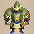 Swordsman</td>
    </tr>
    <tr>
      <td> Explochin</td>
      <td class="caution">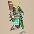 Hoppin' Batter</td>
      <td> Zapdon</td>
      <td class="danger"> Schubell</td>
      <td class="highlightGray"></td>
    </tr>
    <tr>
      <td colspan="10" class="tableDivider"></td>
    </tr>
    <tr>
      <td rowspan="2" class="centeredText">21-30</td>
      <td> Pit Mamel</td>
      <td> Mid Chintala</td>
      <td> Lt. Spearfish</td>
      <td class="danger"> Pumpanshee</td>
      <td class="caution"> Flamepuff</td>
    </tr>
    <tr>
      <td> Brodillo</td>
      <td> Minotaur</td>
      <td class="highlightGray"></td>
      <td class="highlightGray"></td>
      <td class="highlightGray"></td>
    </tr>
    <tr>
      <td colspan="10" class="tableDivider"></td>
    </tr>
    <tr>
      <td class="monsterTableExtension"></td>
      <td colspan="5" class="monsterTableExtension centeredText">Sacred Tree Mode</td>
    </tr>
    <tr>
      <td colspan="10" class="tableDivider"></td>
    </tr>
    <tr>
      <td rowspan="4" class="centeredText">31-49</td>
      <td class="danger"> Ornery Tank</td>
      <td class="danger"> Pesky Kappa</td>
      <td class="danger"> Porko</td>
      <td class="danger"> Sky Dragon</td>
      <td class="caution"> Daze Radish</td>
    </tr>
    <tr>
      <td class="danger"> Skull Wizard</td>
      <td> Super Gazer</td>
      <td> Floppy Hani</td>
      <td> Vile Scorpion</td>
      <td> Pot Knave</td>
    </tr>
    <tr>
      <td> Nigiri Morph</td>
      <td> Hat Prankster</td>
      <td> Cursister</td>
      <td> Fencer</td>
      <td> Concusschin</td>
    </tr>
    <tr>
      <td class="caution"> Hoppin' Hitter</td>
      <td> Rumbledon</td>
      <td class="danger">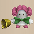 Menbell</td>
      <td class="highlightGray"></td>
      <td class="highlightGray"></td>
    </tr>
    <tr>
      <td colspan="10" class="tableDivider"></td>
    </tr>
    <tr>
      <td rowspan="6" class="centeredText">50</td>
      <td> Cave Mamel</td>
      <td> Big Chintala</td>
      <td> Capt. Spearfish</td>
      <td class="danger"> Soul Reaper</td>
      <td class="danger"> Pumplich</td>
    </tr>
    <tr>
      <td> Blazepuff</td>
      <td> Popdillo</td>
      <td> Megataur</td>
      <td class="danger"> Ornery Tank</td>
      <td class="danger"> Pesky Kappa</td>
    </tr>
    <tr>
      <td class="danger"> Porko</td>
      <td class="danger"> Sky Dragon</td>
      <td class="caution"> Daze Radish</td>
      <td class="danger"> Skull Wizard</td>
      <td> Super Gazer</td>
    </tr>
    <tr>
      <td> Floppy Hani</td>
      <td> Vile Scorpion</td>
      <td> Pot Knave</td>
      <td> Nigiri Morph</td>
      <td> Hat Prankster</td>
    </tr>
    <tr>
      <td> Cursister</td>
      <td> Fencer</td>
      <td> Concusschin</td>
      <td class="caution"> Hoppin' Hitter</td>
      <td> Rumbledon</td>
    </tr>
    <tr>
      <td class="danger"> Menbell</td>
      <td class="highlightGray"></td>
      <td class="highlightGray"></td>
      <td class="highlightGray"></td>
      <td class="highlightGray"></td>
    </tr>
    <tr>
      <td colspan="10" class="tableDivider"></td>
    </tr>
    <tr>
      <td rowspan="2" class="centeredText">51-59</td>
      <td> Cave Mamel</td>
      <td> Big Chintala</td>
      <td> Capt. Spearfish</td>
      <td class="danger"> Pumplich</td>
      <td> Blazepuff</td>
    </tr>
    <tr>
      <td> Popdillo</td>
      <td> Megataur</td>
      <td class="highlightGray"></td>
      <td class="highlightGray"></td>
      <td class="highlightGray"></td>
    </tr>
    <tr>
      <td colspan="10" class="tableDivider"></td>
    </tr>
    <tr>
      <td rowspan="6" class="centeredText">60</td>
      <td> Cave Mamel</td>
      <td> Big Chintala</td>
      <td> Capt. Spearfish</td>
      <td class="danger"> Soul Reaper</td>
      <td class="danger"> Pumplich</td>
    </tr>
    <tr>
      <td> Blazepuff</td>
      <td> Popdillo</td>
      <td> Megataur</td>
      <td class="danger"> Great Hen</td>
      <td class="caution"> Lashagga</td>
    </tr>
    <tr>
      <td class="danger"> Baby Tank</td>
      <td class="caution"> Ornery Tank</td>
      <td class="danger">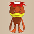 Vexing Kappa</td>
      <td class="danger"> Porkon</td>
      <td class="danger">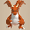 Archdragon</td>
    </tr>
    <tr>
      <td class="danger"> Sleep Radish</td>
      <td class="danger"> Skullmancer</td>
      <td> Hyper Gazer</td>
      <td> Droopy Hani</td>
      <td> Terror Scorpion</td>
    </tr>
    <tr>
      <td class="caution"> Bag Knave</td>
      <td> Nigiri Boss</td>
      <td> Hat Brat</td>
      <td> Curse Matron</td>
      <td> Battler</td>
    </tr>
    <tr>
      <td> Fulminachin</td>
      <td class="caution"> Hoppin' Slugger</td>
      <td> Clapdon</td>
      <td class="danger"> Bellthoven</td>
      <td class="highlightGray"></td>
    </tr>
    <tr>
      <td colspan="10" class="tableDivider"></td>
    </tr>
    <tr>
      <td rowspan="6" class="centeredText">61-69</td>
      <td> Cave Mamel</td>
      <td> Big Chintala</td>
      <td> Capt. Spearfish</td>
      <td class="danger"> Pumplich</td>
      <td> Blazepuff</td>
    </tr>
    <tr>
      <td> Popdillo</td>
      <td> Megataur</td>
      <td class="danger"> Great Hen</td>
      <td class="caution"> Lashagga</td>
      <td class="danger"> Baby Tank</td>
    </tr>
    <tr>
      <td class="caution"> Ornery Tank</td>
      <td class="danger"> Vexing Kappa</td>
      <td class="danger"> Porkon</td>
      <td class="danger"> Archdragon</td>
      <td class="danger"> Sleep Radish</td>
    </tr>
    <tr>
      <td class="danger"> Skullmancer</td>
      <td> Hyper Gazer</td>
      <td> Droopy Hani</td>
      <td> Terror Scorpion</td>
      <td class="caution"> Bag Knave</td>
    </tr>
    <tr>
      <td> Nigiri Boss</td>
      <td> Hat Brat</td>
      <td> Curse Matron</td>
      <td> Battler</td>
      <td> Fulminachin</td>
    </tr>
    <tr>
      <td class="caution"> Hoppin' Slugger</td>
      <td> Clapdon</td>
      <td class="danger"> Bellthoven</td>
      <td class="highlightGray"></td>
      <td class="highlightGray"></td>
    </tr>
    <tr>
      <td colspan="10" class="tableDivider"></td>
    </tr>
    <tr>
      <td rowspan="6" class="centeredText">70</td>
      <td> Cave Mamel</td>
      <td> Big Chintala</td>
      <td> Capt. Spearfish</td>
      <td class="danger"> Soul Reaper</td>
      <td class="danger"> Pumplich</td>
    </tr>
    <tr>
      <td> Blazepuff</td>
      <td> Popdillo</td>
      <td> Megataur</td>
      <td class="danger"> Great Hen</td>
      <td class="caution"> Lashagga</td>
    </tr>
    <tr>
      <td class="danger"> Baby Tank</td>
      <td class="caution"> Ornery Tank</td>
      <td class="danger"> Vexing Kappa</td>
      <td class="danger"> Porkon</td>
      <td class="danger"> Archdragon</td>
    </tr>
    <tr>
      <td class="danger"> Sleep Radish</td>
      <td class="danger"> Skullmancer</td>
      <td> Hyper Gazer</td>
      <td> Droopy Hani</td>
      <td> Terror Scorpion</td>
    </tr>
    <tr>
      <td class="caution"> Bag Knave</td>
      <td> Nigiri Boss</td>
      <td> Hat Brat</td>
      <td> Curse Matron</td>
      <td> Battler</td>
    </tr>
    <tr>
      <td> Fulminachin</td>
      <td class="caution"> Hoppin' Slugger</td>
      <td> Clapdon</td>
      <td class="danger"> Bellthoven</td>
      <td class="highlightGray"></td>
    </tr>
    <tr>
      <td colspan="10" class="tableDivider"></td>
    </tr>
    <tr>
      <td rowspan="6" class="centeredText">71-79</td>
      <td> Cave Mamel</td>
      <td> Big Chintala</td>
      <td> Capt. Spearfish</td>
      <td class="danger"> Pumplich</td>
      <td> Blazepuff</td>
    </tr>
    <tr>
      <td> Popdillo</td>
      <td> Megataur</td>
      <td class="danger"> Great Hen</td>
      <td class="caution"> Lashagga</td>
      <td class="danger"> Baby Tank</td>
    </tr>
    <tr>
      <td class="caution"> Ornery Tank</td>
      <td class="danger"> Vexing Kappa</td>
      <td class="danger"> Porkon</td>
      <td class="danger"> Archdragon</td>
      <td class="danger"> Sleep Radish</td>
    </tr>
    <tr>
      <td class="danger"> Skullmancer</td>
      <td> Hyper Gazer</td>
      <td> Droopy Hani</td>
      <td> Terror Scorpion</td>
      <td class="caution"> Bag Knave</td>
    </tr>
    <tr>
      <td> Nigiri Boss</td>
      <td> Hat Brat</td>
      <td> Curse Matron</td>
      <td> Battler</td>
      <td> Fulminachin</td>
    </tr>
    <tr>
      <td class="caution"> Hoppin' Slugger</td>
      <td> Clapdon</td>
      <td class="danger"> Bellthoven</td>
      <td class="highlightGray"></td>
      <td class="highlightGray"></td>
    </tr>
    <tr>
      <td colspan="10" class="tableDivider"></td>
    </tr>
    <tr>
      <td rowspan="6" class="centeredText">80</td>
      <td> Cave Mamel</td>
      <td> Big Chintala</td>
      <td> Capt. Spearfish</td>
      <td class="danger"> Soul Reaper</td>
      <td class="danger"> Pumplich</td>
    </tr>
    <tr>
      <td> Blazepuff</td>
      <td> Popdillo</td>
      <td> Megataur</td>
      <td class="danger"> Great Hen</td>
      <td class="caution"> Lashagga</td>
    </tr>
    <tr>
      <td class="danger"> Baby Tank</td>
      <td class="caution"> Ornery Tank</td>
      <td class="danger"> Vexing Kappa</td>
      <td class="danger"> Porkon</td>
      <td class="danger"> Archdragon</td>
    </tr>
    <tr>
      <td class="danger"> Sleep Radish</td>
      <td class="danger"> Skullmancer</td>
      <td> Hyper Gazer</td>
      <td> Droopy Hani</td>
      <td> Terror Scorpion</td>
    </tr>
    <tr>
      <td class="caution"> Bag Knave</td>
      <td> Nigiri Boss</td>
      <td> Hat Brat</td>
      <td> Curse Matron</td>
      <td> Battler</td>
    </tr>
    <tr>
      <td> Fulminachin</td>
      <td class="caution"> Hoppin' Slugger</td>
      <td> Clapdon</td>
      <td class="danger"> Bellthoven</td>
      <td class="highlightGray"></td>
    </tr>
    <tr>
      <td colspan="10" class="tableDivider"></td>
    </tr>
    <tr>
      <td rowspan="6" class="centeredText">81-89</td>
      <td class="danger"> Gitan Mamel</td>
      <td> Huge Chintala</td>
      <td> Admiral Spearfish</td>
      <td class="danger"> Pumplord</td>
      <td> Pyrepuff</td>
    </tr>
    <tr>
      <td> Grampadillo</td>
      <td> Gigataur</td>
      <td class="danger"> Miracle Hen</td>
      <td class="caution"> Bashagga</td>
      <td class="danger"> Mini Tank</td>
    </tr>
    <tr>
      <td class="caution"> Adamant Tank</td>
      <td class="danger">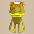 Atrocious Kappa</td>
      <td class="danger"> Porgon</td>
      <td class="danger"> Abyss Dragon</td>
      <td class="danger">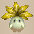 Frenzy Radish</td>
    </tr>
    <tr>
      <td class="danger"> Skull Lord</td>
      <td class="danger"> Ultra Gazer</td>
      <td> Wrinkly Hani</td>
      <td> Demon Scorpion</td>
      <td class="caution"> Nimble Knave</td>
    </tr>
    <tr>
      <td> Nigiri Honcho</td>
      <td> Hat Rascal</td>
      <td> Cursenior</td>
      <td> Swordmaster</td>
      <td> Detonachin</td>
    </tr>
    <tr>
      <td class="caution"> Hoppin' Slammer</td>
      <td> Boomdon</td>
      <td class="danger"> Showpin</td>
      <td class="highlightGray"></td>
      <td class="highlightGray"></td>
    </tr>
    <tr>
      <td colspan="10" class="tableDivider"></td>
    </tr>
    <tr>
      <td rowspan="6" class="centeredText">90</td>
      <td class="danger"> Gitan Mamel</td>
      <td> Huge Chintala</td>
      <td> Admiral Spearfish</td>
      <td class="danger"> King Reaper</td>
      <td class="danger"> Pumplord</td>
    </tr>
    <tr>
      <td> Pyrepuff</td>
      <td> Grampadillo</td>
      <td> Gigataur</td>
      <td class="danger"> Miracle Hen</td>
      <td class="caution"> Bashagga</td>
    </tr>
    <tr>
      <td class="danger"> Mini Tank</td>
      <td class="caution"> Adamant Tank</td>
      <td class="danger"> Atrocious Kappa</td>
      <td class="danger"> Porgon</td>
      <td class="danger"> Abyss Dragon</td>
    </tr>
    <tr>
      <td class="danger"> Frenzy Radish</td>
      <td class="danger"> Skull Lord</td>
      <td class="danger"> Ultra Gazer</td>
      <td> Wrinkly Hani</td>
      <td> Demon Scorpion</td>
    </tr>
    <tr>
      <td class="caution"> Nimble Knave</td>
      <td> Nigiri Honcho</td>
      <td> Hat Rascal</td>
      <td> Cursenior</td>
      <td> Swordmaster</td>
    </tr>
    <tr>
      <td> Detonachin</td>
      <td class="caution"> Hoppin' Slammer</td>
      <td> Boomdon</td>
      <td class="danger"> Showpin</td>
      <td class="highlightGray"></td>
    </tr>
    <tr>
      <td colspan="10" class="tableDivider"></td>
    </tr>
    <tr>
      <td rowspan="6" class="centeredText">91-99</td>
      <td class="danger"> Gitan Mamel</td>
      <td> Huge Chintala</td>
      <td> Admiral Spearfish</td>
      <td class="danger"> Pumplord</td>
      <td> Pyrepuff</td>
    </tr>
    <tr>
      <td> Grampadillo</td>
      <td> Gigataur</td>
      <td class="danger"> Miracle Hen</td>
      <td class="caution"> Bashagga</td>
      <td class="danger"> Mini Tank</td>
    </tr>
    <tr>
      <td class="caution"> Adamant Tank</td>
      <td class="danger"> Atrocious Kappa</td>
      <td class="danger"> Porgon</td>
      <td class="danger"> Abyss Dragon</td>
      <td class="danger"> Frenzy Radish</td>
    </tr>
    <tr>
      <td class="danger"> Skull Lord</td>
      <td class="danger"> Ultra Gazer</td>
      <td> Wrinkly Hani</td>
      <td> Demon Scorpion</td>
      <td class="caution"> Nimble Knave</td>
    </tr>
    <tr>
      <td> Nigiri Honcho</td>
      <td> Hat Rascal</td>
      <td> Cursenior</td>
      <td> Swordmaster</td>
      <td> Detonachin</td>
    </tr>
    <tr>
      <td class="caution"> Hoppin' Slammer</td>
      <td> Boomdon</td>
      <td class="danger"> Showpin</td>
      <td class="highlightGray"></td>
      <td class="highlightGray"></td>
    </tr>
  </tbody>
</table>

# Items

※ This section is currently incomplete.

<h4 id="item-table-key" class="heading4Blue"> Item Table Key</h4>

|ID|Explanation|
|-|-|
|F|Floor|
|G|Behemoth Gate|

<h4 id="weapon" class="heading4Blue"> Weapon</h4>

<table class="dungeonItemTable">
  <tr>
    <th colspan="11" class="highlightLightblue">Weapon</th>
  </tr>
  <tr>
    <th>Name</th>
    <th>F</th>
    <th>G</th>
  </tr>
  <tr>
    <td class="leftText">Wooden Sword</td>
    <td>X</td>
    <td></td>
  </tr>
  <tr>
    <td class="leftText">Bronze Sword</td>
    <td>X</td>
    <td></td>
  </tr>
  <tr>
    <td class="leftText">Katana</td>
    <td>X</td>
    <td></td>
  </tr>
  <tr>
    <td class="leftText">Doutanuki</td>
    <td></td>
    <td></td>
  </tr>
  <tr>
    <td class="leftText">Manji Kabura</td>
    <td></td>
    <td></td>
  </tr>
  <tr>
    <td class="leftText">Kajin Fuuma</td>
    <td></td>
    <td></td>
  </tr>
  <tr>
    <td class="leftText">Kabura Sutegi</td>
    <td></td>
    <td></td>
  </tr>
  <tr>
    <td class="leftText">Golden Sword</td>
    <td>X</td>
    <td></td>
  </tr>
  <tr>
    <td class="leftText">Kama Itachi</td>
    <td>X</td>
    <td></td>
  </tr>
  <tr>
    <td class="leftText">Axe of the Minotaur</td>
    <td></td>
    <td></td>
  </tr>
  <tr>
    <td class="leftText">Accurate Sword</td>
    <td></td>
    <td></td>
  </tr>
  <tr>
    <td class="leftText">Swift Sword</td>
    <td>X</td>
    <td></td>
  </tr>
  <tr>
    <td class="leftText">Watersplitter</td>
    <td>X</td>
    <td></td>
  </tr>
  <tr>
    <td class="leftText">Primal Axe</td>
    <td>X</td>
    <td></td>
  </tr>
  <tr>
    <td class="leftText">Dragonkiller</td>
    <td>X</td>
    <td></td>
  </tr>
  <tr>
    <td class="leftText">Crescent Blade</td>
    <td>X</td>
    <td></td>
  </tr>
  <tr>
    <td class="leftText">Sky Sword</td>
    <td>X</td>
    <td></td>
  </tr>
  <tr>
    <td class="leftText">Sickle of Salvation</td>
    <td>X</td>
    <td></td>
  </tr>
  <tr>
    <td class="leftText">Drain Slayer</td>
    <td>X</td>
    <td></td>
  </tr>
  <tr>
    <td class="leftText">Cyclops Bane</td>
    <td>X</td>
    <td></td>
  </tr>
  <tr>
    <td class="leftText">Steel Severer</td>
    <td></td>
    <td></td>
  </tr>
  <tr>
    <td class="leftText">Whopping Harisen</td>
    <td></td>
    <td></td>
  </tr>
  <tr>
    <td class="leftText">Healing Sword</td>
    <td></td>
    <td></td>
  </tr>
  <tr>
    <td class="leftText">Peach Club</td>
    <td></td>
    <td></td>
  </tr>
  <tr>
    <td class="leftText">Spender's Club</td>
    <td></td>
    <td></td>
  </tr>
  <tr>
    <td class="leftText">Ferrous Greatsword</td>
    <td></td>
    <td></td>
  </tr>
  <tr>
    <td class="leftText">Steak Knife</td>
    <td></td>
    <td></td>
  </tr>
  <tr>
    <td class="leftText">Jagged Sword</td>
    <td></td>
    <td></td>
  </tr>
  <tr>
    <td class="leftText">Quad-edge</td>
    <td></td>
    <td></td>
  </tr>
  <tr>
    <td class="leftText">Auspicious Kumade</td>
    <td></td>
    <td></td>
  </tr>
  <tr>
    <td class="leftText">Pickaxe</td>
    <td>X</td>
    <td></td>
  </tr>
  <tr>
    <td class="leftText">Golden Pickaxe</td>
    <td></td>
    <td></td>
  </tr>
  <tr>
    <td class="leftText">Wooden Mallet</td>
    <td>X</td>
    <td></td>
  </tr>
  <tr>
    <td class="leftText">Epic Hammer</td>
    <td></td>
    <td></td>
  </tr>
  <tr>
    <td class="leftText">Trapseeker</td>
    <td></td>
    <td></td>
  </tr>
  <tr>
    <td class="leftText">Bonito Block</td>
    <td></td>
    <td></td>
  </tr>
  <tr>
    <td class="leftText">Yamanba's Cleaver</td>
    <td></td>
    <td></td>
  </tr>
  <tr>
    <td class="leftText">Break-Off Blade</td>
    <td></td>
    <td></td>
  </tr>
</table>

<h4 id="shield" class="heading4Blue"> Shield</h4>

<table class="dungeonItemTable">
  <tr>
    <th colspan="11" class="highlightLightblue">Shield</th>
  </tr>
  <tr>
    <th>Name</th>
    <th>F</th>
    <th>G</th>
  </tr>
  <tr>
    <td class="leftText">Wooden Shield</td>
    <td>X</td>
    <td></td>
  </tr>
  <tr>
    <td class="leftText">Bronze Shield</td>
    <td>X</td>
    <td></td>
  </tr>
  <tr>
    <td class="leftText">Iron Shield</td>
    <td>X</td>
    <td></td>
  </tr>
  <tr>
    <td class="leftText">Wolfshead</td>
    <td>X</td>
    <td></td>
  </tr>
  <tr>
    <td class="leftText">Fuuma Shield</td>
    <td>X</td>
    <td></td>
  </tr>
  <tr>
    <td class="leftText">Rasen Fuuma</td>
    <td></td>
    <td></td>
  </tr>
  <tr>
    <td class="leftText">Golden Shield</td>
    <td>X</td>
    <td></td>
  </tr>
  <tr>
    <td class="leftText">Counter Shield</td>
    <td>X</td>
    <td></td>
  </tr>
  <tr>
    <td class="leftText">Watchful Shield</td>
    <td>X</td>
    <td></td>
  </tr>
  <tr>
    <td class="leftText">Dragon Shield</td>
    <td>X</td>
    <td></td>
  </tr>
  <tr>
    <td class="leftText">Blast Shield</td>
    <td>X</td>
    <td></td>
  </tr>
  <tr>
    <td class="leftText">Targe of the Minotaur</td>
    <td></td>
    <td></td>
  </tr>
  <tr>
    <td class="leftText">Walrus Stopper</td>
    <td>X</td>
    <td></td>
  </tr>
  <tr>
    <td class="leftText">Froggo Stopper</td>
    <td>X</td>
    <td></td>
  </tr>
  <tr>
    <td class="leftText">Hat Stopper</td>
    <td>X</td>
    <td></td>
  </tr>
  <tr>
    <td class="leftText">Nigiri Stopper</td>
    <td></td>
    <td></td>
  </tr>
  <tr>
    <td class="leftText">Spearscale Shield</td>
    <td>X</td>
    <td></td>
  </tr>
  <tr>
    <td class="leftText">Kappa's Dish</td>
    <td>X</td>
    <td></td>
  </tr>
  <tr>
    <td class="leftText">Gazer Shield</td>
    <td>X</td>
    <td></td>
  </tr>
  <tr>
    <td class="leftText">Shield of Negation</td>
    <td>X</td>
    <td></td>
  </tr>
  <tr>
    <td class="leftText">Unmoving Wall</td>
    <td></td>
    <td></td>
  </tr>
  <tr>
    <td class="leftText">Zabuton</td>
    <td></td>
    <td></td>
  </tr>
  <tr>
    <td class="leftText">Spender's Shield</td>
    <td></td>
    <td></td>
  </tr>
  <tr>
    <td class="leftText">Ferrous Kite</td>
    <td></td>
    <td></td>
  </tr>
  <tr>
    <td class="leftText">Steak Plate</td>
    <td></td>
    <td></td>
  </tr>
  <tr>
    <td class="leftText">Gutsy Shield</td>
    <td>X</td>
    <td></td>
  </tr>
  <tr>
    <td class="leftText">Hunky-dory Shield</td>
    <td></td>
    <td></td>
  </tr>
  <tr>
    <td class="leftText">Bodhi Shield</td>
    <td></td>
    <td></td>
  </tr>
  <tr>
    <td class="leftText">Shield of Sating</td>
    <td>X</td>
    <td></td>
  </tr>
  <tr>
    <td class="leftText">Auspicious Omamori</td>
    <td></td>
    <td></td>
  </tr>
  <tr>
    <td class="leftText">Shield of Presage</td>
    <td></td>
    <td></td>
  </tr>
  <tr>
    <td class="leftText">Yamanba's Potlid</td>
    <td></td>
    <td></td>
  </tr>
  <tr>
    <td class="leftText">Break-Off Shield</td>
    <td></td>
    <td></td>
  </tr>
</table>

<h4 id="bracelet" class="heading4Blue"> Bracelet</h4>

<table class="dungeonItemTable">
  <tr>
    <th colspan="11" class="highlightLightblue">Bracelet</th>
  </tr>
  <tr>
    <th>Name</th>
    <th>F</th>
    <th>G</th>
  </tr>
  <tr>
    <td class="leftText">Healing Bracelet</td>
    <td>X</td>
    <td></td>
  </tr>
  <tr>
    <td class="leftText">Strength Bracelet</td>
    <td>X</td>
    <td></td>
  </tr>
  <tr>
    <td class="leftText">Bellyexpand Bracelet</td>
    <td></td>
    <td></td>
  </tr>
  <tr>
    <td class="leftText">Bellyshrink Bracelet</td>
    <td></td>
    <td></td>
  </tr>
  <tr>
    <td class="leftText">Fortune Bracelet</td>
    <td></td>
    <td></td>
  </tr>
  <tr>
    <td class="leftText">Cleansing Bracelet</td>
    <td>X</td>
    <td></td>
  </tr>
  <tr>
    <td class="leftText">Focusing Bracelet</td>
    <td>X</td>
    <td></td>
  </tr>
  <tr>
    <td class="leftText">Rousing Bracelet</td>
    <td>X</td>
    <td></td>
  </tr>
  <tr>
    <td class="leftText">Rustproof Bracelet</td>
    <td></td>
    <td></td>
  </tr>
  <tr>
    <td class="leftText">Cursebreak Bracelet</td>
    <td></td>
    <td></td>
  </tr>
  <tr>
    <td class="leftText">Affixing Bracelet</td>
    <td></td>
    <td></td>
  </tr>
  <tr>
    <td class="leftText">Far-throwing Bracelet</td>
    <td>X</td>
    <td></td>
  </tr>
  <tr>
    <td class="leftText">Bad-aim Bracelet</td>
    <td>X</td>
    <td></td>
  </tr>
  <tr>
    <td class="leftText">Sure-aim Bracelet</td>
    <td></td>
    <td></td>
  </tr>
  <tr>
    <td class="leftText">Bouncy Bracelet</td>
    <td>X</td>
    <td></td>
  </tr>
  <tr>
    <td class="leftText">Rapid-fire Bracelet</td>
    <td>X</td>
    <td></td>
  </tr>
  <tr>
    <td class="leftText">Daredevil Bracelet</td>
    <td></td>
    <td></td>
  </tr>
  <tr>
    <td class="leftText">Dreaded Bracelet</td>
    <td></td>
    <td></td>
  </tr>
  <tr>
    <td class="leftText">Leaping Bracelet</td>
    <td></td>
    <td></td>
  </tr>
  <tr>
    <td class="leftText">Blasting Bracelet</td>
    <td></td>
    <td></td>
  </tr>
  <tr>
    <td class="leftText">Clairvoyant Bracelet</td>
    <td></td>
    <td></td>
  </tr>
  <tr>
    <td class="leftText">Monster-find Bracelet</td>
    <td>X</td>
    <td></td>
  </tr>
  <tr>
    <td class="leftText">Item-find Bracelet</td>
    <td>X</td>
    <td></td>
  </tr>
  <tr>
    <td class="leftText">Passage-find Bracelet</td>
    <td></td>
    <td></td>
  </tr>
  <tr>
    <td class="leftText">Waterwalk Bracelet</td>
    <td>X</td>
    <td></td>
  </tr>
  <tr>
    <td class="leftText">Floating Bracelet</td>
    <td></td>
    <td></td>
  </tr>
  <tr>
    <td class="leftText">Wallpass Bracelet</td>
    <td></td>
    <td></td>
  </tr>
  <tr>
    <td class="leftText">Tiptoe Bracelet</td>
    <td></td>
    <td></td>
  </tr>
  <tr>
    <td class="leftText">Passerby Bracelet</td>
    <td></td>
    <td></td>
  </tr>
  <tr>
    <td class="leftText">Item-losing Bracelet</td>
    <td></td>
    <td></td>
  </tr>
  <tr>
    <td class="leftText">Gitan-losing Bracelet</td>
    <td></td>
    <td></td>
  </tr>
  <tr>
    <td class="leftText">Monstercall Bracelet</td>
    <td></td>
    <td></td>
  </tr>
  <tr>
    <td class="leftText">Trapmore Bracelet</td>
    <td></td>
    <td></td>
  </tr>
  <tr>
    <td class="leftText">Haggling Bracelet</td>
    <td></td>
    <td></td>
  </tr>
  <tr>
    <td class="leftText">Trapper's Bracelet</td>
    <td></td>
    <td></td>
  </tr>
  <tr>
    <td class="leftText">Appraiser's Bracelet</td>
    <td></td>
    <td></td>
  </tr>
  <tr>
    <td class="leftText">Cannonboost Bracelet</td>
    <td>X</td>
    <td></td>
  </tr>
</table>

<h4 id="projectile" class="heading4Blue">  Projectile</h4>

<table class="dungeonItemTable">
  <tr>
    <th colspan="11" class="highlightLightblue">Projectile</th>
  </tr>
  <tr>
    <th>Name</th>
    <th>F</th>
    <th>G</th>
  </tr>
  <tr>
    <td class="leftText">Wooden Arrow</td>
    <td>X</td>
    <td></td>
  </tr>
  <tr>
    <td class="leftText">Iron Arrow</td>
    <td>X</td>
    <td></td>
  </tr>
  <tr>
    <td class="leftText">Silver Arrow</td>
    <td>X</td>
    <td></td>
  </tr>
  <tr>
    <td class="leftText">Poison Arrow</td>
    <td></td>
    <td></td>
  </tr>
  <tr>
    <td class="leftText">Truestrike Arrow</td>
    <td>X</td>
    <td></td>
  </tr>
  <tr>
    <td class="leftText">Rock</td>
    <td>X</td>
    <td></td>
  </tr>
  <tr>
    <td class="leftText">Porky's Rock</td>
    <td>X</td>
    <td></td>
  </tr>
</table>

<h4 id="food-(items)" class="heading4Blue"> Food</h4>

<table class="dungeonItemTable">
  <tr>
    <th colspan="11" class="highlightLightblue">Food</th>
  </tr>
  <tr>
    <th>Name</th>
    <th>F</th>
    <th>G</th>
  </tr>
  <tr>
    <td class="leftText">Onigiri</td>
    <td>X</td>
    <td></td>
  </tr>
  <tr>
    <td class="leftText">Large Onigiri</td>
    <td>X</td>
    <td></td>
  </tr>
  <tr>
    <td class="leftText">Huge Onigiri</td>
    <td></td>
    <td></td>
  </tr>
  <tr>
    <td class="leftText">Rotten Onigiri</td>
    <td>X</td>
    <td></td>
  </tr>
  <tr>
    <td class="leftText">Grilled Onigiri</td>
    <td></td>
    <td></td>
  </tr>
  <tr>
    <td class="leftText">Special Onigiri</td>
    <td></td>
    <td>X</td>
  </tr>
  <tr>
    <td class="leftText">Sumo Onigiri</td>
    <td></td>
    <td>X</td>
  </tr>
  <tr>
    <td class="leftText">Sweet Potato</td>
    <td></td>
    <td></td>
  </tr>
  <tr>
    <td class="leftText">Yakitori</td>
    <td></td>
    <td></td>
  </tr>
  <tr>
    <td class="leftText">Rotten Peach Bun</td>
    <td></td>
    <td></td>
  </tr>
</table>

<h4 id="grass" class="heading4Blue"> Grass</h4>

<table class="dungeonItemTable">
  <tr>
    <th colspan="11" class="highlightLightblue">Grass</th>
  </tr>
  <tr>
    <th>Name</th>
    <th>F</th>
    <th>G</th>
  </tr>
  <tr>
    <td class="leftText">Weeds</td>
    <td></td>
    <td></td>
  </tr>
  <tr>
    <td class="leftText">Herb</td>
    <td>X</td>
    <td></td>
  </tr>
  <tr>
    <td class="leftText">Otogirisou</td>
    <td>X</td>
    <td></td>
  </tr>
  <tr>
    <td class="leftText">Healing Grass</td>
    <td>X</td>
    <td></td>
  </tr>
  <tr>
    <td class="leftText">Life Grass</td>
    <td>X</td>
    <td>X</td>
  </tr>
  <tr>
    <td class="leftText">Fragrant Grass</td>
    <td></td>
    <td></td>
  </tr>
  <tr>
    <td class="leftText">Revival Grass</td>
    <td>X</td>
    <td>X</td>
  </tr>
  <tr>
    <td class="leftText">Bellyexpand Seed</td>
    <td>X</td>
    <td></td>
  </tr>
  <tr>
    <td class="leftText">Bellyshrink Seed</td>
    <td></td>
    <td></td>
  </tr>
  <tr>
    <td class="leftText">Dragon Grass</td>
    <td>X</td>
    <td></td>
  </tr>
  <tr>
    <td class="leftText">Leaping Grass</td>
    <td>X</td>
    <td></td>
  </tr>
  <tr>
    <td class="leftText">Antidote Grass</td>
    <td>X</td>
    <td></td>
  </tr>
  <tr>
    <td class="leftText">Strength Grass</td>
    <td>X</td>
    <td></td>
  </tr>
  <tr>
    <td class="leftText">Poison Grass</td>
    <td>X</td>
    <td></td>
  </tr>
  <tr>
    <td class="leftText">Confusion Grass</td>
    <td>X</td>
    <td></td>
  </tr>
  <tr>
    <td class="leftText">Sedating Grass</td>
    <td>X</td>
    <td></td>
  </tr>
  <tr>
    <td class="leftText">Berserk Seed</td>
    <td></td>
    <td></td>
  </tr>
  <tr>
    <td class="leftText">Blinding Grass</td>
    <td>X</td>
    <td></td>
  </tr>
  <tr>
    <td class="leftText">Seewell Grass</td>
    <td>X</td>
    <td></td>
  </tr>
  <tr>
    <td class="leftText">Swift Grass</td>
    <td>X</td>
    <td></td>
  </tr>
  <tr>
    <td class="leftText">Power-up Grass</td>
    <td>X</td>
    <td></td>
  </tr>
  <tr>
    <td class="leftText">Invincible Grass</td>
    <td>X</td>
    <td>X</td>
  </tr>
  <tr>
    <td class="leftText">Fortune Grass</td>
    <td>X</td>
    <td>X</td>
  </tr>
  <tr>
    <td class="leftText">Angel Seed</td>
    <td></td>
    <td></td>
  </tr>
  <tr>
    <td class="leftText">Feeble Grass</td>
    <td></td>
    <td></td>
  </tr>
  <tr>
    <td class="leftText">Unlucky Seed</td>
    <td></td>
    <td></td>
  </tr>
  <tr>
    <td class="leftText">Ill-fated Seed</td>
    <td></td>
    <td></td>
  </tr>
</table>

<h4 id="scroll" class="heading4Blue"> Scroll</h4>

<table class="dungeonItemTable">
  <tr>
    <th colspan="11" class="highlightLightblue">Scroll</th>
  </tr>
  <tr>
    <th>Name</th>
    <th>F</th>
    <th>G</th>
  </tr>
  <tr>
    <td class="leftText">Confusion Scroll</td>
    <td>X</td>
    <td></td>
  </tr>
  <tr>
    <td class="leftText">Slumber Scroll</td>
    <td>X</td>
    <td></td>
  </tr>
  <tr>
    <td class="leftText">Jitters Scroll</td>
    <td>X</td>
    <td></td>
  </tr>
  <tr>
    <td class="leftText">Windblade Scroll</td>
    <td>X</td>
    <td></td>
  </tr>
  <tr>
    <td class="leftText">Expulsion Scroll</td>
    <td></td>
    <td></td>
  </tr>
  <tr>
    <td class="leftText">Exorcism Scroll</td>
    <td></td>
    <td></td>
  </tr>
  <tr>
    <td class="leftText">Identifier Scroll</td>
    <td>X</td>
    <td></td>
  </tr>
  <tr>
    <td class="leftText">Heavenly Scroll</td>
    <td></td>
    <td>X</td>
  </tr>
  <tr>
    <td class="leftText">Earthly Scroll</td>
    <td></td>
    <td>X</td>
  </tr>
  <tr>
    <td class="leftText">Plating Scroll</td>
    <td>X</td>
    <td>X</td>
  </tr>
  <tr>
    <td class="leftText">Slot-adding Scroll</td>
    <td></td>
    <td></td>
  </tr>
  <tr>
    <td class="leftText">Rune-eraser Scroll</td>
    <td></td>
    <td></td>
  </tr>
  <tr>
    <td class="leftText">Silver-seal Scroll</td>
    <td></td>
    <td></td>
  </tr>
  <tr>
    <td class="leftText">Silverpurge Scroll</td>
    <td></td>
    <td></td>
  </tr>
  <tr>
    <td class="leftText">Pot-upsize Scroll</td>
    <td></td>
    <td></td>
  </tr>
  <tr>
    <td class="leftText">Extraction Scroll</td>
    <td></td>
    <td></td>
  </tr>
  <tr>
    <td class="leftText">Onigiri Scroll</td>
    <td>X</td>
    <td></td>
  </tr>
  <tr>
    <td class="leftText">Curse Scroll</td>
    <td></td>
    <td></td>
  </tr>
  <tr>
    <td class="leftText">Mapping Scroll</td>
    <td>X</td>
    <td></td>
  </tr>
  <tr>
    <td class="leftText">Map-loss Scroll</td>
    <td></td>
    <td></td>
  </tr>
  <tr>
    <td class="leftText">Trap-eraser Scroll</td>
    <td>X</td>
    <td></td>
  </tr>
  <tr>
    <td class="leftText">Trap Scroll</td>
    <td></td>
    <td></td>
  </tr>
  <tr>
    <td class="leftText">Water-drain Scroll</td>
    <td>X</td>
    <td></td>
  </tr>
  <tr>
    <td class="leftText">Monstercall Scroll</td>
    <td></td>
    <td></td>
  </tr>
  <tr>
    <td class="leftText">Wall-less Scroll</td>
    <td>X</td>
    <td></td>
  </tr>
  <tr>
    <td class="leftText">Gathering Scroll</td>
    <td></td>
    <td></td>
  </tr>
  <tr>
    <td class="leftText">Collection Scroll</td>
    <td>X</td>
    <td></td>
  </tr>
  <tr>
    <td class="leftText">Gambler's Scroll</td>
    <td></td>
    <td></td>
  </tr>
  <tr>
    <td class="leftText">Muzzle Scroll</td>
    <td></td>
    <td></td>
  </tr>
  <tr>
    <td class="leftText">Carry-ban Scroll</td>
    <td></td>
    <td></td>
  </tr>
  <tr>
    <td class="leftText">Swift Foe Scroll</td>
    <td></td>
    <td></td>
  </tr>
  <tr>
    <td class="leftText">Fixer Scroll</td>
    <td>X</td>
    <td>X</td>
  </tr>
  <tr>
    <td class="leftText">Escape Scroll</td>
    <td></td>
    <td></td>
  </tr>
  <tr>
    <td class="leftText">Eradication Scroll</td>
    <td></td>
    <td></td>
  </tr>
  <tr>
    <td class="leftText">Sanctuary Scroll</td>
    <td>X</td>
    <td></td>
  </tr>
  <tr>
    <td class="leftText">Blank Scroll</td>
    <td>X</td>
    <td>X</td>
  </tr>
  <tr>
    <td class="leftText">Wet Scroll</td>
    <td></td>
    <td></td>
  </tr>
</table>

<h4 id="staff" class="heading4Blue"> Staff</h4>

<table class="dungeonItemTable">
  <tr>
    <th colspan="11" class="highlightLightblue">Staff</th>
  </tr>
  <tr>
    <th>Name</th>
    <th>F</th>
    <th>G</th>
  </tr>
  <tr>
    <td class="leftText">Ordinary Staff</td>
    <td></td>
    <td></td>
  </tr>
  <tr>
    <td class="leftText">Paralyzing Staff</td>
    <td>X</td>
    <td></td>
  </tr>
  <tr>
    <td class="leftText">Sealing Staff</td>
    <td>X</td>
    <td></td>
  </tr>
  <tr>
    <td class="leftText">Disguising Staff</td>
    <td>X</td>
    <td></td>
  </tr>
  <tr>
    <td class="leftText">Empathetic Staff</td>
    <td>X</td>
    <td></td>
  </tr>
  <tr>
    <td class="leftText">Narrow-escape Staff</td>
    <td>X</td>
    <td></td>
  </tr>
  <tr>
    <td class="leftText">Knockback Staff</td>
    <td>X</td>
    <td></td>
  </tr>
  <tr>
    <td class="leftText">Switching Staff</td>
    <td>X</td>
    <td></td>
  </tr>
  <tr>
    <td class="leftText">Vaulting Staff</td>
    <td>X</td>
    <td></td>
  </tr>
  <tr>
    <td class="leftText">Skull Mage's Staff</td>
    <td></td>
    <td></td>
  </tr>
  <tr>
    <td class="leftText">Thunderbolt Staff</td>
    <td>X</td>
    <td></td>
  </tr>
  <tr>
    <td class="leftText">Burrowing Staff</td>
    <td>X</td>
    <td></td>
  </tr>
  <tr>
    <td class="leftText">Earthmound Staff</td>
    <td>X</td>
    <td></td>
  </tr>
  <tr>
    <td class="leftText">Balance Staff</td>
    <td>X</td>
    <td></td>
  </tr>
  <tr>
    <td class="leftText">Guiding Staff</td>
    <td>X</td>
    <td></td>
  </tr>
  <tr>
    <td class="leftText">Swift Staff</td>
    <td></td>
    <td></td>
  </tr>
  <tr>
    <td class="leftText">Sluggish Staff</td>
    <td>X</td>
    <td></td>
  </tr>
  <tr>
    <td class="leftText">Fortune Staff</td>
    <td></td>
    <td></td>
  </tr>
  <tr>
    <td class="leftText">Unlucky Staff</td>
    <td></td>
    <td></td>
  </tr>
  <tr>
    <td class="leftText">Peach Staff</td>
    <td></td>
    <td></td>
  </tr>
</table>

<h4 id="pot" class="heading4Blue"> Pot</h4>

<table class="dungeonItemTable">
  <tr>
    <th colspan="11" class="highlightLightblue">Pot</th>
  </tr>
  <tr>
    <th>Name</th>
    <th>F</th>
    <th>G</th>
  </tr>
  <tr>
    <td class="leftText">Preservation Pot</td>
    <td>X</td>
    <td>X</td>
  </tr>
  <tr>
    <td class="leftText">Identifier Pot</td>
    <td>X</td>
    <td></td>
  </tr>
  <tr>
    <td class="leftText">Transmutation Pot</td>
    <td>X</td>
    <td></td>
  </tr>
  <tr>
    <td class="leftText">Cashing Pot</td>
    <td>X</td>
    <td></td>
  </tr>
  <tr>
    <td class="leftText">Synthesis Pot</td>
    <td></td>
    <td>X</td>
  </tr>
  <tr>
    <td class="leftText">Exorcism Pot</td>
    <td></td>
    <td></td>
  </tr>
  <tr>
    <td class="leftText">Curse Pot</td>
    <td></td>
    <td></td>
  </tr>
  <tr>
    <td class="leftText">Upgrading Pot</td>
    <td></td>
    <td></td>
  </tr>
  <tr>
    <td class="leftText">Degrading Pot</td>
    <td></td>
    <td></td>
  </tr>
  <tr>
    <td class="leftText">Bottomless Pot</td>
    <td></td>
    <td></td>
  </tr>
  <tr>
    <td class="leftText">Warehouse Pot</td>
    <td></td>
    <td></td>
  </tr>
  <tr>
    <td class="leftText">Handtrapper Pot</td>
    <td></td>
    <td></td>
  </tr>
  <tr>
    <td class="leftText">Unbreakable Pot</td>
    <td></td>
    <td></td>
  </tr>
  <tr>
    <td class="leftText">Ordinary Pot</td>
    <td>X</td>
    <td></td>
  </tr>
  <tr>
    <td class="leftText">Hiding Pot</td>
    <td>X</td>
    <td></td>
  </tr>
  <tr>
    <td class="leftText">Rejuvenation Pot</td>
    <td></td>
    <td>X</td>
  </tr>
  <tr>
    <td class="leftText">Walrus Pot</td>
    <td>X</td>
    <td></td>
  </tr>
  <tr>
    <td class="leftText">Water Gun Pot</td>
    <td>X</td>
    <td></td>
  </tr>
  <tr>
    <td class="leftText">Hilarious Pot</td>
    <td></td>
    <td></td>
  </tr>
  <tr>
    <td class="leftText">Monster Pot</td>
    <td>X</td>
    <td></td>
  </tr>
  <tr>
    <td class="leftText">Surprise Pot</td>
    <td></td>
    <td></td>
  </tr>
</table>

<h4 id="incense" class="heading4Blue"> Incense</h4>

<table class="dungeonItemTable">
  <tr>
    <th colspan="11" class="highlightLightblue">Incense</th>
  </tr>
  <tr>
    <th>Name</th>
    <th>F</th>
    <th>G</th>
  </tr>
  <tr>
    <td class="leftText">Heat-ban Incense</td>
    <td>X</td>
    <td></td>
  </tr>
  <tr>
    <td class="leftText">Evasive Incense</td>
    <td>X</td>
    <td></td>
  </tr>
  <tr>
    <td class="leftText">Cautious Incense</td>
    <td>X</td>
    <td></td>
  </tr>
  <tr>
    <td class="leftText">Reflective Incense</td>
    <td>X</td>
    <td></td>
  </tr>
  <tr>
    <td class="leftText">Aggressive Incense</td>
    <td>X</td>
    <td></td>
  </tr>
  <tr>
    <td class="leftText">Defensive Incense</td>
    <td>X</td>
    <td></td>
  </tr>
  <tr>
    <td class="leftText">Blurry Incense</td>
    <td>X</td>
    <td></td>
  </tr>
  <tr>
    <td class="leftText">Weighted Incense</td>
    <td>X</td>
    <td></td>
  </tr>
  <tr>
    <td class="leftText">Unwanting Incense</td>
    <td>X</td>
    <td></td>
  </tr>
</table>
