

  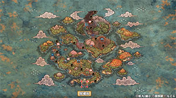

# Overview

<table class="dungeonOverview">
  <tr>
    <th>Unlock</th>
    <td class="highlightYellow">Available after the opening.</td>
  </tr>
  <tr>
    <th>Entrance</th>
    <td class="highlightYellow">Shukuba Beach</td>
  </tr>
</table>

<table class="dungeonTable">
  <tr>
    <th>Floors</th>
    <td colspan="3">31F</td>
  </tr>
  <tr>
    <th>Bring Items</th>
    <td>Yes</td>
    <th>Stairs</th>
    <td>Varies</td>
  </tr>
  <tr>
    <th>Companions</th>
    <td>Yes</td>
    <th>Roamers</th>
    <td>Yes</td>
  </tr>
  <tr>
    <th>Rescues</th>
    <td>3</td>
    <th>Starting Level</th>
    <td>Lv1</td>
  </tr>
  <tr>
    <th>Starting Item</th>
    <td colspan="3">Onigiri</td>
  </tr>
  <tr>
    <th>Unidentified</th>
    <td colspan="3">Bracelets, Pots</td>
  </tr>
  <tr>
    <th>Shops</th>
    <td>Yes</td>
    <th>Monster Houses</th>
    <td>Yes (Regular, Sudden)</td>
  </tr>
  <tr>
    <th>Behemoths</th>
    <td>Yes</td>
    <th>Wishing Shrines</th>
    <td>Yes</td>
  </tr>
  <tr>
    <th>Kron's Challenge</th>
    <td>No</td>
    <th>Fever Time</th>
    <td>No</td>
  </tr>
  <tr>
    <th>Initial Enemies</th>
    <td>Varies</td>
    <th>Spawn Rate</th>
    <td>Varies</td>
  </tr>
  <tr>
    <th>Wind (1st Gust)</th>
    <td>Varies</td>
    <th>Reward</th>
    <td>Blue Sacred Item (Postgame)</td>
  </tr>
</table>

 

|Floor|Initial|Spawn|Wind|
|-|-|-|-|
|1-2F|4~5|40 Turns|1200 Turns|
|3-5F|4~5|35 Turns|1200 Turns|
|6-14F|4~6|30 Turns|1200 Turns|
|15-21F|4~6|30 Turns|1700 Turns|
|22-30F|5~7|25 Turns|1700 Turns|

The main story dungeon, featuring 31 floors with the final floor being a one-time boss fight. It's similar to Shiren 1 in structure, with many villages and overworld rest areas along the way. Mixer, Synthesis Pot, Peach Club, Peach Staff, Disguising Staff, and Escape Scroll can't be found until you've completed certain events - So the player can't synthesize items during the 1st attempt.

Escape Scrolls are unlocked by clearing a postgame dungeon, and Undo Grass isn't in the game. The only way to save items is to send them to the warehouse using a Warehouse Pot or Hikyaku NPC.

Despite the lack of synthesis, the dungeon can be cleared on your 1st attempt if you're experienced. However, if you're new to Shiren games, expect to collapse a number of times before you clear it.

# Navigation

<ul class="quickLinksUL">
  <li><a href="#strategy">Strategy</a>
    <ul>
      <li><a href="#general-advice">General Advice</a></li>
    </ul>
  </li>
  <li><a href="#floor-guide">Floor Guide</a>
    <ul>
      <li><a href="#sozoro-bay-(1-2f)">Sozoro Bay (1-2F)</a></li>
      <li><a href="#suzunari-pass-(3-4f)">Suzunari Pass (3-4F)</a></li>
      <li><a href="#mountain-village">Mountain Village</a></li>
      <li><a href="#mount-jingara-(5-9f)">Mount Jingara (5-9F)</a></li>
      <li><a href="#small-harbor">Small Harbor</a></li>
      <li><a href="#underwater-passage-(10-12f)">Underwater Passage (10-12F)</a></li>
      <li><a href="#underwater-training-ground">Underwater Training Ground</a></li>
      <li><a href="#underwater-passage-(13-15f)">Underwater Passage (13-15F)</a></li>
      <li><a href="#kibanuma-marsh-(16-18f)">Kibanuma Marsh (16-18F)</a></li>
      <li><a href="#hot-spring-cabin">Hot Spring Cabin</a></li>
      <li><a href="#firespew-mountain-(19-23f)">Firespew Mountain (19-23F)</a></li>
      <li><a href="#mount-jatou-(24-26f)">Mount Jatou (24-26F)</a></li>
      <li><a href="#icewall-village">Icewall Village</a></li>
      <li><a href="#mount-jatou-(27-30f)">Mount Jatou (27-30F)</a></li>
      <li><a href="#boss-(31f)">Boss (31F)</a></li>
    </ul>
  </li>
  <li><a href="#monsters">Monsters</a></li>
  <li><a href="#behemoths">Behemoths</a></li>
  <li><a href="#items">Items</a>
    <ul>
      <li><a href="#weapon">Weapon</a></li>
      <li><a href="#shield">Shield</a></li>
      <li><a href="#bracelet">Bracelet</a></li>
      <li><a href="#projectile">Projectile</a></li>
      <li><a href="#food-(items)">Food</a></li>
      <li><a href="#grass">Grass</a></li>
      <li><a href="#scroll">Scroll</a></li>
      <li><a href="#stave">Staff</a></li>
      <li><a href="#pot">Pot</a></li>
      <li><a href="#incense">Incense</a></li>
    </ul>
  </li>
</ul>

# Strategy

<h3 id="general-advice" class="heading3Yellow">General Advice</h3>

Enemies generally have high attack power in Shiren 6, and synthesis isn't available right away. This means you'll quickly end up collapsed if you try to trade hits during the 2nd half of the dungeon.

Some of the basics when trying for a 1st attempt clear:

- HP regenerates very quickly in this game.
    - Step in place or run away to regen HP when your HP gets low.
- Collect arrows from sources like Wooden Arrow Trap or Crossbowboy - 200 arrows is plenty.
    - Evasive Incense is the easiest method, but Bored Kappa (10-12F) can also be used.
- Use arrows to conserve better items for the 2nd half of the dungeon + boss fight.
    - Paralyzing Staff, Narrow-escape Staff, Sluggish Staff, Vaulting Staff, Swift Grass, Invincible Grass.
    - Arrows can also be used to check for incoming enemies on floors with dark hallways.
- Single path floors are dangerous since they force lots of monster encounters.
    - If you notice a floor is a single path during the 2nd half, it's best to hurry to the stairs.
- Rush to the stairs starting from 20F or so.
    - Make full use of staves and other items to disable enemies while searching for the stairs.
- Monster-find Bracelet is an immense help for later floors, so always buy it if a shop has it.
    - This bracelet costs 2500 Gitan in this game.
- Prioritize equipment with high base value instead of focusing on runes (special abilities).
    - Resonance can add to stats, like Katana + Iron Shield = +3 attack and defense.
- Save any Mapping Scrolls you find for 27-30F instead of using them right away.

# Floor Guide

This guide mostly assumes that the player is trying to clear the dungeon on their 1st attempt.

### Sozoro Bay (1-2F)

  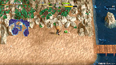

Preparation area - Retreat a few steps to heal HP when you receive damage and you should be fine. That said, it's best to use hallways to regen HP since hidden traps can be generated inside rooms.

Gitan deals damage equal to 20% of the bag's value when thrown, so don't pick up Gitan bags normally. Instead, hold B to step on top of the bag and swap it with an inventory item to add it to your inventory.

For consistency, aim to linger until your level reaches "current floor number + 2" during early game. If you find Fortune Grass, throw it at a Pit Mamel, then throw Gitan at the Cave Mamel to level up. You'll have an easier time for a bit if you find an item like Fuuma Shield or Fortune Bracelet.

Pots and bracelets are unidentified in this dungeon - If you find a pot, try inserting an item. Preservation Pots increase the number of items you can carry, and also protect food from rotting. In this dungeon, items are never found cursed and negative effect bracelets can't be found, so it's fine to equip unidentified bracelets to check for effects.

#### Monster Stats (1-2F)

|Floor|Monster|HP|Atk|Def|Exp|Type|
|-|-|-|-|-|-|-|
|1-2|Mamel|8|3|4|2|Normal|
|1-2|Octopling|14|4|6|4|Aquatic|
|1-2|Spearfish|16|6|2|7|Aquatic|
|2-3|Pit Mamel|11|5|8|5|Normal|

### Suzunari Pass (3-4F)

  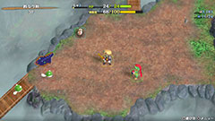

Pumphantasm (3-4F) often deals 15+ damage without a shield. Always position yourself so that you have an escape route when facing a Pumphantasm, and throw a Gitan bag worth at least 115 Gitan to one-shot them if needed.

Froggo (4F) always drops Gitan when defeated, and can't steal Gitan bags in your inventory. If you have extra food, consider hunting them on 4F to earn money for the upcoming village's shop.

#### Monster Stats (3-4F)

|Floor|Monster|HP|Atk|Def|Exp|Type|
|-|-|-|-|-|-|-|
|2-3|Pit Mamel|11|5|8|5|Normal|
|3-4|Chintala|15|9|4|12|Beast|
|3-4|Pumphantasm|23|16|10|25|Ghost/Floating|
|3-4|Armordillo|20|11|15|15|Beast|
|4|Froggo|23|10|13|18|Normal|

### Mountain Village

  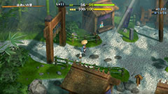

Village with an item shop and blacksmith - If you don't have a lot of Gitan, prioritize the item shop. Upgrade value +1 isn't a big impact compared to buying useful items like Otogirisou or Fixer Scroll, and there's a chance you'll find better equipment on a later floor, making the upgrade pointless.

### Mount Jingara (5-9F)

  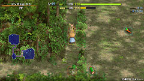

Ninjas who occasionally dodge normal attacks appear, and they all hit pretty hard without a shield. Don't neglect the basics like stepping in place to lure enemies closer to get the first hit in.

Tree Ninja D (5-7F) sends a log flying at you, dealing 5 damage + 10 tiles of knockback. They also occasionally warp to a different spot on the current floor when they receive damage.

Fire Ninja D (5-8F) shoots a flame when adjacent, dealing 5 damage and grilling onigiri not in pots. They also walk toward and burn staves, scrolls, grass, and onigiri items that are on the ground. Grilled Onigiri replenishes 75 Fullness and restores 40 HP, so it's nice to grill Rotten Onigiri or Onigiri.

Earth Ninja D (5-9F) blasts sand when adjacent, dealing 5 damage + occasionally inflicting Blind status. Blind status (player side) blacks out the screen and makes you unable to see your surroundings (10 turns). They can also create and hide inside sand pillars, and are much sturdier than other ninjas.

Water Ninja D (7-9F) shoots water that deals 5 damage from up to 3 tiles away in a straight line. This also lowers weapon or shield upgrade value by 1, makes food rot, or turns scrolls into Wet Scrolls. Water Ninjas never use their special attack when adjacent.

Metal Ninja D (7-9F) throws Gitan which deals 8~14 damage from up to 10 tiles away in a straight line. Metal Ninjas never use their special attack when adjacent.

If you have enough food, linger and hunt Ninja family monsters on 5F until you reach Lv10, since Lv10 is the 1st threshold where HP regen speed increases (1 HP/Turn → 2 HP/Turn). Otherwise, you might struggle against Hoppin' Hitter (6-9F) which hits harder than any ninja, and also has a special ability that either reflects or nullifies projectiles and staff magic. You'll likely need to rely on Dragon Grass or scrolls if the situation gets bad.

Mid Chintala (8-10F) tends to get overshadowed a bit since it lacks a special ability, but it has high HP and similar attack power to Hoppin' Hitter, so don't underestimate it.

#### Monster Stats (5-9F)

|Floor|Monster|HP|Atk|Def|Exp|Type|
|-|-|-|-|-|-|-|
|5-7|Tree Ninja D|25|14|10|27|Normal|
|5-8|Fire Ninja D|28|18|5|30|Normal|
|5-9|Earth Ninja D|38|11|20|30|Normal|
|6-9|Hoppin' Hitter|32|22|15|34|Normal|
|7-9|Metal Ninja D|27|13|11|35|Normal|
|7-9|Water Ninja D|24|15|9|31|Normal|
|8-10|Mid Chintala|45|23|10|27|Beast|

### Small Harbor

  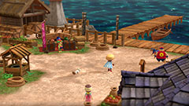

Village featuring an inn and a daily item shop that stocks a certain category each time you visit the area. To avoid confusion, the shop's stock of items doesn't change even if you change your Switch's clock. Bracelets and pots are sold in an unidentified state.

#### Side Quest (Synthesis Pot & Mixer Unlock)

The Synthesis unlock side quest begins in this village, so be sure to visit the docks.

### Underwater Passage (10-12F)

  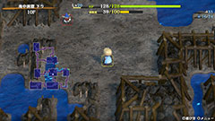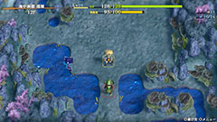

Crossbowboy (10-12F) can be used to collect Iron Arrows if there's a room with pillars. Alternatively, maneuver the Crossbowboy so that a Bored Kappa is between Shiren and the Crossbowboy, then have the Crossbowboy shoot arrows at the Bored Kappa to collect Iron Arrows instead.

Masked Samurai (10-12F) revives as Ghost Samurai within 4\~9 turns after being defeated. Ghost Samurai has 4 HP but only takes 1 damage from attacks that don't deal fixed damage. If left alone, it'll possess a different monster and level them up, which can become quite a problem. The easiest way to deal with them is to step in place until they spawn, then throw a rock to one-shot them.

Mudkin (11-14F) can make equipment rust when adjacent, so unequip your weapon and shield. They don't use normal attacks, so they're a good target to intentionally level up via Ghost Samurai for exp. However, be warned that Mudkin can multiply when attacked, so it's best to hunt high level Mudkin while you're standing on the stairs in case the situation gets out of control.

Fresh Octopling (10-13F) gains an attack power boost when the target it's following gets slain. The attack boosts can quickly snowball, so try to defeat Fresh Octoplings before other monsters.

Pillars in rooms can be destroyed by normal attacks, and often have an item, monster, or trap hidden inside. Mapping Scroll, Monster-find Bracelet, or Item-find Bracelet lets you safely check what they contain.

#### Monster Stats (10-12F)

|Floor|Monster|HP|Atk|Def|Exp|Type|
|-|-|-|-|-|-|-|
|8-10|Mid Chintala|45|23|10|27|Beast|
|10-11|Bowboy|45|17|18|60|Normal|
|10-12|Crossbowboy|55|20|20|80|Normal|
|10-12|Bored Kappa|50|18|11|48|Aquatic|
|10-12|Masked Samurai|47|18|18|48|Normal|
|10-13|Fresh Octopling|60|19|14|55|Aquatic|
|11-14|Mudkin|70|5|9|53|Draining/Aquatic|

### Underwater Training Ground

  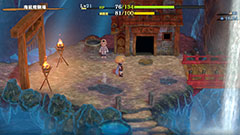

Village that only has a blacksmith in terms of facilities.

### Underwater Passage (13-15F)

  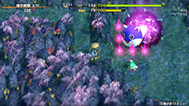

13F (always) and 15F (random chance) feature Behemoth Gates - a new mechanic in Shiren 6. Possible Behemoth Monsters here include Mamel, Bowboy, Pop Tank, Explochin, and Schubell. They all have slow action speed but have incredibly high attack power - expect to collapse if you get hit. 1 Rock or Porky's Rock is enough to one-shot them from any direction, as rocks arc over their barrier. Otherwise, Silver Arrows can also pierce through their barrier, but most other attacks get nullified. There's nothing to be gained by defeating them, so it's best to go around them for safety.

The Behemoth Gate vanishes and leaves behind an item after you've entered every room on the floor. The item left behind is often decent in quality (Blank Scroll, Sumo Onigiri, Rejuvenation Pot, etc.). Reading a Mapping Scroll won't make the Behemoth Gate vanish, but a Wall-less Scroll works.

For regular enemies, Metalhead (13-15F) and Tiger Thrower (13-15F) can be somewhat tricky. Metalhead attacks 2 tiles ahead (cuts corners), and Tiger Thrower throws creatures within a 5 tile radius.

#### Monster Stats (13-15F)

|Floor|Monster|HP|Atk|Def|Exp|Type|
|-|-|-|-|-|-|-|
|10-13|Fresh Octopling|60|19|14|55|Aquatic|
|11-14|Mudkin|70|5|9|53|Draining/Aquatic|
|13-14|Lt. Spearfish|60|24|17|55|Aquatic|
|13-15|Metalhead|66|30|19|61|Cyclops|
|13-15|Floor Dragon|55|25|20|80|Dragon|
|13-15|Tiger Thrower|68|26|22|77|Beast|

### Kibanuma Marsh (16-18F)

  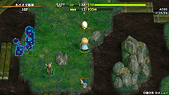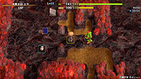

Reclusive monks, the other main new monster family alongside ninjas, make their first appearance. Each type of mask is counted as a separate family, and their special attacks vary depending on the mask. Monk family special attacks never target themselves or other monk family monsters.

4 out of 5 types of monks appear in this dungeon:

Okina Monk D (16-18F) warps a monster from anywhere on the floor closer to Shiren. This monster-warping effect occurs not only in rooms, but even when Shiren is walking in a hallway.

Okame Monk D (16-19F) cures bad status conditions that a monster is afflicted with from anywhere on the floor.

Hannya Monk D (18-19F) inflicts a monster with Monk's Berserk status, making it attack any creature. However, the monster with this special Berserk status won't attack any monk family monsters. The danger in this is due to the Berserk monster leveling up when it slays another creature.

Tengu Monk D (18-19F) boosts action speed of a monster by 1 stage (Slow → Normal → Swift 1 → Swift 2). <u>Slow</u> = Monster gets 1 action every 2 turns. <u>Normal</u> = Monster gets 1 action per turn. <u>Swift 1</u> = Monster gets 2 actions per turn, but can only ever attack 1 time per turn. <u>Swift 2</u> = Monster gets 2 actions per turn, which can both be attacks.

Otherwise, brawler monsters like Master Hen (16-18F) and Minotaur (16-18F) also appear, along with slightly trickier ranged attackers like Ghost Radish (16-17F) and Pop Tank (16-18F). Master Hen grants 400 exp if slain before reverting to Hen, and Minotaur can drop an Axe of the Minotaur. Ghost Radish throws Poison Grass 2 tiles ahead, which lowers strength and slows action speed for a while. Pop Tank shoots a cannonball from a distance when lined up, which deals 20 damage in a 1 tile radius.

If you have enough food, linger and hunt Master Hens to reach Lv20 before proceeding past 18F, since Lv20 is the 2nd threshold where HP regen speed increases (2 HP/Turn → 3 HP/Turn).

Thiefwalrus (16-19F) always drops a new item when slain prior to stealing, so hunt them if possible. Sealing Staff stops them from stealing, but beware of their normal attacks backed by 25 attack power. They can be tricky to catch if they steal one of your items on a floor that contains lots of water tiles, so unless you have arrows or a Walrus Stopper (shield), it might be more trouble than it's worth.

#### Monster Stats (16-18F)

|Floor|Monster|HP|Atk|Def|Exp|Type|
|-|-|-|-|-|-|-|
|16-17|Egg Thing|5|2|14|7|Cyclops|
|16-17|Ghost Radish|40|18|15|49|Ghost|
|16-17|Hat Prankster|70|15|6|50|Cyclops|
|16-18|Minotaur|70|31|20|90|Beast|
|16-18|Master Hen|70|33|21|400|Beast|
|16-18|Pop Tank|90|20|24|100|Metal/Exploding|
|16-18|Okina Monk D|70|25|25|80|Normal|
|16-19|Okame Monk D|60|19|23|75|Normal|
|16-19|Thiefwalrus|65|25|23|75|Aquatic|
|17-20|Zapdon|80|43|35|105|Metal|
|18-19|Tengu Monk D|80|24|20|85|Normal|
|18-19|Hannya Monk D|66|37|25|80|Normal|
|18-20|Flamepuff|50|25|20|175|Dragon/Floating|
|18-21|N'dubba|32|16|8|16|Metal|

### Hot Spring Cabin

  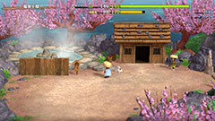

Fully restore HP and strength for free, and organize your items inside the warehouse if desired.

### Firespew Mountain (19-23F)

  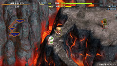

This is around the point where you want to start rushing to the stairs instead of fully exploring. However, if you don't have enough items for the boss fight, you might want to take things a bit slower. The monster spawn rate speeds up from 1 monster/30 Turns → 1 monster/25 Turns starting on 22F.

Lv2 Ninjas have the same special attacks as Lv1 Ninjas, aside from dealing slightly more damage. Fire Ninjas mean there's little point in exploring the floor since most consumable items get destroyed. Attack power for Lv2 Ninjas: Fire (45) &gt; Metal (42) &gt; Water (37) = Tree (37) &gt; Earth (21).

Other threats include Blazeous (21-23F), Super Gazer (22-24F), and Skull Wizard (19-21F). Blazeous only uses normal attacks, but is immune to projectiles that lack piercing properties. Super Gazer hypnotizes Shiren when adjacent, forcing him to either randomly attack or use an item. Skull Wizard's magic can inflict Confused status, warp you to the stairs and inflict Paralyzed status, deal 20 damage, or morph you into a monster (open the menu → select End Morph to revert back).

Lastly, also beware of Explochin (20-22F), as it explodes when its HP gets low. The explosion reduces Shiren's HP to 1, so use rocks to adjust how much damage you deal as needed. It stops moving after 60 damage, and explodes when damage received reaches 96+ damage.

#### Monster Stats (19-23F)

|Floor|Monster|HP|Atk|Def|Exp|Type|
|-|-|-|-|-|-|-|
|16-19|Okame Monk D|60|19|23|75|Normal|
|16-19|Thiefwalrus|65|25|23|75|Aquatic|
|17-20|Zapdon|80|43|35|105|Metal|
|18-19|Tengu Monk D|80|24|20|85|Normal|
|18-19|Hannya Monk D|66|37|25|80|Normal|
|18-20|Flamepuff|50|25|20|175|Dragon/Floating|
|18-21|N'dubba|32|16|8|16|Metal|
|19-21|Skull Wizard|88|35|24|250|Ghost|
|20-21|Tree Ninja C|70|37|24|88|Normal|
|20-21|Earth Ninja C|85|21|28|90|Normal|
|20-22|Explochin|120|25|22|55|Exploding/Cyclops/Aquatic|
|20-23|Fire Ninja C|75|45|21|100|Normal|
|21-23|Blazeous|92|36|24|150|Normal|
|22-23|Metal Ninja C|85|42|29|93|Normal|
|22-23|Water Ninja C|80|37|26|95|Normal|
|22-23|Skull Mage|77|31|21|210|Ghost|
|22-24|Super Gazer|66|30|26|222|Cyclops|

### Mount Jatou (24-26F)

  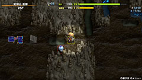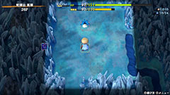

Continue rushing to the stairs instead of exploring the floor for items.

Porko (24-27F) throws Porky's Rocks that deal 20 damage within a 5 tile radius. These monsters throw rocks even when Shiren isn't in their view, so they can be a major problem. It's usually best to go towards the Porko and defeat it instead of trying to run away from the rocks. Pesky Kappa (24-27F) throws items on the ground at you, so there's less incentive to explore.

Daze Radish (26-29F) throws Confusion Grass within a 2 tile radius. If you already have Confused status, it throws Poison Grass instead - Focusing Bracelet keeps you safe. Greenwalrus (25-29F)'s theft can be annoying when you don't have a Walrus Stopper (shield). If it's not adjacent, shoot an arrow at a wall so that it doesn't steal an inventory item.

Mixers (24-29F) will only spawn if they've been unlocked through a side quest. The power boost they gain from eating items is significant, so always use an item to disable them. In this game, Mixers also get cured of bad status conditions each time they eat an item, so inflict the status condition after you've thrown the items you want to synthesize.

#### Monster Stats (24-26F)

|Floor|Monster|HP|Atk|Def|Exp|Type|
|-|-|-|-|-|-|-|
|22-24|Super Gazer|66|30|26|222|Cyclops|
|24-25|Dark Owl|90|16|25|120|Normal|
|24-25|Capt. Spearfish|100|39|30|410|Aquatic|
|24-25|Famed Octopling|99|25|30|420|Aquatic|
|24-27|Porko|65|36|18|840|Beast|
|24-27|Pesky Kappa|75|29|22|330|Aquatic|
|24-28|N'dulu|70|40|31|230|Metal|
|24-29|Mixer|78|39|29|280|Normal|
|25-28|Dartingfrog|75|40|28|300|Aquatic|
|25-29|Greenwalrus|88|30|27|240|Aquatic|
|26-29|Daze Radish|80|37|27|400|Ghost|

### Icewall Village

  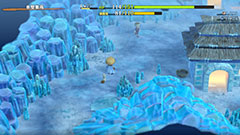

Village featuring an item shop and an inn.

### Mount Jatou (27-30F)

  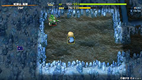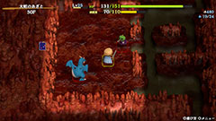

Again, rush to the stairs instead of trying to explore the floor for items.

Dragon (27-31F) and Sky Dragon (28-31F) make an appearance. Dragons breathe 20 damage fire in a straight line, and Sky Dragons from anywhere in the room. It's hopeless to trade hits unless you're using a Dragonkiller + Dragon Shield equipment combination. Instead, use items like Paralyzing Staff or Sluggish Staff to weaken them and avoid taking damage.

Vile Scorpion (29-31F) can lower Shiren's Current Strength by 2 per special attack use. Similar to Dragons, use items to deal with them instead of trying to trade normal attacks. Also beware of Pumplich (30-31F), as they have high attack power and can pass through walls.

If you plan on throwing Gitan against the boss, be sure to break any Cashing Pots on 30F. You'll need a total of 3885 Gitan worth of Gitan bags to use as projectiles to defeat it in this manner.

#### Monster Stats (27-30F)

|Floor|Monster|HP|Atk|Def|Exp|Type|
|-|-|-|-|-|-|-|
|24-27|Porko|65|36|18|840|Beast|
|24-27|Pesky Kappa|75|29|22|330|Aquatic|
|24-28|N'dulu|70|40|31|230|Metal|
|24-29|Mixer|78|39|29|280|Normal|
|25-28|Dartingfrog|75|40|28|300|Aquatic|
|25-29|Greenwalrus|88|30|27|240|Aquatic|
|26-29|Daze Radish|80|37|27|400|Ghost|
|27-31|Dragon|120|45|40|1000|Dragon|
|28-31|Sky Dragon|140|55|50|1600|Dragon|
|29-30|Baby Tank|85|40|30|450|Normal|
|29-31|Vile Scorpion|108|45|33|500|Draining|
|30-31|Pumplich|100|50|30|800|Ghost/Floating|
|30-31|Polygon Shaka|70|34|33|360|Draining|
|30-31|Hoppin' Slugger|72|39|31|400|Normal|

### Boss (31F)

  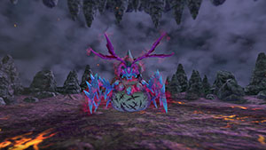

Jakaku (777 HP, 50 atk, 20 def) is a Draining type monster, so Drain Slayer deals x1.5 damage. Status conditions can be inflicted, but they get cured in roughly 2\~4 turns depending on the status. Sanctuary Scroll and Knockback Staff do not work, Paralyzing Staff and Narrow-escape Staff do work. Throwing Antidote Grass deals 50 damage, Poison Grass or Poison Arrow raises its attack power.

Special attacks:

- Spit Poison (adjacent)
    - Lowers Shiren's strength by 1 and inflicts Slow status.
- Shove (adjacent)
    - Pushes Shiren back 1 tile, and makes him drop some items.
        - If you drop important items, be sure to pick them up before defeating the boss.
- Eat Monster (adjacent)
    - Jakaku eats an adjacent monster, restoring 30 HP and curing bad status conditions.

Other notes:

- Expect to deal around 30\~40 damage with normal attacks, or 20\~30 damage using arrows.
    - This calculates out to roughly 20\~26 normal attacks to defeat it.
- The fight begins with Pumplich, Dragon, Vile Scorpion, and 2 Hoppin' Sluggers on the field.
    - Monsters also continue to spawn as turns elapse, which can include Sky Dragons.
- Swift Grass, Power-up Grass, and Invincible Grass are fantastic.
    - Arrows deal \~50 damage with Power-up Grass, and are even better with a Rapid-fire Bracelet.
    - Aggressive Incense can be paired with Invincible Grass to quickly deal massive damage.
- If you want to quickly close the distance at the start, step right → swing a Vaulting Staff upward.
    - This lets you reach Jakaku without dealing with any of the regular monsters.
- If you plan to use arrows, you'll need to create distance using Vaulting Staff or such.
    - Don't shoot Poison Arrows, since it boosts Jakaku's attack power!
- Paralyzing Staff is great for quickly disabling regular monsters.
    - Either defeat Hoppin' Sluggers normally, use a Fixer Scroll, or have Jakaku eat them.
- If you position Jakaku between Shiren and a Dragon, the Dragon will breathe fire at Jakaku.
    - However, this only works with a Lv1 Dragon, not a Lv2 Sky Dragon.
- Throwing Gitan is very effective, since the damage was buffed to 20% of the Gitan bag's value.
    - Don't throw a pot containing Gitan bags, as the pot's contents won't hit the target.
- Empathetic Staff can be used to supplement damage if your damage output is low.

#### Monster Stats (31F)

|Floor|Monster|HP|Atk|Def|Exp|Type|
|-|-|-|-|-|-|-|
|31|Jakaku|777|50|20|0|Draining|
|27-31|Dragon|120|45|40|1000|Dragon|
|28-31|Sky Dragon|140|55|50|1600|Dragon|
|29-31|Vile Scorpion|108|45|33|500|Draining|
|30-31|Pumplich|100|50|30|800|Ghost/Floating|
|30-31|Polygon Shaka|70|34|33|360|Draining|
|30-31|Hoppin' Slugger|72|39|31|400|Normal|

# Monsters

<button id="hideMonTblImgBtn" onClick={()=>{var mon_imgs = document.querySelectorAll('#monsterTable img');mon_imgs.forEach(e => e.classList.toggle('hidden'));}}>Toggle Monster Images</button>

See [Monsters](/system/monsters) for individual monster details.

- F - Dark hallways, Boss Floor
- S - Shop is possible
- M - Monster House is possible
- W - Wishing Shrine is possible
- B - Behemoth Gate is possible

Monster Colors = Mixer, Farming, Useful, Lowers Stats, Targets Items, Dangerous

<table id="monsterTable" class="monsterTable">
  <thead>
    <tr>
      <th>F</th>
      <th>S</th>
      <th>M</th>
      <th>W</th>
      <th colspan="5">Monsters</th>
      <th>B</th>
    </tr>
  </thead>
  <tbody>
    <tr>
      <td class="centeredText">1</td>
      <td class=""></td>
      <td class=""></td>
      <td class=""></td>
      <td> Mamel</td>
      <td> Octopling</td>
      <td> Spearfish</td>
      <td class="highlightGray"></td>
      <td class="highlightGray"></td>
      <td class=""></td>
    </tr>
    <tr>
      <td colspan="10" class="tableDivider"></td>
    </tr>
    <tr>
      <td class="centeredText">2</td>
      <td class=""></td>
      <td class=""></td>
      <td class=""></td>
      <td> Mamel</td>
      <td> Pit Mamel</td>
      <td> Octopling</td>
      <td> Spearfish</td>
      <td class="highlightGray"></td>
      <td class=""></td>
    </tr>
    <tr>
      <td colspan="10" class="tableDivider"></td>
    </tr>
    <tr>
      <td class="centeredText">3</td>
      <td class=""></td>
      <td class=""></td>
      <td class=""></td>
      <td> Pit Mamel</td>
      <td> Chintala</td>
      <td class="danger"> Pumphantasm</td>
      <td>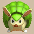 Armordillo</td>
      <td class="highlightGray"></td>
      <td class=""></td>
    </tr>
    <tr>
      <td colspan="10" class="tableDivider"></td>
    </tr>
    <tr>
      <td class="centeredText">4</td>
      <td class=""></td>
      <td class=""></td>
      <td class=""></td>
      <td> Chintala</td>
      <td class="farming">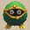 Froggo</td>
      <td class="danger"> Pumphantasm</td>
      <td> Armordillo</td>
      <td class="highlightGray"></td>
      <td class=""></td>
    </tr>
    <tr>
      <td colspan="10" class="tableDivider"></td>
    </tr>
    <tr>
      <td class="monsterTableVillage"></td>
      <td colspan="3" class="monsterTableVillage"></td>
      <td colspan="5" class="monsterTableVillage centeredText">Mountain Village</td>
      <td class="monsterTableVillage"></td>
    </tr>
    <tr>
      <td colspan="10" class="tableDivider"></td>
    </tr>
    <tr>
      <td class="centeredText">5</td>
      <td class="highlightShop"></td>
      <td class=""></td>
      <td class=""></td>
      <td> Tree Ninja D</td>
      <td> Earth Ninja D</td>
      <td class="items"> Fire Ninja D</td>
      <td class="highlightGray"></td>
      <td class="highlightGray"></td>
      <td class=""></td>
    </tr>
    <tr>
      <td colspan="10" class="tableDivider"></td>
    </tr>
    <tr>
      <td class="centeredText">6</td>
      <td class="highlightShop"></td>
      <td class=""></td>
      <td class=""></td>
      <td> Tree Ninja D</td>
      <td> Earth Ninja D</td>
      <td class="items"> Fire Ninja D</td>
      <td class="danger"> Hoppin' Hitter</td>
      <td class="highlightGray"></td>
      <td class=""></td>
    </tr>
    <tr>
      <td colspan="10" class="tableDivider"></td>
    </tr>
    <tr>
      <td rowspan="2" class="centeredText">7</td>
      <td rowspan="2" class="highlightShop"></td>
      <td rowspan="2" class=""></td>
      <td rowspan="2" class=""></td>
      <td> Tree Ninja D</td>
      <td> Earth Ninja D</td>
      <td class="items"> Fire Ninja D</td>
      <td class="items">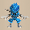 Water Ninja D</td>
      <td>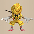 Metal Ninja D</td>
      <td rowspan="2" class=""></td>
    </tr>
    <tr>
      <td class="danger"> Hoppin' Hitter</td>
      <td class="highlightGray"></td>
      <td class="highlightGray"></td>
      <td class="highlightGray"></td>
      <td class="highlightGray"></td>
    </tr>
    <tr>
      <td colspan="10" class="tableDivider"></td>
    </tr>
    <tr>
      <td rowspan="2" class="centeredText">8</td>
      <td rowspan="2" class="highlightShop"></td>
      <td rowspan="2" class="highlightMH"></td>
      <td rowspan="2" class=""></td>
      <td> Earth Ninja D</td>
      <td class="items"> Fire Ninja D</td>
      <td class="items"> Water Ninja D</td>
      <td> Metal Ninja D</td>
      <td class="danger"> Hoppin' Hitter</td>
      <td rowspan="2" class=""></td>
    </tr>
    <tr>
      <td> Mid Chintala</td>
      <td class="highlightGray"></td>
      <td class="highlightGray"></td>
      <td class="highlightGray"></td>
      <td class="highlightGray"></td>
    </tr>
    <tr>
      <td colspan="10" class="tableDivider"></td>
    </tr>
    <tr>
      <td class="centeredText">9</td>
      <td class="highlightShop"></td>
      <td class="highlightMH"></td>
      <td class=""></td>
      <td> Earth Ninja D</td>
      <td class="items"> Water Ninja D</td>
      <td> Metal Ninja D</td>
      <td class="danger"> Hoppin' Hitter</td>
      <td> Mid Chintala</td>
      <td class=""></td>
    </tr>
    <tr>
      <td colspan="10" class="tableDivider"></td>
    </tr>
    <tr>
      <td class="monsterTableVillage"></td>
      <td colspan="3" class="monsterTableVillage"></td>
      <td colspan="5" class="monsterTableVillage centeredText">Small Harbor</td>
      <td class="monsterTableVillage"></td>
    </tr>
    <tr>
      <td colspan="10" class="tableDivider"></td>
    </tr>
    <tr>
      <td rowspan="2" class="centeredText">10</td>
      <td rowspan="2" class="highlightShop"></td>
      <td rowspan="2" class=""></td>
      <td rowspan="2" class=""></td>
      <td> Mid Chintala</td>
      <td>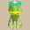 Bored Kappa</td>
      <td class="useful"> Bowboy</td>
      <td class="useful">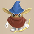 Crossbowboy</td>
      <td> Masked Samurai</td>
      <td rowspan="2" class=""></td>
    </tr>
    <tr>
      <td> Fresh Octopling</td>
      <td class="highlightGray"></td>
      <td class="highlightGray"></td>
      <td class="highlightGray"></td>
      <td class="highlightGray"></td>
    </tr>
    <tr>
      <td colspan="10" class="tableDivider"></td>
    </tr>
    <tr>
      <td rowspan="2" class="centeredText">11</td>
      <td rowspan="2" class="highlightShop"></td>
      <td rowspan="2" class="highlightMH"></td>
      <td rowspan="2" class=""></td>
      <td> Bored Kappa</td>
      <td class="useful"> Bowboy</td>
      <td class="useful"> Crossbowboy</td>
      <td> Masked Samurai</td>
      <td> Fresh Octopling</td>
      <td rowspan="2" class=""></td>
    </tr>
    <tr>
      <td class="items"> Mudkin</td>
      <td class="highlightGray"></td>
      <td class="highlightGray"></td>
      <td class="highlightGray"></td>
      <td class="highlightGray"></td>
    </tr>
    <tr>
      <td colspan="10" class="tableDivider"></td>
    </tr>
    <tr>
      <td class="centeredText">12</td>
      <td class="highlightShop"></td>
      <td class="highlightMH"></td>
      <td class=""></td>
      <td> Bored Kappa</td>
      <td class="useful"> Crossbowboy</td>
      <td> Masked Samurai</td>
      <td> Fresh Octopling</td>
      <td class="items"> Mudkin</td>
      <td class=""></td>
    </tr>
    <tr>
      <td colspan="10" class="tableDivider"></td>
    </tr>
    <tr>
      <td class="monsterTableVillage"></td>
      <td colspan="3" class="monsterTableVillage"></td>
      <td colspan="5" class="monsterTableVillage centeredText">Underwater Training Ground</td>
      <td class="monsterTableVillage"></td>
    </tr>
    <tr>
      <td colspan="10" class="tableDivider"></td>
    </tr>
    <tr>
      <td rowspan="2" class="centeredText">13</td>
      <td rowspan="2" class="highlightShop"></td>
      <td rowspan="2" class="highlightMH"></td>
      <td rowspan="2" class=""></td>
      <td> Fresh Octopling</td>
      <td class="items"> Mudkin</td>
      <td> Lt. Spearfish</td>
      <td>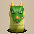 Floor Dragon</td>
      <td>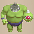 Metalhead</td>
      <td rowspan="2" class="highlightBehemoth"></td>
    </tr>
    <tr>
      <td> Tiger Thrower</td>
      <td class="highlightGray"></td>
      <td class="highlightGray"></td>
      <td class="highlightGray"></td>
      <td class="highlightGray"></td>
    </tr>
    <tr>
      <td colspan="10" class="tableDivider"></td>
    </tr>
    <tr>
      <td class="centeredText">14</td>
      <td class="highlightShop"></td>
      <td class="highlightMH"></td>
      <td class=""></td>
      <td class="items"> Mudkin</td>
      <td> Lt. Spearfish</td>
      <td> Floor Dragon</td>
      <td> Metalhead</td>
      <td> Tiger Thrower</td>
      <td class=""></td>
    </tr>
    <tr>
      <td colspan="10" class="tableDivider"></td>
    </tr>
    <tr>
      <td class="highlightFog centeredText">15</td>
      <td class="highlightShop"></td>
      <td class=""></td>
      <td class=""></td>
      <td> Floor Dragon</td>
      <td> Metalhead</td>
      <td> Tiger Thrower</td>
      <td class="highlightGray"></td>
      <td class="highlightGray"></td>
      <td class="highlightBehemoth"></td>
    </tr>
    <tr>
      <td colspan="10" class="tableDivider"></td>
    </tr>
    <tr>
      <td rowspan="2" class="centeredText">16</td>
      <td rowspan="2" class=""></td>
      <td rowspan="2" class=""></td>
      <td rowspan="2" class=""></td>
      <td> Master Hen</td>
      <td> Minotaur</td>
      <td> Okina Monk D</td>
      <td>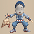 Okame Monk D</td>
      <td class="farming"> Thiefwalrus</td>
      <td rowspan="2" class=""></td>
    </tr>
    <tr>
      <td> Pop Tank</td>
      <td> Egg Thing</td>
      <td class="items"> Hat Prankster</td>
      <td class="stats"> Ghost Radish</td>
      <td class="highlightGray"></td>
    </tr>
    <tr>
      <td colspan="10" class="tableDivider"></td>
    </tr>
    <tr>
      <td rowspan="2" class="centeredText">17</td>
      <td rowspan="2" class=""></td>
      <td rowspan="2" class=""></td>
      <td rowspan="2" class=""></td>
      <td> Master Hen</td>
      <td> Minotaur</td>
      <td> Okina Monk D</td>
      <td> Okame Monk D</td>
      <td class="farming"> Thiefwalrus</td>
      <td rowspan="2" class=""></td>
    </tr>
    <tr>
      <td> Zapdon</td>
      <td> Pop Tank</td>
      <td> Egg Thing</td>
      <td class="items"> Hat Prankster</td>
      <td class="stats"> Ghost Radish</td>
    </tr>
    <tr>
      <td colspan="10" class="tableDivider"></td>
    </tr>
    <tr>
      <td rowspan="3" class="centeredText">18</td>
      <td rowspan="3" class="highlightShop"></td>
      <td rowspan="3" class="highlightMH"></td>
      <td rowspan="3" class=""></td>
      <td> Master Hen</td>
      <td> Minotaur</td>
      <td> Okina Monk D</td>
      <td> Okame Monk D</td>
      <td> Tengu Monk D</td>
      <td rowspan="3" class=""></td>
    </tr>
    <tr>
      <td> Hannya Monk D</td>
      <td class="farming"> Thiefwalrus</td>
      <td> Zapdon</td>
      <td> Pop Tank</td>
      <td> Flamepuff</td>
    </tr>
    <tr>
      <td> N'dubba</td>
      <td class="highlightGray"></td>
      <td class="highlightGray"></td>
      <td class="highlightGray"></td>
      <td class="highlightGray"></td>
    </tr>
    <tr>
      <td colspan="10" class="tableDivider"></td>
    </tr>
    <tr>
      <td class="monsterTableVillage"></td>
      <td colspan="3" class="monsterTableVillage"></td>
      <td colspan="5" class="monsterTableVillage centeredText">Hot Spring Cabin</td>
      <td class="monsterTableVillage"></td>
    </tr>
    <tr>
      <td colspan="10" class="tableDivider"></td>
    </tr>
    <tr>
      <td rowspan="2" class="centeredText">19</td>
      <td rowspan="2" class="highlightShop"></td>
      <td rowspan="2" class="highlightMH"></td>
      <td rowspan="2" class=""></td>
      <td> Okame Monk D</td>
      <td> Tengu Monk D</td>
      <td> Hannya Monk D</td>
      <td class="farming"> Thiefwalrus</td>
      <td> Zapdon</td>
      <td rowspan="2" class=""></td>
    </tr>
    <tr>
      <td> Flamepuff</td>
      <td> N'dubba</td>
      <td> Skull Wizard</td>
      <td class="highlightGray"></td>
      <td class="highlightGray"></td>
    </tr>
    <tr>
      <td colspan="10" class="tableDivider"></td>
    </tr>
    <tr>
      <td rowspan="2" class="centeredText">20</td>
      <td rowspan="2" class=""></td>
      <td rowspan="2" class=""></td>
      <td rowspan="2" class=""></td>
      <td> Zapdon</td>
      <td> Flamepuff</td>
      <td> N'dubba</td>
      <td> Tree Ninja C</td>
      <td> Earth Ninja C</td>
      <td rowspan="2" class=""></td>
    </tr>
    <tr>
      <td class="items">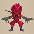 Fire Ninja C</td>
      <td> Explochin</td>
      <td> Skull Wizard</td>
      <td class="highlightGray"></td>
      <td class="highlightGray"></td>
    </tr>
    <tr>
      <td colspan="10" class="tableDivider"></td>
    </tr>
    <tr>
      <td rowspan="2" class="centeredText">21</td>
      <td rowspan="2" class=""></td>
      <td rowspan="2" class=""></td>
      <td rowspan="2" class=""></td>
      <td> N'dubba</td>
      <td> Tree Ninja C</td>
      <td> Earth Ninja C</td>
      <td class="items"> Fire Ninja C</td>
      <td> Explochin</td>
      <td rowspan="2" class=""></td>
    </tr>
    <tr>
      <td> Blazeous</td>
      <td> Skull Wizard</td>
      <td class="highlightGray"></td>
      <td class="highlightGray"></td>
      <td class="highlightGray"></td>
    </tr>
    <tr>
      <td colspan="10" class="tableDivider"></td>
    </tr>
    <tr>
      <td rowspan="2" class="centeredText">22</td>
      <td rowspan="2" class=""></td>
      <td rowspan="2" class=""></td>
      <td rowspan="2" class=""></td>
      <td class="items"> Fire Ninja C</td>
      <td> Metal Ninja C</td>
      <td class="items"> Water Ninja C</td>
      <td> Explochin</td>
      <td> Blazeous</td>
      <td rowspan="2" class=""></td>
    </tr>
    <tr>
      <td>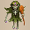 Skull Mage</td>
      <td class="items"> Super Gazer</td>
      <td class="highlightGray"></td>
      <td class="highlightGray"></td>
      <td class="highlightGray"></td>
    </tr>
    <tr>
      <td colspan="10" class="tableDivider"></td>
    </tr>
    <tr>
      <td rowspan="2" class="centeredText">23</td>
      <td rowspan="2" class=""></td>
      <td rowspan="2" class=""></td>
      <td rowspan="2" class=""></td>
      <td class="items"> Fire Ninja C</td>
      <td> Metal Ninja C</td>
      <td class="items"> Water Ninja C</td>
      <td> Blazeous</td>
      <td> Skull Mage</td>
      <td rowspan="2" class=""></td>
    </tr>
    <tr>
      <td class="items"> Super Gazer</td>
      <td class="highlightGray"></td>
      <td class="highlightGray"></td>
      <td class="highlightGray"></td>
      <td class="highlightGray"></td>
    </tr>
    <tr>
      <td colspan="10" class="tableDivider"></td>
    </tr>
    <tr>
      <td rowspan="2" class="highlightFog centeredText">24</td>
      <td rowspan="2" class=""></td>
      <td rowspan="2" class=""></td>
      <td rowspan="2" class="highlightGold"></td>
      <td class="items"> Super Gazer</td>
      <td> N'dulu</td>
      <td class="items">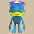 Pesky Kappa</td>
      <td> Porko</td>
      <td> Dark Owl</td>
      <td rowspan="2" class=""></td>
    </tr>
    <tr>
      <td>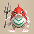 Capt. Spearfish</td>
      <td> Famed Octopling</td>
      <td class="mixer"> Mixer</td>
      <td class="highlightGray"></td>
      <td class="highlightGray"></td>
    </tr>
    <tr>
      <td colspan="10" class="tableDivider"></td>
    </tr>
    <tr>
      <td rowspan="2" class="highlightFog centeredText">25</td>
      <td rowspan="2" class="highlightShop"></td>
      <td rowspan="2" class="highlightMH"></td>
      <td rowspan="2" class=""></td>
      <td> N'dulu</td>
      <td class="items"> Pesky Kappa</td>
      <td> Porko</td>
      <td> Dark Owl</td>
      <td> Capt. Spearfish</td>
      <td rowspan="2" class=""></td>
    </tr>
    <tr>
      <td> Famed Octopling</td>
      <td class="farming"> Greenwalrus</td>
      <td> Dartingfrog</td>
      <td class="mixer"> Mixer</td>
      <td class="highlightGray"></td>
    </tr>
    <tr>
      <td colspan="10" class="tableDivider"></td>
    </tr>
    <tr>
      <td rowspan="2" class="highlightFog centeredText">26</td>
      <td rowspan="2" class="highlightShop"></td>
      <td rowspan="2" class=""></td>
      <td rowspan="2" class=""></td>
      <td> N'dulu</td>
      <td class="items"> Pesky Kappa</td>
      <td> Porko</td>
      <td class="stats"> Daze Radish</td>
      <td class="farming"> Greenwalrus</td>
      <td rowspan="2" class=""></td>
    </tr>
    <tr>
      <td> Dartingfrog</td>
      <td class="mixer"> Mixer</td>
      <td class="highlightGray"></td>
      <td class="highlightGray"></td>
      <td class="highlightGray"></td>
    </tr>
    <tr>
      <td colspan="10" class="tableDivider"></td>
    </tr>
    <tr>
      <td class="monsterTableVillage"></td>
      <td colspan="3" class="monsterTableVillage"></td>
      <td colspan="5" class="monsterTableVillage centeredText">Icewall Village</td>
      <td class="monsterTableVillage"></td>
    </tr>
    <tr>
      <td colspan="10" class="tableDivider"></td>
    </tr>
    <tr>
      <td rowspan="2" class="highlightFog centeredText">27</td>
      <td rowspan="2" class="highlightShop"></td>
      <td rowspan="2" class=""></td>
      <td rowspan="2" class="highlightGold"></td>
      <td> N'dulu</td>
      <td class="items"> Pesky Kappa</td>
      <td> Porko</td>
      <td class="stats"> Daze Radish</td>
      <td class="danger"> Dragon</td>
      <td rowspan="2" class=""></td>
    </tr>
    <tr>
      <td class="farming"> Greenwalrus</td>
      <td> Dartingfrog</td>
      <td class="mixer"> Mixer</td>
      <td class="highlightGray"></td>
      <td class="highlightGray"></td>
    </tr>
    <tr>
      <td colspan="10" class="tableDivider"></td>
    </tr>
    <tr>
      <td rowspan="2" class="highlightFog centeredText">28</td>
      <td rowspan="2" class="highlightShop"></td>
      <td rowspan="2" class="highlightMH"></td>
      <td rowspan="2" class="highlightGold"></td>
      <td> N'dulu</td>
      <td class="stats"> Daze Radish</td>
      <td class="danger"> Dragon</td>
      <td class="danger"> Sky Dragon</td>
      <td class="farming"> Greenwalrus</td>
      <td rowspan="2" class=""></td>
    </tr>
    <tr>
      <td> Dartingfrog</td>
      <td class="mixer"> Mixer</td>
      <td class="highlightGray"></td>
      <td class="highlightGray"></td>
      <td class="highlightGray"></td>
    </tr>
    <tr>
      <td colspan="10" class="tableDivider"></td>
    </tr>
    <tr>
      <td rowspan="2" class="highlightFog centeredText">29</td>
      <td rowspan="2" class="highlightShop"></td>
      <td rowspan="2" class="highlightMH"></td>
      <td rowspan="2" class="highlightGold"></td>
      <td class="stats"> Daze Radish</td>
      <td> Baby Tank</td>
      <td class="stats"> Vile Scorpion</td>
      <td class="danger"> Dragon</td>
      <td class="danger"> Sky Dragon</td>
      <td rowspan="2" class=""></td>
    </tr>
    <tr>
      <td class="farming"> Greenwalrus</td>
      <td class="mixer"> Mixer</td>
      <td class="highlightGray"></td>
      <td class="highlightGray"></td>
      <td class="highlightGray"></td>
    </tr>
    <tr>
      <td colspan="10" class="tableDivider"></td>
    </tr>
    <tr>
      <td rowspan="2" class="highlightFog centeredText">30</td>
      <td rowspan="2" class="highlightShop"></td>
      <td rowspan="2" class="highlightMH"></td>
      <td rowspan="2" class=""></td>
      <td> Baby Tank</td>
      <td class="stats"> Vile Scorpion</td>
      <td> Hoppin' Slugger</td>
      <td class="stats">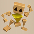 Polygon Shaka</td>
      <td class="danger"> Dragon</td>
      <td rowspan="2" class=""></td>
    </tr>
    <tr>
      <td class="danger"> Sky Dragon</td>
      <td> Pumplich</td>
      <td class="highlightGray"></td>
      <td class="highlightGray"></td>
      <td class="highlightGray"></td>
    </tr>
    <tr>
      <td colspan="10" class="tableDivider"></td>
    </tr>
    <tr>
      <td rowspan="2" class="highlightOrange2 centeredText">31</td>
      <td rowspan="2" class=""></td>
      <td rowspan="2" class=""></td>
      <td rowspan="2" class=""></td>
      <td class="danger">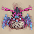 Jakaku</td>
      <td class="stats"> Vile Scorpion</td>
      <td> Hoppin' Slugger</td>
      <td class="stats"> Polygon Shaka</td>
      <td class="danger"> Dragon</td>
      <td rowspan="2" class=""></td>
    </tr>
    <tr>
      <td class="danger"> Sky Dragon</td>
      <td> Pumplich</td>
      <td class="highlightGray"></td>
      <td class="highlightGray"></td>
      <td class="highlightGray"></td>
    </tr>
  </tbody>
</table>

# Behemoths

<button id="hideMonTblImgBtn" onClick={()=>{var mon_imgs = document.querySelectorAll('#behemothTable img');mon_imgs.forEach(e => e.classList.toggle('hidden'));}}>Toggle Monster Images</button>

See [Monsters](/system/monsters) for individual monster details.

<table id="behemothTable" class="monsterTable">
  <thead>
    <tr>
      <th>F</th>
      <th colspan="6">Behemoth Monsters</th>
    </tr>
  </thead>
  <tbody>
    <tr>
      <td rowspan="1" class="centeredText">13, 15</td>
      <td> Mamel</td>
      <td> Bowboy</td>
      <td> Pop Tank</td>
      <td> Ghost Radish</td>
      <td> Schubell</td>
      <td> Explochin</td>
    </tr>
  </tbody>
</table>

# Items

※ This section is currently incomplete.

<h4 id="item-table-key" class="heading4Blue"> Item Table Key</h4>

|ID|Explanation|
|-|-|
|F|Floor|
|S|Shop|
|P|Peddler|
|M|Monster drop|
|B|Buried|
|H|Thiefwalrus|
|I|Island|
|T|Transmutation Pot|
|U|Surprise Pot|
|W|Tunnel of Wishes|

<h4 id="weapon" class="heading4Blue"> Weapon</h4>

<table class="dungeonItemTable">
  <tr>
    <th colspan="11" class="highlightLightblue">Weapon</th>
  </tr>
  <tr>
    <th>Name</th>
    <th>F</th>
    <th>S</th>
    <th>P</th>
    <th>M</th>
    <th>B</th>
    <th>H</th>
    <th>I</th>
    <th>T</th>
    <th>U</th>
    <th>W</th>
  </tr>
  <tr>
    <td class="leftText">Wooden Sword</td>
    <td>X</td>
    <td></td>
    <td>X</td>
    <td></td>
    <td></td>
    <td></td>
    <td></td>
    <td></td>
    <td></td>
    <td></td>
  </tr>
  <tr>
    <td class="leftText">Bronze Sword</td>
    <td>X</td>
    <td></td>
    <td></td>
    <td></td>
    <td>X</td>
    <td>X</td>
    <td></td>
    <td>X</td>
    <td></td>
    <td></td>
  </tr>
  <tr>
    <td class="leftText">Katana</td>
    <td>X</td>
    <td>X</td>
    <td></td>
    <td></td>
    <td>X</td>
    <td>X</td>
    <td></td>
    <td></td>
    <td></td>
    <td></td>
  </tr>
  <tr>
    <td class="leftText">Doutanuki</td>
    <td>X</td>
    <td></td>
    <td>X</td>
    <td></td>
    <td></td>
    <td></td>
    <td></td>
    <td></td>
    <td></td>
    <td></td>
  </tr>
  <tr>
    <td class="leftText">Manji Kabura</td>
    <td>X</td>
    <td></td>
    <td></td>
    <td></td>
    <td></td>
    <td></td>
    <td></td>
    <td></td>
    <td></td>
    <td></td>
  </tr>
  <tr>
    <td class="leftText">Kajin Fuuma</td>
    <td></td>
    <td></td>
    <td></td>
    <td></td>
    <td></td>
    <td></td>
    <td></td>
    <td></td>
    <td></td>
    <td></td>
  </tr>
  <tr>
    <td class="leftText">Kabura Sutegi</td>
    <td></td>
    <td></td>
    <td></td>
    <td></td>
    <td></td>
    <td></td>
    <td></td>
    <td></td>
    <td></td>
    <td></td>
  </tr>
  <tr>
    <td class="leftText">Golden Sword</td>
    <td>X</td>
    <td>X</td>
    <td>X</td>
    <td></td>
    <td></td>
    <td></td>
    <td></td>
    <td></td>
    <td></td>
    <td></td>
  </tr>
  <tr>
    <td class="leftText">Kama Itachi</td>
    <td>X</td>
    <td>X</td>
    <td></td>
    <td></td>
    <td></td>
    <td>X</td>
    <td></td>
    <td></td>
    <td></td>
    <td></td>
  </tr>
  <tr>
    <td class="leftText">Axe of the Minotaur</td>
    <td></td>
    <td></td>
    <td></td>
    <td></td>
    <td></td>
    <td></td>
    <td></td>
    <td></td>
    <td></td>
    <td></td>
  </tr>
  <tr>
    <td class="leftText">Accurate Sword</td>
    <td></td>
    <td></td>
    <td></td>
    <td></td>
    <td></td>
    <td></td>
    <td></td>
    <td></td>
    <td></td>
    <td></td>
  </tr>
  <tr>
    <td class="leftText">Swift Sword</td>
    <td>X</td>
    <td></td>
    <td></td>
    <td>X</td>
    <td></td>
    <td>X</td>
    <td></td>
    <td></td>
    <td></td>
    <td></td>
  </tr>
  <tr>
    <td class="leftText">Watersplitter</td>
    <td>X</td>
    <td></td>
    <td></td>
    <td></td>
    <td></td>
    <td>X</td>
    <td></td>
    <td></td>
    <td></td>
    <td></td>
  </tr>
  <tr>
    <td class="leftText">Primal Axe</td>
    <td>X</td>
    <td></td>
    <td>X</td>
    <td>X</td>
    <td></td>
    <td></td>
    <td></td>
    <td></td>
    <td></td>
    <td></td>
  </tr>
  <tr>
    <td class="leftText">Dragonkiller</td>
    <td></td>
    <td></td>
    <td>X</td>
    <td></td>
    <td></td>
    <td></td>
    <td></td>
    <td></td>
    <td></td>
    <td></td>
  </tr>
  <tr>
    <td class="leftText">Crescent Blade</td>
    <td></td>
    <td>X</td>
    <td></td>
    <td></td>
    <td></td>
    <td></td>
    <td></td>
    <td>X</td>
    <td></td>
    <td></td>
  </tr>
  <tr>
    <td class="leftText">Sky Sword</td>
    <td>X</td>
    <td></td>
    <td>X</td>
    <td></td>
    <td></td>
    <td></td>
    <td></td>
    <td></td>
    <td></td>
    <td></td>
  </tr>
  <tr>
    <td class="leftText">Sickle of Salvation</td>
    <td></td>
    <td></td>
    <td></td>
    <td></td>
    <td></td>
    <td></td>
    <td></td>
    <td></td>
    <td></td>
    <td></td>
  </tr>
  <tr>
    <td class="leftText">Drain Slayer</td>
    <td></td>
    <td>X</td>
    <td></td>
    <td></td>
    <td></td>
    <td>X</td>
    <td></td>
    <td></td>
    <td></td>
    <td></td>
  </tr>
  <tr>
    <td class="leftText">Cyclops Bane</td>
    <td>X</td>
    <td>X</td>
    <td></td>
    <td></td>
    <td></td>
    <td>X</td>
    <td>X</td>
    <td></td>
    <td></td>
    <td></td>
  </tr>
  <tr>
    <td class="leftText">Steel Severer</td>
    <td>X</td>
    <td></td>
    <td></td>
    <td></td>
    <td></td>
    <td></td>
    <td></td>
    <td>X</td>
    <td></td>
    <td></td>
  </tr>
  <tr>
    <td class="leftText">Whopping Harisen</td>
    <td></td>
    <td></td>
    <td></td>
    <td></td>
    <td></td>
    <td></td>
    <td></td>
    <td></td>
    <td></td>
    <td></td>
  </tr>
  <tr>
    <td class="leftText">Healing Sword</td>
    <td></td>
    <td></td>
    <td></td>
    <td></td>
    <td></td>
    <td></td>
    <td></td>
    <td></td>
    <td></td>
    <td></td>
  </tr>
  <tr>
    <td class="leftText">Peach Club</td>
    <td></td>
    <td></td>
    <td></td>
    <td></td>
    <td></td>
    <td></td>
    <td></td>
    <td></td>
    <td></td>
    <td></td>
  </tr>
  <tr>
    <td class="leftText">Spender's Club</td>
    <td></td>
    <td></td>
    <td></td>
    <td></td>
    <td></td>
    <td></td>
    <td></td>
    <td></td>
    <td></td>
    <td></td>
  </tr>
  <tr>
    <td class="leftText">Ferrous Greatsword</td>
    <td></td>
    <td></td>
    <td></td>
    <td></td>
    <td></td>
    <td></td>
    <td></td>
    <td></td>
    <td></td>
    <td></td>
  </tr>
  <tr>
    <td class="leftText">Steak Knife</td>
    <td></td>
    <td></td>
    <td></td>
    <td></td>
    <td></td>
    <td></td>
    <td></td>
    <td></td>
    <td></td>
    <td></td>
  </tr>
  <tr>
    <td class="leftText">Jagged Sword</td>
    <td></td>
    <td></td>
    <td></td>
    <td></td>
    <td></td>
    <td></td>
    <td></td>
    <td></td>
    <td></td>
    <td></td>
  </tr>
  <tr>
    <td class="leftText">Quad-edge</td>
    <td></td>
    <td></td>
    <td></td>
    <td></td>
    <td></td>
    <td></td>
    <td></td>
    <td></td>
    <td></td>
    <td></td>
  </tr>
  <tr>
    <td class="leftText">Auspicious Kumade</td>
    <td></td>
    <td></td>
    <td></td>
    <td></td>
    <td></td>
    <td></td>
    <td></td>
    <td></td>
    <td></td>
    <td></td>
  </tr>
  <tr>
    <td class="leftText">Pickaxe</td>
    <td>X</td>
    <td></td>
    <td></td>
    <td></td>
    <td></td>
    <td></td>
    <td></td>
    <td></td>
    <td></td>
    <td></td>
  </tr>
  <tr>
    <td class="leftText">Golden Pickaxe</td>
    <td></td>
    <td></td>
    <td></td>
    <td></td>
    <td></td>
    <td></td>
    <td></td>
    <td></td>
    <td></td>
    <td></td>
  </tr>
  <tr>
    <td class="leftText">Wooden Mallet</td>
    <td></td>
    <td>X</td>
    <td>X</td>
    <td></td>
    <td></td>
    <td></td>
    <td></td>
    <td></td>
    <td></td>
    <td></td>
  </tr>
  <tr>
    <td class="leftText">Epic Hammer</td>
    <td></td>
    <td></td>
    <td></td>
    <td></td>
    <td></td>
    <td></td>
    <td></td>
    <td></td>
    <td></td>
    <td></td>
  </tr>
  <tr>
    <td class="leftText">Trapseeker</td>
    <td></td>
    <td></td>
    <td></td>
    <td></td>
    <td></td>
    <td></td>
    <td></td>
    <td></td>
    <td></td>
    <td></td>
  </tr>
  <tr>
    <td class="leftText">Bonito Block</td>
    <td></td>
    <td></td>
    <td></td>
    <td></td>
    <td></td>
    <td></td>
    <td></td>
    <td></td>
    <td></td>
    <td></td>
  </tr>
  <tr>
    <td class="leftText">Yamanba's Cleaver</td>
    <td></td>
    <td></td>
    <td></td>
    <td></td>
    <td></td>
    <td></td>
    <td></td>
    <td></td>
    <td></td>
    <td></td>
  </tr>
  <tr>
    <td class="leftText">Break-Off Blade</td>
    <td></td>
    <td></td>
    <td></td>
    <td></td>
    <td></td>
    <td></td>
    <td></td>
    <td></td>
    <td></td>
    <td></td>
  </tr>
</table>

<h4 id="shield" class="heading4Blue"> Shield</h4>

<table class="dungeonItemTable">
  <tr>
    <th colspan="11" class="highlightLightblue">Shield</th>
  </tr>
  <tr>
    <th>Name</th>
    <th>F</th>
    <th>S</th>
    <th>P</th>
    <th>M</th>
    <th>B</th>
    <th>H</th>
    <th>I</th>
    <th>T</th>
    <th>U</th>
    <th>W</th>
  </tr>
  <tr>
    <td class="leftText">Wooden Shield</td>
    <td>X</td>
    <td></td>
    <td></td>
    <td></td>
    <td>X</td>
    <td></td>
    <td></td>
    <td></td>
    <td></td>
    <td></td>
  </tr>
  <tr>
    <td class="leftText">Bronze Shield</td>
    <td>X</td>
    <td></td>
    <td></td>
    <td></td>
    <td></td>
    <td></td>
    <td></td>
    <td></td>
    <td></td>
    <td></td>
  </tr>
  <tr>
    <td class="leftText">Iron Shield</td>
    <td>X</td>
    <td>X</td>
    <td></td>
    <td>X</td>
    <td></td>
    <td></td>
    <td></td>
    <td></td>
    <td></td>
    <td>X</td>
  </tr>
  <tr>
    <td class="leftText">Wolfshead</td>
    <td>X</td>
    <td>X</td>
    <td></td>
    <td></td>
    <td></td>
    <td></td>
    <td></td>
    <td>X</td>
    <td></td>
    <td>X</td>
  </tr>
  <tr>
    <td class="leftText">Fuuma Shield</td>
    <td></td>
    <td>X</td>
    <td></td>
    <td></td>
    <td></td>
    <td></td>
    <td></td>
    <td></td>
    <td></td>
    <td>X</td>
  </tr>
  <tr>
    <td class="leftText">Rasen Fuuma</td>
    <td></td>
    <td></td>
    <td></td>
    <td></td>
    <td></td>
    <td></td>
    <td></td>
    <td></td>
    <td></td>
    <td></td>
  </tr>
  <tr>
    <td class="leftText">Golden Shield</td>
    <td>X</td>
    <td></td>
    <td></td>
    <td></td>
    <td></td>
    <td></td>
    <td></td>
    <td>X</td>
    <td></td>
    <td></td>
  </tr>
  <tr>
    <td class="leftText">Counter Shield</td>
    <td>X</td>
    <td>X</td>
    <td>X</td>
    <td></td>
    <td></td>
    <td></td>
    <td></td>
    <td></td>
    <td></td>
    <td></td>
  </tr>
  <tr>
    <td class="leftText">Watchful Shield</td>
    <td>X</td>
    <td></td>
    <td></td>
    <td></td>
    <td></td>
    <td></td>
    <td></td>
    <td>X</td>
    <td></td>
    <td></td>
  </tr>
  <tr>
    <td class="leftText">Dragon Shield</td>
    <td>X</td>
    <td></td>
    <td></td>
    <td></td>
    <td></td>
    <td></td>
    <td></td>
    <td></td>
    <td></td>
    <td></td>
  </tr>
  <tr>
    <td class="leftText">Blast Shield</td>
    <td></td>
    <td>X</td>
    <td>X</td>
    <td></td>
    <td></td>
    <td></td>
    <td></td>
    <td></td>
    <td></td>
    <td>X</td>
  </tr>
  <tr>
    <td class="leftText">Targe of the Minotaur</td>
    <td></td>
    <td></td>
    <td></td>
    <td></td>
    <td></td>
    <td></td>
    <td></td>
    <td></td>
    <td></td>
    <td></td>
  </tr>
  <tr>
    <td class="leftText">Walrus Stopper</td>
    <td></td>
    <td>X</td>
    <td></td>
    <td></td>
    <td>X</td>
    <td></td>
    <td></td>
    <td></td>
    <td></td>
    <td></td>
  </tr>
  <tr>
    <td class="leftText">Froggo Stopper</td>
    <td></td>
    <td>X</td>
    <td></td>
    <td></td>
    <td></td>
    <td></td>
    <td>X</td>
    <td></td>
    <td></td>
    <td>X</td>
  </tr>
  <tr>
    <td class="leftText">Hat Stopper</td>
    <td></td>
    <td></td>
    <td></td>
    <td></td>
    <td></td>
    <td></td>
    <td></td>
    <td></td>
    <td></td>
    <td></td>
  </tr>
  <tr>
    <td class="leftText">Nigiri Stopper</td>
    <td></td>
    <td></td>
    <td></td>
    <td></td>
    <td></td>
    <td></td>
    <td></td>
    <td></td>
    <td></td>
    <td></td>
  </tr>
  <tr>
    <td class="leftText">Spearscale Shield</td>
    <td>X</td>
    <td>X</td>
    <td></td>
    <td></td>
    <td></td>
    <td></td>
    <td></td>
    <td></td>
    <td></td>
    <td>X</td>
  </tr>
  <tr>
    <td class="leftText">Kappa's Dish</td>
    <td>X</td>
    <td>X</td>
    <td></td>
    <td></td>
    <td></td>
    <td></td>
    <td></td>
    <td></td>
    <td></td>
    <td></td>
  </tr>
  <tr>
    <td class="leftText">Gazer Shield</td>
    <td></td>
    <td>X</td>
    <td></td>
    <td>X</td>
    <td></td>
    <td></td>
    <td></td>
    <td>X</td>
    <td></td>
    <td></td>
  </tr>
  <tr>
    <td class="leftText">Shield of Negation</td>
    <td></td>
    <td></td>
    <td></td>
    <td></td>
    <td></td>
    <td>X</td>
    <td></td>
    <td></td>
    <td></td>
    <td></td>
  </tr>
  <tr>
    <td class="leftText">Unmoving Wall</td>
    <td></td>
    <td></td>
    <td></td>
    <td></td>
    <td></td>
    <td></td>
    <td></td>
    <td></td>
    <td></td>
    <td></td>
  </tr>
  <tr>
    <td class="leftText">Zabuton</td>
    <td></td>
    <td></td>
    <td></td>
    <td></td>
    <td></td>
    <td></td>
    <td></td>
    <td></td>
    <td></td>
    <td></td>
  </tr>
  <tr>
    <td class="leftText">Spender's Shield</td>
    <td></td>
    <td></td>
    <td></td>
    <td></td>
    <td></td>
    <td></td>
    <td></td>
    <td></td>
    <td></td>
    <td></td>
  </tr>
  <tr>
    <td class="leftText">Ferrous Kite</td>
    <td></td>
    <td></td>
    <td></td>
    <td></td>
    <td></td>
    <td></td>
    <td></td>
    <td></td>
    <td></td>
    <td></td>
  </tr>
  <tr>
    <td class="leftText">Steak Plate</td>
    <td></td>
    <td></td>
    <td></td>
    <td></td>
    <td></td>
    <td></td>
    <td></td>
    <td></td>
    <td></td>
    <td></td>
  </tr>
  <tr>
    <td class="leftText">Gutsy Shield</td>
    <td></td>
    <td></td>
    <td></td>
    <td></td>
    <td></td>
    <td></td>
    <td></td>
    <td></td>
    <td></td>
    <td></td>
  </tr>
  <tr>
    <td class="leftText">Hunky-dory Shield</td>
    <td></td>
    <td></td>
    <td></td>
    <td></td>
    <td></td>
    <td></td>
    <td></td>
    <td></td>
    <td></td>
    <td></td>
  </tr>
  <tr>
    <td class="leftText">Bodhi Shield</td>
    <td></td>
    <td></td>
    <td></td>
    <td></td>
    <td></td>
    <td></td>
    <td></td>
    <td></td>
    <td></td>
    <td></td>
  </tr>
  <tr>
    <td class="leftText">Shield of Sating</td>
    <td>X</td>
    <td>X</td>
    <td></td>
    <td></td>
    <td></td>
    <td></td>
    <td></td>
    <td>X</td>
    <td></td>
    <td></td>
  </tr>
  <tr>
    <td class="leftText">Auspicious Omamori</td>
    <td></td>
    <td></td>
    <td></td>
    <td></td>
    <td></td>
    <td></td>
    <td></td>
    <td></td>
    <td></td>
    <td></td>
  </tr>
  <tr>
    <td class="leftText">Shield of Presage</td>
    <td></td>
    <td></td>
    <td></td>
    <td></td>
    <td></td>
    <td></td>
    <td></td>
    <td></td>
    <td></td>
    <td></td>
  </tr>
  <tr>
    <td class="leftText">Yamanba's Potlid</td>
    <td></td>
    <td></td>
    <td></td>
    <td></td>
    <td></td>
    <td></td>
    <td></td>
    <td></td>
    <td></td>
    <td></td>
  </tr>
  <tr>
    <td class="leftText">Break-Off Shield</td>
    <td></td>
    <td></td>
    <td></td>
    <td></td>
    <td></td>
    <td></td>
    <td></td>
    <td></td>
    <td></td>
    <td></td>
  </tr>
</table>

<h4 id="bracelet" class="heading4Blue"> Bracelet</h4>

<table class="dungeonItemTable">
  <tr>
    <th colspan="11" class="highlightLightblue">Bracelet</th>
  </tr>
  <tr>
    <th>Name</th>
    <th>F</th>
    <th>S</th>
    <th>P</th>
    <th>M</th>
    <th>B</th>
    <th>H</th>
    <th>I</th>
    <th>T</th>
    <th>U</th>
    <th>W</th>
  </tr>
  <tr>
    <td class="leftText">Healing Bracelet</td>
    <td></td>
    <td></td>
    <td></td>
    <td></td>
    <td></td>
    <td></td>
    <td></td>
    <td></td>
    <td></td>
    <td></td>
  </tr>
  <tr>
    <td class="leftText">Strength Bracelet</td>
    <td>X</td>
    <td>X</td>
    <td>X</td>
    <td></td>
    <td></td>
    <td></td>
    <td></td>
    <td>X</td>
    <td></td>
    <td></td>
  </tr>
  <tr>
    <td class="leftText">Bellyexpand Bracelet</td>
    <td></td>
    <td></td>
    <td></td>
    <td></td>
    <td></td>
    <td></td>
    <td></td>
    <td></td>
    <td></td>
    <td></td>
  </tr>
  <tr>
    <td class="leftText">Bellyshrink Bracelet</td>
    <td></td>
    <td></td>
    <td></td>
    <td></td>
    <td></td>
    <td></td>
    <td></td>
    <td></td>
    <td></td>
    <td></td>
  </tr>
  <tr>
    <td class="leftText">Fortune Bracelet</td>
    <td>X</td>
    <td></td>
    <td></td>
    <td></td>
    <td></td>
    <td></td>
    <td></td>
    <td></td>
    <td></td>
    <td></td>
  </tr>
  <tr>
    <td class="leftText">Cleansing Bracelet</td>
    <td></td>
    <td>X</td>
    <td>X</td>
    <td></td>
    <td></td>
    <td></td>
    <td></td>
    <td></td>
    <td></td>
    <td></td>
  </tr>
  <tr>
    <td class="leftText">Focusing Bracelet</td>
    <td>X</td>
    <td></td>
    <td>X</td>
    <td></td>
    <td></td>
    <td>X</td>
    <td></td>
    <td>X</td>
    <td></td>
    <td></td>
  </tr>
  <tr>
    <td class="leftText">Rousing Bracelet</td>
    <td>X</td>
    <td>X</td>
    <td></td>
    <td></td>
    <td></td>
    <td></td>
    <td></td>
    <td></td>
    <td></td>
    <td></td>
  </tr>
  <tr>
    <td class="leftText">Rustproof Bracelet</td>
    <td>X</td>
    <td>X</td>
    <td></td>
    <td></td>
    <td></td>
    <td></td>
    <td></td>
    <td></td>
    <td></td>
    <td></td>
  </tr>
  <tr>
    <td class="leftText">Cursebreak Bracelet</td>
    <td></td>
    <td></td>
    <td></td>
    <td></td>
    <td></td>
    <td></td>
    <td></td>
    <td></td>
    <td></td>
    <td></td>
  </tr>
  <tr>
    <td class="leftText">Affixing Bracelet</td>
    <td></td>
    <td></td>
    <td></td>
    <td></td>
    <td></td>
    <td></td>
    <td></td>
    <td></td>
    <td></td>
    <td></td>
  </tr>
  <tr>
    <td class="leftText">Far-throwing Bracelet</td>
    <td></td>
    <td></td>
    <td></td>
    <td></td>
    <td></td>
    <td></td>
    <td></td>
    <td></td>
    <td></td>
    <td></td>
  </tr>
  <tr>
    <td class="leftText">Bad-aim Bracelet</td>
    <td></td>
    <td></td>
    <td></td>
    <td></td>
    <td></td>
    <td></td>
    <td></td>
    <td></td>
    <td></td>
    <td></td>
  </tr>
  <tr>
    <td class="leftText">Sure-aim Bracelet</td>
    <td></td>
    <td></td>
    <td></td>
    <td></td>
    <td></td>
    <td></td>
    <td></td>
    <td></td>
    <td></td>
    <td></td>
  </tr>
  <tr>
    <td class="leftText">Bouncy Bracelet</td>
    <td></td>
    <td></td>
    <td></td>
    <td></td>
    <td></td>
    <td></td>
    <td></td>
    <td></td>
    <td></td>
    <td></td>
  </tr>
  <tr>
    <td class="leftText">Rapid-fire Bracelet</td>
    <td></td>
    <td></td>
    <td>X</td>
    <td></td>
    <td></td>
    <td></td>
    <td></td>
    <td></td>
    <td></td>
    <td></td>
  </tr>
  <tr>
    <td class="leftText">Daredevil Bracelet</td>
    <td></td>
    <td></td>
    <td></td>
    <td></td>
    <td></td>
    <td></td>
    <td></td>
    <td></td>
    <td></td>
    <td></td>
  </tr>
  <tr>
    <td class="leftText">Dreaded Bracelet</td>
    <td></td>
    <td></td>
    <td></td>
    <td></td>
    <td></td>
    <td></td>
    <td></td>
    <td></td>
    <td></td>
    <td></td>
  </tr>
  <tr>
    <td class="leftText">Leaping Bracelet</td>
    <td></td>
    <td></td>
    <td></td>
    <td></td>
    <td></td>
    <td></td>
    <td></td>
    <td></td>
    <td></td>
    <td></td>
  </tr>
  <tr>
    <td class="leftText">Blasting Bracelet</td>
    <td></td>
    <td></td>
    <td></td>
    <td></td>
    <td></td>
    <td></td>
    <td></td>
    <td></td>
    <td></td>
    <td></td>
  </tr>
  <tr>
    <td class="leftText">Clairvoyant Bracelet</td>
    <td></td>
    <td></td>
    <td></td>
    <td></td>
    <td></td>
    <td></td>
    <td></td>
    <td></td>
    <td></td>
    <td></td>
  </tr>
  <tr>
    <td class="leftText">Monster-find Bracelet</td>
    <td></td>
    <td>X</td>
    <td></td>
    <td></td>
    <td></td>
    <td></td>
    <td></td>
    <td></td>
    <td></td>
    <td></td>
  </tr>
  <tr>
    <td class="leftText">Item-find Bracelet</td>
    <td></td>
    <td>X</td>
    <td></td>
    <td></td>
    <td></td>
    <td></td>
    <td></td>
    <td></td>
    <td></td>
    <td></td>
  </tr>
  <tr>
    <td class="leftText">Passage-find Bracelet</td>
    <td></td>
    <td></td>
    <td></td>
    <td></td>
    <td></td>
    <td></td>
    <td></td>
    <td></td>
    <td></td>
    <td></td>
  </tr>
  <tr>
    <td class="leftText">Waterwalk Bracelet</td>
    <td></td>
    <td></td>
    <td></td>
    <td></td>
    <td></td>
    <td></td>
    <td></td>
    <td></td>
    <td></td>
    <td></td>
  </tr>
  <tr>
    <td class="leftText">Floating Bracelet</td>
    <td></td>
    <td></td>
    <td></td>
    <td></td>
    <td></td>
    <td></td>
    <td></td>
    <td></td>
    <td></td>
    <td></td>
  </tr>
  <tr>
    <td class="leftText">Wallpass Bracelet</td>
    <td></td>
    <td></td>
    <td></td>
    <td></td>
    <td></td>
    <td></td>
    <td></td>
    <td></td>
    <td></td>
    <td></td>
  </tr>
  <tr>
    <td class="leftText">Tiptoe Bracelet</td>
    <td></td>
    <td></td>
    <td></td>
    <td></td>
    <td></td>
    <td></td>
    <td></td>
    <td></td>
    <td></td>
    <td></td>
  </tr>
  <tr>
    <td class="leftText">Passerby Bracelet</td>
    <td></td>
    <td></td>
    <td></td>
    <td></td>
    <td></td>
    <td></td>
    <td></td>
    <td></td>
    <td></td>
    <td></td>
  </tr>
  <tr>
    <td class="leftText">Item-losing Bracelet</td>
    <td></td>
    <td></td>
    <td></td>
    <td></td>
    <td></td>
    <td></td>
    <td></td>
    <td></td>
    <td></td>
    <td></td>
  </tr>
  <tr>
    <td class="leftText">Gitan-losing Bracelet</td>
    <td></td>
    <td></td>
    <td></td>
    <td></td>
    <td></td>
    <td></td>
    <td></td>
    <td></td>
    <td></td>
    <td></td>
  </tr>
  <tr>
    <td class="leftText">Monstercall Bracelet</td>
    <td></td>
    <td></td>
    <td></td>
    <td></td>
    <td></td>
    <td></td>
    <td></td>
    <td></td>
    <td></td>
    <td></td>
  </tr>
  <tr>
    <td class="leftText">Trapmore Bracelet</td>
    <td></td>
    <td></td>
    <td></td>
    <td></td>
    <td></td>
    <td></td>
    <td></td>
    <td></td>
    <td></td>
    <td></td>
  </tr>
  <tr>
    <td class="leftText">Haggling Bracelet</td>
    <td></td>
    <td></td>
    <td></td>
    <td></td>
    <td></td>
    <td></td>
    <td></td>
    <td></td>
    <td></td>
    <td></td>
  </tr>
  <tr>
    <td class="leftText">Trapper's Bracelet</td>
    <td></td>
    <td></td>
    <td></td>
    <td></td>
    <td></td>
    <td></td>
    <td></td>
    <td></td>
    <td></td>
    <td></td>
  </tr>
  <tr>
    <td class="leftText">Appraiser's Bracelet</td>
    <td></td>
    <td></td>
    <td></td>
    <td></td>
    <td></td>
    <td></td>
    <td></td>
    <td></td>
    <td></td>
    <td></td>
  </tr>
  <tr>
    <td class="leftText">Cannonboost Bracelet</td>
    <td>X</td>
    <td>X</td>
    <td>X</td>
    <td></td>
    <td></td>
    <td></td>
    <td></td>
    <td></td>
    <td></td>
    <td></td>
  </tr>
</table>

<h4 id="projectile" class="heading4Blue">  Projectile</h4>

<table class="dungeonItemTable">
  <tr>
    <th colspan="11" class="highlightLightblue">Projectile</th>
  </tr>
  <tr>
    <th>Name</th>
    <th>F</th>
    <th>S</th>
    <th>P</th>
    <th>M</th>
    <th>B</th>
    <th>H</th>
    <th>I</th>
    <th>T</th>
    <th>U</th>
    <th>W</th>
  </tr>
  <tr>
    <td class="leftText">Wooden Arrow</td>
    <td>X</td>
    <td></td>
    <td></td>
    <td></td>
    <td></td>
    <td></td>
    <td></td>
    <td></td>
    <td></td>
    <td></td>
  </tr>
  <tr>
    <td class="leftText">Iron Arrow</td>
    <td>X</td>
    <td>X</td>
    <td></td>
    <td></td>
    <td></td>
    <td></td>
    <td></td>
    <td></td>
    <td></td>
    <td></td>
  </tr>
  <tr>
    <td class="leftText">Silver Arrow</td>
    <td>X</td>
    <td>X</td>
    <td></td>
    <td></td>
    <td></td>
    <td>X</td>
    <td></td>
    <td>X</td>
    <td></td>
    <td></td>
  </tr>
  <tr>
    <td class="leftText">Poison Arrow</td>
    <td></td>
    <td></td>
    <td></td>
    <td></td>
    <td></td>
    <td></td>
    <td></td>
    <td></td>
    <td></td>
    <td></td>
  </tr>
  <tr>
    <td class="leftText">Truestrike Arrow</td>
    <td>X</td>
    <td>X</td>
    <td>X</td>
    <td></td>
    <td></td>
    <td></td>
    <td></td>
    <td>X</td>
    <td></td>
    <td></td>
  </tr>
  <tr>
    <td class="leftText">Rock</td>
    <td></td>
    <td></td>
    <td></td>
    <td></td>
    <td></td>
    <td></td>
    <td></td>
    <td></td>
    <td></td>
    <td></td>
  </tr>
  <tr>
    <td class="leftText">Porky's Rock</td>
    <td>X</td>
    <td></td>
    <td>X</td>
    <td>X</td>
    <td>X</td>
    <td></td>
    <td></td>
    <td>X</td>
    <td></td>
    <td></td>
  </tr>
</table>

<h4 id="food-(items)" class="heading4Blue"> Food</h4>

<table class="dungeonItemTable">
  <tr>
    <th colspan="11" class="highlightLightblue">Food</th>
  </tr>
  <tr>
    <th>Name</th>
    <th>F</th>
    <th>S</th>
    <th>P</th>
    <th>M</th>
    <th>B</th>
    <th>H</th>
    <th>I</th>
    <th>T</th>
    <th>U</th>
    <th>W</th>
  </tr>
  <tr>
    <td class="leftText">Onigiri</td>
    <td>X</td>
    <td></td>
    <td></td>
    <td></td>
    <td>X</td>
    <td>X</td>
    <td></td>
    <td>X</td>
    <td></td>
    <td></td>
  </tr>
  <tr>
    <td class="leftText">Large Onigiri</td>
    <td>X</td>
    <td>X</td>
    <td>X</td>
    <td></td>
    <td></td>
    <td>X</td>
    <td></td>
    <td>X</td>
    <td></td>
    <td></td>
  </tr>
  <tr>
    <td class="leftText">Huge Onigiri</td>
    <td>X</td>
    <td>X</td>
    <td></td>
    <td></td>
    <td></td>
    <td></td>
    <td></td>
    <td></td>
    <td></td>
    <td></td>
  </tr>
  <tr>
    <td class="leftText">Rotten Onigiri</td>
    <td></td>
    <td></td>
    <td></td>
    <td></td>
    <td></td>
    <td></td>
    <td></td>
    <td></td>
    <td></td>
    <td></td>
  </tr>
  <tr>
    <td class="leftText">Grilled Onigiri</td>
    <td></td>
    <td></td>
    <td></td>
    <td></td>
    <td></td>
    <td></td>
    <td></td>
    <td></td>
    <td></td>
    <td></td>
  </tr>
  <tr>
    <td class="leftText">Special Onigiri</td>
    <td></td>
    <td></td>
    <td></td>
    <td></td>
    <td></td>
    <td></td>
    <td></td>
    <td></td>
    <td></td>
    <td></td>
  </tr>
  <tr>
    <td class="leftText">Sumo Onigiri</td>
    <td></td>
    <td></td>
    <td></td>
    <td></td>
    <td></td>
    <td></td>
    <td></td>
    <td></td>
    <td></td>
    <td></td>
  </tr>
  <tr>
    <td class="leftText">Sweet Potato</td>
    <td></td>
    <td></td>
    <td></td>
    <td></td>
    <td></td>
    <td></td>
    <td></td>
    <td></td>
    <td></td>
    <td></td>
  </tr>
  <tr>
    <td class="leftText">Yakitori</td>
    <td></td>
    <td></td>
    <td></td>
    <td></td>
    <td></td>
    <td></td>
    <td></td>
    <td></td>
    <td></td>
    <td></td>
  </tr>
  <tr>
    <td class="leftText">Rotten Peach Bun</td>
    <td></td>
    <td></td>
    <td></td>
    <td></td>
    <td></td>
    <td></td>
    <td></td>
    <td></td>
    <td></td>
    <td></td>
  </tr>
</table>

<h4 id="grass" class="heading4Blue"> Grass</h4>

<table class="dungeonItemTable">
  <tr>
    <th colspan="11" class="highlightLightblue">Grass</th>
  </tr>
  <tr>
    <th>Name</th>
    <th>F</th>
    <th>S</th>
    <th>P</th>
    <th>M</th>
    <th>B</th>
    <th>H</th>
    <th>I</th>
    <th>T</th>
    <th>U</th>
    <th>W</th>
  </tr>
  <tr>
    <td class="leftText">Weeds</td>
    <td></td>
    <td></td>
    <td></td>
    <td></td>
    <td></td>
    <td></td>
    <td></td>
    <td></td>
    <td></td>
    <td></td>
  </tr>
  <tr>
    <td class="leftText">Herb</td>
    <td>X</td>
    <td></td>
    <td>X</td>
    <td></td>
    <td>X</td>
    <td>X</td>
    <td>X</td>
    <td></td>
    <td></td>
    <td></td>
  </tr>
  <tr>
    <td class="leftText">Otogirisou</td>
    <td>X</td>
    <td>X</td>
    <td></td>
    <td></td>
    <td></td>
    <td></td>
    <td></td>
    <td>X</td>
    <td></td>
    <td></td>
  </tr>
  <tr>
    <td class="leftText">Healing Grass</td>
    <td>X</td>
    <td>X</td>
    <td></td>
    <td></td>
    <td></td>
    <td></td>
    <td>X</td>
    <td></td>
    <td></td>
    <td></td>
  </tr>
  <tr>
    <td class="leftText">Life Grass</td>
    <td>X</td>
    <td>X</td>
    <td></td>
    <td></td>
    <td></td>
    <td></td>
    <td></td>
    <td>X</td>
    <td></td>
    <td></td>
  </tr>
  <tr>
    <td class="leftText">Fragrant Grass</td>
    <td></td>
    <td></td>
    <td></td>
    <td></td>
    <td></td>
    <td></td>
    <td></td>
    <td></td>
    <td></td>
    <td></td>
  </tr>
  <tr>
    <td class="leftText">Revival Grass</td>
    <td>X</td>
    <td>X</td>
    <td></td>
    <td>X</td>
    <td></td>
    <td></td>
    <td></td>
    <td></td>
    <td></td>
    <td></td>
  </tr>
  <tr>
    <td class="leftText">Bellyexpand Seed</td>
    <td>X</td>
    <td>X</td>
    <td></td>
    <td></td>
    <td></td>
    <td></td>
    <td></td>
    <td></td>
    <td></td>
    <td></td>
  </tr>
  <tr>
    <td class="leftText">Bellyshrink Seed</td>
    <td></td>
    <td></td>
    <td></td>
    <td></td>
    <td></td>
    <td></td>
    <td></td>
    <td></td>
    <td></td>
    <td></td>
  </tr>
  <tr>
    <td class="leftText">Dragon Grass</td>
    <td>X</td>
    <td>X</td>
    <td>X</td>
    <td></td>
    <td></td>
    <td></td>
    <td></td>
    <td></td>
    <td></td>
    <td></td>
  </tr>
  <tr>
    <td class="leftText">Leaping Grass</td>
    <td>X</td>
    <td></td>
    <td></td>
    <td></td>
    <td></td>
    <td></td>
    <td></td>
    <td></td>
    <td></td>
    <td></td>
  </tr>
  <tr>
    <td class="leftText">Antidote Grass</td>
    <td>X</td>
    <td>X</td>
    <td>X</td>
    <td></td>
    <td></td>
    <td></td>
    <td></td>
    <td></td>
    <td></td>
    <td></td>
  </tr>
  <tr>
    <td class="leftText">Strength Grass</td>
    <td>X</td>
    <td>X</td>
    <td>X</td>
    <td></td>
    <td></td>
    <td>X</td>
    <td></td>
    <td>X</td>
    <td></td>
    <td></td>
  </tr>
  <tr>
    <td class="leftText">Poison Grass</td>
    <td>X</td>
    <td></td>
    <td></td>
    <td></td>
    <td></td>
    <td></td>
    <td></td>
    <td></td>
    <td></td>
    <td></td>
  </tr>
  <tr>
    <td class="leftText">Confusion Grass</td>
    <td>X</td>
    <td>X</td>
    <td>X</td>
    <td>X</td>
    <td></td>
    <td></td>
    <td></td>
    <td></td>
    <td></td>
    <td></td>
  </tr>
  <tr>
    <td class="leftText">Sedating Grass</td>
    <td>X</td>
    <td>X</td>
    <td></td>
    <td></td>
    <td>X</td>
    <td></td>
    <td>X</td>
    <td></td>
    <td></td>
    <td></td>
  </tr>
  <tr>
    <td class="leftText">Berserk Seed</td>
    <td></td>
    <td></td>
    <td></td>
    <td></td>
    <td></td>
    <td></td>
    <td></td>
    <td></td>
    <td></td>
    <td></td>
  </tr>
  <tr>
    <td class="leftText">Blinding Grass</td>
    <td>X</td>
    <td></td>
    <td></td>
    <td></td>
    <td>X</td>
    <td></td>
    <td></td>
    <td></td>
    <td></td>
    <td></td>
  </tr>
  <tr>
    <td class="leftText">Seewell Grass</td>
    <td>X</td>
    <td>X</td>
    <td></td>
    <td></td>
    <td>X</td>
    <td></td>
    <td></td>
    <td>X</td>
    <td></td>
    <td></td>
  </tr>
  <tr>
    <td class="leftText">Swift Grass</td>
    <td>X</td>
    <td>X</td>
    <td></td>
    <td></td>
    <td></td>
    <td></td>
    <td></td>
    <td>X</td>
    <td></td>
    <td></td>
  </tr>
  <tr>
    <td class="leftText">Power-up Grass</td>
    <td>X</td>
    <td>X</td>
    <td></td>
    <td></td>
    <td></td>
    <td>X</td>
    <td></td>
    <td></td>
    <td></td>
    <td></td>
  </tr>
  <tr>
    <td class="leftText">Invincible Grass</td>
    <td>X</td>
    <td>X</td>
    <td>X</td>
    <td></td>
    <td></td>
    <td>X</td>
    <td></td>
    <td></td>
    <td></td>
    <td></td>
  </tr>
  <tr>
    <td class="leftText">Fortune Grass</td>
    <td>X</td>
    <td>X</td>
    <td></td>
    <td></td>
    <td></td>
    <td></td>
    <td></td>
    <td></td>
    <td></td>
    <td></td>
  </tr>
  <tr>
    <td class="leftText">Angel Seed</td>
    <td></td>
    <td></td>
    <td></td>
    <td></td>
    <td></td>
    <td></td>
    <td></td>
    <td></td>
    <td></td>
    <td></td>
  </tr>
  <tr>
    <td class="leftText">Feeble Grass</td>
    <td></td>
    <td></td>
    <td></td>
    <td></td>
    <td></td>
    <td></td>
    <td></td>
    <td></td>
    <td></td>
    <td></td>
  </tr>
  <tr>
    <td class="leftText">Unlucky Seed</td>
    <td></td>
    <td></td>
    <td></td>
    <td></td>
    <td></td>
    <td></td>
    <td></td>
    <td></td>
    <td></td>
    <td></td>
  </tr>
  <tr>
    <td class="leftText">Ill-fated Seed</td>
    <td></td>
    <td></td>
    <td></td>
    <td></td>
    <td></td>
    <td></td>
    <td></td>
    <td></td>
    <td></td>
    <td></td>
  </tr>
</table>

<h4 id="scroll" class="heading4Blue"> Scroll</h4>

<table class="dungeonItemTable">
  <tr>
    <th colspan="11" class="highlightLightblue">Scroll</th>
  </tr>
  <tr>
    <th>Name</th>
    <th>F</th>
    <th>S</th>
    <th>P</th>
    <th>M</th>
    <th>B</th>
    <th>H</th>
    <th>I</th>
    <th>T</th>
    <th>U</th>
    <th>W</th>
  </tr>
  <tr>
    <td class="leftText">Confusion Scroll</td>
    <td>X</td>
    <td>X</td>
    <td></td>
    <td>X</td>
    <td></td>
    <td></td>
    <td></td>
    <td></td>
    <td></td>
    <td></td>
  </tr>
  <tr>
    <td class="leftText">Slumber Scroll</td>
    <td>X</td>
    <td>X</td>
    <td></td>
    <td></td>
    <td>X</td>
    <td></td>
    <td></td>
    <td>X</td>
    <td></td>
    <td></td>
  </tr>
  <tr>
    <td class="leftText">Jitters Scroll</td>
    <td>X</td>
    <td>X</td>
    <td></td>
    <td></td>
    <td></td>
    <td>X</td>
    <td></td>
    <td></td>
    <td></td>
    <td></td>
  </tr>
  <tr>
    <td class="leftText">Windblade Scroll</td>
    <td>X</td>
    <td>X</td>
    <td></td>
    <td></td>
    <td></td>
    <td>X</td>
    <td></td>
    <td></td>
    <td></td>
    <td></td>
  </tr>
  <tr>
    <td class="leftText">Expulsion Scroll</td>
    <td></td>
    <td></td>
    <td></td>
    <td></td>
    <td></td>
    <td></td>
    <td></td>
    <td></td>
    <td></td>
    <td></td>
  </tr>
  <tr>
    <td class="leftText">Exorcism Scroll</td>
    <td></td>
    <td></td>
    <td></td>
    <td></td>
    <td></td>
    <td></td>
    <td></td>
    <td></td>
    <td></td>
    <td></td>
  </tr>
  <tr>
    <td class="leftText">Identifier Scroll</td>
    <td>X</td>
    <td>X</td>
    <td>X</td>
    <td></td>
    <td></td>
    <td></td>
    <td></td>
    <td></td>
    <td></td>
    <td></td>
  </tr>
  <tr>
    <td class="leftText">Heavenly Scroll</td>
    <td>X</td>
    <td>X</td>
    <td>X</td>
    <td></td>
    <td></td>
    <td>X</td>
    <td></td>
    <td>X</td>
    <td></td>
    <td></td>
  </tr>
  <tr>
    <td class="leftText">Earthly Scroll</td>
    <td>X</td>
    <td>X</td>
    <td>X</td>
    <td>X</td>
    <td></td>
    <td></td>
    <td></td>
    <td>X</td>
    <td></td>
    <td></td>
  </tr>
  <tr>
    <td class="leftText">Plating Scroll</td>
    <td>X</td>
    <td></td>
    <td></td>
    <td></td>
    <td></td>
    <td></td>
    <td></td>
    <td></td>
    <td></td>
    <td></td>
  </tr>
  <tr>
    <td class="leftText">Slot-adding Scroll</td>
    <td></td>
    <td></td>
    <td></td>
    <td></td>
    <td></td>
    <td></td>
    <td></td>
    <td></td>
    <td></td>
    <td></td>
  </tr>
  <tr>
    <td class="leftText">Rune-eraser Scroll</td>
    <td></td>
    <td></td>
    <td></td>
    <td></td>
    <td></td>
    <td></td>
    <td></td>
    <td></td>
    <td></td>
    <td></td>
  </tr>
  <tr>
    <td class="leftText">Silver-seal Scroll</td>
    <td></td>
    <td></td>
    <td></td>
    <td></td>
    <td></td>
    <td></td>
    <td></td>
    <td></td>
    <td></td>
    <td></td>
  </tr>
  <tr>
    <td class="leftText">Silverpurge Scroll</td>
    <td></td>
    <td></td>
    <td></td>
    <td></td>
    <td></td>
    <td></td>
    <td></td>
    <td></td>
    <td></td>
    <td></td>
  </tr>
  <tr>
    <td class="leftText">Pot-upsize Scroll</td>
    <td></td>
    <td></td>
    <td></td>
    <td></td>
    <td></td>
    <td></td>
    <td></td>
    <td></td>
    <td></td>
    <td></td>
  </tr>
  <tr>
    <td class="leftText">Extraction Scroll</td>
    <td></td>
    <td></td>
    <td></td>
    <td></td>
    <td></td>
    <td></td>
    <td></td>
    <td></td>
    <td></td>
    <td></td>
  </tr>
  <tr>
    <td class="leftText">Onigiri Scroll</td>
    <td>X</td>
    <td>X</td>
    <td></td>
    <td></td>
    <td></td>
    <td></td>
    <td>X</td>
    <td></td>
    <td></td>
    <td></td>
  </tr>
  <tr>
    <td class="leftText">Curse Scroll</td>
    <td></td>
    <td></td>
    <td></td>
    <td></td>
    <td></td>
    <td></td>
    <td></td>
    <td></td>
    <td></td>
    <td></td>
  </tr>
  <tr>
    <td class="leftText">Mapping Scroll</td>
    <td>X</td>
    <td>X</td>
    <td></td>
    <td></td>
    <td></td>
    <td></td>
    <td></td>
    <td></td>
    <td></td>
    <td></td>
  </tr>
  <tr>
    <td class="leftText">Map-loss Scroll</td>
    <td></td>
    <td></td>
    <td></td>
    <td></td>
    <td></td>
    <td></td>
    <td></td>
    <td></td>
    <td></td>
    <td></td>
  </tr>
  <tr>
    <td class="leftText">Trap-eraser Scroll</td>
    <td>X</td>
    <td>X</td>
    <td></td>
    <td>X</td>
    <td>X</td>
    <td></td>
    <td></td>
    <td>X</td>
    <td></td>
    <td></td>
  </tr>
  <tr>
    <td class="leftText">Trap Scroll</td>
    <td></td>
    <td></td>
    <td></td>
    <td></td>
    <td></td>
    <td></td>
    <td></td>
    <td></td>
    <td></td>
    <td></td>
  </tr>
  <tr>
    <td class="leftText">Water-drain Scroll</td>
    <td>X</td>
    <td>X</td>
    <td></td>
    <td></td>
    <td></td>
    <td></td>
    <td></td>
    <td></td>
    <td></td>
    <td></td>
  </tr>
  <tr>
    <td class="leftText">Monstercall Scroll</td>
    <td></td>
    <td></td>
    <td></td>
    <td></td>
    <td></td>
    <td></td>
    <td></td>
    <td></td>
    <td></td>
    <td></td>
  </tr>
  <tr>
    <td class="leftText">Wall-less Scroll</td>
    <td></td>
    <td></td>
    <td></td>
    <td></td>
    <td></td>
    <td>X</td>
    <td></td>
    <td></td>
    <td></td>
    <td></td>
  </tr>
  <tr>
    <td class="leftText">Gathering Scroll</td>
    <td></td>
    <td></td>
    <td></td>
    <td></td>
    <td></td>
    <td></td>
    <td></td>
    <td></td>
    <td></td>
    <td></td>
  </tr>
  <tr>
    <td class="leftText">Collection Scroll</td>
    <td>X</td>
    <td>X</td>
    <td>X</td>
    <td></td>
    <td></td>
    <td></td>
    <td></td>
    <td></td>
    <td></td>
    <td></td>
  </tr>
  <tr>
    <td class="leftText">Gambler's Scroll</td>
    <td></td>
    <td></td>
    <td></td>
    <td></td>
    <td></td>
    <td></td>
    <td></td>
    <td></td>
    <td></td>
    <td></td>
  </tr>
  <tr>
    <td class="leftText">Muzzle Scroll</td>
    <td></td>
    <td></td>
    <td></td>
    <td></td>
    <td></td>
    <td></td>
    <td></td>
    <td></td>
    <td></td>
    <td></td>
  </tr>
  <tr>
    <td class="leftText">Carry-ban Scroll</td>
    <td></td>
    <td></td>
    <td></td>
    <td></td>
    <td></td>
    <td></td>
    <td></td>
    <td></td>
    <td></td>
    <td></td>
  </tr>
  <tr>
    <td class="leftText">Swift Foe Scroll</td>
    <td></td>
    <td></td>
    <td></td>
    <td></td>
    <td></td>
    <td></td>
    <td></td>
    <td></td>
    <td></td>
    <td></td>
  </tr>
  <tr>
    <td class="leftText">Fixer Scroll</td>
    <td>X</td>
    <td>X</td>
    <td></td>
    <td></td>
    <td></td>
    <td></td>
    <td>X</td>
    <td></td>
    <td></td>
    <td></td>
  </tr>
  <tr>
    <td class="leftText">Escape Scroll</td>
    <td></td>
    <td></td>
    <td></td>
    <td></td>
    <td></td>
    <td></td>
    <td></td>
    <td></td>
    <td></td>
    <td></td>
  </tr>
  <tr>
    <td class="leftText">Eradication Scroll</td>
    <td></td>
    <td></td>
    <td></td>
    <td></td>
    <td></td>
    <td></td>
    <td></td>
    <td></td>
    <td></td>
    <td></td>
  </tr>
  <tr>
    <td class="leftText">Sanctuary Scroll</td>
    <td></td>
    <td>X</td>
    <td>X</td>
    <td></td>
    <td></td>
    <td></td>
    <td></td>
    <td></td>
    <td></td>
    <td></td>
  </tr>
  <tr>
    <td class="leftText">Blank Scroll</td>
    <td>X</td>
    <td>X</td>
    <td></td>
    <td></td>
    <td></td>
    <td></td>
    <td></td>
    <td></td>
    <td></td>
    <td></td>
  </tr>
  <tr>
    <td class="leftText">Wet Scroll</td>
    <td></td>
    <td></td>
    <td></td>
    <td></td>
    <td></td>
    <td></td>
    <td></td>
    <td></td>
    <td></td>
    <td></td>
  </tr>
</table>

<h4 id="staff" class="heading4Blue"> Staff</h4>

<table class="dungeonItemTable">
  <tr>
    <th colspan="11" class="highlightLightblue">Staff</th>
  </tr>
  <tr>
    <th>Name</th>
    <th>F</th>
    <th>S</th>
    <th>P</th>
    <th>M</th>
    <th>B</th>
    <th>H</th>
    <th>I</th>
    <th>T</th>
    <th>U</th>
    <th>W</th>
  </tr>
  <tr>
    <td class="leftText">Ordinary Staff</td>
    <td></td>
    <td></td>
    <td></td>
    <td></td>
    <td></td>
    <td></td>
    <td></td>
    <td></td>
    <td></td>
    <td></td>
  </tr>
  <tr>
    <td class="leftText">Paralyzing Staff</td>
    <td>X</td>
    <td>X</td>
    <td></td>
    <td></td>
    <td></td>
    <td></td>
    <td></td>
    <td></td>
    <td></td>
    <td></td>
  </tr>
  <tr>
    <td class="leftText">Sealing Staff</td>
    <td>X</td>
    <td>X</td>
    <td></td>
    <td>X</td>
    <td></td>
    <td></td>
    <td></td>
    <td></td>
    <td></td>
    <td></td>
  </tr>
  <tr>
    <td class="leftText">Disguising Staff</td>
    <td></td>
    <td>X</td>
    <td></td>
    <td></td>
    <td></td>
    <td></td>
    <td></td>
    <td></td>
    <td></td>
    <td></td>
  </tr>
  <tr>
    <td class="leftText">Empathetic Staff</td>
    <td>X</td>
    <td></td>
    <td></td>
    <td></td>
    <td></td>
    <td></td>
    <td></td>
    <td>X</td>
    <td></td>
    <td></td>
  </tr>
  <tr>
    <td class="leftText">Narrow-escape Staff</td>
    <td>X</td>
    <td></td>
    <td></td>
    <td></td>
    <td></td>
    <td></td>
    <td>X</td>
    <td>X</td>
    <td></td>
    <td></td>
  </tr>
  <tr>
    <td class="leftText">Knockback Staff</td>
    <td>X</td>
    <td></td>
    <td></td>
    <td>X</td>
    <td></td>
    <td>X</td>
    <td></td>
    <td>X</td>
    <td></td>
    <td></td>
  </tr>
  <tr>
    <td class="leftText">Switching Staff</td>
    <td>X</td>
    <td>X</td>
    <td>X</td>
    <td></td>
    <td></td>
    <td></td>
    <td></td>
    <td>X</td>
    <td></td>
    <td></td>
  </tr>
  <tr>
    <td class="leftText">Vaulting Staff</td>
    <td></td>
    <td>X</td>
    <td>X</td>
    <td>X</td>
    <td></td>
    <td></td>
    <td></td>
    <td></td>
    <td></td>
    <td></td>
  </tr>
  <tr>
    <td class="leftText">Skull Mage's Staff</td>
    <td></td>
    <td></td>
    <td></td>
    <td></td>
    <td></td>
    <td></td>
    <td></td>
    <td></td>
    <td></td>
    <td></td>
  </tr>
  <tr>
    <td class="leftText">Thunderbolt Staff</td>
    <td>X</td>
    <td>X</td>
    <td></td>
    <td></td>
    <td></td>
    <td></td>
    <td>X</td>
    <td></td>
    <td></td>
    <td></td>
  </tr>
  <tr>
    <td class="leftText">Burrowing Staff</td>
    <td>X</td>
    <td></td>
    <td></td>
    <td></td>
    <td></td>
    <td></td>
    <td></td>
    <td></td>
    <td></td>
    <td></td>
  </tr>
  <tr>
    <td class="leftText">Earthmound Staff</td>
    <td>X</td>
    <td></td>
    <td></td>
    <td></td>
    <td>X</td>
    <td></td>
    <td></td>
    <td></td>
    <td></td>
    <td></td>
  </tr>
  <tr>
    <td class="leftText">Balance Staff</td>
    <td>X</td>
    <td></td>
    <td></td>
    <td></td>
    <td></td>
    <td></td>
    <td></td>
    <td>X</td>
    <td></td>
    <td></td>
  </tr>
  <tr>
    <td class="leftText">Guiding Staff</td>
    <td></td>
    <td></td>
    <td></td>
    <td></td>
    <td></td>
    <td></td>
    <td></td>
    <td></td>
    <td></td>
    <td></td>
  </tr>
  <tr>
    <td class="leftText">Swift Staff</td>
    <td></td>
    <td></td>
    <td></td>
    <td></td>
    <td></td>
    <td></td>
    <td></td>
    <td></td>
    <td></td>
    <td></td>
  </tr>
  <tr>
    <td class="leftText">Sluggish Staff</td>
    <td>X</td>
    <td>X</td>
    <td>X</td>
    <td>X</td>
    <td></td>
    <td>X</td>
    <td></td>
    <td></td>
    <td></td>
    <td></td>
  </tr>
  <tr>
    <td class="leftText">Fortune Staff</td>
    <td></td>
    <td></td>
    <td></td>
    <td></td>
    <td></td>
    <td></td>
    <td></td>
    <td></td>
    <td></td>
    <td></td>
  </tr>
  <tr>
    <td class="leftText">Unlucky Staff</td>
    <td></td>
    <td></td>
    <td></td>
    <td></td>
    <td></td>
    <td></td>
    <td></td>
    <td></td>
    <td></td>
    <td></td>
  </tr>
  <tr>
    <td class="leftText">Peach Staff</td>
    <td>X</td>
    <td>X</td>
    <td></td>
    <td>X</td>
    <td></td>
    <td></td>
    <td></td>
    <td></td>
    <td></td>
    <td></td>
  </tr>
</table>

<h4 id="pot" class="heading4Blue"> Pot</h4>

<table class="dungeonItemTable">
  <tr>
    <th colspan="11" class="highlightLightblue">Pot</th>
  </tr>
  <tr>
    <th>Name</th>
    <th>F</th>
    <th>S</th>
    <th>P</th>
    <th>M</th>
    <th>B</th>
    <th>H</th>
    <th>I</th>
    <th>T</th>
    <th>U</th>
    <th>W</th>
  </tr>
  <tr>
    <td class="leftText">Preservation Pot</td>
    <td>X</td>
    <td>X</td>
    <td></td>
    <td></td>
    <td></td>
    <td>X</td>
    <td></td>
    <td></td>
    <td></td>
    <td></td>
  </tr>
  <tr>
    <td class="leftText">Identifier Pot</td>
    <td>X</td>
    <td></td>
    <td></td>
    <td></td>
    <td></td>
    <td></td>
    <td></td>
    <td></td>
    <td></td>
    <td></td>
  </tr>
  <tr>
    <td class="leftText">Transmutation Pot</td>
    <td>X</td>
    <td>X</td>
    <td></td>
    <td></td>
    <td></td>
    <td></td>
    <td></td>
    <td></td>
    <td></td>
    <td></td>
  </tr>
  <tr>
    <td class="leftText">Cashing Pot</td>
    <td>X</td>
    <td></td>
    <td></td>
    <td>X</td>
    <td></td>
    <td></td>
    <td>X</td>
    <td></td>
    <td></td>
    <td></td>
  </tr>
  <tr>
    <td class="leftText">Synthesis Pot</td>
    <td></td>
    <td></td>
    <td></td>
    <td>X</td>
    <td></td>
    <td></td>
    <td></td>
    <td></td>
    <td></td>
    <td></td>
  </tr>
  <tr>
    <td class="leftText">Exorcism Pot</td>
    <td></td>
    <td></td>
    <td></td>
    <td></td>
    <td></td>
    <td></td>
    <td></td>
    <td></td>
    <td></td>
    <td></td>
  </tr>
  <tr>
    <td class="leftText">Curse Pot</td>
    <td></td>
    <td></td>
    <td></td>
    <td></td>
    <td></td>
    <td></td>
    <td></td>
    <td></td>
    <td></td>
    <td></td>
  </tr>
  <tr>
    <td class="leftText">Upgrading Pot</td>
    <td></td>
    <td></td>
    <td></td>
    <td></td>
    <td></td>
    <td></td>
    <td></td>
    <td></td>
    <td></td>
    <td></td>
  </tr>
  <tr>
    <td class="leftText">Degrading Pot</td>
    <td></td>
    <td></td>
    <td></td>
    <td></td>
    <td></td>
    <td></td>
    <td></td>
    <td></td>
    <td></td>
    <td></td>
  </tr>
  <tr>
    <td class="leftText">Bottomless Pot</td>
    <td></td>
    <td></td>
    <td></td>
    <td></td>
    <td></td>
    <td></td>
    <td></td>
    <td></td>
    <td></td>
    <td></td>
  </tr>
  <tr>
    <td class="leftText">Warehouse Pot</td>
    <td></td>
    <td></td>
    <td></td>
    <td></td>
    <td></td>
    <td></td>
    <td></td>
    <td></td>
    <td></td>
    <td></td>
  </tr>
  <tr>
    <td class="leftText">Handtrapper Pot</td>
    <td></td>
    <td></td>
    <td></td>
    <td></td>
    <td></td>
    <td></td>
    <td></td>
    <td></td>
    <td></td>
    <td></td>
  </tr>
  <tr>
    <td class="leftText">Unbreakable Pot</td>
    <td></td>
    <td></td>
    <td></td>
    <td></td>
    <td></td>
    <td></td>
    <td></td>
    <td></td>
    <td></td>
    <td></td>
  </tr>
  <tr>
    <td class="leftText">Ordinary Pot</td>
    <td></td>
    <td></td>
    <td></td>
    <td></td>
    <td></td>
    <td></td>
    <td></td>
    <td></td>
    <td></td>
    <td></td>
  </tr>
  <tr>
    <td class="leftText">Hiding Pot</td>
    <td>X</td>
    <td>X</td>
    <td>X</td>
    <td>X</td>
    <td></td>
    <td></td>
    <td></td>
    <td></td>
    <td></td>
    <td></td>
  </tr>
  <tr>
    <td class="leftText">Rejuvenation Pot</td>
    <td>X</td>
    <td></td>
    <td></td>
    <td>X</td>
    <td></td>
    <td></td>
    <td></td>
    <td></td>
    <td></td>
    <td></td>
  </tr>
  <tr>
    <td class="leftText">Walrus Pot</td>
    <td></td>
    <td></td>
    <td></td>
    <td></td>
    <td></td>
    <td></td>
    <td></td>
    <td></td>
    <td></td>
    <td></td>
  </tr>
  <tr>
    <td class="leftText">Water Gun Pot</td>
    <td>X</td>
    <td></td>
    <td>X</td>
    <td></td>
    <td></td>
    <td></td>
    <td></td>
    <td></td>
    <td></td>
    <td></td>
  </tr>
  <tr>
    <td class="leftText">Hilarious Pot</td>
    <td></td>
    <td></td>
    <td></td>
    <td></td>
    <td></td>
    <td></td>
    <td></td>
    <td></td>
    <td></td>
    <td></td>
  </tr>
  <tr>
    <td class="leftText">Monster Pot</td>
    <td></td>
    <td></td>
    <td></td>
    <td></td>
    <td></td>
    <td></td>
    <td></td>
    <td></td>
    <td></td>
    <td></td>
  </tr>
  <tr>
    <td class="leftText">Surprise Pot</td>
    <td></td>
    <td></td>
    <td></td>
    <td></td>
    <td></td>
    <td></td>
    <td></td>
    <td></td>
    <td></td>
    <td></td>
  </tr>
</table>

<h4 id="incense" class="heading4Blue"> Incense</h4>

<table class="dungeonItemTable">
  <tr>
    <th colspan="11" class="highlightLightblue">Incense</th>
  </tr>
  <tr>
    <th>Name</th>
    <th>F</th>
    <th>S</th>
    <th>P</th>
    <th>M</th>
    <th>B</th>
    <th>H</th>
    <th>I</th>
    <th>T</th>
    <th>U</th>
    <th>W</th>
  </tr>
  <tr>
    <td class="leftText">Heat-ban Incense</td>
    <td></td>
    <td>X</td>
    <td></td>
    <td></td>
    <td></td>
    <td></td>
    <td></td>
    <td></td>
    <td></td>
    <td></td>
  </tr>
  <tr>
    <td class="leftText">Evasive Incense</td>
    <td></td>
    <td>X</td>
    <td></td>
    <td></td>
    <td></td>
    <td></td>
    <td></td>
    <td></td>
    <td></td>
    <td></td>
  </tr>
  <tr>
    <td class="leftText">Cautious Incense</td>
    <td></td>
    <td>X</td>
    <td></td>
    <td></td>
    <td></td>
    <td></td>
    <td></td>
    <td></td>
    <td></td>
    <td></td>
  </tr>
  <tr>
    <td class="leftText">Reflective Incense</td>
    <td></td>
    <td>X</td>
    <td></td>
    <td></td>
    <td></td>
    <td></td>
    <td></td>
    <td></td>
    <td></td>
    <td>X</td>
  </tr>
  <tr>
    <td class="leftText">Aggressive Incense</td>
    <td>X</td>
    <td>X</td>
    <td></td>
    <td></td>
    <td></td>
    <td></td>
    <td></td>
    <td></td>
    <td></td>
    <td></td>
  </tr>
  <tr>
    <td class="leftText">Defensive Incense</td>
    <td></td>
    <td>X</td>
    <td></td>
    <td></td>
    <td></td>
    <td></td>
    <td></td>
    <td></td>
    <td></td>
    <td></td>
  </tr>
  <tr>
    <td class="leftText">Blurry Incense</td>
    <td>X</td>
    <td></td>
    <td></td>
    <td></td>
    <td></td>
    <td></td>
    <td></td>
    <td></td>
    <td></td>
    <td></td>
  </tr>
  <tr>
    <td class="leftText">Weighted Incense</td>
    <td>X</td>
    <td>X</td>
    <td></td>
    <td></td>
    <td></td>
    <td></td>
    <td></td>
    <td></td>
    <td></td>
    <td>X</td>
  </tr>
  <tr>
    <td class="leftText">Unwanting Incense</td>
    <td></td>
    <td>X</td>
    <td></td>
    <td></td>
    <td></td>
    <td></td>
    <td></td>
    <td></td>
    <td></td>
    <td></td>
  </tr>
</table>
