

  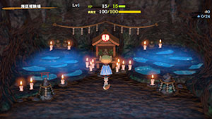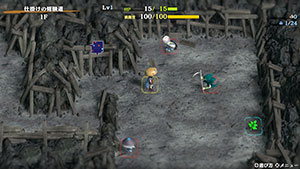

# Overview

<table class="dungeonOverview">
  <tr>
    <th>Unlock</th>
    <td class="highlightYellow">Clear Serpentcoil Island → Check the Jizo Shrine in Underwater Training Ground.</td>
  </tr>
  <tr>
    <th>Entrance</th>
    <td class="highlightYellow">Underwater Training Ground (Jizo Shrine)</td>
  </tr>
</table>

<table class="dungeonTable">
  <tr>
    <th>Floors</th>
    <td colspan="3">20F / 50F (Sacred Tree)</td>
  </tr>
  <tr>
    <th>Bring Items</th>
    <td>Yes</td>
    <th>Stairs</th>
    <td>Descending</td>
  </tr>
  <tr>
    <th>Companions</th>
    <td>Yes</td>
    <th>Roamers</th>
    <td>Yes</td>
  </tr>
  <tr>
    <th>Rescues</th>
    <td>3</td>
    <th>Starting Level</th>
    <td>Lv1</td>
  </tr>
  <tr>
    <th>Starting Item</th>
    <td colspan="3">Large Onigiri</td>
  </tr>
  <tr>
    <th>Unidentified</th>
    <td colspan="3">Equipment, Grass, Staves, Scrolls, Pots</td>
  </tr>
  <tr>
    <th>Shops</th>
    <td>Yes</td>
    <th>Monster Houses</th>
    <td>Yes (Regular, Sudden)</td>
  </tr>
  <tr>
    <th>Behemoths</th>
    <td>Yes</td>
    <th>Wishing Shrines</th>
    <td>Yes</td>
  </tr>
  <tr>
    <th>Kron's Challenge</th>
    <td>Yes</td>
    <th>Fever Time</th>
    <td>Yes</td>
  </tr>
  <tr>
    <th>Initial Enemies</th>
    <td>6~9</td>
    <th>Spawn Rate</th>
    <td>30 Turns</td>
  </tr>
  <tr>
    <th>Wind (1st Gust)</th>
    <td>900 Turns</td>
    <th>Reward</th>
    <td>Auspicious Omamori</td>
  </tr>
</table>

Postgame dungeon where gimmicks and in-dungeon events have a high chance of occurring. Cannons, Kron's Challenge, Fever Time, bouncy walls, Behemoth Gates, flowing water, it's all here. Stronger monsters appear as early as 3F, so the player is expected to bring powerful items. Overall, it's a nice place to visit to duplicate items thanks to the frequency of bouncy wall rooms.

# Navigation

<ul class="quickLinksUL">
  <li><a href="#strategy">Strategy</a>
    <ul>
      <li><a href="#general-advice-(first-clear)">General Advice (First Clear)</a></li>
      <li><a href="#dungeon-gimmicks">Dungeon Gimmicks</a></li>
      <li><a href="#important-items-(first-clear-&-sacred-tree-extension)">Important Items (First Clear & Sacred Tree Extension)</a></li>
      <li><a href="#farming-techniques">Farming Techniques</a></li>
    </ul>
  </li>
  <li><a href="#floor-guide">Floor Guide</a>
    <ul>
      <li><a href="#first-clear">First Clear</a>
        <ul>
          <li><a href="#1-2f">1-2F</a></li>
          <li><a href="#3-5f">3-5F</a></li>
          <li><a href="#6-11f">6-11F</a></li>
          <li><a href="#12-20f">12-20F</a></li>
        </ul>
      </li>
      <li><a href="#sacred-tree-extension">Sacred Tree Extension</a>
        <ul>
          <li><a href="#1-20f">1-20F</a></li>
          <li><a href="#21-50f">21-50F</a></li>
        </ul>
      </li>
    </ul>
  </li>
  <li><a href="#monsters">Monsters</a></li>
  <li><a href="#behemoths">Behemoths</a></li>
  <li><a href="#items">Items</a>
    <ul>
      <li><a href="#weapon">Weapon</a></li>
      <li><a href="#shield">Shield</a></li>
      <li><a href="#bracelet">Bracelet</a></li>
      <li><a href="#projectile">Projectile</a></li>
      <li><a href="#food-(items)">Food</a></li>
      <li><a href="#grass">Grass</a></li>
      <li><a href="#scroll">Scroll</a></li>
      <li><a href="#stave">Staff</a></li>
      <li><a href="#pot">Pot</a></li>
      <li><a href="#incense">Incense</a></li>
    </ul>
  </li>
</ul>

# Strategy

<h3 id="general-advice-(first-clear)" class="heading3Yellow">General Advice (First Clear)</h3>

This dungeon is trivial if you bring powerful items and bracelets that counter specific enemies. The difficulty is perhaps above [Dune of Batsu](/dungeons/dune-of-batsu), since stronger monsters appear earlier on. Threats include Fencer (6-11F), Terror Scorpion (6-9F), Mudster (6-11F), and Curse Matron (14-20F). Reach 10 strength and equip Monster-find + Cleansing / Rustproof / Affixing / Cursebreak bracelets, switching the second bracelet out depending on the opponent (or bring some Sealing Staves).

Cannons lack power against most non-behemoth monsters, and can destroy items on the ground. Some foes prioritize manning a cannon instead of chasing Shiren, making it an effective distraction. For flowing water and raft tiles, aim to go with the flow of water instead of against it if possible. Otherwise, you'll probably end up having to fight wave after wave of raft-riding monsters. Wishing Shrine, Fever Time, and Kron's Challenge can provide great benefits, although random. Be sure to bring items that let you dig out wall tiles, along with an item like Item-find Bracelet.

Bouncy Walls are pretty common and Bouncy Bracelet can be found on the ground in this dungeon, so items can be duplicated easily in bouncy wall rooms using that bracelet and an Earthmound Staff. The trick is to make the thrown item bounce off of all 4 sides of the Bouncy Wall Room.

Behemoth Gates have a chance of being generated on all floors except for 1F, 10F, and 20F. It's fine to try for the item drop at first, but consider skipping it once tougher enemies appear. The Behemoth Monster lineup remains the same throughout the entire dungeon.

<h3 id="dungeon-gimmicks" class="heading3Yellow">Dungeon Gimmicks</h3>

This section is just an overview - See [Dungeon Gimmicks](/system/gameplay-basics#dungeon-gimmicks) for complete details.

<h4 id="cannons" class="heading4Yellow">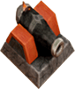 Cannons</h4>

Cannons are stationary objects that can be interacted with inside a room within a dungeon. Perform a normal attack towards a cannon to fire it in the direction you attacked in. Cannons deal fixed damage, break after 5 uses, and can destroy items depending on type. They lack power to defeat tougher enemies, but can be used to slay Behemoth Monsters. Certain monster families will prioritize manning a cannon instead of chasing Shiren.

|Image|Name|Damage|Notes|
|-|-|-|-|
||Cannon|20|Explosion damage, blast hits a 1 tile radius.|
|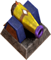|Piercing Cannon|20|1-tile wide, pierces through walls, creatures, Behemoth barriers.|
|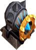|Mega-Piercing Cannon|40|3-tile wide, pierces through walls, creatures, Behemoth barriers.|
|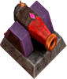|Flamethrower|40|1-tile wide, fire damage, pierces through creatures.|
|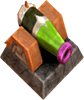|Peach Bun Cannon|-|Transforms a monster (non-Behemoth) into a Peach Bun. The player gains Morphed status when hit by the cannon.|

<h4 id="behemoth-gates" class="heading4Yellow">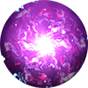 Behemoth Gate</h4>

Behemoth Gates spawn larger (3x3), slower versions of monsters that have far greater attack power. These foes are called  Behemoth Monsters, and have 1 HP aside from Explochin types who have 3 HP. A single rock or projectile is enough to one-shot most types, but they come with a Behemoth Barrier which protects the Behemoth Monster from most attacks coming from the front or side of the Behemoth. Rocks arc over barriers, and attacks with piercing properties like Silver Arrows or Piercing Cannons can be used to successfully strike Behemoth Monsters through their barrier.

Behemoth Gates have a chance of being generated on all floors except for 1F, 10F, and 20F here. The tricky Behemoths are Death Reaper (normal speed), Bashagga (4 attacks), and Bowboy (ranged). Otherwise, none of the other Behemoth Monsters should be notably dangerous to deal with, provided you make use of items like Porky's Rocks or objects like Piercing Cannons.

<h4 id="bouncy-wall-room" class="heading4Yellow">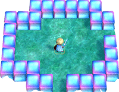 Bouncy Wall Room</h4>

A room containing special blue wall tiles that reflect thrown items back at the player. Throw an item at a wall diagonally and have it bounce off of all 4 sides to duplicate the item. The walls have a decent chance to break each time an item is successfully duplicated, and are guaranteed to break after 10 successful item duplications on the current floor. The duplicated item is a plain (non-upgraded, non-sacred, non-blessed) version of the thrown item, and the item's capacity or quantity is within standard range of what you'd find on the ground. Bouncy Bracelet + Earthmound Staff can make some unsolvable rooms solvable.

<h4 id="flowing-water" class="heading4Yellow">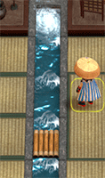 Flowing Water</h4>

A 1-tile wide stream that ends with a whirlpool that warps you back to the start of the stream. Raft tiles (1x1) that often have items or monsters riding them frequently flow downstream, so exploring against the current can result in what feels like an endless horde of enemies. The player can step on a raft to cross to the other side, or ride a raft downstream as well, and most monsters without ranged attacks step off of a raft when they spot the player.

<h4 id="wishing-shrine" class="heading4Yellow">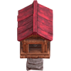 Wishing Shrine</h4>

Object offering 3 wishes, and a Gate of Wishes leading to Tunnel of Wishes opens after a selection. Tunnel of Wishes acts as a bonus zone where the item(s) you wished for can be found on the ground, and the monster table inside Tunnel of Wishes is identical to the floor you were on before entering. Wishing Shrines are usually hidden inside a wall tile (shiny or non-shiny), buried room, or Gitan vault. A chime will sound when a Wishing Shrine is present on a floor if a Shield of Presage is equipped. One 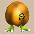 Golden Egg Thing is always generated when a Wishing Shrine is present on a floor.

<b><u>Possible Wishes:</u></b>

- Item Category
    - Weapon, Shield, Bracelet, Arrow / Rock, Food, Scroll, Staff, Incense, Pot, or Gitan.
- Specific Item
    - Preservation Pot, Revival Grass, Blank Scroll, Fixer Scroll, Wallpass Bracelet, Waterwalk Bracelet, Clairvoyant Bracelet, Monster-find Bracelet, or Item-find Bracelet.
- Miscellaneous
    - Identify Items - Identifier Scroll, Identifier Pot, etc.
    - Dig Through Walls - Pickaxe, Burrowing Staff, etc.
    - Increase Strength - Strength Grass, Strength Bracelet, etc.
    - Level Up - Fortune Grass, Angel Seed, etc.
    - Destroy Traps - Pickaxe, Wooden Mallet, Burrowing Staff, Trapseeker, Seewell Grass, etc.
    - Upgrade - Heavenly Scroll, Earthly Scroll, Plating Scroll, Slot-adding Scroll, Rune-eraser Scroll, Silverpurge Scroll, Upgrading Pot, etc.

<h4 id="kron's-challenge-&-fever-time" class="heading4Yellow">Kron's Challenge & Fever Time</h4>

<b><u>Kron's Challenge:</u></b>

Challenges that can occur at random in select postgame dungeons. It begins at the start of a floor, and the player is rewarded if they complete the challenge. The player is still rewarded based on their progress if they advance floors before the challenge ends, but the player usually won't be rewarded if they advance using a Pitfall or Floor-exiting trap. See [Kron's Challenge](/system/gameplay-basics#kron's-challenge) for possible challenges and rewards.

<b><u>Fever Time:</u></b>

Real and limited-time events that can occur at random in select postgame dungeons. When it does randomly trigger, it usually does so when the player is in a room instead of a hallway. There's no penalty for ignoring the event similar to Kron's Challenge, so don't feel pressured to act quickly. You can easily end up getting hit by a nasty special attack or stepping on a trap when in a hurry. See [Fever Time](/system/gameplay-basics#possible-fever-times) for possible fever times and rewards.

<h3 id="important-items-(first-clear-&-sacred-tree-extension)" class="heading3Purple">Important Items (First Clear & Sacred Tree Extension)</h3>

<h4 id="weapon-&-shield" class="heading4Purple">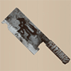 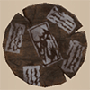 Weapon & Shield</h4>

<b><u>Hunky-dory Shield ( Full Armor)</u></b> The Full Armor shield rune halves damage received when Shiren's current HP = max HP. In this dungeon, it mostly serves as added protection against enemy cannons when Shiren is Lv1. Runes like  HP +20 which increase max HP are also great for early game survival.

<b><u>Yamanba's Cleaver & Yamanba's Potlid (or 2 Strength Grass)</u></b> Methods to start the dungeon with 10+ strength, allowing for 2 bracelets to be equipped. Don't forget to bring a Rejuvenation Pot if you choose to go with Strength Grass, since a Vile Scorpion (3-5F) or Poison Arrow Trap can lower your strength. Alternatively, just keep Cleansing Bracelet equipped at all times.

<b><u>Peach Club ( Peach Bun) or Peach Staff</u></b> Turn Soul Reaper (10-20F) or King Reaper (21-50F) into a Peach Bun to gain wallpass and swift speed. Eating a Peach Bun cures Far-throwing status, so it's nice on Swordsman (6-11F, 21-50F) family floors. Don't forget that Hoppin' Batter (4-7F, 13-17F, 30-50F) family monsters nullify or reflect magic bullets.

<h4 id="weapon-runes" class="heading4Purple"> Weapon Runes</h4>

|Icon|Name|Source|Notes|
|-|-|-|-|
||Rustproof|Golden Sword Plating Scroll|Prevents upgrade value from decreasing due to rust. Raises accuracy of normal attacks by 2.0% (92% → 94%). Mudster (6-11F) and Mudder (21-50F) erase Rustproof first.|
||Frontal Attack|Kama Itachi|Attack 3 forward directions at the same time.|
||Critical|Axe of the Minotaur|30% chance to land a x1.5 damage critical hit.|
||Swift Strikes|Swift Sword|25% chance to attack 2 times in a row (2nd hit has 50% damage).|
||Confusing|Confusion Grass|9% chance to inflict Confused status (20 turns).|
||Sedating|Sedating Grass|9% chance to inflict Asleep status (6 turns).|
||Blinding|Blinding Grass|9% chance to inflict Blind status.|
||Paralyzing|Paralyzing Staff|9% chance to inflict Paralyzed status.|
||Anti-Beast|Primal Axe|Deal x1.5 damage to Beast type monsters. Great Hen (6-11F), Tiger Launcher (21-50F), Gigataur (35-50F), etc.|
||Anti-Draining|Drain Slayer|Deal x1.5 damage to Draining type monsters. Mudster (6-11F), Demon Scorpion (21-39F), Mudder (21-50F), etc.|
||Anti-Ghost|Sickle of Salvation|Deal x1.5 damage to Ghost type monsters. Soul Reaper (10-20F), Pumplord (21-39F), King Reaper (21-50F), etc.|
||Anti-Cyclops|Cyclops Bane|Deal x1.5 damage to Cyclops type monsters. Fulminachin (21-30F), Deathead (35-50F), Detonachin (40-50F), etc.|
||Anti-Floating|Sky Sword|Deal x1.5 damage to Floating type monsters. Soul Reaper (10-20F), King Reaper (21-50F), Pyrepuff (21-50F), etc.|
||HP +20|Life Grass|Increase max HP by 20.|
||HP +15|Healing Grass|Increase max HP by 15.|

<h4 id="shield-runes" class="heading4Purple"> Shield Runes</h4>

|Icon|Name|Source|Notes|
|-|-|-|-|
||Full Armor|Hunky-dory Shield|Reduces damage from any attack by 50% when HP is full.|
||Rustproof|Golden Shield Plating Scroll|Prevents upgrade value from decreasing due to rust. Mudster (6-11F) and Mudder (21-50F) erase Rustproof first.|
||Anti-Dragon|Dragon Shield|Reduces fire and Dragon type normal attack damage by 50%. Flamepuff (3-5F), Blazepuff (9-14F), Pyrepuff (21-50F), etc.|
||Anti-Blast|Blast Shield|Reduces damage from explosions by 50%. Ornery Tank (16-20F), Adamant Tank (21-39F), Steadfast Tank (40-50F), etc.|
||Projectileproof|Kappa's Dish|Roughly 39% chance to dodge enemy projectiles. Metal Ninja B (6-12F), Baby Tank (6-9F), Mini Tank (17-39F).|
||Oracle|Shield of Presage|Chime plays when Wishing Shrine is present. Buried items glow.|
||HP +20|Life Grass|Increase max HP by 20.|
||HP +15|Healing Grass|Increase max HP by 15.|

<h4 id="bracelets" class="heading4Purple"> Bracelets</h4>

<b><u>Monster-find Bracelet</u></b> Hallways are visible so it's not essential, but it's nice to detect nearby off-screen monsters. Handy for Swordsman (6-11F, 21-50F) and Mudkin (6-11F, 21-50F) family floors in particular.

<b><u>Affixing Bracelet, Rustproof Bracelet, Cleansing Bracelet, Cursebreak Bracelet</u></b> Bracelets that block special attacks if one of the major threats becomes adjacent to you.

|Bracelet|Countered Monsters|
|-|-|
|Cleansing Bracelet|Vile Scorpion (3-5F), Terror Scorpion (6-9F), Demon Scorpion (21-39F)|
|Affixing Bracelet|Fencer (6-11F), Battler (21-34F), Swordmaster (35-50F)|
|Rustproof Bracelet|Mudster (6-11F), Mudder (21-50F)|
|Cursebreak Bracelet|Curse Matron (14-20F), Cursenior (21-50F)|

<b><u>Bouncy Bracelet & Earthmound Staff</u></b> These 2 items makes it easier to duplicate items in bouncy wall rooms. The idea is to make unsolvable duplication layouts solvable by creating pillars.

<h4 id="other-items" class="heading4Purple">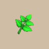 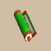  Other Items</h4>

<b><u>Revival Grass, Invincible Grass</u></b> Items that help you survive bad starting rooms, Monster Houses, or other tricky situations.

<b><u>Eradication Scroll</u></b> Throw this at Vile Scorpion (3-5F), Mudster (6-11F), or Fencer (6-11F) if you lack a counter. The floor range for each of these is narrow during the 1st clear, so Sealing Staff might be plenty. However, you'll definitely want an Eradication Scroll during the 2nd clear.

<b><u>Sealing Staff, Paralyzing Staff, Sluggish Staff</u></b> Nice to have on hand to disable a single monster and prevent accidents.

<b><u>Porky's Rock</u></b> Easiest counter for Behemoth Monsters (2-9F, 11-19F, 21-50F).

<h3 id="farming-techniques" class="heading3Green">Farming Techniques</h3>

None of these techniques are necessary since it's a dungeon that allows carry-in items.

<h4 id="igneous-hunting-(3-5f)" class="heading4Green"> Igneous Hunting (3-5F)</h4>

Fierous types level up when hit by flames, and Blazeous (3-5F) & Flamepuff (3-5F) overlap. Easiest methods: Peach Club ( Peach Bun), Peach Staff, or Kajin Fuuma ( Flame Shot). Hit a Blazeous (Lv2) with fire damage using Flamepuff Bun or Flame Shot, then slay it for 999 exp. Igneous (Lv3) has 165 HP and 56 attack, so you'll probably want a shield strength of at least 60. Infernous (Lv4) provides 1,999 exp, but might be too tough with 285 HP and 69 attack.

<h4 id="mudster-/-mudder-hunting-(6-11f)" class="heading4Green">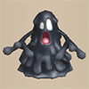 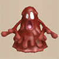 Mudster / Mudder Hunting (6-11F)</h4>

Unequip your weapon and shield → punch Lv3 Mudsters (or Lv4 Mudders) to make them multiply. Seal off the stairs room using Paralyzing or Earthmound staves, and stand on the stairs. It's recommended to bring a Fortune Staff or such if you want to hunt Lv4 Mudders. Mudster provides 460 experience points, and Mudder 920 experience points.

<h4 id="chow-bun-(6-20f)" class="heading4Green"> Chow Bun (6-20F)</h4>

Chow appears on 6-20F, so stock up on Chow Buns for Sacred Item farming in Isle of the Mighty. However, this is mainly only notable for players who haven't purchased the DLC. See [Isle of the Mighty](/dungeons/isle-of-the-mighty) for details.

# Floor Guide

<h3 id="first-clear" class="heading3Yellow">First Clear</h3>

### General Advice (Bringing Items)

An upgraded weapon and shield & Cleansing + Affixing + Rustproof bracelets nearly ensures a win. The only threats against strong gear are Lv2-3 scorpions (3-9F), Fencer (6-11F), and Mudster (6-11F). Curse Matron (14-20F) curses your equipped weapon, shield, or bracelets, but it's not bad here, since Curse Matron doesn't overlap with Scorpion, Swordsman, or Mudkin family monsters. ※ Returning to Shukuba Beach auto-removes all curses from inventory items.

### 1-2F

Behemoth Gates have a chance of being generated on 2F. B-Bowboy can catch you off guard if you get lazy about using the Look Around command, but otherwise most other Behemoth Monsters here can only attack when adjacent. Don't risk a missed rock throw if a Behemoth Monster is adjacent and can act after you, especially when your Max HP is still very low due to being so early in the dungeon.

Regular cannons can one-shot you by dealing 20 damage without the  Anti-Blast rune, so linger in the starting room until Max HP reaches 21+ if you lack  Full Armor,  HP +20, etc. Shagga, Octopling, Hat Urchin, and Death Reaper are the only monsters that spawn on 1-2F. None of them are a threat with strong gear, but level up a bit before descending to 3F.

#### Monster Stats (1-2F)

|Floor|Monster|HP|Atk|Def|Exp|Type|
|-|-|-|-|-|-|-|
|1-2|Shagga|18|6|4|12|Dragon|
|1-2|Octopling|14|4|6|4|Aquatic|
|1-2|Hat Urchin|16|5|3|10|Cyclops|
|1-2|Death Reaper|22|6|5|9|Ghost/Floating|

### 3-5F

Behemoth Gates have a chance of being generated on 3-5F. Be careful near B-Bowboy and higher level adjacent attackers like B-Bashagga.

Some stronger Lv2 monsters appear, along with lesser threats like Mid Chintala. At this point, your gear and level should be good enough to slay these monsters in 1-2 hits. If you're worried about Tiger Thrower family monsters causing accidents in this dungeon, bring a Sumo Onigiri to activate Sumo status which nullifies its special attack.

Cursister (3-5F) curses your equipped weapon or shield, but not bracelets. Vile Scorpion (3-5F) occasionally lowers current strength by 2 when adjacent. Blazeous (3-5F) is immune to projectiles and thrown items that lack piercing properties. Pumpanshee (3-5F) passes through walls and has a somewhat random movement pattern. Tiger Hurler (3-5F) throws creatures within a 10 tile radius, including Shiren onto a visible trap. Overall, none of these monsters should be particularly threatening or notable yet.

#### Monster Stats (3-5F)

|Floor|Monster|HP|Atk|Def|Exp|Type|
|-|-|-|-|-|-|-|
|3-5|Mid Chintala|45|23|10|27|Beast|
|3-5|Blazeous|92|36|24|150|Normal|
|3-5|Zapdon|80|43|35|105|Metal|
|3-5|Flamepuff|50|25|20|175|Dragon/Floating|
|3-5|Tiger Hurler|135|50|45|800|Beast|
|3-5|Cursister|115|38|38|380|Normal|
|3-5|Vile Scorpion|108|45|33|500|Draining|
|3-5|Pumpanshee|60|35|22|250|Ghost/Floating|
|3-5|Master Hen|70|33|21|400|Beast|
|3-5|Fresh Octopling|60|19|14|55|Aquatic|
|4-7|Hoppin' Hitter|32|22|15|34|Normal|

### 6-11F

Behemoth Gates have a chance of being generated on 6-9F and 11F. There's not much to say about Behemoth Monsters that hasn't already been said.

The primary Danger Zone of this dungeon, at least for the first clear depth. Terror Scorpion (6-9F), Mudster (6-11F), and Fencer (6-11F) all overlap for a short while, and Chow (6-20F) also appears, so there's risk of a different monster randomly leveling up. Swap between Cleansing, Rustproof, and Affixing bracelets as needed to protect gear and stats. 10F is always a Shuffle Dungeon style map similar to Sozoro Bay - don't use Handy Dash.

Terror Scorpion (6-9F) occasionally lowers Max Strength by 1 when adjacent. Great Hen (6-11F) has Swift 1 action speed, but only attacks the player when adjacent. Mudster (6-11F) lowers upgrade value or erases 1 rune from your equipped weapon or shield. Fencer (6-11F) disarms your equipped weapon or shield, but can't disarm bracelets. Bellthoven (6-20F) summons up to 3 monsters in a single use of its special attack. Soul Reaper (10-20F) passes through walls and has Swift 2 action speed.

#### Monster Stats (6-11F)

|Floor|Monster|HP|Atk|Def|Exp|Type|
|-|-|-|-|-|-|-|
|4-7|Hoppin' Hitter|32|22|15|34|Normal|
|6-9|Pumplich|100|50|30|800|Ghost/Floating|
|6-9|Baby Tank|85|40|30|450|Normal|
|6-9|Captain Ant|110|55|39|440|Normal|
|6-9|Terror Scorpion|185|55|45|900|Draining|
|6-11|Fencer|140|49|48|1000|Normal|
|6-11|Mudster|140|35|43|460|Draining/Aquatic|
|6-11|Great Hen|120|55|40|800|Beast|
|6-12|Fire Ninja B|105|56|39|500|Normal|
|6-12|Tree Ninja B|145|47|43|688|Normal|
|6-12|Earth Ninja B|155|52|38|780|Normal|
|6-12|Metal Ninja B|125|50|40|444|Normal|
|6-12|Water Ninja B|120|45|39|400|Normal|
|6-20|Chow|20|1|1|5|Floating|
|6-20|Bellthoven|150|45|45|1111|Normal|
|6-20|Concusschin|160|35|27|110|Exploding/Cyclops/Aquatic|
|9-14|Blazepuff|135|55|35|1050|Dragon/Floating|
|10-20|Igneous|165|56|45|999|Normal|
|10-20|Soul Reaper|75|40|40|555|Ghost/Floating|
|11-16|Tiger Chucker|155|60|55|1800|Beast|

### 12-20F

Behemoth Gates have a chance of being generated on 12-19F. Don't get overconfident and throw rocks when adjacent to B-Bashagga - it'll hurt if you miss. Depending on shield strength, you might have enough HP to survive a B-Bowboy's arrow now.

Chow is still around, but this floor range is usually easier than 6-11F if your equipment is strong. Ornery Tank (16-20F) overlaps with Igneous (10-20F) and Concusschin (6-20F) on 16-20F. Igneous multiplies when it gets hit by an explosion, and Concusschin immediately explodes. Cursed gear isn't an issue for the first clear now, so don't worry about Curse Matron (14-20F).

#### Monster Stats (12-20F)

|Floor|Monster|HP|Atk|Def|Exp|Type|
|-|-|-|-|-|-|-|
|6-12|Fire Ninja B|105|56|39|500|Normal|
|6-12|Tree Ninja B|145|47|43|688|Normal|
|6-12|Earth Ninja B|155|52|38|780|Normal|
|6-12|Metal Ninja B|125|50|40|444|Normal|
|6-12|Water Ninja B|120|45|39|400|Normal|
|6-20|Chow|20|1|1|5|Floating|
|6-20|Bellthoven|150|45|45|1111|Normal|
|6-20|Concusschin|160|35|27|110|Exploding/Cyclops/Aquatic|
|9-14|Blazepuff|135|55|35|1050|Dragon/Floating|
|10-20|Igneous|165|56|45|999|Normal|
|10-20|Soul Reaper|75|40|40|555|Ghost/Floating|
|11-16|Tiger Chucker|155|60|55|1800|Beast|
|13-17|Hoppin' Slugger|72|39|31|400|Normal|
|14-20|Clapdon|195|73|55|1888|Metal|
|14-20|Curse Matron|145|53|48|1060|Normal|
|16-20|Ornery Tank|95|40|44|1500|Metal/Exploding|
|17-20|Mini Tank|100|55|40|800|Normal|

<h3 id="sacred-tree-extension" class="heading3Pink">Sacred Tree Extension</h3>

<h3 id="general-advice-(sacred-tree-extension)" class="heading3Red">General Advice (Bringing Items)</h3>

Unlike the first clear, you'll want to avoid getting bracelets cursed by Curse Matron (14-20F), since Demon Scorpion (21-39F), Battler (21-34F), Swordmaster (35-50F), and Mudder (21-50F) overlap. Cursenior (21-50F) also appears, so expect to constantly have to swap around equipped bracelets. The bracelets that counter these monsters are Cleansing, Affixing, Rustproof, and Cursebreak. Eradication Scroll knocks out one of the major threats, making things slightly less tedious.

Some players like to keep Wallpass Bracelet equipped instead of swapping bracelets, but Adamant Tank (21-39) and Steadfast Tank (40-50F) can expose you even if you're inside a wall, so the Wallpass Bracelet route isn't recommended over properly countering the threats.

Tiger Launcher (21-50F), Showpin (21-50F), and Okina Monk A (31-39F) can cause accidents, since their abilities either force enemies to become adjacent or summon additional foes. Extreme threats like Abyss Dragon and Frenzy Radish don't appear at all, thankfully.

<h3 id="1-20f" class="heading3Red">1-20F</h3>

Behemoth Gates have a chance of being generated on 2-9F and 11-19F. Dangerous Behemoths include B-Death Reaper, B-Gigataur, B-Lashagga, B-Bashagga, and B-Bowboy. When it doubt, use the Look Around command to check if a distant Behemoth is B-Bowboy.

Same advice as the [first clear](#first-clear), but avoid getting bracelets cursed by Curse Matron (14-20F). Beware of cannons at the start if you lack  Full Armor,  Anti-Blast,  Anti-Dragon,  HP +20, etc. Go ahead and eat 2 Strength Grass (or otherwise activate the ability to equip 2 bracelets) right away, since it will be a significant help between 6-11F and later on between 21-50F.

<h4 id="monster-stats-(1-20f)" class="heading4Red">Monster Stats (1-20F)</h4>

|Floor|Monster|HP|Atk|Def|Exp|Type|
|-|-|-|-|-|-|-|
|1-2|Shagga|18|6|4|12|Dragon|
|1-2|Octopling|14|4|6|4|Aquatic|
|1-2|Hat Urchin|16|5|3|10|Cyclops|
|1-2|Death Reaper|22|6|5|9|Ghost/Floating|
|3-5|Mid Chintala|45|23|10|27|Beast|
|3-5|Blazeous|92|36|24|150|Normal|
|3-5|Zapdon|80|43|35|105|Metal|
|3-5|Flamepuff|50|25|20|175|Dragon/Floating|
|3-5|Tiger Hurler|135|50|45|800|Beast|
|3-5|Cursister|115|38|38|380|Normal|
|3-5|Vile Scorpion|108|45|33|500|Draining|
|3-5|Pumpanshee|60|35|22|250|Ghost/Floating|
|3-5|Master Hen|70|33|21|400|Beast|
|3-5|Fresh Octopling|60|19|14|55|Aquatic|
|4-7|Hoppin' Hitter|32|22|15|34|Normal|
|6-9|Pumplich|100|50|30|800|Ghost/Floating|
|6-9|Baby Tank|85|40|30|450|Normal|
|6-9|Captain Ant|110|55|39|440|Normal|
|6-9|Terror Scorpion|185|55|45|900|Draining|
|6-11|Fencer|140|49|48|1000|Normal|
|6-11|Mudster|140|35|43|460|Draining/Aquatic|
|6-11|Great Hen|120|55|40|800|Beast|
|6-12|Fire Ninja B|105|56|39|500|Normal|
|6-12|Tree Ninja B|145|47|43|688|Normal|
|6-12|Earth Ninja B|155|52|38|780|Normal|
|6-12|Metal Ninja B|125|50|40|444|Normal|
|6-12|Water Ninja B|120|45|39|400|Normal|
|6-20|Chow|20|1|1|5|Floating|
|6-20|Bellthoven|150|45|45|1111|Normal|
|6-20|Concusschin|160|35|27|110|Exploding/Cyclops/Aquatic|
|9-14|Blazepuff|135|55|35|1050|Dragon/Floating|
|10-20|Igneous|165|56|45|999|Normal|
|10-20|Soul Reaper|75|40|40|555|Ghost/Floating|
|11-16|Tiger Chucker|155|60|55|1800|Beast|
|13-17|Hoppin' Slugger|72|39|31|400|Normal|
|14-20|Clapdon|195|73|55|1888|Metal|
|14-20|Curse Matron|145|53|48|1060|Normal|
|16-20|Ornery Tank|95|40|44|1500|Metal/Exploding|
|17-39|Mini Tank|100|55|40|800|Normal|

<h3 id="21-50f" class="heading3Red">21-50F</h3>

Behemoth Gates have a chance of being generated on 21-50F. That's right, Behemoth Gates can spawn even on the final floor, unlike most other dungeons. The Behemoth Monster lineup is the same, so B-Bowboy is still the only notable ranged attacker.

The Danger Zone of the Sacred Tree Extension, for similar reasons to 6-11F during the 1st clear. Most monsters in this floor range have 200+ HP and maybe an average of 65-70+ Attack Power, but these extension floors still shouldn't be too bad if you have a fully upgraded weapon and shield. Demon Scorpion (21-39F), Lv3-4 Swordsman (21-50F), Mudder (21-50F), and Cursenior (21-50F) overlap, and Tiger Launcher (21-50F), Showpin (21-50F), and Okina Monk A (31-39F) can complicate situations. Adamant Tank (21-39) and Steadfast Tank (40-50F) shoot cannonballs even if you're in a wall tile.

The best Eradication Scroll target includes Scorpion, Swordsman, Mudkin, or Curse Girl families, since it means there will be one fewer monster families you need to swap bracelets around for. Swap between Cleansing, Affixing, Rustproof, and Cursebreak bracelets to counter the above. Sumo Onigiri can be used to counter Tiger Launcher, but Showpin and Okina Monk A are trickier. Side note, but this is also a rare postgame dungeon where the final floor's BGM isn't the same as 1F.

<h4 id="monster-stats-(21-50f)" class="heading4Red">Monster Stats (21-50F)</h4>

|Floor|Monster|HP|Atk|Def|Exp|Type|
|-|-|-|-|-|-|-|
|17-39|Mini Tank|100|55|40|800|Normal|
|21-30|Fulminachin|200|45|32|440|Exploding/Cyclops/Aquatic|
|21-34|Battler|200|69|50|1200|Normal|
|21-39|Boomdon|285|93|65|2999|Metal|
|21-39|Pumplord|185|75|35|1850|Ghost/Floating|
|21-39|Adamant Tank|100|60|54|2500|Metal/Exploding|
|21-39|Demon Scorpion|295|73|55|1350|Draining|
|21-50|Mudder|145|45|53|920|Draining/Aquatic|
|21-50|Showpin|250|55|55|1555|Normal|
|21-50|Pyrepuff|255|75|45|1550|Dragon/Floating|
|21-50|Infernous|285|69|55|1999|Normal|
|21-50|Cursenior|205|65|58|1360|Normal|
|21-50|General Ant|125|76|49|880|Normal|
|21-50|King Reaper|225|65|50|1555|Ghost/Floating|
|21-50|Tiger Launcher|255|83|65|2800|Beast|
|30-50|Hoppin' Slammer|125|49|49|820|Normal|
|31-39|Okina Monk A|270|76|60|1400|Normal|
|35-50|Gigataur|235|85|62|1790|Beast|
|35-50|Deathead|282|99|60|2350|Cyclops|
|35-50|Swordmaster|250|77|55|1400|Normal|
|36-39 45-50|Kitsune Monk A|275|73|58|1380|Normal|
|40-44|Okame Monk A|260|70|61|1400|Normal|
|40-44|Hannya Monk A|266|67|55|1400|Normal|
|40-50|Detonachin|260|55|37|1440|Exploding/Cyclops/Aquatic|
|40-50|Steadfast Tank|105|80|64|3500|Metal/Exploding|

# Monsters

<button id="hideMonTblImgBtn" onClick={()=>{var mon_imgs = document.querySelectorAll('#monsterTable img');mon_imgs.forEach(e => e.classList.toggle('hidden'));}}>Toggle Monster Images</button>

See [Monsters](/system/monsters) for individual monster details.

- F - Dark hallways
- S - Shop is possible
- M - Monster House is possible
- W - Wishing Shrine is possible
- B - Behemoth Gate is possible

Monster Colors = Farming, Useful, Lowers Stats, Targets Items, Dangerous

<table id="monsterTable" class="monsterTable">
  <thead>
    <tr>
      <th>F</th>
      <th>S</th>
      <th>M</th>
      <th>W</th>
      <th colspan="5">Monsters</th>
      <th>B</th>
    </tr>
  </thead>
  <tbody>
    <tr>
      <td class="centeredText">1</td>
      <td class=""></td>
      <td class=""></td>
      <td class=""></td>
      <td> Hat Urchin</td>
      <td>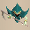 Death Reaper</td>
      <td>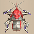 Shagga</td>
      <td> Octopling</td>
      <td class="highlightGray"></td>
      <td class=""></td>
    </tr>
    <tr>
      <td colspan="10" class="tableDivider"></td>
    </tr>
    <tr>
      <td class="centeredText">2</td>
      <td class=""></td>
      <td class=""></td>
      <td class=""></td>
      <td> Hat Urchin</td>
      <td> Death Reaper</td>
      <td> Shagga</td>
      <td> Octopling</td>
      <td class="highlightGray"></td>
      <td class="highlightBehemoth"></td>
    </tr>
    <tr>
      <td colspan="10" class="tableDivider"></td>
    </tr>
    <tr>
      <td rowspan="2" class="centeredText">3</td>
      <td rowspan="2" class=""></td>
      <td rowspan="2" class="highlightMH"></td>
      <td rowspan="2" class=""></td>
      <td> Mid Chintala</td>
      <td> Blazeous</td>
      <td>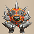 Zapdon</td>
      <td> Flamepuff</td>
      <td> Tiger Hurler</td>
      <td rowspan="2" class="highlightBehemoth"></td>
    </tr>
    <tr>
      <td class="items">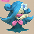 Cursister</td>
      <td class="stats">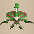 Vile Scorpion</td>
      <td> Pumpanshee</td>
      <td>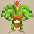 Master Hen</td>
      <td> Fresh Octopling</td>
    </tr>
    <tr>
      <td colspan="10" class="tableDivider"></td>
    </tr>
    <tr>
      <td rowspan="3" class="centeredText">4</td>
      <td rowspan="3" class=""></td>
      <td rowspan="3" class=""></td>
      <td rowspan="3" class=""></td>
      <td> Mid Chintala</td>
      <td> Blazeous</td>
      <td> Zapdon</td>
      <td> Flamepuff</td>
      <td> Tiger Hurler</td>
      <td rowspan="3" class="highlightBehemoth"></td>
    </tr>
    <tr>
      <td class="items"> Cursister</td>
      <td class="stats"> Vile Scorpion</td>
      <td> Pumpanshee</td>
      <td> Master Hen</td>
      <td> Fresh Octopling</td>
    </tr>
    <tr>
      <td> Hoppin' Hitter</td>
      <td class="highlightGray"></td>
      <td class="highlightGray"></td>
      <td class="highlightGray"></td>
      <td class="highlightGray"></td>
    </tr>
    <tr>
      <td colspan="10" class="tableDivider"></td>
    </tr>
    <tr>
      <td rowspan="3" class="centeredText">5</td>
      <td rowspan="3" class=""></td>
      <td rowspan="3" class=""></td>
      <td rowspan="3" class=""></td>
      <td> Mid Chintala</td>
      <td> Blazeous</td>
      <td> Zapdon</td>
      <td> Flamepuff</td>
      <td> Tiger Hurler</td>
      <td rowspan="3" class="highlightBehemoth"></td>
    </tr>
    <tr>
      <td class="items"> Cursister</td>
      <td class="stats"> Vile Scorpion</td>
      <td> Pumpanshee</td>
      <td> Master Hen</td>
      <td> Fresh Octopling</td>
    </tr>
    <tr>
      <td> Hoppin' Hitter</td>
      <td class="highlightGray"></td>
      <td class="highlightGray"></td>
      <td class="highlightGray"></td>
      <td class="highlightGray"></td>
    </tr>
    <tr>
      <td colspan="10" class="tableDivider"></td>
    </tr>
    <tr>
      <td rowspan="4" class="centeredText">6</td>
      <td rowspan="4" class=""></td>
      <td rowspan="4" class=""></td>
      <td rowspan="4" class=""></td>
      <td> Baby Tank</td>
      <td class="items"> Mudster</td>
      <td class="stats"> Terror Scorpion</td>
      <td> Pumplich</td>
      <td class="items"> Fencer</td>
      <td rowspan="4" class="highlightBehemoth"></td>
    </tr>
    <tr>
      <td> Great Hen</td>
      <td> Concusschin</td>
      <td>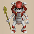 Captain Ant</td>
      <td class="farming"> Chow</td>
      <td class="danger"> Bellthoven</td>
    </tr>
    <tr>
      <td class="items"> Fire Ninja B</td>
      <td class="items"> Water Ninja B</td>
      <td> Tree Ninja B</td>
      <td> Metal Ninja B</td>
      <td> Earth Ninja B</td>
    </tr>
    <tr>
      <td> Hoppin' Hitter</td>
      <td class="highlightGray"></td>
      <td class="highlightGray"></td>
      <td class="highlightGray"></td>
      <td class="highlightGray"></td>
    </tr>
    <tr>
      <td colspan="10" class="tableDivider"></td>
    </tr>
    <tr>
      <td rowspan="4" class="centeredText">7</td>
      <td rowspan="4" class=""></td>
      <td rowspan="4" class=""></td>
      <td rowspan="4" class=""></td>
      <td> Baby Tank</td>
      <td class="items"> Mudster</td>
      <td class="stats"> Terror Scorpion</td>
      <td> Pumplich</td>
      <td class="items"> Fencer</td>
      <td rowspan="4" class="highlightBehemoth"></td>
    </tr>
    <tr>
      <td> Great Hen</td>
      <td> Concusschin</td>
      <td> Captain Ant</td>
      <td class="farming"> Chow</td>
      <td class="danger"> Bellthoven</td>
    </tr>
    <tr>
      <td class="items"> Fire Ninja B</td>
      <td class="items"> Water Ninja B</td>
      <td> Tree Ninja B</td>
      <td> Metal Ninja B</td>
      <td> Earth Ninja B</td>
    </tr>
    <tr>
      <td> Hoppin' Hitter</td>
      <td class="highlightGray"></td>
      <td class="highlightGray"></td>
      <td class="highlightGray"></td>
      <td class="highlightGray"></td>
    </tr>
    <tr>
      <td colspan="10" class="tableDivider"></td>
    </tr>
    <tr>
      <td rowspan="3" class="centeredText">8</td>
      <td rowspan="3" class=""></td>
      <td rowspan="3" class=""></td>
      <td rowspan="3" class=""></td>
      <td> Baby Tank</td>
      <td class="items"> Mudster</td>
      <td class="stats"> Terror Scorpion</td>
      <td> Pumplich</td>
      <td class="items"> Fencer</td>
      <td rowspan="3" class="highlightBehemoth"></td>
    </tr>
    <tr>
      <td> Great Hen</td>
      <td> Concusschin</td>
      <td> Captain Ant</td>
      <td class="farming"> Chow</td>
      <td class="danger"> Bellthoven</td>
    </tr>
    <tr>
      <td class="items"> Fire Ninja B</td>
      <td class="items"> Water Ninja B</td>
      <td> Tree Ninja B</td>
      <td> Metal Ninja B</td>
      <td> Earth Ninja B</td>
    </tr>
    <tr>
      <td colspan="10" class="tableDivider"></td>
    </tr>
    <tr>
      <td rowspan="4" class="centeredText">9</td>
      <td rowspan="4" class=""></td>
      <td rowspan="4" class=""></td>
      <td rowspan="4" class=""></td>
      <td>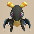 Blazepuff</td>
      <td> Baby Tank</td>
      <td class="items"> Mudster</td>
      <td class="stats"> Terror Scorpion</td>
      <td> Pumplich</td>
      <td rowspan="4" class="highlightBehemoth"></td>
    </tr>
    <tr>
      <td class="items"> Fencer</td>
      <td> Great Hen</td>
      <td> Concusschin</td>
      <td> Captain Ant</td>
      <td class="farming"> Chow</td>
    </tr>
    <tr>
      <td class="danger"> Bellthoven</td>
      <td class="items"> Fire Ninja B</td>
      <td class="items"> Water Ninja B</td>
      <td> Tree Ninja B</td>
      <td> Metal Ninja B</td>
    </tr>
    <tr>
      <td> Earth Ninja B</td>
      <td class="highlightGray"></td>
      <td class="highlightGray"></td>
      <td class="highlightGray"></td>
      <td class="highlightGray"></td>
    </tr>
    <tr>
      <td colspan="10" class="tableDivider"></td>
    </tr>
    <tr>
      <td rowspan="3" class="centeredText">10</td>
      <td rowspan="3" class=""></td>
      <td rowspan="3" class=""></td>
      <td rowspan="3" class=""></td>
      <td> Igneous</td>
      <td> Blazepuff</td>
      <td class="items"> Mudster</td>
      <td> Soul Reaper</td>
      <td class="items"> Fencer</td>
      <td rowspan="3" class=""></td>
    </tr>
    <tr>
      <td> Great Hen</td>
      <td> Concusschin</td>
      <td class="farming"> Chow</td>
      <td class="danger"> Bellthoven</td>
      <td class="items"> Fire Ninja B</td>
    </tr>
    <tr>
      <td class="items"> Water Ninja B</td>
      <td> Tree Ninja B</td>
      <td> Metal Ninja B</td>
      <td> Earth Ninja B</td>
      <td class="highlightGray"></td>
    </tr>
    <tr>
      <td colspan="10" class="tableDivider"></td>
    </tr>
    <tr>
      <td rowspan="3" class="centeredText">11</td>
      <td rowspan="3" class=""></td>
      <td rowspan="3" class=""></td>
      <td rowspan="3" class=""></td>
      <td> Igneous</td>
      <td> Blazepuff</td>
      <td>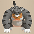 Tiger Chucker</td>
      <td class="items"> Mudster</td>
      <td> Soul Reaper</td>
      <td rowspan="3" class="highlightBehemoth"></td>
    </tr>
    <tr>
      <td class="items"> Fencer</td>
      <td> Great Hen</td>
      <td> Concusschin</td>
      <td class="farming"> Chow</td>
      <td class="danger"> Bellthoven</td>
    </tr>
    <tr>
      <td class="items"> Fire Ninja B</td>
      <td class="items"> Water Ninja B</td>
      <td> Tree Ninja B</td>
      <td> Metal Ninja B</td>
      <td> Earth Ninja B</td>
    </tr>
    <tr>
      <td colspan="10" class="tableDivider"></td>
    </tr>
    <tr>
      <td rowspan="3" class="centeredText">12</td>
      <td rowspan="3" class=""></td>
      <td rowspan="3" class=""></td>
      <td rowspan="3" class=""></td>
      <td> Igneous</td>
      <td> Blazepuff</td>
      <td> Tiger Chucker</td>
      <td> Soul Reaper</td>
      <td> Concusschin</td>
      <td rowspan="3" class="highlightBehemoth"></td>
    </tr>
    <tr>
      <td class="farming"> Chow</td>
      <td class="danger"> Bellthoven</td>
      <td class="items"> Fire Ninja B</td>
      <td class="items"> Water Ninja B</td>
      <td> Tree Ninja B</td>
    </tr>
    <tr>
      <td> Metal Ninja B</td>
      <td> Earth Ninja B</td>
      <td class="highlightGray"></td>
      <td class="highlightGray"></td>
      <td class="highlightGray"></td>
    </tr>
    <tr>
      <td colspan="10" class="tableDivider"></td>
    </tr>
    <tr>
      <td rowspan="2" class="centeredText">13</td>
      <td rowspan="2" class=""></td>
      <td rowspan="2" class=""></td>
      <td rowspan="2" class=""></td>
      <td> Igneous</td>
      <td> Blazepuff</td>
      <td> Tiger Chucker</td>
      <td> Soul Reaper</td>
      <td> Concusschin</td>
      <td rowspan="2" class="highlightBehemoth"></td>
    </tr>
    <tr>
      <td class="farming"> Chow</td>
      <td class="danger"> Bellthoven</td>
      <td>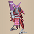 Hoppin' Slugger</td>
      <td class="highlightGray"></td>
      <td class="highlightGray"></td>
    </tr>
    <tr>
      <td colspan="10" class="tableDivider"></td>
    </tr>
    <tr>
      <td rowspan="2" class="centeredText">14</td>
      <td rowspan="2" class=""></td>
      <td rowspan="2" class=""></td>
      <td rowspan="2" class=""></td>
      <td> Igneous</td>
      <td> Clapdon</td>
      <td> Blazepuff</td>
      <td> Tiger Chucker</td>
      <td class="items"> Curse Matron</td>
      <td rowspan="2" class="highlightBehemoth"></td>
    </tr>
    <tr>
      <td> Soul Reaper</td>
      <td> Concusschin</td>
      <td class="farming"> Chow</td>
      <td class="danger"> Bellthoven</td>
      <td> Hoppin' Slugger</td>
    </tr>
    <tr>
      <td colspan="10" class="tableDivider"></td>
    </tr>
    <tr>
      <td rowspan="2" class="centeredText">15</td>
      <td rowspan="2" class=""></td>
      <td rowspan="2" class=""></td>
      <td rowspan="2" class=""></td>
      <td> Igneous</td>
      <td> Clapdon</td>
      <td> Tiger Chucker</td>
      <td class="items"> Curse Matron</td>
      <td> Soul Reaper</td>
      <td rowspan="2" class="highlightBehemoth"></td>
    </tr>
    <tr>
      <td> Concusschin</td>
      <td class="farming"> Chow</td>
      <td class="danger"> Bellthoven</td>
      <td> Hoppin' Slugger</td>
      <td class="highlightGray"></td>
    </tr>
    <tr>
      <td colspan="10" class="tableDivider"></td>
    </tr>
    <tr>
      <td rowspan="2" class="centeredText">16</td>
      <td rowspan="2" class=""></td>
      <td rowspan="2" class=""></td>
      <td rowspan="2" class=""></td>
      <td> Igneous</td>
      <td> Ornery Tank</td>
      <td> Clapdon</td>
      <td> Tiger Chucker</td>
      <td class="items"> Curse Matron</td>
      <td rowspan="2" class="highlightBehemoth"></td>
    </tr>
    <tr>
      <td> Soul Reaper</td>
      <td> Concusschin</td>
      <td class="farming"> Chow</td>
      <td class="danger"> Bellthoven</td>
      <td> Hoppin' Slugger</td>
    </tr>
    <tr>
      <td colspan="10" class="tableDivider"></td>
    </tr>
    <tr>
      <td rowspan="2" class="centeredText">17</td>
      <td rowspan="2" class=""></td>
      <td rowspan="2" class=""></td>
      <td rowspan="2" class=""></td>
      <td> Igneous</td>
      <td> Ornery Tank</td>
      <td> Clapdon</td>
      <td>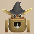 Mini Tank</td>
      <td class="items"> Curse Matron</td>
      <td rowspan="2" class="highlightBehemoth"></td>
    </tr>
    <tr>
      <td> Soul Reaper</td>
      <td> Concusschin</td>
      <td class="farming"> Chow</td>
      <td class="danger"> Bellthoven</td>
      <td> Hoppin' Slugger</td>
    </tr>
    <tr>
      <td colspan="10" class="tableDivider"></td>
    </tr>
    <tr>
      <td rowspan="2" class="centeredText">18</td>
      <td rowspan="2" class=""></td>
      <td rowspan="2" class=""></td>
      <td rowspan="2" class=""></td>
      <td> Igneous</td>
      <td> Ornery Tank</td>
      <td> Clapdon</td>
      <td> Mini Tank</td>
      <td class="items"> Curse Matron</td>
      <td rowspan="2" class="highlightBehemoth"></td>
    </tr>
    <tr>
      <td> Soul Reaper</td>
      <td> Concusschin</td>
      <td class="farming"> Chow</td>
      <td class="danger"> Bellthoven</td>
      <td class="highlightGray"></td>
    </tr>
    <tr>
      <td colspan="10" class="tableDivider"></td>
    </tr>
    <tr>
      <td rowspan="2" class="centeredText">19</td>
      <td rowspan="2" class=""></td>
      <td rowspan="2" class=""></td>
      <td rowspan="2" class=""></td>
      <td> Igneous</td>
      <td> Ornery Tank</td>
      <td> Clapdon</td>
      <td> Mini Tank</td>
      <td class="items"> Curse Matron</td>
      <td rowspan="2" class="highlightBehemoth"></td>
    </tr>
    <tr>
      <td> Soul Reaper</td>
      <td> Concusschin</td>
      <td class="farming"> Chow</td>
      <td class="danger"> Bellthoven</td>
      <td class="highlightGray"></td>
    </tr>
    <tr>
      <td colspan="10" class="tableDivider"></td>
    </tr>
    <tr>
      <td rowspan="2" class="centeredText">20</td>
      <td rowspan="2" class=""></td>
      <td rowspan="2" class=""></td>
      <td rowspan="2" class=""></td>
      <td> Igneous</td>
      <td> Ornery Tank</td>
      <td> Clapdon</td>
      <td> Mini Tank</td>
      <td class="items"> Curse Matron</td>
      <td rowspan="2" class=""></td>
    </tr>
    <tr>
      <td> Soul Reaper</td>
      <td> Concusschin</td>
      <td class="farming"> Chow</td>
      <td class="danger"> Bellthoven</td>
      <td class="highlightGray"></td>
    </tr>
    <tr>
      <td colspan="10" class="tableDivider"></td>
    </tr>
    <tr>
      <td class="monsterTableExtension"></td>
      <td colspan="3" class="monsterTableExtension"></td>
      <td colspan="5" class="monsterTableExtension centeredText">Sacred Tree Mode</td>
      <td class="monsterTableExtension"></td>
    </tr>
    <tr>
      <td colspan="10" class="tableDivider"></td>
    </tr>
    <tr>
      <td rowspan="3" class="centeredText">21</td>
      <td rowspan="3" class=""></td>
      <td rowspan="3" class=""></td>
      <td rowspan="3" class=""></td>
      <td>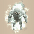 Infernous</td>
      <td class="danger"> Adamant Tank</td>
      <td>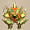 Boomdon</td>
      <td> Pyrepuff</td>
      <td> Mini Tank</td>
      <td rowspan="3" class="highlightBehemoth"></td>
    </tr>
    <tr>
      <td class="danger">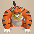 Tiger Launcher</td>
      <td class="items"> Cursenior</td>
      <td class="items">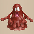 Mudder</td>
      <td class="stats">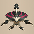 Demon Scorpion</td>
      <td> King Reaper</td>
    </tr>
    <tr>
      <td>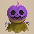 Pumplord</td>
      <td class="items"> Battler</td>
      <td>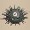 Fulminachin</td>
      <td>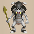 General Ant</td>
      <td class="danger">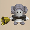 Showpin</td>
    </tr>
    <tr>
      <td colspan="10" class="tableDivider"></td>
    </tr>
    <tr>
      <td rowspan="3" class="centeredText">22</td>
      <td rowspan="3" class=""></td>
      <td rowspan="3" class=""></td>
      <td rowspan="3" class=""></td>
      <td> Infernous</td>
      <td class="danger"> Adamant Tank</td>
      <td> Boomdon</td>
      <td> Pyrepuff</td>
      <td> Mini Tank</td>
      <td rowspan="3" class="highlightBehemoth"></td>
    </tr>
    <tr>
      <td class="danger"> Tiger Launcher</td>
      <td class="items"> Cursenior</td>
      <td class="items"> Mudder</td>
      <td class="stats"> Demon Scorpion</td>
      <td> King Reaper</td>
    </tr>
    <tr>
      <td> Pumplord</td>
      <td class="items"> Battler</td>
      <td> Fulminachin</td>
      <td> General Ant</td>
      <td class="danger"> Showpin</td>
    </tr>
    <tr>
      <td colspan="10" class="tableDivider"></td>
    </tr>
    <tr>
      <td rowspan="3" class="centeredText">23</td>
      <td rowspan="3" class=""></td>
      <td rowspan="3" class=""></td>
      <td rowspan="3" class=""></td>
      <td> Infernous</td>
      <td class="danger"> Adamant Tank</td>
      <td> Boomdon</td>
      <td> Pyrepuff</td>
      <td> Mini Tank</td>
      <td rowspan="3" class="highlightBehemoth"></td>
    </tr>
    <tr>
      <td class="danger"> Tiger Launcher</td>
      <td class="items"> Cursenior</td>
      <td class="items"> Mudder</td>
      <td class="stats"> Demon Scorpion</td>
      <td> King Reaper</td>
    </tr>
    <tr>
      <td> Pumplord</td>
      <td class="items"> Battler</td>
      <td> Fulminachin</td>
      <td> General Ant</td>
      <td class="danger"> Showpin</td>
    </tr>
    <tr>
      <td colspan="10" class="tableDivider"></td>
    </tr>
    <tr>
      <td rowspan="3" class="centeredText">24</td>
      <td rowspan="3" class=""></td>
      <td rowspan="3" class=""></td>
      <td rowspan="3" class=""></td>
      <td> Infernous</td>
      <td class="danger"> Adamant Tank</td>
      <td> Boomdon</td>
      <td> Pyrepuff</td>
      <td> Mini Tank</td>
      <td rowspan="3" class="highlightBehemoth"></td>
    </tr>
    <tr>
      <td class="danger"> Tiger Launcher</td>
      <td class="items"> Cursenior</td>
      <td class="items"> Mudder</td>
      <td class="stats"> Demon Scorpion</td>
      <td> King Reaper</td>
    </tr>
    <tr>
      <td> Pumplord</td>
      <td class="items"> Battler</td>
      <td> Fulminachin</td>
      <td> General Ant</td>
      <td class="danger"> Showpin</td>
    </tr>
    <tr>
      <td colspan="10" class="tableDivider"></td>
    </tr>
    <tr>
      <td rowspan="3" class="centeredText">25</td>
      <td rowspan="3" class=""></td>
      <td rowspan="3" class=""></td>
      <td rowspan="3" class=""></td>
      <td> Infernous</td>
      <td class="danger"> Adamant Tank</td>
      <td> Boomdon</td>
      <td> Pyrepuff</td>
      <td> Mini Tank</td>
      <td rowspan="3" class="highlightBehemoth"></td>
    </tr>
    <tr>
      <td class="danger"> Tiger Launcher</td>
      <td class="items"> Cursenior</td>
      <td class="items"> Mudder</td>
      <td class="stats"> Demon Scorpion</td>
      <td> King Reaper</td>
    </tr>
    <tr>
      <td> Pumplord</td>
      <td class="items"> Battler</td>
      <td> Fulminachin</td>
      <td> General Ant</td>
      <td class="danger"> Showpin</td>
    </tr>
    <tr>
      <td colspan="10" class="tableDivider"></td>
    </tr>
    <tr>
      <td rowspan="3" class="centeredText">26</td>
      <td rowspan="3" class=""></td>
      <td rowspan="3" class="highlightMH"></td>
      <td rowspan="3" class=""></td>
      <td> Infernous</td>
      <td class="danger"> Adamant Tank</td>
      <td> Boomdon</td>
      <td> Pyrepuff</td>
      <td> Mini Tank</td>
      <td rowspan="3" class="highlightBehemoth"></td>
    </tr>
    <tr>
      <td class="danger"> Tiger Launcher</td>
      <td class="items"> Cursenior</td>
      <td class="items"> Mudder</td>
      <td class="stats"> Demon Scorpion</td>
      <td> King Reaper</td>
    </tr>
    <tr>
      <td> Pumplord</td>
      <td class="items"> Battler</td>
      <td> Fulminachin</td>
      <td> General Ant</td>
      <td class="danger"> Showpin</td>
    </tr>
    <tr>
      <td colspan="10" class="tableDivider"></td>
    </tr>
    <tr>
      <td rowspan="3" class="centeredText">27</td>
      <td rowspan="3" class=""></td>
      <td rowspan="3" class=""></td>
      <td rowspan="3" class=""></td>
      <td> Infernous</td>
      <td class="danger"> Adamant Tank</td>
      <td> Boomdon</td>
      <td> Pyrepuff</td>
      <td> Mini Tank</td>
      <td rowspan="3" class="highlightBehemoth"></td>
    </tr>
    <tr>
      <td class="danger"> Tiger Launcher</td>
      <td class="items"> Cursenior</td>
      <td class="items"> Mudder</td>
      <td class="stats"> Demon Scorpion</td>
      <td> King Reaper</td>
    </tr>
    <tr>
      <td> Pumplord</td>
      <td class="items"> Battler</td>
      <td> Fulminachin</td>
      <td> General Ant</td>
      <td class="danger"> Showpin</td>
    </tr>
    <tr>
      <td colspan="10" class="tableDivider"></td>
    </tr>
    <tr>
      <td rowspan="3" class="centeredText">28</td>
      <td rowspan="3" class=""></td>
      <td rowspan="3" class=""></td>
      <td rowspan="3" class=""></td>
      <td> Infernous</td>
      <td class="danger"> Adamant Tank</td>
      <td> Boomdon</td>
      <td> Pyrepuff</td>
      <td> Mini Tank</td>
      <td rowspan="3" class="highlightBehemoth"></td>
    </tr>
    <tr>
      <td class="danger"> Tiger Launcher</td>
      <td class="items"> Cursenior</td>
      <td class="items"> Mudder</td>
      <td class="stats"> Demon Scorpion</td>
      <td> King Reaper</td>
    </tr>
    <tr>
      <td> Pumplord</td>
      <td class="items"> Battler</td>
      <td> Fulminachin</td>
      <td> General Ant</td>
      <td class="danger"> Showpin</td>
    </tr>
    <tr>
      <td colspan="10" class="tableDivider"></td>
    </tr>
    <tr>
      <td rowspan="3" class="centeredText">29</td>
      <td rowspan="3" class=""></td>
      <td rowspan="3" class=""></td>
      <td rowspan="3" class=""></td>
      <td> Infernous</td>
      <td class="danger"> Adamant Tank</td>
      <td> Boomdon</td>
      <td> Pyrepuff</td>
      <td> Mini Tank</td>
      <td rowspan="3" class="highlightBehemoth"></td>
    </tr>
    <tr>
      <td class="danger"> Tiger Launcher</td>
      <td class="items"> Cursenior</td>
      <td class="items"> Mudder</td>
      <td class="stats"> Demon Scorpion</td>
      <td> King Reaper</td>
    </tr>
    <tr>
      <td> Pumplord</td>
      <td class="items"> Battler</td>
      <td> Fulminachin</td>
      <td> General Ant</td>
      <td class="danger"> Showpin</td>
    </tr>
    <tr>
      <td colspan="10" class="tableDivider"></td>
    </tr>
    <tr>
      <td rowspan="4" class="centeredText">30</td>
      <td rowspan="4" class=""></td>
      <td rowspan="4" class=""></td>
      <td rowspan="4" class=""></td>
      <td> Infernous</td>
      <td class="danger"> Adamant Tank</td>
      <td> Boomdon</td>
      <td> Pyrepuff</td>
      <td> Mini Tank</td>
      <td rowspan="4" class="highlightBehemoth"></td>
    </tr>
    <tr>
      <td class="danger"> Tiger Launcher</td>
      <td class="items"> Cursenior</td>
      <td class="items"> Mudder</td>
      <td class="stats"> Demon Scorpion</td>
      <td> King Reaper</td>
    </tr>
    <tr>
      <td> Pumplord</td>
      <td class="items"> Battler</td>
      <td> Fulminachin</td>
      <td> General Ant</td>
      <td class="danger"> Showpin</td>
    </tr>
    <tr>
      <td> Hoppin' Slammer</td>
      <td class="highlightGray"></td>
      <td class="highlightGray"></td>
      <td class="highlightGray"></td>
      <td class="highlightGray"></td>
    </tr>
    <tr>
      <td colspan="10" class="tableDivider"></td>
    </tr>
    <tr>
      <td rowspan="4" class="centeredText">31</td>
      <td rowspan="4" class=""></td>
      <td rowspan="4" class=""></td>
      <td rowspan="4" class=""></td>
      <td> Infernous</td>
      <td class="danger"> Adamant Tank</td>
      <td> Boomdon</td>
      <td> Pyrepuff</td>
      <td> Mini Tank</td>
      <td rowspan="4" class="highlightBehemoth"></td>
    </tr>
    <tr>
      <td class="danger"> Tiger Launcher</td>
      <td class="items"> Cursenior</td>
      <td class="items"> Mudder</td>
      <td class="stats"> Demon Scorpion</td>
      <td> King Reaper</td>
    </tr>
    <tr>
      <td> Pumplord</td>
      <td class="items"> Battler</td>
      <td> General Ant</td>
      <td class="danger"> Showpin</td>
      <td> Hoppin' Slammer</td>
    </tr>
    <tr>
      <td class="danger"> Okina Monk A</td>
      <td class="highlightGray"></td>
      <td class="highlightGray"></td>
      <td class="highlightGray"></td>
      <td class="highlightGray"></td>
    </tr>
    <tr>
      <td colspan="10" class="tableDivider"></td>
    </tr>
    <tr>
      <td rowspan="4" class="centeredText">32</td>
      <td rowspan="4" class=""></td>
      <td rowspan="4" class="highlightMH"></td>
      <td rowspan="4" class=""></td>
      <td> Infernous</td>
      <td class="danger"> Adamant Tank</td>
      <td> Boomdon</td>
      <td> Pyrepuff</td>
      <td> Mini Tank</td>
      <td rowspan="4" class="highlightBehemoth"></td>
    </tr>
    <tr>
      <td class="danger"> Tiger Launcher</td>
      <td class="items"> Cursenior</td>
      <td class="items"> Mudder</td>
      <td class="stats"> Demon Scorpion</td>
      <td> King Reaper</td>
    </tr>
    <tr>
      <td> Pumplord</td>
      <td class="items"> Battler</td>
      <td> General Ant</td>
      <td class="danger"> Showpin</td>
      <td> Hoppin' Slammer</td>
    </tr>
    <tr>
      <td class="danger"> Okina Monk A</td>
      <td class="highlightGray"></td>
      <td class="highlightGray"></td>
      <td class="highlightGray"></td>
      <td class="highlightGray"></td>
    </tr>
    <tr>
      <td colspan="10" class="tableDivider"></td>
    </tr>
    <tr>
      <td rowspan="4" class="centeredText">33</td>
      <td rowspan="4" class=""></td>
      <td rowspan="4" class=""></td>
      <td rowspan="4" class=""></td>
      <td> Infernous</td>
      <td class="danger"> Adamant Tank</td>
      <td> Boomdon</td>
      <td> Pyrepuff</td>
      <td> Mini Tank</td>
      <td rowspan="4" class="highlightBehemoth"></td>
    </tr>
    <tr>
      <td class="danger"> Tiger Launcher</td>
      <td class="items"> Cursenior</td>
      <td class="items"> Mudder</td>
      <td class="stats"> Demon Scorpion</td>
      <td> King Reaper</td>
    </tr>
    <tr>
      <td> Pumplord</td>
      <td class="items"> Battler</td>
      <td> General Ant</td>
      <td class="danger"> Showpin</td>
      <td> Hoppin' Slammer</td>
    </tr>
    <tr>
      <td class="danger"> Okina Monk A</td>
      <td class="highlightGray"></td>
      <td class="highlightGray"></td>
      <td class="highlightGray"></td>
      <td class="highlightGray"></td>
    </tr>
    <tr>
      <td colspan="10" class="tableDivider"></td>
    </tr>
    <tr>
      <td rowspan="4" class="centeredText">34</td>
      <td rowspan="4" class=""></td>
      <td rowspan="4" class=""></td>
      <td rowspan="4" class=""></td>
      <td> Infernous</td>
      <td class="danger"> Adamant Tank</td>
      <td> Boomdon</td>
      <td> Pyrepuff</td>
      <td> Mini Tank</td>
      <td rowspan="4" class="highlightBehemoth"></td>
    </tr>
    <tr>
      <td class="danger"> Tiger Launcher</td>
      <td class="items"> Cursenior</td>
      <td class="items"> Mudder</td>
      <td class="stats"> Demon Scorpion</td>
      <td> King Reaper</td>
    </tr>
    <tr>
      <td> Pumplord</td>
      <td class="items"> Battler</td>
      <td> General Ant</td>
      <td class="danger"> Showpin</td>
      <td> Hoppin' Slammer</td>
    </tr>
    <tr>
      <td class="danger"> Okina Monk A</td>
      <td class="highlightGray"></td>
      <td class="highlightGray"></td>
      <td class="highlightGray"></td>
      <td class="highlightGray"></td>
    </tr>
    <tr>
      <td colspan="10" class="tableDivider"></td>
    </tr>
    <tr>
      <td rowspan="4" class="centeredText">35</td>
      <td rowspan="4" class=""></td>
      <td rowspan="4" class=""></td>
      <td rowspan="4" class=""></td>
      <td> Infernous</td>
      <td class="danger"> Adamant Tank</td>
      <td> Boomdon</td>
      <td> Pyrepuff</td>
      <td> Mini Tank</td>
      <td rowspan="4" class="highlightBehemoth"></td>
    </tr>
    <tr>
      <td class="danger"> Tiger Launcher</td>
      <td class="items"> Cursenior</td>
      <td class="items"> Mudder</td>
      <td class="stats"> Demon Scorpion</td>
      <td> King Reaper</td>
    </tr>
    <tr>
      <td> Pumplord</td>
      <td> General Ant</td>
      <td class="danger"> Showpin</td>
      <td> Hoppin' Slammer</td>
      <td> Deathead</td>
    </tr>
    <tr>
      <td> Gigataur</td>
      <td class="items"> Swordmaster</td>
      <td class="danger"> Okina Monk A</td>
      <td class="highlightGray"></td>
      <td class="highlightGray"></td>
    </tr>
    <tr>
      <td colspan="10" class="tableDivider"></td>
    </tr>
    <tr>
      <td rowspan="4" class="centeredText">36</td>
      <td rowspan="4" class=""></td>
      <td rowspan="4" class=""></td>
      <td rowspan="4" class=""></td>
      <td> Infernous</td>
      <td class="danger"> Adamant Tank</td>
      <td> Boomdon</td>
      <td> Pyrepuff</td>
      <td> Mini Tank</td>
      <td rowspan="4" class="highlightBehemoth"></td>
    </tr>
    <tr>
      <td class="danger"> Tiger Launcher</td>
      <td class="items"> Cursenior</td>
      <td class="items"> Mudder</td>
      <td class="stats"> Demon Scorpion</td>
      <td> King Reaper</td>
    </tr>
    <tr>
      <td> Pumplord</td>
      <td> General Ant</td>
      <td class="danger"> Showpin</td>
      <td> Hoppin' Slammer</td>
      <td> Kitsune Monk A</td>
    </tr>
    <tr>
      <td> Deathead</td>
      <td> Gigataur</td>
      <td class="items"> Swordmaster</td>
      <td class="danger"> Okina Monk A</td>
      <td class="highlightGray"></td>
    </tr>
    <tr>
      <td colspan="10" class="tableDivider"></td>
    </tr>
    <tr>
      <td rowspan="4" class="centeredText">37</td>
      <td rowspan="4" class=""></td>
      <td rowspan="4" class=""></td>
      <td rowspan="4" class=""></td>
      <td> Infernous</td>
      <td class="danger"> Adamant Tank</td>
      <td> Boomdon</td>
      <td> Pyrepuff</td>
      <td> Mini Tank</td>
      <td rowspan="4" class="highlightBehemoth"></td>
    </tr>
    <tr>
      <td class="danger"> Tiger Launcher</td>
      <td class="items"> Cursenior</td>
      <td class="items"> Mudder</td>
      <td class="stats"> Demon Scorpion</td>
      <td> King Reaper</td>
    </tr>
    <tr>
      <td> Pumplord</td>
      <td> General Ant</td>
      <td class="danger"> Showpin</td>
      <td> Hoppin' Slammer</td>
      <td> Kitsune Monk A</td>
    </tr>
    <tr>
      <td> Deathead</td>
      <td> Gigataur</td>
      <td class="items"> Swordmaster</td>
      <td class="danger"> Okina Monk A</td>
      <td class="highlightGray"></td>
    </tr>
    <tr>
      <td colspan="10" class="tableDivider"></td>
    </tr>
    <tr>
      <td rowspan="4" class="centeredText">38</td>
      <td rowspan="4" class=""></td>
      <td rowspan="4" class=""></td>
      <td rowspan="4" class=""></td>
      <td> Infernous</td>
      <td class="danger"> Adamant Tank</td>
      <td> Boomdon</td>
      <td> Pyrepuff</td>
      <td> Mini Tank</td>
      <td rowspan="4" class="highlightBehemoth"></td>
    </tr>
    <tr>
      <td class="danger"> Tiger Launcher</td>
      <td class="items"> Cursenior</td>
      <td class="items"> Mudder</td>
      <td class="stats"> Demon Scorpion</td>
      <td> King Reaper</td>
    </tr>
    <tr>
      <td> Pumplord</td>
      <td> General Ant</td>
      <td class="danger"> Showpin</td>
      <td> Hoppin' Slammer</td>
      <td> Kitsune Monk A</td>
    </tr>
    <tr>
      <td> Deathead</td>
      <td> Gigataur</td>
      <td class="items"> Swordmaster</td>
      <td class="danger"> Okina Monk A</td>
      <td class="highlightGray"></td>
    </tr>
    <tr>
      <td colspan="10" class="tableDivider"></td>
    </tr>
    <tr>
      <td rowspan="4" class="centeredText">39</td>
      <td rowspan="4" class=""></td>
      <td rowspan="4" class=""></td>
      <td rowspan="4" class=""></td>
      <td> Infernous</td>
      <td class="danger"> Adamant Tank</td>
      <td> Boomdon</td>
      <td> Pyrepuff</td>
      <td> Mini Tank</td>
      <td rowspan="4" class="highlightBehemoth"></td>
    </tr>
    <tr>
      <td class="danger"> Tiger Launcher</td>
      <td class="items"> Cursenior</td>
      <td class="items"> Mudder</td>
      <td class="stats"> Demon Scorpion</td>
      <td> King Reaper</td>
    </tr>
    <tr>
      <td> Pumplord</td>
      <td> General Ant</td>
      <td class="danger"> Showpin</td>
      <td> Hoppin' Slammer</td>
      <td> Kitsune Monk A</td>
    </tr>
    <tr>
      <td> Deathead</td>
      <td> Gigataur</td>
      <td class="items"> Swordmaster</td>
      <td class="danger"> Okina Monk A</td>
      <td class="highlightGray"></td>
    </tr>
    <tr>
      <td colspan="10" class="tableDivider"></td>
    </tr>
    <tr>
      <td rowspan="4" class="centeredText">40</td>
      <td rowspan="4" class=""></td>
      <td rowspan="4" class=""></td>
      <td rowspan="4" class=""></td>
      <td> Infernous</td>
      <td> Pyrepuff</td>
      <td class="danger"> Tiger Launcher</td>
      <td class="items"> Cursenior</td>
      <td class="items"> Mudder</td>
      <td rowspan="4" class="highlightBehemoth"></td>
    </tr>
    <tr>
      <td> King Reaper</td>
      <td> General Ant</td>
      <td class="danger"> Showpin</td>
      <td> Hoppin' Slammer</td>
      <td>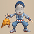 Okame Monk A</td>
    </tr>
    <tr>
      <td>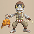 Hannya Monk A</td>
      <td> Deathead</td>
      <td> Gigataur</td>
      <td class="items"> Swordmaster</td>
      <td> Detonachin</td>
    </tr>
    <tr>
      <td class="danger"> Steadfast Tank</td>
      <td class="highlightGray"></td>
      <td class="highlightGray"></td>
      <td class="highlightGray"></td>
      <td class="highlightGray"></td>
    </tr>
    <tr>
      <td colspan="10" class="tableDivider"></td>
    </tr>
    <tr>
      <td rowspan="4" class="centeredText">41</td>
      <td rowspan="4" class=""></td>
      <td rowspan="4" class=""></td>
      <td rowspan="4" class=""></td>
      <td> Infernous</td>
      <td> Pyrepuff</td>
      <td class="danger"> Tiger Launcher</td>
      <td class="items"> Cursenior</td>
      <td class="items"> Mudder</td>
      <td rowspan="4" class="highlightBehemoth"></td>
    </tr>
    <tr>
      <td> King Reaper</td>
      <td> General Ant</td>
      <td class="danger"> Showpin</td>
      <td> Hoppin' Slammer</td>
      <td> Okame Monk A</td>
    </tr>
    <tr>
      <td> Hannya Monk A</td>
      <td> Deathead</td>
      <td> Gigataur</td>
      <td class="items"> Swordmaster</td>
      <td> Detonachin</td>
    </tr>
    <tr>
      <td class="danger"> Steadfast Tank</td>
      <td class="highlightGray"></td>
      <td class="highlightGray"></td>
      <td class="highlightGray"></td>
      <td class="highlightGray"></td>
    </tr>
    <tr>
      <td colspan="10" class="tableDivider"></td>
    </tr>
    <tr>
      <td rowspan="4" class="centeredText">42</td>
      <td rowspan="4" class=""></td>
      <td rowspan="4" class=""></td>
      <td rowspan="4" class=""></td>
      <td> Infernous</td>
      <td> Pyrepuff</td>
      <td class="danger"> Tiger Launcher</td>
      <td class="items"> Cursenior</td>
      <td class="items"> Mudder</td>
      <td rowspan="4" class="highlightBehemoth"></td>
    </tr>
    <tr>
      <td> King Reaper</td>
      <td> General Ant</td>
      <td class="danger"> Showpin</td>
      <td> Hoppin' Slammer</td>
      <td> Okame Monk A</td>
    </tr>
    <tr>
      <td> Hannya Monk A</td>
      <td> Deathead</td>
      <td> Gigataur</td>
      <td class="items"> Swordmaster</td>
      <td> Detonachin</td>
    </tr>
    <tr>
      <td class="danger"> Steadfast Tank</td>
      <td class="highlightGray"></td>
      <td class="highlightGray"></td>
      <td class="highlightGray"></td>
      <td class="highlightGray"></td>
    </tr>
    <tr>
      <td colspan="10" class="tableDivider"></td>
    </tr>
    <tr>
      <td rowspan="4" class="centeredText">43</td>
      <td rowspan="4" class=""></td>
      <td rowspan="4" class=""></td>
      <td rowspan="4" class=""></td>
      <td> Infernous</td>
      <td> Pyrepuff</td>
      <td class="danger"> Tiger Launcher</td>
      <td class="items"> Cursenior</td>
      <td class="items"> Mudder</td>
      <td rowspan="4" class="highlightBehemoth"></td>
    </tr>
    <tr>
      <td> King Reaper</td>
      <td> General Ant</td>
      <td class="danger"> Showpin</td>
      <td> Hoppin' Slammer</td>
      <td> Okame Monk A</td>
    </tr>
    <tr>
      <td> Hannya Monk A</td>
      <td> Deathead</td>
      <td> Gigataur</td>
      <td class="items"> Swordmaster</td>
      <td> Detonachin</td>
    </tr>
    <tr>
      <td class="danger"> Steadfast Tank</td>
      <td class="highlightGray"></td>
      <td class="highlightGray"></td>
      <td class="highlightGray"></td>
      <td class="highlightGray"></td>
    </tr>
    <tr>
      <td colspan="10" class="tableDivider"></td>
    </tr>
    <tr>
      <td rowspan="4" class="centeredText">44</td>
      <td rowspan="4" class=""></td>
      <td rowspan="4" class=""></td>
      <td rowspan="4" class=""></td>
      <td> Infernous</td>
      <td> Pyrepuff</td>
      <td class="danger"> Tiger Launcher</td>
      <td class="items"> Cursenior</td>
      <td class="items"> Mudder</td>
      <td rowspan="4" class="highlightBehemoth"></td>
    </tr>
    <tr>
      <td> King Reaper</td>
      <td> General Ant</td>
      <td class="danger"> Showpin</td>
      <td> Hoppin' Slammer</td>
      <td> Okame Monk A</td>
    </tr>
    <tr>
      <td> Hannya Monk A</td>
      <td> Deathead</td>
      <td> Gigataur</td>
      <td class="items"> Swordmaster</td>
      <td> Detonachin</td>
    </tr>
    <tr>
      <td class="danger"> Steadfast Tank</td>
      <td class="highlightGray"></td>
      <td class="highlightGray"></td>
      <td class="highlightGray"></td>
      <td class="highlightGray"></td>
    </tr>
    <tr>
      <td colspan="10" class="tableDivider"></td>
    </tr>
    <tr>
      <td rowspan="3" class="centeredText">45</td>
      <td rowspan="3" class=""></td>
      <td rowspan="3" class=""></td>
      <td rowspan="3" class=""></td>
      <td> Infernous</td>
      <td> Pyrepuff</td>
      <td class="danger"> Tiger Launcher</td>
      <td class="items"> Cursenior</td>
      <td class="items"> Mudder</td>
      <td rowspan="3" class="highlightBehemoth"></td>
    </tr>
    <tr>
      <td> King Reaper</td>
      <td> General Ant</td>
      <td class="danger"> Showpin</td>
      <td> Hoppin' Slammer</td>
      <td> Kitsune Monk A</td>
    </tr>
    <tr>
      <td> Deathead</td>
      <td> Gigataur</td>
      <td class="items"> Swordmaster</td>
      <td> Detonachin</td>
      <td class="danger"> Steadfast Tank</td>
    </tr>
    <tr>
      <td colspan="10" class="tableDivider"></td>
    </tr>
    <tr>
      <td rowspan="3" class="centeredText">46</td>
      <td rowspan="3" class=""></td>
      <td rowspan="3" class=""></td>
      <td rowspan="3" class=""></td>
      <td> Infernous</td>
      <td> Pyrepuff</td>
      <td class="danger"> Tiger Launcher</td>
      <td class="items"> Cursenior</td>
      <td class="items"> Mudder</td>
      <td rowspan="3" class="highlightBehemoth"></td>
    </tr>
    <tr>
      <td> King Reaper</td>
      <td> General Ant</td>
      <td class="danger"> Showpin</td>
      <td> Hoppin' Slammer</td>
      <td> Kitsune Monk A</td>
    </tr>
    <tr>
      <td> Deathead</td>
      <td> Gigataur</td>
      <td class="items"> Swordmaster</td>
      <td> Detonachin</td>
      <td class="danger"> Steadfast Tank</td>
    </tr>
    <tr>
      <td colspan="10" class="tableDivider"></td>
    </tr>
    <tr>
      <td rowspan="3" class="centeredText">47</td>
      <td rowspan="3" class=""></td>
      <td rowspan="3" class=""></td>
      <td rowspan="3" class=""></td>
      <td> Infernous</td>
      <td> Pyrepuff</td>
      <td class="danger"> Tiger Launcher</td>
      <td class="items"> Cursenior</td>
      <td class="items"> Mudder</td>
      <td rowspan="3" class="highlightBehemoth"></td>
    </tr>
    <tr>
      <td> King Reaper</td>
      <td> General Ant</td>
      <td class="danger"> Showpin</td>
      <td> Hoppin' Slammer</td>
      <td> Kitsune Monk A</td>
    </tr>
    <tr>
      <td> Deathead</td>
      <td> Gigataur</td>
      <td class="items"> Swordmaster</td>
      <td> Detonachin</td>
      <td class="danger"> Steadfast Tank</td>
    </tr>
    <tr>
      <td colspan="10" class="tableDivider"></td>
    </tr>
    <tr>
      <td rowspan="3" class="centeredText">48</td>
      <td rowspan="3" class=""></td>
      <td rowspan="3" class=""></td>
      <td rowspan="3" class=""></td>
      <td> Infernous</td>
      <td> Pyrepuff</td>
      <td class="danger"> Tiger Launcher</td>
      <td class="items"> Cursenior</td>
      <td class="items"> Mudder</td>
      <td rowspan="3" class="highlightBehemoth"></td>
    </tr>
    <tr>
      <td> King Reaper</td>
      <td> General Ant</td>
      <td class="danger"> Showpin</td>
      <td> Hoppin' Slammer</td>
      <td> Kitsune Monk A</td>
    </tr>
    <tr>
      <td> Deathead</td>
      <td> Gigataur</td>
      <td class="items"> Swordmaster</td>
      <td> Detonachin</td>
      <td class="danger"> Steadfast Tank</td>
    </tr>
    <tr>
      <td colspan="10" class="tableDivider"></td>
    </tr>
    <tr>
      <td rowspan="3" class="centeredText">49</td>
      <td rowspan="3" class=""></td>
      <td rowspan="3" class=""></td>
      <td rowspan="3" class=""></td>
      <td> Infernous</td>
      <td> Pyrepuff</td>
      <td class="danger"> Tiger Launcher</td>
      <td class="items"> Cursenior</td>
      <td class="items"> Mudder</td>
      <td rowspan="3" class="highlightBehemoth"></td>
    </tr>
    <tr>
      <td> King Reaper</td>
      <td> General Ant</td>
      <td class="danger"> Showpin</td>
      <td> Hoppin' Slammer</td>
      <td> Kitsune Monk A</td>
    </tr>
    <tr>
      <td> Deathead</td>
      <td> Gigataur</td>
      <td class="items"> Swordmaster</td>
      <td> Detonachin</td>
      <td class="danger"> Steadfast Tank</td>
    </tr>
    <tr>
      <td colspan="10" class="tableDivider"></td>
    </tr>
    <tr>
      <td rowspan="3" class="centeredText">50</td>
      <td rowspan="3" class=""></td>
      <td rowspan="3" class=""></td>
      <td rowspan="3" class=""></td>
      <td> Infernous</td>
      <td> Pyrepuff</td>
      <td class="danger"> Tiger Launcher</td>
      <td class="items"> Cursenior</td>
      <td class="items"> Mudder</td>
      <td rowspan="3" class="highlightBehemoth"></td>
    </tr>
    <tr>
      <td> King Reaper</td>
      <td> General Ant</td>
      <td class="danger"> Showpin</td>
      <td> Hoppin' Slammer</td>
      <td> Kitsune Monk A</td>
    </tr>
    <tr>
      <td> Deathead</td>
      <td> Gigataur</td>
      <td class="items"> Swordmaster</td>
      <td> Detonachin</td>
      <td class="danger"> Steadfast Tank</td>
    </tr>
  </tbody>
</table>

# Behemoths

<table class="monsterTable">
  <thead>
    <tr>
      <th>F</th>
      <th colspan="5">Behemoth Monsters</th>
    </tr>
  </thead>
  <tbody>
    <tr>
      <td rowspan="3" class="centeredText">2-9 11-19 21-50</td>
      <td> Mamel</td>
      <td class="caution"> Death Reaper</td>
      <td>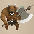 Minotaur</td>
      <td> Megataur</td>
      <td class="caution"> Gigataur</td>
    </tr>
    <tr>
      <td> Shagga</td>
      <td> Nashagga</td>
      <td class="caution"> Lashagga</td>
      <td class="danger"> Bashagga</td>
      <td class="caution"> Bowboy</td>
    </tr>
    <tr>
      <td> Pop Tank</td>
      <td> Ghost Radish</td>
      <td>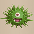 Explochin</td>
      <td> Schubell</td>
      <td class="highlightGray"></td>
    </tr>
  </tbody>
</table>

# Items

※ This section is currently incomplete.

<h4 id="item-table-key" class="heading4Blue"> Item Table Key</h4>

|ID|Explanation|
|-|-|
|F|Floor|
|S|Shop|
|P|Peddler|
|M|Monster drop|
|B|Buried|
|H|Thiefwalrus|
|I|Island|
|T|Transmutation Pot|
|U|Surprise Pot|
|W|Tunnel of Wishes|

<h4 id="weapon" class="heading4Blue"> Weapon</h4>

<table class="dungeonItemTable">
  <tr>
    <th colspan="11" class="highlightLightblue">Weapon</th>
  </tr>
  <tr>
    <th>Name</th>
    <th>F</th>
    <th>S</th>
    <th>P</th>
    <th>M</th>
    <th>B</th>
    <th>H</th>
    <th>I</th>
    <th>T</th>
    <th>U</th>
    <th>W</th>
  </tr>
  <tr>
    <td class="leftText">Wooden Sword</td>
    <td></td>
    <td></td>
    <td></td>
    <td></td>
    <td></td>
    <td></td>
    <td></td>
    <td></td>
    <td></td>
    <td></td>
  </tr>
  <tr>
    <td class="leftText">Bronze Sword</td>
    <td></td>
    <td></td>
    <td></td>
    <td></td>
    <td></td>
    <td></td>
    <td></td>
    <td></td>
    <td></td>
    <td></td>
  </tr>
  <tr>
    <td class="leftText">Katana</td>
    <td></td>
    <td></td>
    <td></td>
    <td></td>
    <td></td>
    <td></td>
    <td></td>
    <td></td>
    <td></td>
    <td></td>
  </tr>
  <tr>
    <td class="leftText">Doutanuki</td>
    <td></td>
    <td></td>
    <td></td>
    <td></td>
    <td></td>
    <td></td>
    <td></td>
    <td></td>
    <td></td>
    <td></td>
  </tr>
  <tr>
    <td class="leftText">Manji Kabura</td>
    <td></td>
    <td></td>
    <td></td>
    <td></td>
    <td></td>
    <td></td>
    <td></td>
    <td></td>
    <td></td>
    <td></td>
  </tr>
  <tr>
    <td class="leftText">Kajin Fuuma</td>
    <td></td>
    <td></td>
    <td></td>
    <td></td>
    <td></td>
    <td></td>
    <td></td>
    <td></td>
    <td></td>
    <td></td>
  </tr>
  <tr>
    <td class="leftText">Kabura Sutegi</td>
    <td></td>
    <td></td>
    <td></td>
    <td></td>
    <td></td>
    <td></td>
    <td></td>
    <td></td>
    <td></td>
    <td></td>
  </tr>
  <tr>
    <td class="leftText">Golden Sword</td>
    <td></td>
    <td></td>
    <td></td>
    <td></td>
    <td></td>
    <td></td>
    <td></td>
    <td></td>
    <td></td>
    <td></td>
  </tr>
  <tr>
    <td class="leftText">Kama Itachi</td>
    <td></td>
    <td></td>
    <td></td>
    <td></td>
    <td></td>
    <td></td>
    <td></td>
    <td></td>
    <td></td>
    <td></td>
  </tr>
  <tr>
    <td class="leftText">Axe of the Minotaur</td>
    <td></td>
    <td></td>
    <td></td>
    <td></td>
    <td></td>
    <td></td>
    <td></td>
    <td></td>
    <td></td>
    <td></td>
  </tr>
  <tr>
    <td class="leftText">Accurate Sword</td>
    <td></td>
    <td></td>
    <td></td>
    <td></td>
    <td></td>
    <td></td>
    <td></td>
    <td></td>
    <td></td>
    <td></td>
  </tr>
  <tr>
    <td class="leftText">Swift Sword</td>
    <td></td>
    <td></td>
    <td></td>
    <td></td>
    <td></td>
    <td></td>
    <td></td>
    <td></td>
    <td></td>
    <td></td>
  </tr>
  <tr>
    <td class="leftText">Watersplitter</td>
    <td></td>
    <td></td>
    <td></td>
    <td></td>
    <td></td>
    <td></td>
    <td></td>
    <td></td>
    <td></td>
    <td></td>
  </tr>
  <tr>
    <td class="leftText">Primal Axe</td>
    <td></td>
    <td></td>
    <td></td>
    <td></td>
    <td></td>
    <td></td>
    <td></td>
    <td></td>
    <td></td>
    <td></td>
  </tr>
  <tr>
    <td class="leftText">Dragonkiller</td>
    <td></td>
    <td></td>
    <td></td>
    <td></td>
    <td></td>
    <td></td>
    <td></td>
    <td></td>
    <td></td>
    <td></td>
  </tr>
  <tr>
    <td class="leftText">Crescent Blade</td>
    <td></td>
    <td></td>
    <td></td>
    <td></td>
    <td></td>
    <td></td>
    <td></td>
    <td></td>
    <td></td>
    <td></td>
  </tr>
  <tr>
    <td class="leftText">Sky Sword</td>
    <td></td>
    <td></td>
    <td></td>
    <td></td>
    <td></td>
    <td></td>
    <td></td>
    <td></td>
    <td></td>
    <td></td>
  </tr>
  <tr>
    <td class="leftText">Sickle of Salvation</td>
    <td></td>
    <td></td>
    <td></td>
    <td></td>
    <td></td>
    <td></td>
    <td></td>
    <td></td>
    <td></td>
    <td></td>
  </tr>
  <tr>
    <td class="leftText">Drain Slayer</td>
    <td></td>
    <td></td>
    <td></td>
    <td></td>
    <td></td>
    <td></td>
    <td></td>
    <td></td>
    <td></td>
    <td></td>
  </tr>
  <tr>
    <td class="leftText">Cyclops Bane</td>
    <td></td>
    <td></td>
    <td></td>
    <td></td>
    <td></td>
    <td></td>
    <td></td>
    <td></td>
    <td></td>
    <td></td>
  </tr>
  <tr>
    <td class="leftText">Steel Severer</td>
    <td></td>
    <td></td>
    <td></td>
    <td></td>
    <td></td>
    <td></td>
    <td></td>
    <td></td>
    <td></td>
    <td></td>
  </tr>
  <tr>
    <td class="leftText">Whopping Harisen</td>
    <td></td>
    <td></td>
    <td></td>
    <td></td>
    <td></td>
    <td></td>
    <td></td>
    <td></td>
    <td></td>
    <td></td>
  </tr>
  <tr>
    <td class="leftText">Healing Sword</td>
    <td></td>
    <td></td>
    <td></td>
    <td></td>
    <td></td>
    <td></td>
    <td></td>
    <td></td>
    <td></td>
    <td></td>
  </tr>
  <tr>
    <td class="leftText">Peach Club</td>
    <td></td>
    <td></td>
    <td></td>
    <td></td>
    <td></td>
    <td></td>
    <td></td>
    <td></td>
    <td></td>
    <td></td>
  </tr>
  <tr>
    <td class="leftText">Spender's Club</td>
    <td></td>
    <td></td>
    <td></td>
    <td></td>
    <td></td>
    <td></td>
    <td></td>
    <td></td>
    <td></td>
    <td></td>
  </tr>
  <tr>
    <td class="leftText">Ferrous Greatsword</td>
    <td></td>
    <td></td>
    <td></td>
    <td></td>
    <td></td>
    <td></td>
    <td></td>
    <td></td>
    <td></td>
    <td></td>
  </tr>
  <tr>
    <td class="leftText">Steak Knife</td>
    <td></td>
    <td></td>
    <td></td>
    <td></td>
    <td></td>
    <td></td>
    <td></td>
    <td></td>
    <td></td>
    <td></td>
  </tr>
  <tr>
    <td class="leftText">Jagged Sword</td>
    <td></td>
    <td></td>
    <td></td>
    <td></td>
    <td></td>
    <td></td>
    <td></td>
    <td></td>
    <td></td>
    <td></td>
  </tr>
  <tr>
    <td class="leftText">Quad-edge</td>
    <td></td>
    <td></td>
    <td></td>
    <td></td>
    <td></td>
    <td></td>
    <td></td>
    <td></td>
    <td></td>
    <td></td>
  </tr>
  <tr>
    <td class="leftText">Auspicious Kumade</td>
    <td></td>
    <td></td>
    <td></td>
    <td></td>
    <td></td>
    <td></td>
    <td></td>
    <td></td>
    <td></td>
    <td></td>
  </tr>
  <tr>
    <td class="leftText">Pickaxe</td>
    <td></td>
    <td></td>
    <td></td>
    <td></td>
    <td></td>
    <td></td>
    <td></td>
    <td></td>
    <td></td>
    <td></td>
  </tr>
  <tr>
    <td class="leftText">Golden Pickaxe</td>
    <td></td>
    <td></td>
    <td></td>
    <td></td>
    <td></td>
    <td></td>
    <td></td>
    <td></td>
    <td></td>
    <td></td>
  </tr>
  <tr>
    <td class="leftText">Wooden Mallet</td>
    <td></td>
    <td></td>
    <td></td>
    <td></td>
    <td></td>
    <td></td>
    <td></td>
    <td></td>
    <td></td>
    <td></td>
  </tr>
  <tr>
    <td class="leftText">Epic Hammer</td>
    <td></td>
    <td></td>
    <td></td>
    <td></td>
    <td></td>
    <td></td>
    <td></td>
    <td></td>
    <td></td>
    <td></td>
  </tr>
  <tr>
    <td class="leftText">Trapseeker</td>
    <td></td>
    <td></td>
    <td></td>
    <td></td>
    <td></td>
    <td></td>
    <td></td>
    <td></td>
    <td></td>
    <td></td>
  </tr>
  <tr>
    <td class="leftText">Bonito Block</td>
    <td></td>
    <td></td>
    <td></td>
    <td></td>
    <td></td>
    <td></td>
    <td></td>
    <td></td>
    <td></td>
    <td></td>
  </tr>
  <tr>
    <td class="leftText">Yamanba's Cleaver</td>
    <td></td>
    <td></td>
    <td></td>
    <td></td>
    <td></td>
    <td></td>
    <td></td>
    <td></td>
    <td></td>
    <td></td>
  </tr>
  <tr>
    <td class="leftText">Break-Off Blade</td>
    <td></td>
    <td></td>
    <td></td>
    <td></td>
    <td></td>
    <td></td>
    <td></td>
    <td></td>
    <td></td>
    <td></td>
  </tr>
</table>

<h4 id="shield" class="heading4Blue"> Shield</h4>

<table class="dungeonItemTable">
  <tr>
    <th colspan="11" class="highlightLightblue">Shield</th>
  </tr>
  <tr>
    <th>Name</th>
    <th>F</th>
    <th>S</th>
    <th>P</th>
    <th>M</th>
    <th>B</th>
    <th>H</th>
    <th>I</th>
    <th>T</th>
    <th>U</th>
    <th>W</th>
  </tr>
  <tr>
    <td class="leftText">Wooden Shield</td>
    <td></td>
    <td></td>
    <td></td>
    <td></td>
    <td></td>
    <td></td>
    <td></td>
    <td></td>
    <td></td>
    <td></td>
  </tr>
  <tr>
    <td class="leftText">Bronze Shield</td>
    <td></td>
    <td></td>
    <td></td>
    <td></td>
    <td></td>
    <td></td>
    <td></td>
    <td></td>
    <td></td>
    <td></td>
  </tr>
  <tr>
    <td class="leftText">Iron Shield</td>
    <td></td>
    <td></td>
    <td></td>
    <td></td>
    <td></td>
    <td></td>
    <td></td>
    <td></td>
    <td></td>
    <td></td>
  </tr>
  <tr>
    <td class="leftText">Wolfshead</td>
    <td></td>
    <td></td>
    <td></td>
    <td></td>
    <td></td>
    <td></td>
    <td></td>
    <td></td>
    <td></td>
    <td></td>
  </tr>
  <tr>
    <td class="leftText">Fuuma Shield</td>
    <td></td>
    <td></td>
    <td></td>
    <td></td>
    <td></td>
    <td></td>
    <td></td>
    <td></td>
    <td></td>
    <td></td>
  </tr>
  <tr>
    <td class="leftText">Rasen Fuuma</td>
    <td></td>
    <td></td>
    <td></td>
    <td></td>
    <td></td>
    <td></td>
    <td></td>
    <td></td>
    <td></td>
    <td></td>
  </tr>
  <tr>
    <td class="leftText">Golden Shield</td>
    <td></td>
    <td></td>
    <td></td>
    <td></td>
    <td></td>
    <td></td>
    <td></td>
    <td></td>
    <td></td>
    <td></td>
  </tr>
  <tr>
    <td class="leftText">Counter Shield</td>
    <td></td>
    <td></td>
    <td></td>
    <td></td>
    <td></td>
    <td></td>
    <td></td>
    <td></td>
    <td></td>
    <td></td>
  </tr>
  <tr>
    <td class="leftText">Watchful Shield</td>
    <td></td>
    <td></td>
    <td></td>
    <td></td>
    <td></td>
    <td></td>
    <td></td>
    <td></td>
    <td></td>
    <td></td>
  </tr>
  <tr>
    <td class="leftText">Dragon Shield</td>
    <td></td>
    <td></td>
    <td></td>
    <td></td>
    <td></td>
    <td></td>
    <td></td>
    <td></td>
    <td></td>
    <td></td>
  </tr>
  <tr>
    <td class="leftText">Blast Shield</td>
    <td></td>
    <td></td>
    <td></td>
    <td></td>
    <td></td>
    <td></td>
    <td></td>
    <td></td>
    <td></td>
    <td></td>
  </tr>
  <tr>
    <td class="leftText">Targe of the Minotaur</td>
    <td></td>
    <td></td>
    <td></td>
    <td></td>
    <td></td>
    <td></td>
    <td></td>
    <td></td>
    <td></td>
    <td></td>
  </tr>
  <tr>
    <td class="leftText">Walrus Stopper</td>
    <td></td>
    <td></td>
    <td></td>
    <td></td>
    <td></td>
    <td></td>
    <td></td>
    <td></td>
    <td></td>
    <td></td>
  </tr>
  <tr>
    <td class="leftText">Froggo Stopper</td>
    <td></td>
    <td></td>
    <td></td>
    <td></td>
    <td></td>
    <td></td>
    <td></td>
    <td></td>
    <td></td>
    <td></td>
  </tr>
  <tr>
    <td class="leftText">Hat Stopper</td>
    <td></td>
    <td></td>
    <td></td>
    <td></td>
    <td></td>
    <td></td>
    <td></td>
    <td></td>
    <td></td>
    <td></td>
  </tr>
  <tr>
    <td class="leftText">Nigiri Stopper</td>
    <td></td>
    <td></td>
    <td></td>
    <td></td>
    <td></td>
    <td></td>
    <td></td>
    <td></td>
    <td></td>
    <td></td>
  </tr>
  <tr>
    <td class="leftText">Spearscale Shield</td>
    <td></td>
    <td></td>
    <td></td>
    <td></td>
    <td></td>
    <td></td>
    <td></td>
    <td></td>
    <td></td>
    <td></td>
  </tr>
  <tr>
    <td class="leftText">Kappa's Dish</td>
    <td></td>
    <td></td>
    <td></td>
    <td></td>
    <td></td>
    <td></td>
    <td></td>
    <td></td>
    <td></td>
    <td></td>
  </tr>
  <tr>
    <td class="leftText">Gazer Shield</td>
    <td></td>
    <td></td>
    <td></td>
    <td></td>
    <td></td>
    <td></td>
    <td></td>
    <td></td>
    <td></td>
    <td></td>
  </tr>
  <tr>
    <td class="leftText">Shield of Negation</td>
    <td></td>
    <td></td>
    <td></td>
    <td></td>
    <td></td>
    <td></td>
    <td></td>
    <td></td>
    <td></td>
    <td></td>
  </tr>
  <tr>
    <td class="leftText">Unmoving Wall</td>
    <td></td>
    <td></td>
    <td></td>
    <td></td>
    <td></td>
    <td></td>
    <td></td>
    <td></td>
    <td></td>
    <td></td>
  </tr>
  <tr>
    <td class="leftText">Zabuton</td>
    <td></td>
    <td></td>
    <td></td>
    <td></td>
    <td></td>
    <td></td>
    <td></td>
    <td></td>
    <td></td>
    <td></td>
  </tr>
  <tr>
    <td class="leftText">Spender's Shield</td>
    <td></td>
    <td></td>
    <td></td>
    <td></td>
    <td></td>
    <td></td>
    <td></td>
    <td></td>
    <td></td>
    <td></td>
  </tr>
  <tr>
    <td class="leftText">Ferrous Kite</td>
    <td></td>
    <td></td>
    <td></td>
    <td></td>
    <td></td>
    <td></td>
    <td></td>
    <td></td>
    <td></td>
    <td></td>
  </tr>
  <tr>
    <td class="leftText">Steak Plate</td>
    <td></td>
    <td></td>
    <td></td>
    <td></td>
    <td></td>
    <td></td>
    <td></td>
    <td></td>
    <td></td>
    <td></td>
  </tr>
  <tr>
    <td class="leftText">Gutsy Shield</td>
    <td></td>
    <td></td>
    <td></td>
    <td></td>
    <td></td>
    <td></td>
    <td></td>
    <td></td>
    <td></td>
    <td></td>
  </tr>
  <tr>
    <td class="leftText">Hunky-dory Shield</td>
    <td></td>
    <td></td>
    <td></td>
    <td></td>
    <td></td>
    <td></td>
    <td></td>
    <td></td>
    <td></td>
    <td></td>
  </tr>
  <tr>
    <td class="leftText">Bodhi Shield</td>
    <td></td>
    <td></td>
    <td></td>
    <td></td>
    <td></td>
    <td></td>
    <td></td>
    <td></td>
    <td></td>
    <td></td>
  </tr>
  <tr>
    <td class="leftText">Shield of Sating</td>
    <td></td>
    <td></td>
    <td></td>
    <td></td>
    <td></td>
    <td></td>
    <td></td>
    <td></td>
    <td></td>
    <td></td>
  </tr>
  <tr>
    <td class="leftText">Auspicious Omamori</td>
    <td></td>
    <td></td>
    <td></td>
    <td></td>
    <td></td>
    <td></td>
    <td></td>
    <td></td>
    <td></td>
    <td></td>
  </tr>
  <tr>
    <td class="leftText">Shield of Presage</td>
    <td></td>
    <td></td>
    <td></td>
    <td></td>
    <td></td>
    <td></td>
    <td></td>
    <td></td>
    <td></td>
    <td></td>
  </tr>
  <tr>
    <td class="leftText">Yamanba's Potlid</td>
    <td></td>
    <td></td>
    <td></td>
    <td></td>
    <td></td>
    <td></td>
    <td></td>
    <td></td>
    <td></td>
    <td></td>
  </tr>
  <tr>
    <td class="leftText">Break-Off Shield</td>
    <td></td>
    <td></td>
    <td></td>
    <td></td>
    <td></td>
    <td></td>
    <td></td>
    <td></td>
    <td></td>
    <td></td>
  </tr>
</table>

<h4 id="bracelet" class="heading4Blue"> Bracelet</h4>

<table class="dungeonItemTable">
  <tr>
    <th colspan="11" class="highlightLightblue">Bracelet</th>
  </tr>
  <tr>
    <th>Name</th>
    <th>F</th>
    <th>S</th>
    <th>P</th>
    <th>M</th>
    <th>B</th>
    <th>H</th>
    <th>I</th>
    <th>T</th>
    <th>U</th>
    <th>W</th>
  </tr>
  <tr>
    <td class="leftText">Healing Bracelet</td>
    <td></td>
    <td></td>
    <td></td>
    <td></td>
    <td></td>
    <td></td>
    <td></td>
    <td></td>
    <td></td>
    <td></td>
  </tr>
  <tr>
    <td class="leftText">Strength Bracelet</td>
    <td></td>
    <td></td>
    <td></td>
    <td></td>
    <td></td>
    <td></td>
    <td></td>
    <td></td>
    <td></td>
    <td></td>
  </tr>
  <tr>
    <td class="leftText">Bellyexpand Bracelet</td>
    <td></td>
    <td></td>
    <td></td>
    <td></td>
    <td></td>
    <td></td>
    <td></td>
    <td></td>
    <td></td>
    <td></td>
  </tr>
  <tr>
    <td class="leftText">Bellyshrink Bracelet</td>
    <td></td>
    <td></td>
    <td></td>
    <td></td>
    <td></td>
    <td></td>
    <td></td>
    <td></td>
    <td></td>
    <td></td>
  </tr>
  <tr>
    <td class="leftText">Fortune Bracelet</td>
    <td></td>
    <td></td>
    <td></td>
    <td></td>
    <td></td>
    <td></td>
    <td></td>
    <td></td>
    <td></td>
    <td></td>
  </tr>
  <tr>
    <td class="leftText">Cleansing Bracelet</td>
    <td></td>
    <td></td>
    <td></td>
    <td></td>
    <td></td>
    <td></td>
    <td></td>
    <td></td>
    <td></td>
    <td></td>
  </tr>
  <tr>
    <td class="leftText">Focusing Bracelet</td>
    <td></td>
    <td></td>
    <td></td>
    <td></td>
    <td></td>
    <td></td>
    <td></td>
    <td></td>
    <td></td>
    <td></td>
  </tr>
  <tr>
    <td class="leftText">Rousing Bracelet</td>
    <td></td>
    <td></td>
    <td></td>
    <td></td>
    <td></td>
    <td></td>
    <td></td>
    <td></td>
    <td></td>
    <td></td>
  </tr>
  <tr>
    <td class="leftText">Rustproof Bracelet</td>
    <td></td>
    <td></td>
    <td></td>
    <td></td>
    <td></td>
    <td></td>
    <td></td>
    <td></td>
    <td></td>
    <td></td>
  </tr>
  <tr>
    <td class="leftText">Cursebreak Bracelet</td>
    <td></td>
    <td></td>
    <td></td>
    <td></td>
    <td></td>
    <td></td>
    <td></td>
    <td></td>
    <td></td>
    <td></td>
  </tr>
  <tr>
    <td class="leftText">Affixing Bracelet</td>
    <td></td>
    <td></td>
    <td></td>
    <td></td>
    <td></td>
    <td></td>
    <td></td>
    <td></td>
    <td></td>
    <td></td>
  </tr>
  <tr>
    <td class="leftText">Far-throwing Bracelet</td>
    <td></td>
    <td></td>
    <td></td>
    <td></td>
    <td></td>
    <td></td>
    <td></td>
    <td></td>
    <td></td>
    <td></td>
  </tr>
  <tr>
    <td class="leftText">Bad-aim Bracelet</td>
    <td></td>
    <td></td>
    <td></td>
    <td></td>
    <td></td>
    <td></td>
    <td></td>
    <td></td>
    <td></td>
    <td></td>
  </tr>
  <tr>
    <td class="leftText">Sure-aim Bracelet</td>
    <td></td>
    <td></td>
    <td></td>
    <td></td>
    <td></td>
    <td></td>
    <td></td>
    <td></td>
    <td></td>
    <td></td>
  </tr>
  <tr>
    <td class="leftText">Bouncy Bracelet</td>
    <td></td>
    <td></td>
    <td></td>
    <td></td>
    <td></td>
    <td></td>
    <td></td>
    <td></td>
    <td></td>
    <td></td>
  </tr>
  <tr>
    <td class="leftText">Rapid-fire Bracelet</td>
    <td></td>
    <td></td>
    <td></td>
    <td></td>
    <td></td>
    <td></td>
    <td></td>
    <td></td>
    <td></td>
    <td></td>
  </tr>
  <tr>
    <td class="leftText">Daredevil Bracelet</td>
    <td></td>
    <td></td>
    <td></td>
    <td></td>
    <td></td>
    <td></td>
    <td></td>
    <td></td>
    <td></td>
    <td></td>
  </tr>
  <tr>
    <td class="leftText">Dreaded Bracelet</td>
    <td></td>
    <td></td>
    <td></td>
    <td></td>
    <td></td>
    <td></td>
    <td></td>
    <td></td>
    <td></td>
    <td></td>
  </tr>
  <tr>
    <td class="leftText">Leaping Bracelet</td>
    <td></td>
    <td></td>
    <td></td>
    <td></td>
    <td></td>
    <td></td>
    <td></td>
    <td></td>
    <td></td>
    <td></td>
  </tr>
  <tr>
    <td class="leftText">Blasting Bracelet</td>
    <td></td>
    <td></td>
    <td></td>
    <td></td>
    <td></td>
    <td></td>
    <td></td>
    <td></td>
    <td></td>
    <td></td>
  </tr>
  <tr>
    <td class="leftText">Clairvoyant Bracelet</td>
    <td></td>
    <td></td>
    <td></td>
    <td></td>
    <td></td>
    <td></td>
    <td></td>
    <td></td>
    <td></td>
    <td></td>
  </tr>
  <tr>
    <td class="leftText">Monster-find Bracelet</td>
    <td></td>
    <td></td>
    <td></td>
    <td></td>
    <td></td>
    <td></td>
    <td></td>
    <td></td>
    <td></td>
    <td></td>
  </tr>
  <tr>
    <td class="leftText">Item-find Bracelet</td>
    <td></td>
    <td></td>
    <td></td>
    <td></td>
    <td></td>
    <td></td>
    <td></td>
    <td></td>
    <td></td>
    <td></td>
  </tr>
  <tr>
    <td class="leftText">Passage-find Bracelet</td>
    <td></td>
    <td></td>
    <td></td>
    <td></td>
    <td></td>
    <td></td>
    <td></td>
    <td></td>
    <td></td>
    <td></td>
  </tr>
  <tr>
    <td class="leftText">Waterwalk Bracelet</td>
    <td></td>
    <td></td>
    <td></td>
    <td></td>
    <td></td>
    <td></td>
    <td></td>
    <td></td>
    <td></td>
    <td></td>
  </tr>
  <tr>
    <td class="leftText">Floating Bracelet</td>
    <td></td>
    <td></td>
    <td></td>
    <td></td>
    <td></td>
    <td></td>
    <td></td>
    <td></td>
    <td></td>
    <td></td>
  </tr>
  <tr>
    <td class="leftText">Wallpass Bracelet</td>
    <td></td>
    <td></td>
    <td></td>
    <td></td>
    <td></td>
    <td></td>
    <td></td>
    <td></td>
    <td></td>
    <td></td>
  </tr>
  <tr>
    <td class="leftText">Tiptoe Bracelet</td>
    <td></td>
    <td></td>
    <td></td>
    <td></td>
    <td></td>
    <td></td>
    <td></td>
    <td></td>
    <td></td>
    <td></td>
  </tr>
  <tr>
    <td class="leftText">Passerby Bracelet</td>
    <td></td>
    <td></td>
    <td></td>
    <td></td>
    <td></td>
    <td></td>
    <td></td>
    <td></td>
    <td></td>
    <td></td>
  </tr>
  <tr>
    <td class="leftText">Item-losing Bracelet</td>
    <td></td>
    <td></td>
    <td></td>
    <td></td>
    <td></td>
    <td></td>
    <td></td>
    <td></td>
    <td></td>
    <td></td>
  </tr>
  <tr>
    <td class="leftText">Gitan-losing Bracelet</td>
    <td></td>
    <td></td>
    <td></td>
    <td></td>
    <td></td>
    <td></td>
    <td></td>
    <td></td>
    <td></td>
    <td></td>
  </tr>
  <tr>
    <td class="leftText">Monstercall Bracelet</td>
    <td></td>
    <td></td>
    <td></td>
    <td></td>
    <td></td>
    <td></td>
    <td></td>
    <td></td>
    <td></td>
    <td></td>
  </tr>
  <tr>
    <td class="leftText">Trapmore Bracelet</td>
    <td></td>
    <td></td>
    <td></td>
    <td></td>
    <td></td>
    <td></td>
    <td></td>
    <td></td>
    <td></td>
    <td></td>
  </tr>
  <tr>
    <td class="leftText">Haggling Bracelet</td>
    <td></td>
    <td></td>
    <td></td>
    <td></td>
    <td></td>
    <td></td>
    <td></td>
    <td></td>
    <td></td>
    <td></td>
  </tr>
  <tr>
    <td class="leftText">Trapper's Bracelet</td>
    <td></td>
    <td></td>
    <td></td>
    <td></td>
    <td></td>
    <td></td>
    <td></td>
    <td></td>
    <td></td>
    <td></td>
  </tr>
  <tr>
    <td class="leftText">Appraiser's Bracelet</td>
    <td></td>
    <td></td>
    <td></td>
    <td></td>
    <td></td>
    <td></td>
    <td></td>
    <td></td>
    <td></td>
    <td></td>
  </tr>
  <tr>
    <td class="leftText">Cannonboost Bracelet</td>
    <td></td>
    <td></td>
    <td></td>
    <td></td>
    <td></td>
    <td></td>
    <td></td>
    <td></td>
    <td></td>
    <td></td>
  </tr>
</table>

<h4 id="projectile" class="heading4Blue">  Projectile</h4>

<table class="dungeonItemTable">
  <tr>
    <th colspan="11" class="highlightLightblue">Projectile</th>
  </tr>
  <tr>
    <th>Name</th>
    <th>F</th>
    <th>S</th>
    <th>P</th>
    <th>M</th>
    <th>B</th>
    <th>H</th>
    <th>I</th>
    <th>T</th>
    <th>U</th>
    <th>W</th>
  </tr>
  <tr>
    <td class="leftText">Wooden Arrow</td>
    <td></td>
    <td></td>
    <td></td>
    <td></td>
    <td></td>
    <td></td>
    <td></td>
    <td></td>
    <td></td>
    <td></td>
  </tr>
  <tr>
    <td class="leftText">Iron Arrow</td>
    <td></td>
    <td></td>
    <td></td>
    <td></td>
    <td></td>
    <td></td>
    <td></td>
    <td></td>
    <td></td>
    <td></td>
  </tr>
  <tr>
    <td class="leftText">Silver Arrow</td>
    <td></td>
    <td></td>
    <td></td>
    <td></td>
    <td></td>
    <td></td>
    <td></td>
    <td></td>
    <td></td>
    <td></td>
  </tr>
  <tr>
    <td class="leftText">Poison Arrow</td>
    <td></td>
    <td></td>
    <td></td>
    <td></td>
    <td></td>
    <td></td>
    <td></td>
    <td></td>
    <td></td>
    <td></td>
  </tr>
  <tr>
    <td class="leftText">Truestrike Arrow</td>
    <td></td>
    <td></td>
    <td></td>
    <td></td>
    <td></td>
    <td></td>
    <td></td>
    <td></td>
    <td></td>
    <td></td>
  </tr>
  <tr>
    <td class="leftText">Rock</td>
    <td></td>
    <td></td>
    <td></td>
    <td></td>
    <td></td>
    <td></td>
    <td></td>
    <td></td>
    <td></td>
    <td></td>
  </tr>
  <tr>
    <td class="leftText">Porky's Rock</td>
    <td></td>
    <td></td>
    <td></td>
    <td></td>
    <td></td>
    <td></td>
    <td></td>
    <td></td>
    <td></td>
    <td></td>
  </tr>
</table>

<h4 id="food-(items)" class="heading4Blue">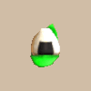 Food</h4>

<table class="dungeonItemTable">
  <tr>
    <th colspan="11" class="highlightLightblue">Food</th>
  </tr>
  <tr>
    <th>Name</th>
    <th>F</th>
    <th>S</th>
    <th>P</th>
    <th>M</th>
    <th>B</th>
    <th>H</th>
    <th>I</th>
    <th>T</th>
    <th>U</th>
    <th>W</th>
  </tr>
  <tr>
    <td class="leftText">Onigiri</td>
    <td></td>
    <td></td>
    <td></td>
    <td></td>
    <td></td>
    <td></td>
    <td></td>
    <td></td>
    <td></td>
    <td></td>
  </tr>
  <tr>
    <td class="leftText">Large Onigiri</td>
    <td></td>
    <td></td>
    <td></td>
    <td></td>
    <td></td>
    <td></td>
    <td></td>
    <td></td>
    <td></td>
    <td></td>
  </tr>
  <tr>
    <td class="leftText">Huge Onigiri</td>
    <td></td>
    <td></td>
    <td></td>
    <td></td>
    <td></td>
    <td></td>
    <td></td>
    <td></td>
    <td></td>
    <td></td>
  </tr>
  <tr>
    <td class="leftText">Rotten Onigiri</td>
    <td></td>
    <td></td>
    <td></td>
    <td></td>
    <td></td>
    <td></td>
    <td></td>
    <td></td>
    <td></td>
    <td></td>
  </tr>
  <tr>
    <td class="leftText">Grilled Onigiri</td>
    <td></td>
    <td></td>
    <td></td>
    <td></td>
    <td></td>
    <td></td>
    <td></td>
    <td></td>
    <td></td>
    <td></td>
  </tr>
  <tr>
    <td class="leftText">Special Onigiri</td>
    <td></td>
    <td></td>
    <td></td>
    <td></td>
    <td></td>
    <td></td>
    <td></td>
    <td></td>
    <td></td>
    <td></td>
  </tr>
  <tr>
    <td class="leftText">Sumo Onigiri</td>
    <td></td>
    <td></td>
    <td></td>
    <td></td>
    <td></td>
    <td></td>
    <td></td>
    <td></td>
    <td></td>
    <td></td>
  </tr>
  <tr>
    <td class="leftText">Sweet Potato</td>
    <td></td>
    <td></td>
    <td></td>
    <td></td>
    <td></td>
    <td></td>
    <td></td>
    <td></td>
    <td></td>
    <td></td>
  </tr>
  <tr>
    <td class="leftText">Yakitori</td>
    <td></td>
    <td></td>
    <td></td>
    <td></td>
    <td></td>
    <td></td>
    <td></td>
    <td></td>
    <td></td>
    <td></td>
  </tr>
  <tr>
    <td class="leftText">Rotten Peach Bun</td>
    <td></td>
    <td></td>
    <td></td>
    <td></td>
    <td></td>
    <td></td>
    <td></td>
    <td></td>
    <td></td>
    <td></td>
  </tr>
</table>

<h4 id="grass" class="heading4Blue"> Grass</h4>

<table class="dungeonItemTable">
  <tr>
    <th colspan="11" class="highlightLightblue">Grass</th>
  </tr>
  <tr>
    <th>Name</th>
    <th>F</th>
    <th>S</th>
    <th>P</th>
    <th>M</th>
    <th>B</th>
    <th>H</th>
    <th>I</th>
    <th>T</th>
    <th>U</th>
    <th>W</th>
  </tr>
  <tr>
    <td class="leftText">Weeds</td>
    <td></td>
    <td></td>
    <td></td>
    <td></td>
    <td></td>
    <td></td>
    <td></td>
    <td></td>
    <td></td>
    <td></td>
  </tr>
  <tr>
    <td class="leftText">Herb</td>
    <td></td>
    <td></td>
    <td></td>
    <td></td>
    <td></td>
    <td></td>
    <td></td>
    <td></td>
    <td></td>
    <td></td>
  </tr>
  <tr>
    <td class="leftText">Otogirisou</td>
    <td></td>
    <td></td>
    <td></td>
    <td></td>
    <td></td>
    <td></td>
    <td></td>
    <td></td>
    <td></td>
    <td></td>
  </tr>
  <tr>
    <td class="leftText">Healing Grass</td>
    <td></td>
    <td></td>
    <td></td>
    <td></td>
    <td></td>
    <td></td>
    <td></td>
    <td></td>
    <td></td>
    <td></td>
  </tr>
  <tr>
    <td class="leftText">Life Grass</td>
    <td></td>
    <td></td>
    <td></td>
    <td></td>
    <td></td>
    <td></td>
    <td></td>
    <td></td>
    <td></td>
    <td></td>
  </tr>
  <tr>
    <td class="leftText">Fragrant Grass</td>
    <td></td>
    <td></td>
    <td></td>
    <td></td>
    <td></td>
    <td></td>
    <td></td>
    <td></td>
    <td></td>
    <td></td>
  </tr>
  <tr>
    <td class="leftText">Revival Grass</td>
    <td></td>
    <td></td>
    <td></td>
    <td></td>
    <td></td>
    <td></td>
    <td></td>
    <td></td>
    <td></td>
    <td></td>
  </tr>
  <tr>
    <td class="leftText">Bellyexpand Seed</td>
    <td></td>
    <td></td>
    <td></td>
    <td></td>
    <td></td>
    <td></td>
    <td></td>
    <td></td>
    <td></td>
    <td></td>
  </tr>
  <tr>
    <td class="leftText">Bellyshrink Seed</td>
    <td></td>
    <td></td>
    <td></td>
    <td></td>
    <td></td>
    <td></td>
    <td></td>
    <td></td>
    <td></td>
    <td></td>
  </tr>
  <tr>
    <td class="leftText">Dragon Grass</td>
    <td></td>
    <td></td>
    <td></td>
    <td></td>
    <td></td>
    <td></td>
    <td></td>
    <td></td>
    <td></td>
    <td></td>
  </tr>
  <tr>
    <td class="leftText">Leaping Grass</td>
    <td></td>
    <td></td>
    <td></td>
    <td></td>
    <td></td>
    <td></td>
    <td></td>
    <td></td>
    <td></td>
    <td></td>
  </tr>
  <tr>
    <td class="leftText">Antidote Grass</td>
    <td></td>
    <td></td>
    <td></td>
    <td></td>
    <td></td>
    <td></td>
    <td></td>
    <td></td>
    <td></td>
    <td></td>
  </tr>
  <tr>
    <td class="leftText">Strength Grass</td>
    <td></td>
    <td></td>
    <td></td>
    <td></td>
    <td></td>
    <td></td>
    <td></td>
    <td></td>
    <td></td>
    <td></td>
  </tr>
  <tr>
    <td class="leftText">Poison Grass</td>
    <td></td>
    <td></td>
    <td></td>
    <td></td>
    <td></td>
    <td></td>
    <td></td>
    <td></td>
    <td></td>
    <td></td>
  </tr>
  <tr>
    <td class="leftText">Confusion Grass</td>
    <td></td>
    <td></td>
    <td></td>
    <td></td>
    <td></td>
    <td></td>
    <td></td>
    <td></td>
    <td></td>
    <td></td>
  </tr>
  <tr>
    <td class="leftText">Sedating Grass</td>
    <td></td>
    <td></td>
    <td></td>
    <td></td>
    <td></td>
    <td></td>
    <td></td>
    <td></td>
    <td></td>
    <td></td>
  </tr>
  <tr>
    <td class="leftText">Berserk Seed</td>
    <td></td>
    <td></td>
    <td></td>
    <td></td>
    <td></td>
    <td></td>
    <td></td>
    <td></td>
    <td></td>
    <td></td>
  </tr>
  <tr>
    <td class="leftText">Blinding Grass</td>
    <td></td>
    <td></td>
    <td></td>
    <td></td>
    <td></td>
    <td></td>
    <td></td>
    <td></td>
    <td></td>
    <td></td>
  </tr>
  <tr>
    <td class="leftText">Seewell Grass</td>
    <td></td>
    <td></td>
    <td></td>
    <td></td>
    <td></td>
    <td></td>
    <td></td>
    <td></td>
    <td></td>
    <td></td>
  </tr>
  <tr>
    <td class="leftText">Swift Grass</td>
    <td></td>
    <td></td>
    <td></td>
    <td></td>
    <td></td>
    <td></td>
    <td></td>
    <td></td>
    <td></td>
    <td></td>
  </tr>
  <tr>
    <td class="leftText">Power-up Grass</td>
    <td></td>
    <td></td>
    <td></td>
    <td></td>
    <td></td>
    <td></td>
    <td></td>
    <td></td>
    <td></td>
    <td></td>
  </tr>
  <tr>
    <td class="leftText">Invincible Grass</td>
    <td></td>
    <td></td>
    <td></td>
    <td></td>
    <td></td>
    <td></td>
    <td></td>
    <td></td>
    <td></td>
    <td></td>
  </tr>
  <tr>
    <td class="leftText">Fortune Grass</td>
    <td></td>
    <td></td>
    <td></td>
    <td></td>
    <td></td>
    <td></td>
    <td></td>
    <td></td>
    <td></td>
    <td></td>
  </tr>
  <tr>
    <td class="leftText">Angel Seed</td>
    <td></td>
    <td></td>
    <td></td>
    <td></td>
    <td></td>
    <td></td>
    <td></td>
    <td></td>
    <td></td>
    <td></td>
  </tr>
  <tr>
    <td class="leftText">Feeble Grass</td>
    <td></td>
    <td></td>
    <td></td>
    <td></td>
    <td></td>
    <td></td>
    <td></td>
    <td></td>
    <td></td>
    <td></td>
  </tr>
  <tr>
    <td class="leftText">Unlucky Seed</td>
    <td></td>
    <td></td>
    <td></td>
    <td></td>
    <td></td>
    <td></td>
    <td></td>
    <td></td>
    <td></td>
    <td></td>
  </tr>
  <tr>
    <td class="leftText">Ill-fated Seed</td>
    <td></td>
    <td></td>
    <td></td>
    <td></td>
    <td></td>
    <td></td>
    <td></td>
    <td></td>
    <td></td>
    <td></td>
  </tr>
</table>

<h4 id="scroll" class="heading4Blue"> Scroll</h4>

<table class="dungeonItemTable">
  <tr>
    <th colspan="11" class="highlightLightblue">Scroll</th>
  </tr>
  <tr>
    <th>Name</th>
    <th>F</th>
    <th>S</th>
    <th>P</th>
    <th>M</th>
    <th>B</th>
    <th>H</th>
    <th>I</th>
    <th>T</th>
    <th>U</th>
    <th>W</th>
  </tr>
  <tr>
    <td class="leftText">Confusion Scroll</td>
    <td></td>
    <td></td>
    <td></td>
    <td></td>
    <td></td>
    <td></td>
    <td></td>
    <td></td>
    <td></td>
    <td></td>
  </tr>
  <tr>
    <td class="leftText">Slumber Scroll</td>
    <td></td>
    <td></td>
    <td></td>
    <td></td>
    <td></td>
    <td></td>
    <td></td>
    <td></td>
    <td></td>
    <td></td>
  </tr>
  <tr>
    <td class="leftText">Jitters Scroll</td>
    <td></td>
    <td></td>
    <td></td>
    <td></td>
    <td></td>
    <td></td>
    <td></td>
    <td></td>
    <td></td>
    <td></td>
  </tr>
  <tr>
    <td class="leftText">Windblade Scroll</td>
    <td></td>
    <td></td>
    <td></td>
    <td></td>
    <td></td>
    <td></td>
    <td></td>
    <td></td>
    <td></td>
    <td></td>
  </tr>
  <tr>
    <td class="leftText">Expulsion Scroll</td>
    <td></td>
    <td></td>
    <td></td>
    <td></td>
    <td></td>
    <td></td>
    <td></td>
    <td></td>
    <td></td>
    <td></td>
  </tr>
  <tr>
    <td class="leftText">Exorcism Scroll</td>
    <td></td>
    <td></td>
    <td></td>
    <td></td>
    <td></td>
    <td></td>
    <td></td>
    <td></td>
    <td></td>
    <td></td>
  </tr>
  <tr>
    <td class="leftText">Identifier Scroll</td>
    <td></td>
    <td></td>
    <td></td>
    <td></td>
    <td></td>
    <td></td>
    <td></td>
    <td></td>
    <td></td>
    <td></td>
  </tr>
  <tr>
    <td class="leftText">Heavenly Scroll</td>
    <td></td>
    <td></td>
    <td></td>
    <td></td>
    <td></td>
    <td></td>
    <td></td>
    <td></td>
    <td></td>
    <td></td>
  </tr>
  <tr>
    <td class="leftText">Earthly Scroll</td>
    <td></td>
    <td></td>
    <td></td>
    <td></td>
    <td></td>
    <td></td>
    <td></td>
    <td></td>
    <td></td>
    <td></td>
  </tr>
  <tr>
    <td class="leftText">Plating Scroll</td>
    <td></td>
    <td></td>
    <td></td>
    <td></td>
    <td></td>
    <td></td>
    <td></td>
    <td></td>
    <td></td>
    <td></td>
  </tr>
  <tr>
    <td class="leftText">Slot-adding Scroll</td>
    <td></td>
    <td></td>
    <td></td>
    <td></td>
    <td></td>
    <td></td>
    <td></td>
    <td></td>
    <td></td>
    <td></td>
  </tr>
  <tr>
    <td class="leftText">Rune-eraser Scroll</td>
    <td></td>
    <td></td>
    <td></td>
    <td></td>
    <td></td>
    <td></td>
    <td></td>
    <td></td>
    <td></td>
    <td></td>
  </tr>
  <tr>
    <td class="leftText">Silver-seal Scroll</td>
    <td></td>
    <td></td>
    <td></td>
    <td></td>
    <td></td>
    <td></td>
    <td></td>
    <td></td>
    <td></td>
    <td></td>
  </tr>
  <tr>
    <td class="leftText">Silverpurge Scroll</td>
    <td></td>
    <td></td>
    <td></td>
    <td></td>
    <td></td>
    <td></td>
    <td></td>
    <td></td>
    <td></td>
    <td></td>
  </tr>
  <tr>
    <td class="leftText">Pot-upsize Scroll</td>
    <td></td>
    <td></td>
    <td></td>
    <td></td>
    <td></td>
    <td></td>
    <td></td>
    <td></td>
    <td></td>
    <td></td>
  </tr>
  <tr>
    <td class="leftText">Extraction Scroll</td>
    <td></td>
    <td></td>
    <td></td>
    <td></td>
    <td></td>
    <td></td>
    <td></td>
    <td></td>
    <td></td>
    <td></td>
  </tr>
  <tr>
    <td class="leftText">Onigiri Scroll</td>
    <td></td>
    <td></td>
    <td></td>
    <td></td>
    <td></td>
    <td></td>
    <td></td>
    <td></td>
    <td></td>
    <td></td>
  </tr>
  <tr>
    <td class="leftText">Curse Scroll</td>
    <td></td>
    <td></td>
    <td></td>
    <td></td>
    <td></td>
    <td></td>
    <td></td>
    <td></td>
    <td></td>
    <td></td>
  </tr>
  <tr>
    <td class="leftText">Mapping Scroll</td>
    <td></td>
    <td></td>
    <td></td>
    <td></td>
    <td></td>
    <td></td>
    <td></td>
    <td></td>
    <td></td>
    <td></td>
  </tr>
  <tr>
    <td class="leftText">Map-loss Scroll</td>
    <td></td>
    <td></td>
    <td></td>
    <td></td>
    <td></td>
    <td></td>
    <td></td>
    <td></td>
    <td></td>
    <td></td>
  </tr>
  <tr>
    <td class="leftText">Trap-eraser Scroll</td>
    <td></td>
    <td></td>
    <td></td>
    <td></td>
    <td></td>
    <td></td>
    <td></td>
    <td></td>
    <td></td>
    <td></td>
  </tr>
  <tr>
    <td class="leftText">Trap Scroll</td>
    <td></td>
    <td></td>
    <td></td>
    <td></td>
    <td></td>
    <td></td>
    <td></td>
    <td></td>
    <td></td>
    <td></td>
  </tr>
  <tr>
    <td class="leftText">Water-drain Scroll</td>
    <td></td>
    <td></td>
    <td></td>
    <td></td>
    <td></td>
    <td></td>
    <td></td>
    <td></td>
    <td></td>
    <td></td>
  </tr>
  <tr>
    <td class="leftText">Monstercall Scroll</td>
    <td></td>
    <td></td>
    <td></td>
    <td></td>
    <td></td>
    <td></td>
    <td></td>
    <td></td>
    <td></td>
    <td></td>
  </tr>
  <tr>
    <td class="leftText">Wall-less Scroll</td>
    <td></td>
    <td></td>
    <td></td>
    <td></td>
    <td></td>
    <td></td>
    <td></td>
    <td></td>
    <td></td>
    <td></td>
  </tr>
  <tr>
    <td class="leftText">Gathering Scroll</td>
    <td></td>
    <td></td>
    <td></td>
    <td></td>
    <td></td>
    <td></td>
    <td></td>
    <td></td>
    <td></td>
    <td></td>
  </tr>
  <tr>
    <td class="leftText">Collection Scroll</td>
    <td></td>
    <td></td>
    <td></td>
    <td></td>
    <td></td>
    <td></td>
    <td></td>
    <td></td>
    <td></td>
    <td></td>
  </tr>
  <tr>
    <td class="leftText">Gambler's Scroll</td>
    <td></td>
    <td></td>
    <td></td>
    <td></td>
    <td></td>
    <td></td>
    <td></td>
    <td></td>
    <td></td>
    <td></td>
  </tr>
  <tr>
    <td class="leftText">Muzzle Scroll</td>
    <td></td>
    <td></td>
    <td></td>
    <td></td>
    <td></td>
    <td></td>
    <td></td>
    <td></td>
    <td></td>
    <td></td>
  </tr>
  <tr>
    <td class="leftText">Carry-ban Scroll</td>
    <td></td>
    <td></td>
    <td></td>
    <td></td>
    <td></td>
    <td></td>
    <td></td>
    <td></td>
    <td></td>
    <td></td>
  </tr>
  <tr>
    <td class="leftText">Swift Foe Scroll</td>
    <td></td>
    <td></td>
    <td></td>
    <td></td>
    <td></td>
    <td></td>
    <td></td>
    <td></td>
    <td></td>
    <td></td>
  </tr>
  <tr>
    <td class="leftText">Fixer Scroll</td>
    <td></td>
    <td></td>
    <td></td>
    <td></td>
    <td></td>
    <td></td>
    <td></td>
    <td></td>
    <td></td>
    <td></td>
  </tr>
  <tr>
    <td class="leftText">Escape Scroll</td>
    <td></td>
    <td></td>
    <td></td>
    <td></td>
    <td></td>
    <td></td>
    <td></td>
    <td></td>
    <td></td>
    <td></td>
  </tr>
  <tr>
    <td class="leftText">Eradication Scroll</td>
    <td></td>
    <td></td>
    <td></td>
    <td></td>
    <td></td>
    <td></td>
    <td></td>
    <td></td>
    <td></td>
    <td></td>
  </tr>
  <tr>
    <td class="leftText">Sanctuary Scroll</td>
    <td></td>
    <td></td>
    <td></td>
    <td></td>
    <td></td>
    <td></td>
    <td></td>
    <td></td>
    <td></td>
    <td></td>
  </tr>
  <tr>
    <td class="leftText">Blank Scroll</td>
    <td></td>
    <td></td>
    <td></td>
    <td></td>
    <td></td>
    <td></td>
    <td></td>
    <td></td>
    <td></td>
    <td></td>
  </tr>
  <tr>
    <td class="leftText">Wet Scroll</td>
    <td></td>
    <td></td>
    <td></td>
    <td></td>
    <td></td>
    <td></td>
    <td></td>
    <td></td>
    <td></td>
    <td></td>
  </tr>
</table>

<h4 id="staff" class="heading4Blue">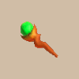 Staff</h4>

<table class="dungeonItemTable">
  <tr>
    <th colspan="11" class="highlightLightblue">Staff</th>
  </tr>
  <tr>
    <th>Name</th>
    <th>F</th>
    <th>S</th>
    <th>P</th>
    <th>M</th>
    <th>B</th>
    <th>H</th>
    <th>I</th>
    <th>T</th>
    <th>U</th>
    <th>W</th>
  </tr>
  <tr>
    <td class="leftText">Ordinary Staff</td>
    <td></td>
    <td></td>
    <td></td>
    <td></td>
    <td></td>
    <td></td>
    <td></td>
    <td></td>
    <td></td>
    <td></td>
  </tr>
  <tr>
    <td class="leftText">Paralyzing Staff</td>
    <td></td>
    <td></td>
    <td></td>
    <td></td>
    <td></td>
    <td></td>
    <td></td>
    <td></td>
    <td></td>
    <td></td>
  </tr>
  <tr>
    <td class="leftText">Sealing Staff</td>
    <td></td>
    <td></td>
    <td></td>
    <td></td>
    <td></td>
    <td></td>
    <td></td>
    <td></td>
    <td></td>
    <td></td>
  </tr>
  <tr>
    <td class="leftText">Disguising Staff</td>
    <td></td>
    <td></td>
    <td></td>
    <td></td>
    <td></td>
    <td></td>
    <td></td>
    <td></td>
    <td></td>
    <td></td>
  </tr>
  <tr>
    <td class="leftText">Empathetic Staff</td>
    <td></td>
    <td></td>
    <td></td>
    <td></td>
    <td></td>
    <td></td>
    <td></td>
    <td></td>
    <td></td>
    <td></td>
  </tr>
  <tr>
    <td class="leftText">Narrow-escape Staff</td>
    <td></td>
    <td></td>
    <td></td>
    <td></td>
    <td></td>
    <td></td>
    <td></td>
    <td></td>
    <td></td>
    <td></td>
  </tr>
  <tr>
    <td class="leftText">Knockback Staff</td>
    <td></td>
    <td></td>
    <td></td>
    <td></td>
    <td></td>
    <td></td>
    <td></td>
    <td></td>
    <td></td>
    <td></td>
  </tr>
  <tr>
    <td class="leftText">Switching Staff</td>
    <td></td>
    <td></td>
    <td></td>
    <td></td>
    <td></td>
    <td></td>
    <td></td>
    <td></td>
    <td></td>
    <td></td>
  </tr>
  <tr>
    <td class="leftText">Vaulting Staff</td>
    <td></td>
    <td></td>
    <td></td>
    <td></td>
    <td></td>
    <td></td>
    <td></td>
    <td></td>
    <td></td>
    <td></td>
  </tr>
  <tr>
    <td class="leftText">Skull Mage's Staff</td>
    <td></td>
    <td></td>
    <td></td>
    <td></td>
    <td></td>
    <td></td>
    <td></td>
    <td></td>
    <td></td>
    <td></td>
  </tr>
  <tr>
    <td class="leftText">Thunderbolt Staff</td>
    <td></td>
    <td></td>
    <td></td>
    <td></td>
    <td></td>
    <td></td>
    <td></td>
    <td></td>
    <td></td>
    <td></td>
  </tr>
  <tr>
    <td class="leftText">Burrowing Staff</td>
    <td></td>
    <td></td>
    <td></td>
    <td></td>
    <td></td>
    <td></td>
    <td></td>
    <td></td>
    <td></td>
    <td></td>
  </tr>
  <tr>
    <td class="leftText">Earthmound Staff</td>
    <td></td>
    <td></td>
    <td></td>
    <td></td>
    <td></td>
    <td></td>
    <td></td>
    <td></td>
    <td></td>
    <td></td>
  </tr>
  <tr>
    <td class="leftText">Balance Staff</td>
    <td></td>
    <td></td>
    <td></td>
    <td></td>
    <td></td>
    <td></td>
    <td></td>
    <td></td>
    <td></td>
    <td></td>
  </tr>
  <tr>
    <td class="leftText">Guiding Staff</td>
    <td></td>
    <td></td>
    <td></td>
    <td></td>
    <td></td>
    <td></td>
    <td></td>
    <td></td>
    <td></td>
    <td></td>
  </tr>
  <tr>
    <td class="leftText">Swift Staff</td>
    <td></td>
    <td></td>
    <td></td>
    <td></td>
    <td></td>
    <td></td>
    <td></td>
    <td></td>
    <td></td>
    <td></td>
  </tr>
  <tr>
    <td class="leftText">Sluggish Staff</td>
    <td></td>
    <td></td>
    <td></td>
    <td></td>
    <td></td>
    <td></td>
    <td></td>
    <td></td>
    <td></td>
    <td></td>
  </tr>
  <tr>
    <td class="leftText">Fortune Staff</td>
    <td></td>
    <td></td>
    <td></td>
    <td></td>
    <td></td>
    <td></td>
    <td></td>
    <td></td>
    <td></td>
    <td></td>
  </tr>
  <tr>
    <td class="leftText">Unlucky Staff</td>
    <td></td>
    <td></td>
    <td></td>
    <td></td>
    <td></td>
    <td></td>
    <td></td>
    <td></td>
    <td></td>
    <td></td>
  </tr>
  <tr>
    <td class="leftText">Peach Staff</td>
    <td></td>
    <td></td>
    <td></td>
    <td></td>
    <td></td>
    <td></td>
    <td></td>
    <td></td>
    <td></td>
    <td></td>
  </tr>
</table>

<h4 id="pot" class="heading4Blue">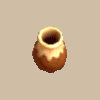 Pot</h4>

<table class="dungeonItemTable">
  <tr>
    <th colspan="11" class="highlightLightblue">Pot</th>
  </tr>
  <tr>
    <th>Name</th>
    <th>F</th>
    <th>S</th>
    <th>P</th>
    <th>M</th>
    <th>B</th>
    <th>H</th>
    <th>I</th>
    <th>T</th>
    <th>U</th>
    <th>W</th>
  </tr>
  <tr>
    <td class="leftText">Preservation Pot</td>
    <td></td>
    <td></td>
    <td></td>
    <td></td>
    <td></td>
    <td></td>
    <td></td>
    <td></td>
    <td></td>
    <td></td>
  </tr>
  <tr>
    <td class="leftText">Identifier Pot</td>
    <td></td>
    <td></td>
    <td></td>
    <td></td>
    <td></td>
    <td></td>
    <td></td>
    <td></td>
    <td></td>
    <td></td>
  </tr>
  <tr>
    <td class="leftText">Transmutation Pot</td>
    <td></td>
    <td></td>
    <td></td>
    <td></td>
    <td></td>
    <td></td>
    <td></td>
    <td></td>
    <td></td>
    <td></td>
  </tr>
  <tr>
    <td class="leftText">Cashing Pot</td>
    <td></td>
    <td></td>
    <td></td>
    <td></td>
    <td></td>
    <td></td>
    <td></td>
    <td></td>
    <td></td>
    <td></td>
  </tr>
  <tr>
    <td class="leftText">Synthesis Pot</td>
    <td></td>
    <td></td>
    <td></td>
    <td></td>
    <td></td>
    <td></td>
    <td></td>
    <td></td>
    <td></td>
    <td></td>
  </tr>
  <tr>
    <td class="leftText">Exorcism Pot</td>
    <td></td>
    <td></td>
    <td></td>
    <td></td>
    <td></td>
    <td></td>
    <td></td>
    <td></td>
    <td></td>
    <td></td>
  </tr>
  <tr>
    <td class="leftText">Curse Pot</td>
    <td></td>
    <td></td>
    <td></td>
    <td></td>
    <td></td>
    <td></td>
    <td></td>
    <td></td>
    <td></td>
    <td></td>
  </tr>
  <tr>
    <td class="leftText">Upgrading Pot</td>
    <td></td>
    <td></td>
    <td></td>
    <td></td>
    <td></td>
    <td></td>
    <td></td>
    <td></td>
    <td></td>
    <td></td>
  </tr>
  <tr>
    <td class="leftText">Degrading Pot</td>
    <td></td>
    <td></td>
    <td></td>
    <td></td>
    <td></td>
    <td></td>
    <td></td>
    <td></td>
    <td></td>
    <td></td>
  </tr>
  <tr>
    <td class="leftText">Bottomless Pot</td>
    <td></td>
    <td></td>
    <td></td>
    <td></td>
    <td></td>
    <td></td>
    <td></td>
    <td></td>
    <td></td>
    <td></td>
  </tr>
  <tr>
    <td class="leftText">Warehouse Pot</td>
    <td></td>
    <td></td>
    <td></td>
    <td></td>
    <td></td>
    <td></td>
    <td></td>
    <td></td>
    <td></td>
    <td></td>
  </tr>
  <tr>
    <td class="leftText">Handtrapper Pot</td>
    <td></td>
    <td></td>
    <td></td>
    <td></td>
    <td></td>
    <td></td>
    <td></td>
    <td></td>
    <td></td>
    <td></td>
  </tr>
  <tr>
    <td class="leftText">Unbreakable Pot</td>
    <td></td>
    <td></td>
    <td></td>
    <td></td>
    <td></td>
    <td></td>
    <td></td>
    <td></td>
    <td></td>
    <td></td>
  </tr>
  <tr>
    <td class="leftText">Ordinary Pot</td>
    <td></td>
    <td></td>
    <td></td>
    <td></td>
    <td></td>
    <td></td>
    <td></td>
    <td></td>
    <td></td>
    <td></td>
  </tr>
  <tr>
    <td class="leftText">Hiding Pot</td>
    <td></td>
    <td></td>
    <td></td>
    <td></td>
    <td></td>
    <td></td>
    <td></td>
    <td></td>
    <td></td>
    <td></td>
  </tr>
  <tr>
    <td class="leftText">Rejuvenation Pot</td>
    <td></td>
    <td></td>
    <td></td>
    <td></td>
    <td></td>
    <td></td>
    <td></td>
    <td></td>
    <td></td>
    <td></td>
  </tr>
  <tr>
    <td class="leftText">Walrus Pot</td>
    <td></td>
    <td></td>
    <td></td>
    <td></td>
    <td></td>
    <td></td>
    <td></td>
    <td></td>
    <td></td>
    <td></td>
  </tr>
  <tr>
    <td class="leftText">Water Gun Pot</td>
    <td></td>
    <td></td>
    <td></td>
    <td></td>
    <td></td>
    <td></td>
    <td></td>
    <td></td>
    <td></td>
    <td></td>
  </tr>
  <tr>
    <td class="leftText">Hilarious Pot</td>
    <td></td>
    <td></td>
    <td></td>
    <td></td>
    <td></td>
    <td></td>
    <td></td>
    <td></td>
    <td></td>
    <td></td>
  </tr>
  <tr>
    <td class="leftText">Monster Pot</td>
    <td></td>
    <td></td>
    <td></td>
    <td></td>
    <td></td>
    <td></td>
    <td></td>
    <td></td>
    <td></td>
    <td></td>
  </tr>
  <tr>
    <td class="leftText">Surprise Pot</td>
    <td></td>
    <td></td>
    <td></td>
    <td></td>
    <td></td>
    <td></td>
    <td></td>
    <td></td>
    <td></td>
    <td></td>
  </tr>
</table>

<h4 id="incense" class="heading4Blue">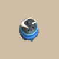 Incense</h4>

<table class="dungeonItemTable">
  <tr>
    <th colspan="11" class="highlightLightblue">Incense</th>
  </tr>
  <tr>
    <th>Name</th>
    <th>F</th>
    <th>S</th>
    <th>P</th>
    <th>M</th>
    <th>B</th>
    <th>H</th>
    <th>I</th>
    <th>T</th>
    <th>U</th>
    <th>W</th>
  </tr>
  <tr>
    <td class="leftText">Heat-ban Incense</td>
    <td></td>
    <td></td>
    <td></td>
    <td></td>
    <td></td>
    <td></td>
    <td></td>
    <td></td>
    <td></td>
    <td></td>
  </tr>
  <tr>
    <td class="leftText">Evasive Incense</td>
    <td></td>
    <td></td>
    <td></td>
    <td></td>
    <td></td>
    <td></td>
    <td></td>
    <td></td>
    <td></td>
    <td></td>
  </tr>
  <tr>
    <td class="leftText">Cautious Incense</td>
    <td></td>
    <td></td>
    <td></td>
    <td></td>
    <td></td>
    <td></td>
    <td></td>
    <td></td>
    <td></td>
    <td></td>
  </tr>
  <tr>
    <td class="leftText">Reflective Incense</td>
    <td></td>
    <td></td>
    <td></td>
    <td></td>
    <td></td>
    <td></td>
    <td></td>
    <td></td>
    <td></td>
    <td></td>
  </tr>
  <tr>
    <td class="leftText">Aggressive Incense</td>
    <td></td>
    <td></td>
    <td></td>
    <td></td>
    <td></td>
    <td></td>
    <td></td>
    <td></td>
    <td></td>
    <td></td>
  </tr>
  <tr>
    <td class="leftText">Defensive Incense</td>
    <td></td>
    <td></td>
    <td></td>
    <td></td>
    <td></td>
    <td></td>
    <td></td>
    <td></td>
    <td></td>
    <td></td>
  </tr>
  <tr>
    <td class="leftText">Blurry Incense</td>
    <td></td>
    <td></td>
    <td></td>
    <td></td>
    <td></td>
    <td></td>
    <td></td>
    <td></td>
    <td></td>
    <td></td>
  </tr>
  <tr>
    <td class="leftText">Weighted Incense</td>
    <td></td>
    <td></td>
    <td></td>
    <td></td>
    <td></td>
    <td></td>
    <td></td>
    <td></td>
    <td></td>
    <td></td>
  </tr>
  <tr>
    <td class="leftText">Unwanting Incense</td>
    <td></td>
    <td></td>
    <td></td>
    <td></td>
    <td></td>
    <td></td>
    <td></td>
    <td></td>
    <td></td>
    <td></td>
  </tr>
</table>
