

  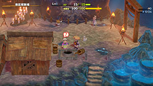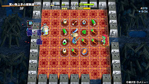

# Overview

<table class="dungeonOverview">
  <tr>
    <th>Unlock</th>
    <td class="highlightYellow">Clear Serpentcoil Island → Go to the well in Underwater Training Ground.</td>
  </tr>
  <tr>
    <th>Entrance</th>
    <td class="highlightYellow">Underwater Training Ground (Well)</td>
  </tr>
</table>

<table class="dungeonTable">
  <tr>
    <th>Floors</th>
    <td colspan="3">40F / 99F (Sacred Tree)</td>
  </tr>
  <tr>
    <th>Bring Items</th>
    <td>Yes</td>
    <th>Stairs</th>
    <td>Descending</td>
  </tr>
  <tr>
    <th>Companions</th>
    <td>Yes</td>
    <th>Roamers</th>
    <td>Yes</td>
  </tr>
  <tr>
    <th>Rescues</th>
    <td>3</td>
    <th>Starting Level</th>
    <td>Lv1</td>
  </tr>
  <tr>
    <th>Starting Item</th>
    <td colspan="3">Large Onigiri</td>
  </tr>
  <tr>
    <th>Unidentified</th>
    <td colspan="3">Bracelets, Pots, Grass, Scrolls, Staves</td>
  </tr>
  <tr>
    <th>Shops</th>
    <td>Yes</td>
    <th>Monster Houses</th>
    <td>Yes (Regular, Sudden, Special)</td>
  </tr>
  <tr>
    <th>Behemoths</th>
    <td>Yes</td>
    <th>Wishing Shrines</th>
    <td>Yes</td>
  </tr>
  <tr>
    <th>Kron's Challenge</th>
    <td>Yes</td>
    <th>Fever Time</th>
    <td>Yes</td>
  </tr>
  <tr>
    <th>Initial Enemies</th>
    <td>5~9</td>
    <th>Spawn Rate</th>
    <td>30 Turns</td>
  </tr>
  <tr>
    <th>Wind (1st Gust)</th>
    <td>900 Turns</td>
    <th>Reward</th>
    <td>Shield of Presage (Gold)</td>
  </tr>
</table>

Postgame dungeon where shops and peddlers are common, and floor items mostly consist of Gitan. The gimmick is similar to Asuka Kenzan's 自由経済活動 and Shiren 4 Plus's Mystery Shopping Mall, but unlike those two dungeons, you're allowed to bring items into Training Path of Shopping. Overall, it's a decent place to find some uncommon bracelets and practice stealing techniques.

# Navigation

<ul class="quickLinksUL">
  <li><a href="#strategy">Strategy</a>
    <ul>
      <li><a href="#dungeon-characteristics">Dungeon Characteristics</a></li>
      <li><a href="#restricted-play-(start-from-sozoro-bay)">Restricted Play (Start from Sozoro Bay)</a></li>
      <li><a href="#restricted-play-(no-bringing-items)">Restricted Play (No Bringing Items)</a></li>
      <li><a href="#important-items-(bringing-items)">Important Items (Bringing Items)</a></li>
      <li><a href="#travel-companions">Travel Companions</a></li>
      <li><a href="#farming-techniques">Farming Techniques</a></li>
    </ul>
  </li>
  <li><a href="#floor-guide">Floor Guide</a>
    <ul>
      <li><a href="#first-clear">First Clear</a>
        <ul>
          <li><a href="#1-2f">1-2F</a></li>
          <li><a href="#3-4f">3-4F</a></li>
          <li><a href="#5-10f">5-10F</a></li>
          <li><a href="#11-14f">11-14F</a></li>
          <li><a href="#15-19f">15-19F</a></li>
          <li><a href="#20-24f">20-24F</a></li>
          <li><a href="#25-30f">25-30F</a></li>
          <li><a href="#31-40f">31-40F</a></li>
        </ul>
      </li>
      <li><a href="#sacred-tree-extension">Sacred Tree Extension</a>
        <ul>
          <li><a href="#1-40f">1-40F</a></li>
          <li><a href="#41-99f">41-99F</a></li>
        </ul>
      </li>
    </ul>
  </li>
  <li><a href="#monsters">Monsters</a></li>
  <li><a href="#behemoths">Behemoths</a></li>
  <li><a href="#items">Items</a>
    <ul>
      <li><a href="#weapon">Weapon</a></li>
      <li><a href="#shield">Shield</a></li>
      <li><a href="#bracelet">Bracelet</a></li>
      <li><a href="#projectile">Projectile</a></li>
      <li><a href="#food-(items)">Food</a></li>
      <li><a href="#grass">Grass</a></li>
      <li><a href="#scroll">Scroll</a></li>
      <li><a href="#stave">Staff</a></li>
      <li><a href="#pot">Pot</a></li>
      <li><a href="#incense">Incense</a></li>
    </ul>
  </li>
</ul>

# Strategy

<h3 id="dungeon-characteristics" class="heading3Yellow">Dungeon Characteristics</h3>

Most items generated are Gitan bags aside from items in walls, and shops are extremely common. Nazoh (Peddler) also appears, so there will be plenty of chances to obtain Gitan and go shopping. It goes without saying, but most non-Gitan bag items will have to be purchased or stolen from shops, and the kind of dungeon shop or exact lineup of merchandise you'll come across is of course random. Specialty shops that only stock one item category can appear, like a shop that only sells scrolls.

<h4 id="extra-notes" class="heading4Yellow"> Extra Notes</h4>

- Monsters are stronger than [Sumo Dungeon](/dungeons/sumo-dungeon), [Dune of Batsu](/dungeons/dune-of-batsu), and [Training Path of Gimmicks](/dungeons/training-path-of-gimmicks).
    - Minotaurs and other enemies from [Serpentcoil Island](/dungeons/serpentcoil-island)'s mid-game floors appear from 3F.
    - Starting from 10F, the monster table is updated with tricky monsters every 5\~10 floors.
    - 31-40F features very dangerous monsters like Miracle Hen, Nigiri Honcho, and Nimble Knave.
- Flowing water and rafts are somewhat common, and a Porkon or monk on a raft can be tricky.
- Monster Houses are uncommon, but Sudden and Special styles can be generated on occasion.
- Behemoth Gates have a chance of being generated between 2-19F, 21-39F, and 41-98F.
- Overall, it's said to be the 3rd hardest dungeon among those that allow bringing items.
    - The harder dungeons are [Isle of the Mighty](/dungeons/isle-of-the-mighty) and [Clash of Weapons and Shields](/dungeons/clash-of-weapons-and-shields).
- It's important to synthesize defensive runes to block as many special attacks as possible.
    - Don't forget to bring a powerful weapon, shield, and a variety of bracelets as well.

<h4 id="dangerous-merchandise" class="heading4Yellow">  Dangerous Merchandise</h4>

Bring the following 5 items in a Preservation Pot for auto-identification purposes, which will prevent accidentally using them in an unidentified state while shopping.

|Item|Buying Price|Selling Price|
|-|-|-|
|Leaping Grass|100|40|
|Silver-seal Scroll|300|120|
|Onigiri Scroll|400|160|
|Rune-eraser Scroll|400|160|
|Gambler's Scroll|1000|400|

<h4 id="item-table" class="heading4Yellow"> Item Table</h4>

The floor table mostly consists of Gitan bags so a player is bound to assume that other items can only be obtained from shops, but non-Gitan items are often generated in wall tiles here. The frequency is also high, perhaps with around half or more of the floors featuring buried items. Therefore, it's best to bring items like Burrowing Staff, Item-find Bracelet, Collection Scroll, etc. Shiny wall tiles and single tile pillars in rooms can also be destroyed by any normal attack, and unlike digging with a Pickaxe, your equipped weapon's upgrade value won't decrease.

While slain monsters mostly drop Gitan bags if they drop an item, certain families drop other items. These families include the likes of Minotaur (3-6F), Ironwalrus (11-30F), Magicwalrus (31-40F), etc. Also, items generated by reading a Monstercall Scroll will also mostly be Gitan bags.

To be precise, weapon and shield category items can rarely be generated even in this dungeon. However, this is currently thought to be exclusive to 1F, and the chance is still extremely low. Only basic gear (Katana, Fuuma Shield, etc.) and the Break-Off set have been sighted so far.

<h4 id="dungeon-gimmick-&-trap" class="heading4Yellow"> Dungeon Gimmicks & Traps</h4>

Bouncy Walls, Fever Times, Kron's Challenges, and Wishing Shrines can be encountered here. Unfortunately, Item Fever features floor table items, so it mostly generates Gitan bags. Tunnel of Wishes adjust the item table to match the wish, so enemies can drop other items.

A wider variety of traps appear compared to Serpentcoil Island, but unlike Dune of Batsu or such, Feeding and Starvation traps are never generated, so the player's Max Fullness is safe. It seems like Silver-seal, Curse, Gassy, Summoning, and Pitfall traps have a high rate. The first two traps in the above list are quite troublesome, so Sumo status is a significant help. The stairs are descending, so Pitfall Trap can be used to safely steal from a dungeon shop. Blast and Explosion traps can be used to make Grilled Onigiri, helping with HP management when relying on Wallpass Bracelet to travel through walls when stealing from a dungeon shop. Gassy Trap is handy when solo, but backfires by separating you from companions in a party. Poison Arrow Trap can appear, but it's rare so don't expect to collect lots of Poison Arrows.

<h3 id="restricted-play-(start-from-sozoro-bay)" class="heading3Red">Restricted Play (Start from Sozoro Bay)</h3>

Challenge where you enter Sozoro Bay without bringing items, go to Underwater Training Ground, then enter the first clear depth of Training Path of Shopping with the items you've collected. Expect a solid challenge thanks to weak gear options and powerful foes in the monster table, but an early game Wallpass Bracelet or Travel Companion can turn the tide even with a bad start. Generally speaking, it's hard to clear this challenge if you don't find a strong option by 11F.

<h3 id="restricted-play-(no-bringing-items)" class="heading3Red">Restricted Play (No Bringing Items)</h3>

On paper, it's possible to clear this dungeon's first clear depth without bringing any items. 1-2F has high value Gitan bags on the ground, so with some shop luck, you can get a run going. That said, it basically requires either an early Wallpass Bracelet or Travel Companion, so expect to restart the dungeon a lot - especially due to Death Reapers appearing on 1F. Overall, this challenge is not recommended over the "Start from Sozoro Bay" version.

<h3 id="important-items-(bringing-items)" class="heading3Purple">Important Items (Bringing Items)</h3>

<h4 id="weapon-&-shield" class="heading4Purple">  Weapon & Shield</h4>

<b><u>Yamanba's Cleaver & Yamanba's Potlid</u></b> Method to start the dungeon with 10+ strength, allowing for 2 bracelets to be equipped.

<b><u>Kabura Sutegi & Rasen Fuuma (+ 2 Strength Grass)</u></b> Another way to start the dungeon with 10 strength, allowing for 2 bracelets to be equipped. Don't forget to bring a Rejuvenation Pot, since Poison Arrow Trap can lower your strength. The weapon and shield doesn't have to be Kabura Sutegi and Rasen Fuuma, provided they're strong.

<h4 id="weapon-runes" class="heading4Purple"> Weapon Runes</h4>

|Icon|Name|Source|Notes|
|-|-|-|-|
||Rustproof|Golden Sword Plating Scroll|Prevents upgrade value from decreasing due to rust. Raises accuracy of normal attacks by 2.0% (92% → 94%). Mudkin family doesn't spawn, but Water Ninja A (41-59F) appears.|
||Frontal Attack|Kama Itachi|Attack 3 forward directions at the same time.|
||Peach Bun|Peach Club|30% chance for a defeated monster to drop a Peach Bun. Replenish Fullness, stock up on Mixergon Buns on 16-30F.|
||Critical|Axe of the Minotaur|30% chance to land a x1.5 damage critical hit.|
||Swift Strikes|Swift Sword|25% chance to attack 2 times in a row (2nd hit has 50% damage).|
||Confusing|Confusion Grass|9% chance to inflict Confused status (20 turns).|
||Sedating|Sedating Grass|9% chance to inflict Asleep status (6 turns).|
||Blinding|Blinding Grass|9% chance to inflict Blind status.|
||Paralyzing|Paralyzing Staff|9% chance to inflict Paralyzed status.|
||Anti-Beast|Primal Axe|Deal x1.5 damage to Beast type monsters. Miracle Hen (31-50F), Porgon (66-99F), Grampadillo (76-99F), etc.|
||Anti-Draining|Drain Slayer|Deal x1.5 damage to Draining type monsters. Polygon Singa (11-30F) and Polygon Stunna (81-95F).|
||Anti-Ghost|Sickle of Salvation|Deal x1.5 damage to Ghost type monsters. Skull Wizard (5-10F) and Skullmancer (22-30F).|
||Anti-Cyclops|Cyclops Bane|Deal x1.5 damage to Cyclops type monsters. Hyper Gazer (20-30F), Deathead (41-70F), Detonachin (60-80F), etc.|
||Anti-Dragon|Dragonkiller|Deal x1.5 damage to Dragon type monsters. Dragon Pit (11-19F), Lashagga (20-24F), Abyss Dragon (60-70F), etc.|

<h4 id="shield-runes" class="heading4Purple"> Shield Runes</h4>

|Icon|Name|Source|Notes|
|-|-|-|-|
||Rustproof|Golden Shield Plating Scroll|Prevents upgrade value from decreasing due to rust. Mudkin family doesn't spawn, but Water Ninja A (41-59F) appears.|
||Magic Cancel|Shield of Negation|Nullifies magic bullets aimed at you. Skull Wizard (5-10F) and Skullmancer (22-30F).|
||Hypnosisproof|Gazer Shield|Protects against Gazer's hypnosis. Hyper Gazer (20-30F) and Ultra Gazer (50F, 60F, 70F, 80F, 90F).|
||Walrusproof|Walrus Stopper|Thiefwalrus monsters can't steal your items. Ironwalrus (11-30F) and Magicwalrus (31-40F).|
||Nigiriproof|Nigiri Stopper|Nigiri Morphs can't turn items into onigiri, prevents Onigiri status. Nigiri Boss (11-19F) and Nigiri Honcho (31-50F).|
||Anti-Dragon|Dragon Shield|Reduces fire and Dragon type normal attack damage by 50%. Dragon Pit (11-19F), Lashagga (20-24F), Abyss Dragon (60-70F), etc.|
||Anti-Blast|Blast Shield|Reduces damage from explosions by 50%. Detonachin (60-80F), Blast and Explosion traps.|
||Projectileproof|Kappa's Dish|Roughly 39% chance to dodge enemy projectiles. Porkon (20-30F), Frogginator (31-40F), and Porgon (66-99F).|
||Full Armor|Hunky-dory Shield|Reduces damage from any attack by 50% when HP is full.|
||Sating|Shield of Sating|Halves hunger rate (1 Fullness / 20 turns).|
||Oracle|Shield of Presage|Chime plays when Wishing Shrine is present. Buried items glow.|

<h4 id="bracelets" class="heading4Purple"> Bracelets</h4>

<b><u>Monster-find Bracelet, Item-find Bracelet, Clairvoyant Bracelet</u></b> Monster-find Bracelet lets you detect incoming dangerous threats in dark hallways, and also makes it easier to spot shops and Nazoh or other Roamers present on the floor. Item-find Bracelet is mostly used to locate items that are buried in wall tiles, and to detect shops. Clairvoyant Bracelet is a combo of the above, but it likely isn't in this dungeon's item table.

<b><u>Affixing Bracelet</u></b> Protects your items from Bag Knave (11-30F), Nimble Knave (31-50F), and Swordmaster (60-70F). Pots in your inventory that get knocked away by Weeds almost always shatter and create a mess, and having this bracelet also lets you throw Eradication Scroll at a different threat instead.

<b><u>Trapper's Bracelet</u></b> This dungeon has descending stairs, so you can steal using a Pitfall Trap. The Pitfall Trap must be placed outside of the shop's carpeted area, or else the trap will vanish. Can be used during Sumo status if placed next to a wall → shoot an arrow at the wall to trigger it. Pitfall Trap cannot be used to clear the dungeon if the current floor is the final floor of the dungeon. Trapper's Bracelet is primarily obtained by playing through <a href="/shiren-6/dungeons/trapper's-secret-path">Trapper's Secret Path</a>.

<b><u>Wallpass Bracelet</u></b> Among the best finds within this dungeon's shop table lineup, and thankfully not super uncommon. Lets you pass through walls, but you take damage equal to 4% of your Max HP per turn inside a wall. Some players keep this + Monster-find Bracelet on to avoid all adjacent special attackers, instead of preparing separate bracelets or items to counter Curse Matron, Swordmaster, etc. Wallpass Bracelet's price is 6,500 Gitan and can be identified by walking next to the shop's wall, or if the shop has unbreakable walls, try attacking a foe through a corner near the shop's entrance.

<h4 id="other-items" class="heading4Purple">   Other Items</h4>

<b><u>Peach Club ( Peach Bun), Peach Staff</u></b> Turn most any monster into a Peach Bun and and eat it replenish Fullness as needed. Mixergon (16-30F) can be turned into a Mixergon Bun which functions like a Synthesis Pot[4], but with the added ability to synthesize Cross-Mixing runes like  Onigiri Payback on a shield. In addition, Mixergon Buns can be stored inside Preservation Pots, unlike actual Synthesis Pots. Remember that equipment runes and bracelet abilities are disabled during Morphed status.

<b><u>Eradication Scroll (Blank Scroll)</u></b> Eradicate a monster family that serves as a major threat that you didn't bring a counter to. Skullmancer when you lack  Magic Cancel, Nigiri Honcho when you lack  Nigiriproof, Bag Knave or Nimble Knave when you don't have an Affixing Bracelet, and so on. Common route: Bag Knave on 11F → Abyss Dragon on 60F → Okina Monk A on 71F. Eradication Scroll is easily unlocked and obtained in <a href="/shiren-6/dungeons/domain-of-staves-and-scrolls">Domain of Staves and Scrolls</a>.

##### Notable Eradication Targets

|Floor|Monster|Priority|Counter|
|-|-|-|-|
|11-30 / 31-50|Bag Knave / Nimble Knave|Top|Affixing Bracelet|
|60-70|Swordmaster|Top|Affixing Bracelet|
|60-70|Abyss Dragon|Top|Anti-Dragon (shield rune)|
|50-99|Okina Monk A|Top|None|
|11-19 / 31-50|Nigiri Boss / Nigiri Honcho|High|Nigiriproof (shield rune)|
|5-10 / 22-30|Skull Wizard / Skullmancer|Medium|Magic Cancel (shield rune)|
|20-30 / 50,60,70,80,90|Hyper Gazer / Ultra Gazer|Medium|Hypnosisproof (shield rune)|

<b><u>Revival Grass, Invincible Grass</u></b> The player can't request a rescue if they collapse during Thief Mode, so bring 3+ Revival Grass. Invincible Grass helps keep you safe if the situation deteriorates when stealing.

<b><u>Strength Grass x 2</u></b> Being able to equip 2 bracelets from the start of the run makes things easier, so do some <a href="/shiren-6/dungeons/serpentcoil-island">Serpentcoil Island</a> runs or such to stock up on Strength Grass beforehand. There's no need to bring Strength Grass if you main Yamanba's Cleaver & Yamanba's Potlid.

<b><u>Porky's Rock</u></b> Simple and space efficient method to deal with all of the Behemoth Monsters you'll encounter. Buy a Porky Bun at Shukuba Beach → Throw Porky's Rocks in the Warehouse to stock up.

<b><u>Sumo Onigiri</u></b> Increases Max Fullness to 150 if Max Fullness &lt; 150, then fully replenishes Fullness. Sumo status boosts Max HP (+50), Attack Power (x1.5), grants trap immunity and wall dig. Digging through walls lets you claim buried items and create escape routes for stealing. Synthesize the  Sating rune or bring a Bonito Block to remain in Sumo status even longer. Sumo Onigiri is easily obtained in <a href="/shiren-6/dungeons/sumo-dungeon">Sumo Dungeon</a>.

<b><u>Sweet Potato</u></b> Common in shops, and serves as a counter when surrounded by enemies during Sumo status. Don't forget that Travel Companions inside the room will also warp elsewhere when you eat it. Some players like to buy any Sweet Potatoes that they see to stock up for other dungeons.

<b><u>Mapping Scroll</u></b> All floors have dark hallways, except for 20F which has a Shuffle Dungeon style map. Save these scrolls for dangerous floors (11F+) instead of reading them without thought, and you'll get more benefit out of the scroll if you read it at the start of a floor.

<b><u>Water-drain Scroll</u></b> Flowing water is pretty common, and foes like Porkon, monks, and Aquatic types appear. Therefore, it can be nice to keep at least 1 of these scrolls on hand to counter a bad map. It costs 1,000 Gitan, which is the same as Gambler's Scroll - beware if the latter is unidentified.

<b><u>Disguising Staff</u></b> Often used to create an early game Cave Mamel (2,000 exp), but Pit Mamel doesn't spawn, and Hat Brat (880 exp) spawns on 3-10F, so this is just used as a crowd control option here. Same high price point as Peach Staff, so it's easily identified in shops.

<b><u>Earthmound Staff</u></b> Bury a companion in wall tiles in the corner of a room before stealing from a shop to ensure safety. The buried companion also serves as a lure that distracts shop-related enemies when detected. A minimum of 2 uses is needed to do this, but 3 is best if Skull Wizard or such is around, since monsters with ranged attacks can attack through corners.

<b><u>Burrowing Staff</u></b> One method that can be used to dig out wall tiles to claim buried items. Being able to dig 10 tiles in a single turn can be handy even if you have Sumo status.

<b><u>Transmutation Pot</u></b> Insert Gitan to obtain non-Gitan category items like food, equipment, or grass. One way you might be able to obtain Strength Grass in-dungeon if you forgot to bring some. Can be reused if you find an Extraction Scroll (1,000 Gitan) for sale in a shop.

<b><u>Evasive Incense</u></b> Mainly used to counter Porkon (20-30F), Frogginator (31-40F), and Porgon (66-99F). Also lets you stock up on Porky's Rocks which can be used to one-shot Behemoth Monsters.

<b><u>Cautious Incense</u></b> Keeps items/Gitan safe from Ironwalrus (11-30F), Magicwalrus (31-40F), and Froggo types. Also blocks Bag Knave (11-30F), Nimble Knave (31-50F), and Swordmaster (60-70F) abilities.

<b><u>Reflective Incense</u></b> Counters Skullmancer (22-30F), Polygon Singa (11-30F), Hyper Gazer (20-30F), etc. Can be used to hit yourself with Narrow-escape Staff's magic to instantly warp to the stairs, but it's risky if foes like Bag Knave (11-30F), Curse Matron (17-30F), or Ironwalrus (11-30F) spawn.

<b><u>Gitan</u></b> Consumable items are found in shops in this dungeon, so money is important. Sacred gear and other rare pieces of equipment generally have higher price tags, too. However, if you're very confident in your ability to steal from shops, you won't need much Gitan. Safe ways to amass Gitan include selling Eradication Scrolls from <a href="/shiren-6/dungeons/domain-of-staves-and-scrolls">Domain of Staves and Scrolls</a>, selling Sumo Onigiri from <a href="/shiren-6/dungeons/sumo-dungeon">Sumo Dungeon</a>, and reading Fixer Scrolls at 0 Gitan in a Warehouse.

<h3 id="travel-companions" class="heading3Pink">Travel Companions</h3>

Travel Companions join at a minimum of Lv15 even when recruited on 1F in this dungeon, and are naturally immune to Thiefwalrus and Froggo family's theft-related special attacks.

<h4 id="asuka" class="heading4Pink"> Asuka</h4>

Asuka can equip a weapon and shield, so she can end up stronger than Shiren depending on gear. Aim to also upgrade Asuka's gear on Mixergon (16-30F) floors instead of only focusing on Shiren. Recommended runes include HP+X, status inflicting, and payback (onigiri and jitter) type runes. An unidentified weapon or shield can be thrown at Asuka to check upgrade value and cursed state. This trick isn't as exceptional here since the above can also be checked by looking at prices in shops, but it's a neat trick for other dungeons where the floor table features more equipment.

<h4 id="tugai" class="heading4Pink"> Tugai</h4>

Tugai has the highest stats among allies, and has an innate chance for critical hits. He also occasionally takes the hit for the player if they would've collapsed from an attack, which serves as a means to help boost early game consistency a bit more than usual. Overall, a simple yet powerful companion who remains useful the entire time.

<h4 id="seki" class="heading4Pink"> Seki</h4>

Seki has Swift speed and retreats 1 tile after attacking when space is available. This combo leads to her shredding through 1vs1 fights, provided the target lacks a ranged attack. However, keep in mind that she won't retreat if her attack misses - don't get too careless, like letting her fight Nigiri Boss (11-19F) on her own (Seki misses → gets turned into an onigiri). Beware of ranged attacker families like Skull Mage, Pullfrog, and Metalhead in particular.

<h4 id="hibiki" class="heading4Pink"> Hibiki</h4>

Hibiki offers support by using or throwing status altering medicine on herself or at others. She can boost her own action speed, inflict status conditions on monsters, heal Shiren, etc. There's some randomness to her ability, but she's no doubt a powerful companion.

<h4 id="porky-the-pirate" class="heading4Pink"> Porky the Pirate</h4>

Porky the Pirate can throw Porky's Rocks that deal 20 damage at monsters within a 3 tile radius. Porky's Rock one-shots Behemoth Monsters, so he serves as a guardian on Behemoth Gate floors. That said, monster stats ramp up way too quickly for Porky the Pirate to keep up in damage output, so he's by far the weakest companion in this dungeon once you progress past the first few floors. He also unfortunately has the lowest Max HP among companions, so he gets taken out easily too. Basically, expect him to collapse in 2 hits from most monsters from around 11F onwards.

<h3 id="farming-techniques" class="heading3Green">Farming Techniques</h3>

<h4 id="stealing-from-shops-(1-19f,-21-99f)" class="heading4Green">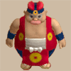 Stealing from Shops (1-19F, 21-99F)</h4>

The title of the dungeon only refers to shopping, but of course stealing is always an option. Use Wall-less Scroll, Reflective Incense & Narrow-escape Staff, Burrowing Staff & Vaulting Staff, etc. Or bring Trapper's Bracelet → collect and utilize Pitfall Traps to steal with absolutely minimal effort. It's easy to reach 999,999 Gitan per run if you repeatedly sell your inventory before stealing it back, but beware of unidentified Gambler's Scroll (1,000 Gitan) since it can reduce your Gitan total to 0.

<h4 id="behemoth-gate-rewards-(2-19f,-21-39f,-41-98f)" class="heading4Green"> Behemoth Gate Rewards (2-19F, 21-39F, 41-98F)</h4>

Behemoth Gates are common, so making them vanish for a reward helps replenish items. It's probably best to stick to early game floors for this, as later floors can get hectic.

<h4 id="item-drop-hunting-(3-30f)" class="heading4Green">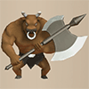 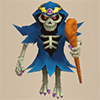  Item Drop Hunting (3-30F)</h4>

Certain floor ranges feature some monsters that have either fixed or guaranteed item drops. The following table lists target monsters and the items they drop for early game floors.

|Floor|Monster|Drop|
|-|-|-|
|3-6|Minotaur|Axe of the Minotaur|
|5-10|Skull Wizard|Skull Mage's Staff|
|11-19|Nigiri Boss|Huge Onigiri|
|11-30|Ironwalrus|Random (100% chance)|
|11-30|Froggon|Gitan (100% chance)|

<h4 id="mixergon-bun-(16-30f)" class="heading4Green">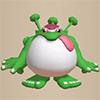 Mixergon Bun (16-30F)</h4>

Mixergon Bun is essentially a Synthesis Pot [4] that can be put into pots / can do Cross-Mixing. Mixergon (118 HP, 68 atk, 40 def) appears on 16-30F, so the idea is to turn them into Peach Buns using Peach Staves or a weapon that has the Peach Bun rune synthesized (from Peach Club). Mixergon Bun can be eaten inside a village warehouse to safely synthesize items.

# Floor Guide

<h3 id="first-clear" class="heading3Yellow">First Clear</h3>

### General Advice (Bringing Items)

See [Important Items (Bringing Items)](#important-items-(bringing-items)) for some ideas on what to bring. The essential shield runes are Magic Cancel, Hypnosisproof, Walrusproof, and Nigiriproof. Affixing Bracelet is needed to protect inventory items against Bag Knave and Nimble Knave. Wallpass Bracelet can be found in shops in this dungeon - It costs 6,500 Gitan. You should be fine for the 1st clear if you have the above + a fully upgraded weapon and shield, but feel free to bring extra food, Revival Grass, or anything else you'd like just in case.

### 1-2F

Behemoth Gates have a chance of being generated on 2F. B-Bowboy can catch you off guard if you get lazy about using the Look Around command, but otherwise most other Behemoth Monsters here can only attack when adjacent. Don't risk a missed rock throw if a Behemoth Monster is adjacent and can act after you, especially when your Max HP is still very low due to being so early in the dungeon.

Hat Urchin, Death Reaper, and Shagga are the only monsters that spawn on 1-2F. Enemies are much stronger from 3F, so level up before descending past 2F if your gear is weak. Most monsters that don't have fixed item drops will drop a Gitan bag when slain in this dungeon, so lingering until the wind blows (900 Turns) can further supplement Gitan for shopping. A shop is likely to be generated on most floors, so go ahead and buy food and other useful items that will help you keep pace with this dungeon's harsher monster table.

Gitan bags found on 1-2F are usually higher in value than later floors, though they can be cursed. You'll probably be able to secure around 3,000 Gitan per floor unless your luck is exceptionally bad. Consider keeping some Gitan bags on hand as projectiles instead of adding them all to your wallet. Hat Brat (3-10F) requires throwing a Gitan bag worth 630+ Gitan to one-shot.

#### Monster Stats (1-2F)

|Floor|Monster|HP|Atk|Def|Exp|Type|
|-|-|-|-|-|-|-|
|1-2|Shagga|18|6|4|12|Dragon|
|1-2|Hat Urchin|16|5|3|10|Cyclops|
|1-2|Death Reaper|22|6|5|9|Ghost/Floating|

### 3-4F

Behemoth Gates have a chance of being generated on 3-4F. The Behemoth Monster table doesn't change at any point in this dungeon, but beware of B-Bowboy.

Minotaur (3-6F), Floor Dragon (3-10F), Metalhead (3-10F), and Hat Brat (3-10F) appear on 3-4F. The Lv3 Hat Brat provides 880 exp, but be warned that it has 125 HP and 45 attack power. Use items for safety, and try to hunt multiple of them to reach Lv20 for +3 HP / Turn regen speed. Lingering also gives you a chance at obtaining Axe of the Minotaur from a defeated Minotaur.

#### Monster Stats (3-4F)

|Floor|Monster|HP|Atk|Def|Exp|Type|
|-|-|-|-|-|-|-|
|3-6|Minotaur|70|31|20|90|Beast|
|3-10|Hat Brat|125|45|9|880|Cyclops|
|3-10|Metalhead|66|30|19|61|Cyclops|
|3-10|Floor Dragon|55|25|20|80|Dragon|

### 5-10F

Behemoth Gates have a chance of being generated on 5-10F.

Same as 3-4F, but Skull Wizard, Dartingfrog, and Lv1 monks (except Okina) spawn on 5-10F. Be careful near Skull Wizard when shopping since it can force you to warp to the stairs, resulting in Thief Mode activating while you're Paralyzed and pretty much ensuring a collapse. There's also some risk of a companion becoming Confused and attacking a Shopkeeper. Tengu Monk D can create swift Skull Wizards, so consider eradicating Skull Mage types unless you have a Shield of Negation or the  Magic Cancel or 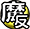 Magic Reflect rune. Eradicating them now also lets you avoid Skullmancer (22-30F) later on.

It's possible to morph into a Hat Urchin type monster to farm items via Skull Wizard's magic, but going to that much trouble isn't worth it in a dungeon where you can bring items. Hannya Monk D causes monsters to attack each other and level up or defeat Shopkeepers, which can be a problem if you're planning on going shopping or encounter a Skull Lord, etc. Tengu Monk D increases the action speed of other monsters, including leveled up ones. All said, watch the message log and rush to the stairs if too strong of a foe appears.

Overall, none of these monsters should really be a threat yet if you brought powerful gear. It'll be hard to progress much further if you're already beginning to struggle.

#### Monster Stats (5-10F)

|Floor|Monster|HP|Atk|Def|Exp|Type|
|-|-|-|-|-|-|-|
|3-6|Minotaur|70|31|20|90|Beast|
|3-10|Hat Brat|125|45|9|880|Cyclops|
|3-10|Metalhead|66|30|19|61|Cyclops|
|3-10|Floor Dragon|55|25|20|80|Dragon|
|5-10|Skull Wizard|88|35|24|250|Ghost|
|5-10|Dartingfrog|75|40|28|300|Aquatic|
|5-10|Tengu Monk D|80|24|20|85|Normal|
|5-10|Okame Monk D|60|19|23|75|Normal|
|5-10|Hannya Monk D|66|37|25|80|Normal|
|5-10|Kitsune Monk D|75|22|24|80|Normal|

### 11-14F

Behemoth Gates have a chance of being generated on 11-14F.

The monster lineup features enemies from the 30-60F range of Heart of Serpentcoil Island, with notables Nigiri Boss (11-19F), Dragon Pit (11-19F), Polygon Singa (11-30F), Bag Knave (11-30F), and some bonus monsters that drop items or Gitan like Ironwalrus (11-30F) and Froggon (11-30F). Nigiri Boss is especially dangerous without the  Nigiriproof rune - use items to avoid Onigiri status, since a Blast Trap, Rotting Trap, or Blazepuff (13-19F)'s flame can one-shot you as an onigiri.

Polygon Singa (11-30F) warps next to you in rooms, and lowers Max Fullness by 7 when adjacent. You should be able to one-shot it with a strong weapon that has the  Anti-Draining rune, but don't forget that normal attacks can miss, and Tengu Monks can speed up foes.

Dragon Pit (11-19F) has Swift 1 speed so it's difficult to run away, and it also hits pretty hard. Don't hesitate to use staves before you take damage if your equipment is on the weak side. It's best to read a Mapping Scroll or equip a Monster-find Bracelet if you decide to linger.

#### Monster Stats (11-14F)

|Floor|Monster|HP|Atk|Def|Exp|Type|
|-|-|-|-|-|-|-|
|11-14|Hoppin' Slugger|72|39|31|400|Normal|
|11-19|Dragon Pit|130|54|40|960|Dragon|
|11-19|Nigiri Boss|133|45|42|555|Normal|
|11-19|Big Chintala|85|40|33|350|Beast|
|11-30|Froggon|100|30|45|350|Normal|
|11-30|Ironwalrus|138|35|55|860|Aquatic|
|11-30|Bag Knave|95|40|35|600|Normal|
|11-30|Polygon Singa|129|40|40|445|Draining|
|13-19|Blazepuff|135|55|35|1050|Dragon/Floating|

### 15-19F

Behemoth Gates have a chance of being generated on 15-19F.

Lv2 Monks excluding Okina Monk C spawn on 15-19F, so beware of Berserk and Swift foes. Monks never target other Monk family foes with their abilities, so Paralyzed status is effective at instantly shutting down Hannya or Tengu monks even if Okame Monk is present on the floor. Some players like to inflict Sluggish status on Kitsune Monk and let it roam to have it disable non-monk family monsters on the current floor with its item-morph note.

Monsters start to have higher stats, with Admiral Spearfish (15-30F) being a standout. This Aquatic type has 200 HP, 59 attack, and 50 defense, and gets a power boost on water. It also seeks out a water tile to heal itself when its HP gets low before chasing you again, meaning things can end up devolving into a quagmire of a fight if your weapon is weak. Either inflict a status condition or shoot arrows to ensure it collapses - don't let it escape.

Electroid (15-30F) and Popdillo (16-20F) also have 50+ attack power. Electroid has Swift 1 speed and always spawns Napping, but Monk notes can wake it up. Popdillo makes you trip and drop items when adjacent, which can result in pots breaking. N'dama (15-19F) is trivial to deal with in this dungeon despite normally being a tricky foe, since it only disguises itself as a Gitan bag and doesn't immediately attack when picked up. Basically, if you walk on a Gitan bag and it doesn't get auto-added to your wallet, it's a N'dama.

Mixergon (16-30F) eats and synthesizes up to 4 thrown items. However, it has 118 HP, 68 attack, and 40 defense, and gains power each time it eats an item. Beware of synthesizing when you have allies - Mixergon (2 items eaten) will likely one-shot Porky the Pirate, and it's also questionable if other characters would survive a single hit. Mixergon (3 items eaten) will likely one-shot any character other than Asuka with good gear. If your positioning is bad, use Paralyzing Staff or Narrow-escape Staff to adjust as needed. Also, don't forget that Lv2 Monk abilities will cure Mixergon's Paralyzed status.

Curse Matron (17-30F) curses up to 2 of your equipped weapon, shield, or bracelets in 1 turn. You'll need an item like Fixer Scroll or Exorcism Scroll to remove curses from bracelets. A cursed weapon and shield isn't a big deal here since Mudster and Mudder don't spawn, and equipping cursed items prevents Hyper Gazer from being able to wreck your equipment, if you happen to lack the  Hypnosisproof shield rune.

#### Monster Stats (15-19F)

|Floor|Monster|HP|Atk|Def|Exp|Type|
|-|-|-|-|-|-|-|
|11-19|Dragon Pit|130|54|40|960|Dragon|
|11-19|Nigiri Boss|133|45|42|555|Normal|
|11-19|Big Chintala|85|40|33|350|Beast|
|11-30|Froggon|100|30|45|350|Normal|
|11-30|Ironwalrus|138|35|55|860|Aquatic|
|11-30|Bag Knave|95|40|35|600|Normal|
|11-30|Polygon Singa|129|40|40|445|Draining|
|13-19|Blazepuff|135|55|35|1050|Dragon/Floating|
|15-19|N'dama|135|50|35|650|Metal|
|15-19|Tengu Monk C|130|45|37|800|Normal|
|15-19|Okame Monk C|110|40|41|800|Normal|
|15-19|Hannya Monk C|106|47|35|800|Normal|
|15-19|Kitsune Monk C|125|43|38|680|Normal|
|15-30|Electroid|150|56|53|1333|Metal|
|15-30|Admiral Spearfish|200|59|50|1410|Aquatic|
|16-20|Popdillo|100|51|45|1200|Beast|
|16-30|Mixergon|118|68|40|880|Normal|
|17-30|Curse Matron|145|53|48|1060|Normal|

### 20-24F

Behemoth Gates have a chance of being generated on 21-24F (Not 20F).

20F is a Shuffle Dungeon style floor, meaning the map is chosen from a group of preset patterns. In this map's case, hallways are never dark, and terrain is often surrounded by water tiles. Admiral Spearfish (15-30F) can be particularly annoying - Waterwalk and Floating bracelets help. Use items like Mapping Scroll or Guiding Staff to quickly locate the stairs if possible.

Monks don't spawn between 20-24F, but Porkon (20-30F) appears as a new major threat. This Beast type monster can throw a 20 damage Porky's Rock anywhere within a 8 tile radius, which can be extremely irritating when paired with a floor that has flowing water and rafts. If the map's layout is complex, consider rushing to the stairs instead of exploring for items. Porkon has 150 HP, 75 attack, and 50 defense, so also be careful when trading hits. New additions also include Lashagga (20-24F), Megataur (20-30F), and Great Samurai (20-30F).

Other trickier foes include Hyper Gazer (20-30F), Fleefrog (20-30F), and Skullmancer (22-30F). Hyper Gazer hypnotizes you when adjacent, but the  Hypnosisproof shield rune blocks it. Skullmancer's magic inflicts Paralyzed, Sluggish, Sealed, Onigiri, Disguised (Confused), or Lv-1. Skull Mage family monsters have a 100% special attack usage rate when lined up at a distance. If you don't have the  Magic Cancel shield rune, it's best to throw an Eradication Scroll at it. Fleefrog pulls you and attacks from up to 10 tiles away, but Sumo status negates the pull effect.

#### Monster Stats (20-24F)

|Floor|Monster|HP|Atk|Def|Exp|Type|
|-|-|-|-|-|-|-|
|11-30|Froggon|100|30|45|350|Normal|
|11-30|Ironwalrus|138|35|55|860|Aquatic|
|11-30|Bag Knave|95|40|35|600|Normal|
|11-30|Polygon Singa|129|40|40|445|Draining|
|15-30|Electroid|150|56|53|1333|Metal|
|15-30|Admiral Spearfish|200|59|50|1410|Aquatic|
|16-20|Popdillo|100|51|45|1200|Beast|
|16-30|Mixergon|118|68|40|880|Normal|
|17-30|Curse Matron|145|53|48|1060|Normal|
|20-24|Lashagga|99|43|34|500|Dragon|
|20-30|Porkon|150|75|50|1800|Beast|
|20-30|Fleefrog|125|60|45|900|Aquatic|
|20-30|Megataur|170|55|42|790|Beast|
|20-30|Hyper Gazer|126|55|45|922|Cyclops|
|20-30|Great Samurai|149|58|40|840|Normal|
|22-30|Skullmancer|111|50|41|888|Ghost|

### 25-30F

Behemoth Gates have a chance of being generated on 25-30F.

Lv3 Monks excluding Okina Monk B spawn on 25-40F, so beware of Berserk and Swift foes. If unlucky, this can result in a Swift Skull Lord or Ultra Gazer being created between 25-30F, so get in the habit of quickly defeating any Tengu Monk B or Hannya Monk B that enter your view. Mixer family monsters don't naturally appear at all between 31-99F, so finish synthesizing and/or stocking up on Mixergon Buns before descending past 30F.

#### Monster Stats (25-30F)

|Floor|Monster|HP|Atk|Def|Exp|Type|
|-|-|-|-|-|-|-|
|11-30|Froggon|100|30|45|350|Normal|
|11-30|Ironwalrus|138|35|55|860|Aquatic|
|11-30|Bag Knave|95|40|35|600|Normal|
|11-30|Polygon Singa|129|40|40|445|Draining|
|15-30|Electroid|150|56|53|1333|Metal|
|15-30|Admiral Spearfish|200|59|50|1410|Aquatic|
|16-30|Mixergon|118|68|40|880|Normal|
|17-30|Curse Matron|145|53|48|1060|Normal|
|20-30|Porkon|150|75|50|1800|Beast|
|20-30|Fleefrog|125|60|45|900|Aquatic|
|20-30|Megataur|170|55|42|790|Beast|
|20-30|Hyper Gazer|126|55|45|922|Cyclops|
|20-30|Great Samurai|149|58|40|840|Normal|
|22-30|Skullmancer|111|50|41|888|Ghost|
|25-40|Tengu Monk B|180|55|47|1200|Normal|
|25-40|Okame Monk B|160|50|51|1200|Normal|
|25-40|Hannya Monk B|166|57|45|1200|Normal|
|25-40|Kitsune Monk B|175|53|48|1180|Normal|

### 31-40F

Behemoth Gates have a chance of being generated on 31-39F (Not 40F).

The monster lineup is refreshed, aside from the same four Lv3 Monks continuing to appear. Powerful threats like Miracle Hen (31-40F), Frogginator (31-40F), and Nigiri Honcho (31-40F) spawn. Miracle Hen has Swift 2 speed & 220 HP, 82 attack, and 60 defense - basically a gear check. Gitan bags are in the range of 500-900 Gitan here, so Frogginator's ability deals 100-200 damage. Nigiri Honcho either inflicts Onigiri status, or turns 1 inventory item into a Large Onigiri. Onigiri status prevents item usage and nullifies the effects of any equipped items for 10 turns. Pot category items are prioritized for the latter, but the  Nigiriproof shield rune protects you.

The Swift 1 Nimble Knave (31-40F) also spawns, who throws Weeds to parry items from a distance. Keep Affixing Bracelet equipped if you want to protect pots in your inventory from being destroyed. Overall, it's best to rush stairs in this floor range, especially since Lv3 Monks are still around. Hannya Monk B (25-40F) can indirectly slay Shopkeepers even if you find a shop, forcing a theft. Also, ignore Gitan bags on the ground since Kitsune Monk B (25-40F) is a possible spawn.

#### Monster Stats (31-40F)

|Floor|Monster|HP|Atk|Def|Exp|Type|
|-|-|-|-|-|-|-|
|25-40|Tengu Monk B|180|55|47|1200|Normal|
|25-40|Okame Monk B|160|50|51|1200|Normal|
|25-40|Hannya Monk B|166|57|45|1200|Normal|
|25-40|Kitsune Monk B|175|53|48|1180|Normal|
|31-40|Megahead|182|65|48|1350|Cyclops|
|31-40|Frogginator|140|40|60|700|Normal|
|31-40|Magicwalrus|188|40|75|1650|Aquatic|
|31-40|Huge Chintala|185|60|40|1350|Beast|
|31-40|Miracle Hen|220|82|60|1600|Beast|
|31-40|Nigiri Honcho|165|61|54|1230|Normal|
|31-40|Nimble Knave|145|50|40|850|Normal|
|31-40|Hoppin' Slammer|125|49|49|820|Normal|

<h3 id="sacred-tree-extension" class="heading3Pink">Sacred Tree Extension</h3>

<h3 id="general-advice-(sacred-tree-extension)" class="heading3Red">General Advice (Bringing Items)</h3>

The extension is an additional 59 floors, so plan what items to bring in accordingly. Powerful equipment goes without saying - don't skip out on synthesizing key runes beforehand. Staves with 20-50+ uses are nice against single-targets, and are great inventory space savers. Shops don't have special merchandise near the end, unlike [Clash of Weapons and Shields](/dungeons/clash-of-weapons-and-shields), so this extension is not the right place if you're looking for special rewards.

Notable extension spawns include Okina Monk A and Tengu Monk A appearing on 50-99F, and monsters potentially capable of forcing Thief Mode to trigger appearing between 76-99F. Nimble Knave & Nigiri Honcho (31-50F) and Swordmaster (60-70F) are the threats to items. Deathead (41-70F), Abyss Dragon (60-70F), and Porgon (66-99F) are the ranged attackers. Lastly, special monsters spawn between 50-90F (X0F = Ultra Gazer, X5F = Gitan Mamel).

<h3 id="1-40f" class="heading3Red">1-40F</h3>

Behemoth Gates have a chance of being generated on 2-19F and 21-39F.

You can bring items into this dungeon, so the same strategy used during the [first clear](#first-clear) applies. The monster table and everything is exactly the same as the first clear for this floor range.

<h4 id="monster-stats-(1-40f)" class="heading4Red">Monster Stats (1-40F)</h4>

|Floor|Monster|HP|Atk|Def|Exp|Type|
|-|-|-|-|-|-|-|
|1-2|Shagga|18|6|4|12|Dragon|
|1-2|Hat Urchin|16|5|3|10|Cyclops|
|1-2|Death Reaper|22|6|5|9|Ghost/Floating|
|3-6|Minotaur|70|31|20|90|Beast|
|3-10|Hat Brat|125|45|9|880|Cyclops|
|3-10|Metalhead|66|30|19|61|Cyclops|
|3-10|Floor Dragon|55|25|20|80|Dragon|
|5-10|Skull Wizard|88|35|24|250|Ghost|
|5-10|Dartingfrog|75|40|28|300|Aquatic|
|5-10|Tengu Monk D|80|24|20|85|Normal|
|5-10|Okame Monk D|60|19|23|75|Normal|
|5-10|Hannya Monk D|66|37|25|80|Normal|
|5-10|Kitsune Monk D|75|22|24|80|Normal|
|11-14|Hoppin' Slugger|72|39|31|400|Normal|
|11-19|Dragon Pit|130|54|40|960|Dragon|
|11-19|Nigiri Boss|133|45|42|555|Normal|
|11-19|Big Chintala|85|40|33|350|Beast|
|11-30|Froggon|100|30|45|350|Normal|
|11-30|Ironwalrus|138|35|55|860|Aquatic|
|11-30|Bag Knave|95|40|35|600|Normal|
|11-30|Polygon Singa|129|40|40|445|Draining|
|13-19|Blazepuff|135|55|35|1050|Dragon/Floating|
|15-19|N'dama|135|50|35|650|Metal|
|15-19|Tengu Monk C|130|45|37|800|Normal|
|15-19|Okame Monk C|110|40|41|800|Normal|
|15-19|Hannya Monk C|106|47|35|800|Normal|
|15-19|Kitsune Monk C|125|43|38|680|Normal|
|15-30|Electroid|150|56|53|1333|Metal|
|15-30|Admiral Spearfish|200|59|50|1410|Aquatic|
|16-20|Popdillo|100|51|45|1200|Beast|
|16-30|Mixergon|118|68|40|880|Normal|
|17-30|Curse Matron|145|53|48|1060|Normal|
|20-24|Lashagga|99|43|34|500|Dragon|
|20-30|Porkon|150|75|50|1800|Beast|
|20-30|Fleefrog|125|60|45|900|Aquatic|
|20-30|Megataur|170|55|42|790|Beast|
|20-30|Hyper Gazer|126|55|45|922|Cyclops|
|20-30|Great Samurai|149|58|40|840|Normal|
|22-30|Skullmancer|111|50|41|888|Ghost|
|25-40|Tengu Monk B|180|55|47|1200|Normal|
|25-40|Okame Monk B|160|50|51|1200|Normal|
|25-40|Hannya Monk B|166|57|45|1200|Normal|
|25-40|Kitsune Monk B|175|53|48|1180|Normal|
|31-40|Megahead|182|65|48|1350|Cyclops|
|31-40|Frogginator|140|40|60|700|Normal|
|31-40|Magicwalrus|188|40|75|1650|Aquatic|
|31-40|Huge Chintala|185|60|40|1350|Beast|
|31-50|Miracle Hen|220|82|60|1600|Beast|
|31-50|Nigiri Honcho|165|61|54|1230|Normal|
|31-50|Nimble Knave|145|50|40|850|Normal|
|31-50|Hoppin' Slammer|125|49|49|820|Normal|

<h3 id="41-99f" class="heading3Red">41-99F</h3>

Behemoth Gates have a chance of being generated on 41-98F.

Lv4 Monks appear in various combinations between 41-99F. Okame, Hannya, and Kitsune spawn on 41-60F, while Okina and Tengu spawn on 50-99F. Detonachin (60-80F) can vaporize merchandise, but Bowboy & Pop Tank monsters don't appear. Special foes appear every 5 floors starting from 50F (X0F = Ultra Gazer, X5F = Gitan Mamel). Ultra Gazer can hypnotize the player even when they're in a wall, so don't let your guard down. The best counter is to rely on the  Hypnosisproof shield rune to block its special attack.

Other notable threats enter or cycle out of the monster table every 5-20 floors or so. 40-49F - Nimble Knave, Nigiri Honcho, Miracle Hen, and Lv4 Ninjas. 50-59F - Mostly Lv4 Ninjas and Lv4 Monks, so this is one of the milder floor ranges. 60-65F - Swordmaster (60-70F) and Abyss Dragon (60-70F) are the 2 major threats. 66-99F - Porgon (66-99F), Grampadillo (76-99F), Polygon Stunna (81-95F), Tiger Launcher (86-99F).

Grampadillo or Tiger Launcher can send you out of a shop, forcing Thief Mode to trigger. The main counter is to activate Sumo status → avoid letting Polygon Stunna lower Max Fullness. It's also recommended to throw an Eradication Scroll at Okina Monk A for game tempo reasons. Wallpass Bracelet is handy when it comes to avoiding monk-boosted shop-related enemies. Unlike some other dungeons, there's nothing special about merchandise in shops near the end.

<h4 id="monster-stats-(41-99f)" class="heading4Red">Monster Stats (41-99F)</h4>

|Floor|Monster|HP|Atk|Def|Exp|Type|
|-|-|-|-|-|-|-|
|31-50|Miracle Hen|220|82|60|1600|Beast|
|31-50|Nigiri Honcho|165|61|54|1230|Normal|
|31-50|Nimble Knave|145|50|40|850|Normal|
|31-50|Hoppin' Slammer|125|49|49|820|Normal|
|41-59|Fire Ninja A|185|70|59|1000|Normal|
|41-59|Tree Ninja A|195|72|57|1000|Normal|
|41-59|Earth Ninja A|215|68|58|1000|Normal|
|41-59|Water Ninja A|205|65|49|1000|Normal|
|41-60|Okame Monk A|260|70|61|1400|Normal|
|41-60|Hannya Monk A|266|67|55|1400|Normal|
|41-60|Kitsune Monk A|275|73|58|1380|Normal|
|41-70|Deathead|282|99|60|2350|Cyclops|
|50-99|Okina Monk A|270|76|60|1400|Normal|
|50-99|Tengu Monk A|280|75|57|1400|Normal|
|50,60,70,80,90|Ultra Gazer|196|60|55|1322|Cyclops|
|55,65,75,85|Gitan Mamel|20|100|999|3333|Normal|
|60-70|Swordmaster|250|77|55|1400|Normal|
|60-70|Abyss Dragon|300|90|65|2800|Dragon|
|60-80|Detonachin|260|55|37|1440|Exploding/Cyclops/Aquatic|
|60-80|Infernous|285|69|55|1999|Normal|
|60-99|Gigataur|235|85|62|1790|Beast|
|61-80|Lordly Samurai|200|63|50|1280|Normal|
|66-99|Porgon|200|85|60|2000|Beast|
|76-99|Grampadillo|175|71|56|1400|Beast|
|81-95|Polygon Stunna|229|50|55|890|Draining|
|86-99|Tiger Launcher|255|83|65|2800|Beast|

# Monsters

<button id="hideMonTblImgBtn" onClick={()=>{var mon_imgs = document.querySelectorAll('#monsterTable img');mon_imgs.forEach(e => e.classList.toggle('hidden'));}}>Toggle Monster Images</button>

See [Monsters](/system/monsters) for individual monster details.

- F - Dark hallways
- S - Shop is possible
- M - Monster House is possible
- W - Wishing Shrine is possible
- B - Behemoth Gate is possible

Monster Colors = Mixer, Farming, Useful, Lowers Stats, Targets Items, Dangerous

<table id="monsterTable" class="monsterTable">
  <thead>
    <tr>
      <th>F</th>
      <th>S</th>
      <th>M</th>
      <th>W</th>
      <th colspan="5">Monsters</th>
      <th>B</th>
    </tr>
  </thead>
  <tbody>
    <tr>
      <td class="centeredText highlightFog">1</td>
      <td class="highlightShop"></td>
      <td class=""></td>
      <td class="highlightGold"></td>
      <td class="items"> Hat Urchin</td>
      <td> Death Reaper</td>
      <td> Shagga</td>
      <td class="highlightGray"></td>
      <td class="highlightGray"></td>
      <td class=""></td>
    </tr>
    <tr>
      <td colspan="10" class="tableDivider"></td>
    </tr>
    <tr>
      <td class="centeredText highlightFog">2</td>
      <td class="highlightShop"></td>
      <td class=""></td>
      <td class=""></td>
      <td class="items"> Hat Urchin</td>
      <td> Death Reaper</td>
      <td> Shagga</td>
      <td class="highlightGray"></td>
      <td class="highlightGray"></td>
      <td class="highlightBehemoth"></td>
    </tr>
    <tr>
      <td colspan="10" class="tableDivider"></td>
    </tr>
    <tr>
      <td class="centeredText highlightFog">3</td>
      <td class="highlightShop"></td>
      <td class=""></td>
      <td class=""></td>
      <td class="danger"> Hat Brat</td>
      <td> Minotaur</td>
      <td> Floor Dragon</td>
      <td> Metalhead</td>
      <td class="highlightGray"></td>
      <td class="highlightBehemoth"></td>
    </tr>
    <tr>
      <td colspan="10" class="tableDivider"></td>
    </tr>
    <tr>
      <td class="centeredText highlightFog">4</td>
      <td class="highlightShop"></td>
      <td class=""></td>
      <td class=""></td>
      <td class="danger"> Hat Brat</td>
      <td> Minotaur</td>
      <td> Floor Dragon</td>
      <td> Metalhead</td>
      <td class="highlightGray"></td>
      <td class="highlightBehemoth"></td>
    </tr>
    <tr>
      <td colspan="10" class="tableDivider"></td>
    </tr>
    <tr>
      <td rowspan="2" class="centeredText highlightFog">5</td>
      <td rowspan="2" class="highlightShop"></td>
      <td rowspan="2" class="highlightMH"></td>
      <td rowspan="2" class=""></td>
      <td class="items"> Hat Brat</td>
      <td class="danger"> Skull Wizard</td>
      <td> Dartingfrog</td>
      <td> Minotaur</td>
      <td> Okame Monk D</td>
      <td rowspan="2" class="highlightBehemoth"></td>
    </tr>
    <tr>
      <td> Hannya Monk D</td>
      <td> Kitsune Monk D</td>
      <td> Tengu Monk D</td>
      <td> Floor Dragon</td>
      <td> Metalhead</td>
    </tr>
    <tr>
      <td colspan="10" class="tableDivider"></td>
    </tr>
    <tr>
      <td rowspan="2" class="centeredText highlightFog">6</td>
      <td rowspan="2" class="highlightShop"></td>
      <td rowspan="2" class=""></td>
      <td rowspan="2" class="highlightGold"></td>
      <td class="items"> Hat Brat</td>
      <td class="danger"> Skull Wizard</td>
      <td> Dartingfrog</td>
      <td> Minotaur</td>
      <td> Okame Monk D</td>
      <td rowspan="2" class="highlightBehemoth"></td>
    </tr>
    <tr>
      <td> Hannya Monk D</td>
      <td> Kitsune Monk D</td>
      <td> Tengu Monk D</td>
      <td> Floor Dragon</td>
      <td> Metalhead</td>
    </tr>
    <tr>
      <td colspan="10" class="tableDivider"></td>
    </tr>
    <tr>
      <td rowspan="2" class="centeredText highlightFog">7</td>
      <td rowspan="2" class="highlightShop"></td>
      <td rowspan="2" class=""></td>
      <td rowspan="2" class=""></td>
      <td class="items"> Hat Brat</td>
      <td class="danger"> Skull Wizard</td>
      <td> Dartingfrog</td>
      <td> Okame Monk D</td>
      <td> Hannya Monk D</td>
      <td rowspan="2" class="highlightBehemoth"></td>
    </tr>
    <tr>
      <td> Kitsune Monk D</td>
      <td> Tengu Monk D</td>
      <td> Floor Dragon</td>
      <td> Metalhead</td>
      <td class="highlightGray"></td>
    </tr>
    <tr>
      <td colspan="10" class="tableDivider"></td>
    </tr>
    <tr>
      <td rowspan="2" class="centeredText highlightFog">8</td>
      <td rowspan="2" class="highlightShop"></td>
      <td rowspan="2" class=""></td>
      <td rowspan="2" class=""></td>
      <td class="items"> Hat Brat</td>
      <td class="danger"> Skull Wizard</td>
      <td> Dartingfrog</td>
      <td> Okame Monk D</td>
      <td> Hannya Monk D</td>
      <td rowspan="2" class="highlightBehemoth"></td>
    </tr>
    <tr>
      <td> Kitsune Monk D</td>
      <td> Tengu Monk D</td>
      <td> Floor Dragon</td>
      <td> Metalhead</td>
      <td class="highlightGray"></td>
    </tr>
    <tr>
      <td colspan="10" class="tableDivider"></td>
    </tr>
    <tr>
      <td rowspan="2" class="centeredText highlightFog">9</td>
      <td rowspan="2" class="highlightShop"></td>
      <td rowspan="2" class=""></td>
      <td rowspan="2" class=""></td>
      <td class="items"> Hat Brat</td>
      <td class="danger"> Skull Wizard</td>
      <td> Dartingfrog</td>
      <td> Okame Monk D</td>
      <td> Hannya Monk D</td>
      <td rowspan="2" class="highlightBehemoth"></td>
    </tr>
    <tr>
      <td> Kitsune Monk D</td>
      <td> Tengu Monk D</td>
      <td> Floor Dragon</td>
      <td> Metalhead</td>
      <td class="highlightGray"></td>
    </tr>
    <tr>
      <td colspan="10" class="tableDivider"></td>
    </tr>
    <tr>
      <td rowspan="2" class="centeredText highlightFog">10</td>
      <td rowspan="2" class="highlightShop"></td>
      <td rowspan="2" class=""></td>
      <td rowspan="2" class=""></td>
      <td class="items"> Hat Brat</td>
      <td class="danger"> Skull Wizard</td>
      <td> Dartingfrog</td>
      <td> Okame Monk D</td>
      <td> Hannya Monk D</td>
      <td rowspan="2" class="highlightBehemoth"></td>
    </tr>
    <tr>
      <td> Kitsune Monk D</td>
      <td> Tengu Monk D</td>
      <td> Floor Dragon</td>
      <td> Metalhead</td>
      <td class="highlightGray"></td>
    </tr>
    <tr>
      <td colspan="10" class="tableDivider"></td>
    </tr>
    <tr>
      <td rowspan="2" class="centeredText highlightFog">11</td>
      <td rowspan="2" class="highlightShop"></td>
      <td rowspan="2" class=""></td>
      <td rowspan="2" class=""></td>
      <td> Big Chintala</td>
      <td class="stats"> Polygon Singa</td>
      <td class="items">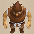 Bag Knave</td>
      <td> Hoppin' Slugger</td>
      <td class="farming"> Froggon</td>
      <td rowspan="2" class="highlightBehemoth"></td>
    </tr>
    <tr>
      <td class="farming"> Ironwalrus</td>
      <td class="danger"> Nigiri Boss</td>
      <td class="danger">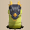 Dragon Pit</td>
      <td class="highlightGray"></td>
      <td class="highlightGray"></td>
    </tr>
    <tr>
      <td colspan="10" class="tableDivider"></td>
    </tr>
    <tr>
      <td rowspan="2" class="centeredText highlightFog">12</td>
      <td rowspan="2" class="highlightShop"></td>
      <td rowspan="2" class=""></td>
      <td rowspan="2" class="highlightGold"></td>
      <td> Big Chintala</td>
      <td class="stats"> Polygon Singa</td>
      <td class="items"> Bag Knave</td>
      <td> Hoppin' Slugger</td>
      <td class="farming"> Froggon</td>
      <td rowspan="2" class="highlightBehemoth"></td>
    </tr>
    <tr>
      <td class="farming"> Ironwalrus</td>
      <td class="danger"> Nigiri Boss</td>
      <td class="danger"> Dragon Pit</td>
      <td class="highlightGray"></td>
      <td class="highlightGray"></td>
    </tr>
    <tr>
      <td colspan="10" class="tableDivider"></td>
    </tr>
    <tr>
      <td rowspan="2" class="centeredText highlightFog">13</td>
      <td rowspan="2" class="highlightShop"></td>
      <td rowspan="2" class=""></td>
      <td rowspan="2" class=""></td>
      <td> Big Chintala</td>
      <td class="stats"> Polygon Singa</td>
      <td class="items"> Bag Knave</td>
      <td> Hoppin' Slugger</td>
      <td class="farming"> Froggon</td>
      <td rowspan="2" class="highlightBehemoth"></td>
    </tr>
    <tr>
      <td class="farming"> Ironwalrus</td>
      <td class="danger"> Nigiri Boss</td>
      <td class="danger"> Dragon Pit</td>
      <td> Blazepuff</td>
      <td class="highlightGray"></td>
    </tr>
    <tr>
      <td colspan="10" class="tableDivider"></td>
    </tr>
    <tr>
      <td rowspan="2" class="centeredText highlightFog">14</td>
      <td rowspan="2" class="highlightShop"></td>
      <td rowspan="2" class=""></td>
      <td rowspan="2" class=""></td>
      <td> Big Chintala</td>
      <td class="stats"> Polygon Singa</td>
      <td class="items"> Bag Knave</td>
      <td> Hoppin' Slugger</td>
      <td class="farming"> Froggon</td>
      <td rowspan="2" class="highlightBehemoth"></td>
    </tr>
    <tr>
      <td class="farming"> Ironwalrus</td>
      <td class="danger"> Nigiri Boss</td>
      <td class="danger"> Dragon Pit</td>
      <td> Blazepuff</td>
      <td class="highlightGray"></td>
    </tr>
    <tr>
      <td colspan="10" class="tableDivider"></td>
    </tr>
    <tr>
      <td rowspan="3" class="centeredText highlightFog">15</td>
      <td rowspan="3" class="highlightShop"></td>
      <td rowspan="3" class=""></td>
      <td rowspan="3" class=""></td>
      <td> Big Chintala</td>
      <td class="stats"> Polygon Singa</td>
      <td class="items"> Bag Knave</td>
      <td>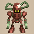 Electroid</td>
      <td> Admiral Spearfish</td>
      <td rowspan="3" class="highlightBehemoth"></td>
    </tr>
    <tr>
      <td class="farming"> Froggon</td>
      <td class="farming"> Ironwalrus</td>
      <td class="danger"> Nigiri Boss</td>
      <td class="danger"> Dragon Pit</td>
      <td> Blazepuff</td>
    </tr>
    <tr>
      <td> N'dama</td>
      <td>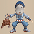 Okame Monk C</td>
      <td class="danger">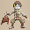 Hannya Monk C</td>
      <td> Kitsune Monk C</td>
      <td class="danger">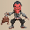 Tengu Monk C</td>
    </tr>
    <tr>
      <td colspan="10" class="tableDivider"></td>
    </tr>
    <tr>
      <td rowspan="4" class="centeredText highlightFog">16</td>
      <td rowspan="4" class="highlightShop"></td>
      <td rowspan="4" class=""></td>
      <td rowspan="4" class=""></td>
      <td> Big Chintala</td>
      <td class="stats"> Polygon Singa</td>
      <td class="items"> Popdillo</td>
      <td class="items"> Bag Knave</td>
      <td> Electroid</td>
      <td rowspan="4" class="highlightBehemoth"></td>
    </tr>
    <tr>
      <td> Admiral Spearfish</td>
      <td class="farming"> Froggon</td>
      <td class="farming"> Ironwalrus</td>
      <td class="danger"> Nigiri Boss</td>
      <td class="danger"> Dragon Pit</td>
    </tr>
    <tr>
      <td class="mixer"> Mixergon</td>
      <td> Blazepuff</td>
      <td> N'dama</td>
      <td> Okame Monk C</td>
      <td class="danger"> Hannya Monk C</td>
    </tr>
    <tr>
      <td> Kitsune Monk C</td>
      <td class="danger"> Tengu Monk C</td>
      <td class="highlightGray"></td>
      <td class="highlightGray"></td>
      <td class="highlightGray"></td>
    </tr>
    <tr>
      <td colspan="10" class="tableDivider"></td>
    </tr>
    <tr>
      <td rowspan="4" class="centeredText highlightFog">17</td>
      <td rowspan="4" class="highlightShop"></td>
      <td rowspan="4" class=""></td>
      <td rowspan="4" class=""></td>
      <td> Big Chintala</td>
      <td class="stats"> Polygon Singa</td>
      <td class="items"> Popdillo</td>
      <td class="items"> Bag Knave</td>
      <td> Electroid</td>
      <td rowspan="4" class="highlightBehemoth"></td>
    </tr>
    <tr>
      <td> Admiral Spearfish</td>
      <td class="farming"> Froggon</td>
      <td class="farming"> Ironwalrus</td>
      <td class="danger"> Nigiri Boss</td>
      <td class="items"> Curse Matron</td>
    </tr>
    <tr>
      <td class="danger"> Dragon Pit</td>
      <td class="mixer"> Mixergon</td>
      <td> Blazepuff</td>
      <td> N'dama</td>
      <td> Okame Monk C</td>
    </tr>
    <tr>
      <td class="danger"> Hannya Monk C</td>
      <td> Kitsune Monk C</td>
      <td class="danger"> Tengu Monk C</td>
      <td class="highlightGray"></td>
      <td class="highlightGray"></td>
    </tr>
    <tr>
      <td colspan="10" class="tableDivider"></td>
    </tr>
    <tr>
      <td rowspan="4" class="centeredText highlightFog">18</td>
      <td rowspan="4" class="highlightShop"></td>
      <td rowspan="4" class=""></td>
      <td rowspan="4" class=""></td>
      <td> Big Chintala</td>
      <td class="stats"> Polygon Singa</td>
      <td class="items"> Popdillo</td>
      <td class="items"> Bag Knave</td>
      <td> Electroid</td>
      <td rowspan="4" class="highlightBehemoth"></td>
    </tr>
    <tr>
      <td> Admiral Spearfish</td>
      <td class="farming"> Froggon</td>
      <td class="farming"> Ironwalrus</td>
      <td class="danger"> Nigiri Boss</td>
      <td class="items"> Curse Matron</td>
    </tr>
    <tr>
      <td class="danger"> Dragon Pit</td>
      <td class="mixer"> Mixergon</td>
      <td> Blazepuff</td>
      <td> N'dama</td>
      <td> Okame Monk C</td>
    </tr>
    <tr>
      <td class="danger"> Hannya Monk C</td>
      <td> Kitsune Monk C</td>
      <td class="danger"> Tengu Monk C</td>
      <td class="highlightGray"></td>
      <td class="highlightGray"></td>
    </tr>
    <tr>
      <td colspan="10" class="tableDivider"></td>
    </tr>
    <tr>
      <td rowspan="4" class="centeredText highlightFog">19</td>
      <td rowspan="4" class="highlightShop"></td>
      <td rowspan="4" class=""></td>
      <td rowspan="4" class=""></td>
      <td> Big Chintala</td>
      <td class="stats"> Polygon Singa</td>
      <td class="items"> Popdillo</td>
      <td class="items"> Bag Knave</td>
      <td> Electroid</td>
      <td rowspan="4" class="highlightBehemoth"></td>
    </tr>
    <tr>
      <td> Admiral Spearfish</td>
      <td class="farming"> Froggon</td>
      <td class="farming"> Ironwalrus</td>
      <td class="danger"> Nigiri Boss</td>
      <td class="items"> Curse Matron</td>
    </tr>
    <tr>
      <td class="danger"> Dragon Pit</td>
      <td class="mixer"> Mixergon</td>
      <td> Blazepuff</td>
      <td> N'dama</td>
      <td> Okame Monk C</td>
    </tr>
    <tr>
      <td class="danger"> Hannya Monk C</td>
      <td> Kitsune Monk C</td>
      <td class="danger"> Tengu Monk C</td>
      <td class="highlightGray"></td>
      <td class="highlightGray"></td>
    </tr>
    <tr>
      <td colspan="10" class="tableDivider"></td>
    </tr>
    <tr>
      <td rowspan="3" class="centeredText">20</td>
      <td rowspan="3" class=""></td>
      <td rowspan="3" class=""></td>
      <td rowspan="3" class=""></td>
      <td class="items"> Hyper Gazer</td>
      <td class="stats"> Polygon Singa</td>
      <td class="items"> Popdillo</td>
      <td class="items"> Bag Knave</td>
      <td class="danger"> Porkon</td>
      <td rowspan="3" class=""></td>
    </tr>
    <tr>
      <td> Fleefrog</td>
      <td> Electroid</td>
      <td> Admiral Spearfish</td>
      <td class="farming"> Froggon</td>
      <td class="farming"> Ironwalrus</td>
    </tr>
    <tr>
      <td class="items"> Curse Matron</td>
      <td class="mixer"> Mixergon</td>
      <td> Lashagga</td>
      <td> Great Samurai</td>
      <td> Megataur</td>
    </tr>
    <tr>
      <td colspan="10" class="tableDivider"></td>
    </tr>
    <tr>
      <td rowspan="3" class="centeredText highlightFog">21</td>
      <td rowspan="3" class="highlightShop"></td>
      <td rowspan="3" class=""></td>
      <td rowspan="3" class=""></td>
      <td class="items"> Hyper Gazer</td>
      <td class="stats"> Polygon Singa</td>
      <td class="items"> Bag Knave</td>
      <td class="danger"> Porkon</td>
      <td> Fleefrog</td>
      <td rowspan="3" class="highlightBehemoth"></td>
    </tr>
    <tr>
      <td> Electroid</td>
      <td> Admiral Spearfish</td>
      <td class="farming"> Froggon</td>
      <td class="farming"> Ironwalrus</td>
      <td class="items"> Curse Matron</td>
    </tr>
    <tr>
      <td class="mixer"> Mixergon</td>
      <td> Lashagga</td>
      <td> Great Samurai</td>
      <td> Megataur</td>
      <td class="highlightGray"></td>
    </tr>
    <tr>
      <td colspan="10" class="tableDivider"></td>
    </tr>
    <tr>
      <td rowspan="3" class="centeredText highlightFog">22</td>
      <td rowspan="3" class="highlightShop"></td>
      <td rowspan="3" class=""></td>
      <td rowspan="3" class=""></td>
      <td class="danger"> Skullmancer</td>
      <td class="items"> Hyper Gazer</td>
      <td class="stats"> Polygon Singa</td>
      <td class="items"> Bag Knave</td>
      <td class="danger"> Porkon</td>
      <td rowspan="3" class="highlightBehemoth"></td>
    </tr>
    <tr>
      <td> Fleefrog</td>
      <td> Electroid</td>
      <td> Admiral Spearfish</td>
      <td class="farming"> Froggon</td>
      <td class="farming"> Ironwalrus</td>
    </tr>
    <tr>
      <td class="items"> Curse Matron</td>
      <td class="mixer"> Mixergon</td>
      <td> Lashagga</td>
      <td> Great Samurai</td>
      <td> Megataur</td>
    </tr>
    <tr>
      <td colspan="10" class="tableDivider"></td>
    </tr>
    <tr>
      <td rowspan="3" class="centeredText highlightFog">23</td>
      <td rowspan="3" class="highlightShop"></td>
      <td rowspan="3" class=""></td>
      <td rowspan="3" class=""></td>
      <td class="danger"> Skullmancer</td>
      <td class="items"> Hyper Gazer</td>
      <td class="stats"> Polygon Singa</td>
      <td class="items"> Bag Knave</td>
      <td class="danger"> Porkon</td>
      <td rowspan="3" class="highlightBehemoth"></td>
    </tr>
    <tr>
      <td> Fleefrog</td>
      <td> Electroid</td>
      <td> Admiral Spearfish</td>
      <td class="farming"> Froggon</td>
      <td class="farming"> Ironwalrus</td>
    </tr>
    <tr>
      <td class="items"> Curse Matron</td>
      <td class="mixer"> Mixergon</td>
      <td> Lashagga</td>
      <td> Great Samurai</td>
      <td> Megataur</td>
    </tr>
    <tr>
      <td colspan="10" class="tableDivider"></td>
    </tr>
    <tr>
      <td rowspan="3" class="centeredText highlightFog">24</td>
      <td rowspan="3" class="highlightShop"></td>
      <td rowspan="3" class=""></td>
      <td rowspan="3" class=""></td>
      <td class="danger"> Skullmancer</td>
      <td class="items"> Hyper Gazer</td>
      <td class="stats"> Polygon Singa</td>
      <td class="items"> Bag Knave</td>
      <td class="danger"> Porkon</td>
      <td rowspan="3" class="highlightBehemoth"></td>
    </tr>
    <tr>
      <td> Fleefrog</td>
      <td> Electroid</td>
      <td> Admiral Spearfish</td>
      <td class="farming"> Froggon</td>
      <td class="farming"> Ironwalrus</td>
    </tr>
    <tr>
      <td class="items"> Curse Matron</td>
      <td class="mixer"> Mixergon</td>
      <td> Lashagga</td>
      <td> Great Samurai</td>
      <td> Megataur</td>
    </tr>
    <tr>
      <td colspan="10" class="tableDivider"></td>
    </tr>
    <tr>
      <td rowspan="4" class="centeredText highlightFog">25</td>
      <td rowspan="4" class="highlightShop"></td>
      <td rowspan="4" class=""></td>
      <td rowspan="4" class=""></td>
      <td> Okame Monk B</td>
      <td class="danger"> Hannya Monk B</td>
      <td> Kitsune Monk B</td>
      <td class="danger"> Tengu Monk B</td>
      <td class="danger"> Skullmancer</td>
      <td rowspan="4" class="highlightBehemoth"></td>
    </tr>
    <tr>
      <td class="items"> Hyper Gazer</td>
      <td class="stats"> Polygon Singa</td>
      <td class="items"> Bag Knave</td>
      <td class="danger"> Porkon</td>
      <td> Fleefrog</td>
    </tr>
    <tr>
      <td> Electroid</td>
      <td> Admiral Spearfish</td>
      <td class="farming"> Froggon</td>
      <td class="farming"> Ironwalrus</td>
      <td class="items"> Curse Matron</td>
    </tr>
    <tr>
      <td class="mixer"> Mixergon</td>
      <td> Great Samurai</td>
      <td> Megataur</td>
      <td class="highlightGray"></td>
      <td class="highlightGray"></td>
    </tr>
    <tr>
      <td colspan="10" class="tableDivider"></td>
    </tr>
    <tr>
      <td rowspan="4" class="centeredText highlightFog">26</td>
      <td rowspan="4" class="highlightShop"></td>
      <td rowspan="4" class=""></td>
      <td rowspan="4" class=""></td>
      <td> Okame Monk B</td>
      <td class="danger"> Hannya Monk B</td>
      <td> Kitsune Monk B</td>
      <td class="danger"> Tengu Monk B</td>
      <td class="danger"> Skullmancer</td>
      <td rowspan="4" class="highlightBehemoth"></td>
    </tr>
    <tr>
      <td class="items"> Hyper Gazer</td>
      <td class="stats"> Polygon Singa</td>
      <td class="items"> Bag Knave</td>
      <td class="danger"> Porkon</td>
      <td> Fleefrog</td>
    </tr>
    <tr>
      <td> Electroid</td>
      <td> Admiral Spearfish</td>
      <td class="farming"> Froggon</td>
      <td class="farming"> Ironwalrus</td>
      <td class="items"> Curse Matron</td>
    </tr>
    <tr>
      <td class="mixer"> Mixergon</td>
      <td> Great Samurai</td>
      <td> Megataur</td>
      <td class="highlightGray"></td>
      <td class="highlightGray"></td>
    </tr>
    <tr>
      <td colspan="10" class="tableDivider"></td>
    </tr>
    <tr>
      <td rowspan="4" class="centeredText highlightFog">27</td>
      <td rowspan="4" class="highlightShop"></td>
      <td rowspan="4" class=""></td>
      <td rowspan="4" class=""></td>
      <td> Okame Monk B</td>
      <td class="danger"> Hannya Monk B</td>
      <td> Kitsune Monk B</td>
      <td class="danger"> Tengu Monk B</td>
      <td class="danger"> Skullmancer</td>
      <td rowspan="4" class="highlightBehemoth"></td>
    </tr>
    <tr>
      <td class="items"> Hyper Gazer</td>
      <td class="stats"> Polygon Singa</td>
      <td class="items"> Bag Knave</td>
      <td class="danger"> Porkon</td>
      <td> Fleefrog</td>
    </tr>
    <tr>
      <td> Electroid</td>
      <td> Admiral Spearfish</td>
      <td class="farming"> Froggon</td>
      <td class="farming"> Ironwalrus</td>
      <td class="items"> Curse Matron</td>
    </tr>
    <tr>
      <td class="mixer"> Mixergon</td>
      <td> Great Samurai</td>
      <td> Megataur</td>
      <td class="highlightGray"></td>
      <td class="highlightGray"></td>
    </tr>
    <tr>
      <td colspan="10" class="tableDivider"></td>
    </tr>
    <tr>
      <td rowspan="4" class="centeredText highlightFog">28</td>
      <td rowspan="4" class="highlightShop"></td>
      <td rowspan="4" class=""></td>
      <td rowspan="4" class=""></td>
      <td> Okame Monk B</td>
      <td class="danger"> Hannya Monk B</td>
      <td> Kitsune Monk B</td>
      <td class="danger"> Tengu Monk B</td>
      <td class="danger"> Skullmancer</td>
      <td rowspan="4" class="highlightBehemoth"></td>
    </tr>
    <tr>
      <td class="items"> Hyper Gazer</td>
      <td class="stats"> Polygon Singa</td>
      <td class="items"> Bag Knave</td>
      <td class="danger"> Porkon</td>
      <td> Fleefrog</td>
    </tr>
    <tr>
      <td> Electroid</td>
      <td> Admiral Spearfish</td>
      <td class="farming"> Froggon</td>
      <td class="farming"> Ironwalrus</td>
      <td class="items"> Curse Matron</td>
    </tr>
    <tr>
      <td class="mixer"> Mixergon</td>
      <td> Great Samurai</td>
      <td> Megataur</td>
      <td class="highlightGray"></td>
      <td class="highlightGray"></td>
    </tr>
    <tr>
      <td colspan="10" class="tableDivider"></td>
    </tr>
    <tr>
      <td rowspan="4" class="centeredText highlightFog">29</td>
      <td rowspan="4" class="highlightShop"></td>
      <td rowspan="4" class=""></td>
      <td rowspan="4" class=""></td>
      <td> Okame Monk B</td>
      <td class="danger"> Hannya Monk B</td>
      <td> Kitsune Monk B</td>
      <td class="danger"> Tengu Monk B</td>
      <td class="danger"> Skullmancer</td>
      <td rowspan="4" class="highlightBehemoth"></td>
    </tr>
    <tr>
      <td class="items"> Hyper Gazer</td>
      <td class="stats"> Polygon Singa</td>
      <td class="items"> Bag Knave</td>
      <td class="danger"> Porkon</td>
      <td> Fleefrog</td>
    </tr>
    <tr>
      <td> Electroid</td>
      <td> Admiral Spearfish</td>
      <td class="farming"> Froggon</td>
      <td class="farming"> Ironwalrus</td>
      <td class="items"> Curse Matron</td>
    </tr>
    <tr>
      <td class="mixer"> Mixergon</td>
      <td> Great Samurai</td>
      <td> Megataur</td>
      <td class="highlightGray"></td>
      <td class="highlightGray"></td>
    </tr>
    <tr>
      <td colspan="10" class="tableDivider"></td>
    </tr>
    <tr>
      <td rowspan="4" class="centeredText highlightFog">30</td>
      <td rowspan="4" class="highlightShop"></td>
      <td rowspan="4" class=""></td>
      <td rowspan="4" class=""></td>
      <td> Okame Monk B</td>
      <td class="danger"> Hannya Monk B</td>
      <td> Kitsune Monk B</td>
      <td class="danger"> Tengu Monk B</td>
      <td class="danger"> Skullmancer</td>
      <td rowspan="4" class="highlightBehemoth"></td>
    </tr>
    <tr>
      <td class="items"> Hyper Gazer</td>
      <td class="stats"> Polygon Singa</td>
      <td class="items"> Bag Knave</td>
      <td class="danger"> Porkon</td>
      <td> Fleefrog</td>
    </tr>
    <tr>
      <td> Electroid</td>
      <td> Admiral Spearfish</td>
      <td class="farming"> Froggon</td>
      <td class="farming"> Ironwalrus</td>
      <td class="items"> Curse Matron</td>
    </tr>
    <tr>
      <td class="mixer"> Mixergon</td>
      <td> Great Samurai</td>
      <td> Megataur</td>
      <td class="highlightGray"></td>
      <td class="highlightGray"></td>
    </tr>
    <tr>
      <td colspan="10" class="tableDivider"></td>
    </tr>
    <tr>
      <td rowspan="3" class="centeredText highlightFog">31</td>
      <td rowspan="3" class="highlightShop"></td>
      <td rowspan="3" class=""></td>
      <td rowspan="3" class=""></td>
      <td> Okame Monk B</td>
      <td class="danger"> Hannya Monk B</td>
      <td> Kitsune Monk B</td>
      <td class="danger"> Tengu Monk B</td>
      <td> Huge Chintala</td>
      <td rowspan="3" class="highlightBehemoth"></td>
    </tr>
    <tr>
      <td class="items">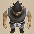 Nimble Knave</td>
      <td> Hoppin' Slammer</td>
      <td class="danger"> Frogginator</td>
      <td class="farming"> Magicwalrus</td>
      <td class="danger"> Nigiri Honcho</td>
    </tr>
    <tr>
      <td class="danger">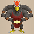 Miracle Hen</td>
      <td> Megahead</td>
      <td class="highlightGray"></td>
      <td class="highlightGray"></td>
      <td class="highlightGray"></td>
    </tr>
    <tr>
      <td colspan="10" class="tableDivider"></td>
    </tr>
    <tr>
      <td rowspan="3" class="centeredText highlightFog">32</td>
      <td rowspan="3" class="highlightShop"></td>
      <td rowspan="3" class=""></td>
      <td rowspan="3" class=""></td>
      <td> Okame Monk B</td>
      <td class="danger"> Hannya Monk B</td>
      <td> Kitsune Monk B</td>
      <td class="danger"> Tengu Monk B</td>
      <td> Huge Chintala</td>
      <td rowspan="3" class="highlightBehemoth"></td>
    </tr>
    <tr>
      <td class="items"> Nimble Knave</td>
      <td> Hoppin' Slammer</td>
      <td class="danger"> Frogginator</td>
      <td class="farming"> Magicwalrus</td>
      <td class="danger"> Nigiri Honcho</td>
    </tr>
    <tr>
      <td class="danger"> Miracle Hen</td>
      <td> Megahead</td>
      <td class="highlightGray"></td>
      <td class="highlightGray"></td>
      <td class="highlightGray"></td>
    </tr>
    <tr>
      <td colspan="10" class="tableDivider"></td>
    </tr>
    <tr>
      <td rowspan="3" class="centeredText highlightFog">33</td>
      <td rowspan="3" class="highlightShop"></td>
      <td rowspan="3" class=""></td>
      <td rowspan="3" class=""></td>
      <td> Okame Monk B</td>
      <td class="danger"> Hannya Monk B</td>
      <td> Kitsune Monk B</td>
      <td class="danger"> Tengu Monk B</td>
      <td> Huge Chintala</td>
      <td rowspan="3" class="highlightBehemoth"></td>
    </tr>
    <tr>
      <td class="items"> Nimble Knave</td>
      <td> Hoppin' Slammer</td>
      <td class="danger"> Frogginator</td>
      <td class="farming"> Magicwalrus</td>
      <td class="danger"> Nigiri Honcho</td>
    </tr>
    <tr>
      <td class="danger"> Miracle Hen</td>
      <td> Megahead</td>
      <td class="highlightGray"></td>
      <td class="highlightGray"></td>
      <td class="highlightGray"></td>
    </tr>
    <tr>
      <td colspan="10" class="tableDivider"></td>
    </tr>
    <tr>
      <td rowspan="3" class="centeredText highlightFog">34</td>
      <td rowspan="3" class="highlightShop"></td>
      <td rowspan="3" class=""></td>
      <td rowspan="3" class=""></td>
      <td> Okame Monk B</td>
      <td class="danger"> Hannya Monk B</td>
      <td> Kitsune Monk B</td>
      <td class="danger"> Tengu Monk B</td>
      <td> Huge Chintala</td>
      <td rowspan="3" class="highlightBehemoth"></td>
    </tr>
    <tr>
      <td class="items"> Nimble Knave</td>
      <td> Hoppin' Slammer</td>
      <td class="danger"> Frogginator</td>
      <td class="farming"> Magicwalrus</td>
      <td class="danger"> Nigiri Honcho</td>
    </tr>
    <tr>
      <td class="danger"> Miracle Hen</td>
      <td> Megahead</td>
      <td class="highlightGray"></td>
      <td class="highlightGray"></td>
      <td class="highlightGray"></td>
    </tr>
    <tr>
      <td colspan="10" class="tableDivider"></td>
    </tr>
    <tr>
      <td rowspan="3" class="centeredText highlightFog">35</td>
      <td rowspan="3" class="highlightShop"></td>
      <td rowspan="3" class=""></td>
      <td rowspan="3" class=""></td>
      <td> Okame Monk B</td>
      <td class="danger"> Hannya Monk B</td>
      <td> Kitsune Monk B</td>
      <td class="danger"> Tengu Monk B</td>
      <td> Huge Chintala</td>
      <td rowspan="3" class="highlightBehemoth"></td>
    </tr>
    <tr>
      <td class="items"> Nimble Knave</td>
      <td> Hoppin' Slammer</td>
      <td class="danger"> Frogginator</td>
      <td class="farming"> Magicwalrus</td>
      <td class="danger"> Nigiri Honcho</td>
    </tr>
    <tr>
      <td class="danger"> Miracle Hen</td>
      <td> Megahead</td>
      <td class="highlightGray"></td>
      <td class="highlightGray"></td>
      <td class="highlightGray"></td>
    </tr>
    <tr>
      <td colspan="10" class="tableDivider"></td>
    </tr>
    <tr>
      <td rowspan="3" class="centeredText highlightFog">36</td>
      <td rowspan="3" class="highlightShop"></td>
      <td rowspan="3" class=""></td>
      <td rowspan="3" class=""></td>
      <td> Okame Monk B</td>
      <td class="danger"> Hannya Monk B</td>
      <td> Kitsune Monk B</td>
      <td class="danger"> Tengu Monk B</td>
      <td> Huge Chintala</td>
      <td rowspan="3" class="highlightBehemoth"></td>
    </tr>
    <tr>
      <td class="items"> Nimble Knave</td>
      <td> Hoppin' Slammer</td>
      <td class="danger"> Frogginator</td>
      <td class="farming"> Magicwalrus</td>
      <td class="danger"> Nigiri Honcho</td>
    </tr>
    <tr>
      <td class="danger"> Miracle Hen</td>
      <td> Megahead</td>
      <td class="highlightGray"></td>
      <td class="highlightGray"></td>
      <td class="highlightGray"></td>
    </tr>
    <tr>
      <td colspan="10" class="tableDivider"></td>
    </tr>
    <tr>
      <td rowspan="3" class="centeredText highlightFog">37</td>
      <td rowspan="3" class="highlightShop"></td>
      <td rowspan="3" class=""></td>
      <td rowspan="3" class=""></td>
      <td> Okame Monk B</td>
      <td class="danger"> Hannya Monk B</td>
      <td> Kitsune Monk B</td>
      <td class="danger"> Tengu Monk B</td>
      <td> Huge Chintala</td>
      <td rowspan="3" class="highlightBehemoth"></td>
    </tr>
    <tr>
      <td class="items"> Nimble Knave</td>
      <td> Hoppin' Slammer</td>
      <td class="danger"> Frogginator</td>
      <td class="farming"> Magicwalrus</td>
      <td class="danger"> Nigiri Honcho</td>
    </tr>
    <tr>
      <td class="danger"> Miracle Hen</td>
      <td> Megahead</td>
      <td class="highlightGray"></td>
      <td class="highlightGray"></td>
      <td class="highlightGray"></td>
    </tr>
    <tr>
      <td colspan="10" class="tableDivider"></td>
    </tr>
    <tr>
      <td rowspan="3" class="centeredText highlightFog">38</td>
      <td rowspan="3" class="highlightShop"></td>
      <td rowspan="3" class=""></td>
      <td rowspan="3" class=""></td>
      <td> Okame Monk B</td>
      <td class="danger"> Hannya Monk B</td>
      <td> Kitsune Monk B</td>
      <td class="danger"> Tengu Monk B</td>
      <td> Huge Chintala</td>
      <td rowspan="3" class="highlightBehemoth"></td>
    </tr>
    <tr>
      <td class="items"> Nimble Knave</td>
      <td> Hoppin' Slammer</td>
      <td class="danger"> Frogginator</td>
      <td class="farming"> Magicwalrus</td>
      <td class="danger"> Nigiri Honcho</td>
    </tr>
    <tr>
      <td class="danger"> Miracle Hen</td>
      <td> Megahead</td>
      <td class="highlightGray"></td>
      <td class="highlightGray"></td>
      <td class="highlightGray"></td>
    </tr>
    <tr>
      <td colspan="10" class="tableDivider"></td>
    </tr>
    <tr>
      <td rowspan="3" class="centeredText highlightFog">39</td>
      <td rowspan="3" class="highlightShop"></td>
      <td rowspan="3" class=""></td>
      <td rowspan="3" class=""></td>
      <td> Okame Monk B</td>
      <td class="danger"> Hannya Monk B</td>
      <td> Kitsune Monk B</td>
      <td class="danger"> Tengu Monk B</td>
      <td> Huge Chintala</td>
      <td rowspan="3" class="highlightBehemoth"></td>
    </tr>
    <tr>
      <td class="items"> Nimble Knave</td>
      <td> Hoppin' Slammer</td>
      <td class="danger"> Frogginator</td>
      <td class="farming"> Magicwalrus</td>
      <td class="danger"> Nigiri Honcho</td>
    </tr>
    <tr>
      <td class="danger"> Miracle Hen</td>
      <td> Megahead</td>
      <td class="highlightGray"></td>
      <td class="highlightGray"></td>
      <td class="highlightGray"></td>
    </tr>
    <tr>
      <td colspan="10" class="tableDivider"></td>
    </tr>
    <tr>
      <td rowspan="3" class="centeredText highlightFog">40</td>
      <td rowspan="3" class="highlightShop"></td>
      <td rowspan="3" class=""></td>
      <td rowspan="3" class=""></td>
      <td> Okame Monk B</td>
      <td class="danger"> Hannya Monk B</td>
      <td> Kitsune Monk B</td>
      <td class="danger"> Tengu Monk B</td>
      <td> Huge Chintala</td>
      <td rowspan="3" class=""></td>
    </tr>
    <tr>
      <td class="items"> Nimble Knave</td>
      <td> Hoppin' Slammer</td>
      <td class="danger"> Frogginator</td>
      <td class="farming"> Magicwalrus</td>
      <td class="danger"> Nigiri Honcho</td>
    </tr>
    <tr>
      <td class="danger"> Miracle Hen</td>
      <td> Megahead</td>
      <td class="highlightGray"></td>
      <td class="highlightGray"></td>
      <td class="highlightGray"></td>
    </tr>
    <tr>
      <td colspan="10" class="tableDivider"></td>
    </tr>
    <tr>
      <td class="monsterTableExtension"></td>
      <td colspan="3" class="monsterTableExtension"></td>
      <td colspan="5" class="monsterTableExtension centeredText">Sacred Tree Mode</td>
      <td class="monsterTableExtension"></td>
    </tr>
    <tr>
      <td colspan="10" class="tableDivider"></td>
    </tr>
    <tr>
      <td rowspan="3" class="centeredText highlightFog">41</td>
      <td rowspan="3" class=""></td>
      <td rowspan="3" class=""></td>
      <td rowspan="3" class=""></td>
      <td class="items"> Nimble Knave</td>
      <td> Hoppin' Slammer</td>
      <td class="danger"> Nigiri Honcho</td>
      <td class="danger"> Miracle Hen</td>
      <td> Okame Monk A</td>
      <td rowspan="3" class="highlightBehemoth"></td>
    </tr>
    <tr>
      <td class="danger"> Hannya Monk A</td>
      <td> Kitsune Monk A</td>
      <td> Deathead</td>
      <td class="items">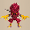 Fire Ninja A</td>
      <td class="items">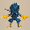 Water Ninja A</td>
    </tr>
    <tr>
      <td>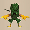 Tree Ninja A</td>
      <td>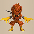 Earth Ninja A</td>
      <td class="highlightGray"></td>
      <td class="highlightGray"></td>
      <td class="highlightGray"></td>
    </tr>
    <tr>
      <td colspan="10" class="tableDivider"></td>
    </tr>
    <tr>
      <td rowspan="3" class="centeredText highlightFog">42</td>
      <td rowspan="3" class=""></td>
      <td rowspan="3" class=""></td>
      <td rowspan="3" class=""></td>
      <td class="items"> Nimble Knave</td>
      <td> Hoppin' Slammer</td>
      <td class="danger"> Nigiri Honcho</td>
      <td class="danger"> Miracle Hen</td>
      <td> Okame Monk A</td>
      <td rowspan="3" class="highlightBehemoth"></td>
    </tr>
    <tr>
      <td class="danger"> Hannya Monk A</td>
      <td> Kitsune Monk A</td>
      <td> Deathead</td>
      <td class="items"> Fire Ninja A</td>
      <td class="items"> Water Ninja A</td>
    </tr>
    <tr>
      <td> Tree Ninja A</td>
      <td> Earth Ninja A</td>
      <td class="highlightGray"></td>
      <td class="highlightGray"></td>
      <td class="highlightGray"></td>
    </tr>
    <tr>
      <td colspan="10" class="tableDivider"></td>
    </tr>
    <tr>
      <td rowspan="3" class="centeredText highlightFog">43</td>
      <td rowspan="3" class=""></td>
      <td rowspan="3" class=""></td>
      <td rowspan="3" class=""></td>
      <td class="items"> Nimble Knave</td>
      <td> Hoppin' Slammer</td>
      <td class="danger"> Nigiri Honcho</td>
      <td class="danger"> Miracle Hen</td>
      <td> Okame Monk A</td>
      <td rowspan="3" class="highlightBehemoth"></td>
    </tr>
    <tr>
      <td class="danger"> Hannya Monk A</td>
      <td> Kitsune Monk A</td>
      <td> Deathead</td>
      <td class="items"> Fire Ninja A</td>
      <td class="items"> Water Ninja A</td>
    </tr>
    <tr>
      <td> Tree Ninja A</td>
      <td> Earth Ninja A</td>
      <td class="highlightGray"></td>
      <td class="highlightGray"></td>
      <td class="highlightGray"></td>
    </tr>
    <tr>
      <td colspan="10" class="tableDivider"></td>
    </tr>
    <tr>
      <td rowspan="3" class="centeredText highlightFog">44</td>
      <td rowspan="3" class="highlightShop"></td>
      <td rowspan="3" class=""></td>
      <td rowspan="3" class=""></td>
      <td class="items"> Nimble Knave</td>
      <td> Hoppin' Slammer</td>
      <td class="danger"> Nigiri Honcho</td>
      <td class="danger"> Miracle Hen</td>
      <td> Okame Monk A</td>
      <td rowspan="3" class="highlightBehemoth"></td>
    </tr>
    <tr>
      <td class="danger"> Hannya Monk A</td>
      <td> Kitsune Monk A</td>
      <td> Deathead</td>
      <td class="items"> Fire Ninja A</td>
      <td class="items"> Water Ninja A</td>
    </tr>
    <tr>
      <td> Tree Ninja A</td>
      <td> Earth Ninja A</td>
      <td class="highlightGray"></td>
      <td class="highlightGray"></td>
      <td class="highlightGray"></td>
    </tr>
    <tr>
      <td colspan="10" class="tableDivider"></td>
    </tr>
    <tr>
      <td rowspan="3" class="centeredText highlightFog">45</td>
      <td rowspan="3" class=""></td>
      <td rowspan="3" class=""></td>
      <td rowspan="3" class="highlightGold"></td>
      <td class="items"> Nimble Knave</td>
      <td> Hoppin' Slammer</td>
      <td class="danger"> Nigiri Honcho</td>
      <td class="danger"> Miracle Hen</td>
      <td> Okame Monk A</td>
      <td rowspan="3" class="highlightBehemoth"></td>
    </tr>
    <tr>
      <td class="danger"> Hannya Monk A</td>
      <td> Kitsune Monk A</td>
      <td> Deathead</td>
      <td class="items"> Fire Ninja A</td>
      <td class="items"> Water Ninja A</td>
    </tr>
    <tr>
      <td> Tree Ninja A</td>
      <td> Earth Ninja A</td>
      <td class="highlightGray"></td>
      <td class="highlightGray"></td>
      <td class="highlightGray"></td>
    </tr>
    <tr>
      <td colspan="10" class="tableDivider"></td>
    </tr>
    <tr>
      <td rowspan="3" class="centeredText highlightFog">46</td>
      <td rowspan="3" class=""></td>
      <td rowspan="3" class=""></td>
      <td rowspan="3" class=""></td>
      <td class="items"> Nimble Knave</td>
      <td> Hoppin' Slammer</td>
      <td class="danger"> Nigiri Honcho</td>
      <td class="danger"> Miracle Hen</td>
      <td> Okame Monk A</td>
      <td rowspan="3" class="highlightBehemoth"></td>
    </tr>
    <tr>
      <td class="danger"> Hannya Monk A</td>
      <td> Kitsune Monk A</td>
      <td> Deathead</td>
      <td class="items"> Fire Ninja A</td>
      <td class="items"> Water Ninja A</td>
    </tr>
    <tr>
      <td> Tree Ninja A</td>
      <td> Earth Ninja A</td>
      <td class="highlightGray"></td>
      <td class="highlightGray"></td>
      <td class="highlightGray"></td>
    </tr>
    <tr>
      <td colspan="10" class="tableDivider"></td>
    </tr>
    <tr>
      <td rowspan="3" class="centeredText highlightFog">47</td>
      <td rowspan="3" class=""></td>
      <td rowspan="3" class=""></td>
      <td rowspan="3" class=""></td>
      <td class="items"> Nimble Knave</td>
      <td> Hoppin' Slammer</td>
      <td class="danger"> Nigiri Honcho</td>
      <td class="danger"> Miracle Hen</td>
      <td> Okame Monk A</td>
      <td rowspan="3" class="highlightBehemoth"></td>
    </tr>
    <tr>
      <td class="danger"> Hannya Monk A</td>
      <td> Kitsune Monk A</td>
      <td> Deathead</td>
      <td class="items"> Fire Ninja A</td>
      <td class="items"> Water Ninja A</td>
    </tr>
    <tr>
      <td> Tree Ninja A</td>
      <td> Earth Ninja A</td>
      <td class="highlightGray"></td>
      <td class="highlightGray"></td>
      <td class="highlightGray"></td>
    </tr>
    <tr>
      <td colspan="10" class="tableDivider"></td>
    </tr>
    <tr>
      <td rowspan="3" class="centeredText highlightFog">48</td>
      <td rowspan="3" class="highlightShop"></td>
      <td rowspan="3" class=""></td>
      <td rowspan="3" class=""></td>
      <td class="items"> Nimble Knave</td>
      <td> Hoppin' Slammer</td>
      <td class="danger"> Nigiri Honcho</td>
      <td class="danger"> Miracle Hen</td>
      <td> Okame Monk A</td>
      <td rowspan="3" class="highlightBehemoth"></td>
    </tr>
    <tr>
      <td class="danger"> Hannya Monk A</td>
      <td> Kitsune Monk A</td>
      <td> Deathead</td>
      <td class="items"> Fire Ninja A</td>
      <td class="items"> Water Ninja A</td>
    </tr>
    <tr>
      <td> Tree Ninja A</td>
      <td> Earth Ninja A</td>
      <td class="highlightGray"></td>
      <td class="highlightGray"></td>
      <td class="highlightGray"></td>
    </tr>
    <tr>
      <td colspan="10" class="tableDivider"></td>
    </tr>
    <tr>
      <td rowspan="3" class="centeredText highlightFog">49</td>
      <td rowspan="3" class=""></td>
      <td rowspan="3" class=""></td>
      <td rowspan="3" class=""></td>
      <td class="items"> Nimble Knave</td>
      <td> Hoppin' Slammer</td>
      <td class="danger"> Nigiri Honcho</td>
      <td class="danger"> Miracle Hen</td>
      <td> Okame Monk A</td>
      <td rowspan="3" class="highlightBehemoth"></td>
    </tr>
    <tr>
      <td class="danger"> Hannya Monk A</td>
      <td> Kitsune Monk A</td>
      <td> Deathead</td>
      <td class="items"> Fire Ninja A</td>
      <td class="items"> Water Ninja A</td>
    </tr>
    <tr>
      <td> Tree Ninja A</td>
      <td> Earth Ninja A</td>
      <td class="highlightGray"></td>
      <td class="highlightGray"></td>
      <td class="highlightGray"></td>
    </tr>
    <tr>
      <td colspan="10" class="tableDivider"></td>
    </tr>
    <tr>
      <td rowspan="3" class="centeredText highlightFog">50</td>
      <td rowspan="3" class="highlightShop"></td>
      <td rowspan="3" class=""></td>
      <td rowspan="3" class=""></td>
      <td class="items"> Nimble Knave</td>
      <td> Hoppin' Slammer</td>
      <td class="danger"> Nigiri Honcho</td>
      <td class="danger"> Miracle Hen</td>
      <td> Okame Monk A</td>
      <td rowspan="3" class="highlightBehemoth"></td>
    </tr>
    <tr>
      <td class="danger"> Hannya Monk A</td>
      <td> Kitsune Monk A</td>
      <td class="danger">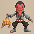 Tengu Monk A</td>
      <td> Deathead</td>
      <td class="items"> Fire Ninja A</td>
    </tr>
    <tr>
      <td class="items"> Water Ninja A</td>
      <td> Tree Ninja A</td>
      <td> Earth Ninja A</td>
      <td class="danger"> Okina Monk A</td>
      <td class="danger"> Ultra Gazer</td>
    </tr>
    <tr>
      <td colspan="10" class="tableDivider"></td>
    </tr>
    <tr>
      <td rowspan="2" class="centeredText highlightFog">51</td>
      <td rowspan="2" class=""></td>
      <td rowspan="2" class=""></td>
      <td rowspan="2" class=""></td>
      <td> Okame Monk A</td>
      <td class="danger"> Hannya Monk A</td>
      <td> Kitsune Monk A</td>
      <td class="danger"> Tengu Monk A</td>
      <td> Deathead</td>
      <td rowspan="2" class="highlightBehemoth"></td>
    </tr>
    <tr>
      <td class="items"> Fire Ninja A</td>
      <td class="items"> Water Ninja A</td>
      <td> Tree Ninja A</td>
      <td> Earth Ninja A</td>
      <td class="danger"> Okina Monk A</td>
    </tr>
    <tr>
      <td colspan="10" class="tableDivider"></td>
    </tr>
    <tr>
      <td rowspan="2" class="centeredText highlightFog">52</td>
      <td rowspan="2" class=""></td>
      <td rowspan="2" class=""></td>
      <td rowspan="2" class=""></td>
      <td> Okame Monk A</td>
      <td class="danger"> Hannya Monk A</td>
      <td> Kitsune Monk A</td>
      <td class="danger"> Tengu Monk A</td>
      <td> Deathead</td>
      <td rowspan="2" class="highlightBehemoth"></td>
    </tr>
    <tr>
      <td class="items"> Fire Ninja A</td>
      <td class="items"> Water Ninja A</td>
      <td> Tree Ninja A</td>
      <td> Earth Ninja A</td>
      <td class="danger"> Okina Monk A</td>
    </tr>
    <tr>
      <td colspan="10" class="tableDivider"></td>
    </tr>
    <tr>
      <td rowspan="2" class="centeredText highlightFog">53</td>
      <td rowspan="2" class=""></td>
      <td rowspan="2" class=""></td>
      <td rowspan="2" class=""></td>
      <td> Okame Monk A</td>
      <td class="danger"> Hannya Monk A</td>
      <td> Kitsune Monk A</td>
      <td class="danger"> Tengu Monk A</td>
      <td> Deathead</td>
      <td rowspan="2" class="highlightBehemoth"></td>
    </tr>
    <tr>
      <td class="items"> Fire Ninja A</td>
      <td class="items"> Water Ninja A</td>
      <td> Tree Ninja A</td>
      <td> Earth Ninja A</td>
      <td class="danger"> Okina Monk A</td>
    </tr>
    <tr>
      <td colspan="10" class="tableDivider"></td>
    </tr>
    <tr>
      <td rowspan="2" class="centeredText highlightFog">54</td>
      <td rowspan="2" class=""></td>
      <td rowspan="2" class=""></td>
      <td rowspan="2" class=""></td>
      <td> Okame Monk A</td>
      <td class="danger"> Hannya Monk A</td>
      <td> Kitsune Monk A</td>
      <td class="danger"> Tengu Monk A</td>
      <td> Deathead</td>
      <td rowspan="2" class="highlightBehemoth"></td>
    </tr>
    <tr>
      <td class="items"> Fire Ninja A</td>
      <td class="items"> Water Ninja A</td>
      <td> Tree Ninja A</td>
      <td> Earth Ninja A</td>
      <td class="danger"> Okina Monk A</td>
    </tr>
    <tr>
      <td colspan="10" class="tableDivider"></td>
    </tr>
    <tr>
      <td rowspan="3" class="centeredText highlightFog">55</td>
      <td rowspan="3" class="highlightShop"></td>
      <td rowspan="3" class=""></td>
      <td rowspan="3" class=""></td>
      <td> Okame Monk A</td>
      <td class="danger"> Hannya Monk A</td>
      <td> Kitsune Monk A</td>
      <td class="danger"> Tengu Monk A</td>
      <td> Deathead</td>
      <td rowspan="3" class="highlightBehemoth"></td>
    </tr>
    <tr>
      <td class="items"> Fire Ninja A</td>
      <td class="items"> Water Ninja A</td>
      <td> Tree Ninja A</td>
      <td> Earth Ninja A</td>
      <td class="danger"> Okina Monk A</td>
    </tr>
    <tr>
      <td class="danger"> Gitan Mamel</td>
      <td class="highlightGray"></td>
      <td class="highlightGray"></td>
      <td class="highlightGray"></td>
      <td class="highlightGray"></td>
    </tr>
    <tr>
      <td colspan="10" class="tableDivider"></td>
    </tr>
    <tr>
      <td rowspan="2" class="centeredText highlightFog">56</td>
      <td rowspan="2" class=""></td>
      <td rowspan="2" class=""></td>
      <td rowspan="2" class=""></td>
      <td> Okame Monk A</td>
      <td class="danger"> Hannya Monk A</td>
      <td> Kitsune Monk A</td>
      <td class="danger"> Tengu Monk A</td>
      <td> Deathead</td>
      <td rowspan="2" class="highlightBehemoth"></td>
    </tr>
    <tr>
      <td class="items"> Fire Ninja A</td>
      <td class="items"> Water Ninja A</td>
      <td> Tree Ninja A</td>
      <td> Earth Ninja A</td>
      <td class="danger"> Okina Monk A</td>
    </tr>
    <tr>
      <td colspan="10" class="tableDivider"></td>
    </tr>
    <tr>
      <td rowspan="2" class="centeredText highlightFog">57</td>
      <td rowspan="2" class=""></td>
      <td rowspan="2" class=""></td>
      <td rowspan="2" class=""></td>
      <td> Okame Monk A</td>
      <td class="danger"> Hannya Monk A</td>
      <td> Kitsune Monk A</td>
      <td class="danger"> Tengu Monk A</td>
      <td> Deathead</td>
      <td rowspan="2" class="highlightBehemoth"></td>
    </tr>
    <tr>
      <td class="items"> Fire Ninja A</td>
      <td class="items"> Water Ninja A</td>
      <td> Tree Ninja A</td>
      <td> Earth Ninja A</td>
      <td class="danger"> Okina Monk A</td>
    </tr>
    <tr>
      <td colspan="10" class="tableDivider"></td>
    </tr>
    <tr>
      <td rowspan="2" class="centeredText highlightFog">58</td>
      <td rowspan="2" class=""></td>
      <td rowspan="2" class=""></td>
      <td rowspan="2" class=""></td>
      <td> Okame Monk A</td>
      <td class="danger"> Hannya Monk A</td>
      <td> Kitsune Monk A</td>
      <td class="danger"> Tengu Monk A</td>
      <td> Deathead</td>
      <td rowspan="2" class="highlightBehemoth"></td>
    </tr>
    <tr>
      <td class="items"> Fire Ninja A</td>
      <td class="items"> Water Ninja A</td>
      <td> Tree Ninja A</td>
      <td> Earth Ninja A</td>
      <td class="danger"> Okina Monk A</td>
    </tr>
    <tr>
      <td colspan="10" class="tableDivider"></td>
    </tr>
    <tr>
      <td rowspan="2" class="centeredText highlightFog">59</td>
      <td rowspan="2" class=""></td>
      <td rowspan="2" class=""></td>
      <td rowspan="2" class=""></td>
      <td> Okame Monk A</td>
      <td class="danger"> Hannya Monk A</td>
      <td> Kitsune Monk A</td>
      <td class="danger"> Tengu Monk A</td>
      <td> Deathead</td>
      <td rowspan="2" class="highlightBehemoth"></td>
    </tr>
    <tr>
      <td class="items"> Fire Ninja A</td>
      <td class="items"> Water Ninja A</td>
      <td> Tree Ninja A</td>
      <td> Earth Ninja A</td>
      <td class="danger"> Okina Monk A</td>
    </tr>
    <tr>
      <td colspan="10" class="tableDivider"></td>
    </tr>
    <tr>
      <td rowspan="3" class="centeredText highlightFog">60</td>
      <td rowspan="3" class=""></td>
      <td rowspan="3" class=""></td>
      <td rowspan="3" class=""></td>
      <td> Okame Monk A</td>
      <td class="danger"> Hannya Monk A</td>
      <td> Kitsune Monk A</td>
      <td class="danger"> Tengu Monk A</td>
      <td> Deathead</td>
      <td rowspan="3" class="highlightBehemoth"></td>
    </tr>
    <tr>
      <td> Gigataur</td>
      <td class="danger">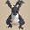 Abyss Dragon</td>
      <td class="items"> Swordmaster</td>
      <td> Detonachin</td>
      <td> Infernous</td>
    </tr>
    <tr>
      <td class="danger"> Okina Monk A</td>
      <td class="danger"> Ultra Gazer</td>
      <td class="highlightGray"></td>
      <td class="highlightGray"></td>
      <td class="highlightGray"></td>
    </tr>
    <tr>
      <td colspan="10" class="tableDivider"></td>
    </tr>
    <tr>
      <td rowspan="2" class="centeredText highlightFog">61</td>
      <td rowspan="2" class=""></td>
      <td rowspan="2" class=""></td>
      <td rowspan="2" class=""></td>
      <td class="danger"> Tengu Monk A</td>
      <td> Deathead</td>
      <td> Gigataur</td>
      <td class="danger"> Abyss Dragon</td>
      <td class="items"> Swordmaster</td>
      <td rowspan="2" class="highlightBehemoth"></td>
    </tr>
    <tr>
      <td> Detonachin</td>
      <td> Infernous</td>
      <td class="danger"> Okina Monk A</td>
      <td> Lordly Samurai</td>
      <td class="highlightGray"></td>
    </tr>
    <tr>
      <td colspan="10" class="tableDivider"></td>
    </tr>
    <tr>
      <td rowspan="2" class="centeredText highlightFog">62</td>
      <td rowspan="2" class=""></td>
      <td rowspan="2" class=""></td>
      <td rowspan="2" class=""></td>
      <td class="danger"> Tengu Monk A</td>
      <td> Deathead</td>
      <td> Gigataur</td>
      <td class="danger"> Abyss Dragon</td>
      <td class="items"> Swordmaster</td>
      <td rowspan="2" class="highlightBehemoth"></td>
    </tr>
    <tr>
      <td> Detonachin</td>
      <td> Infernous</td>
      <td class="danger"> Okina Monk A</td>
      <td> Lordly Samurai</td>
      <td class="highlightGray"></td>
    </tr>
    <tr>
      <td colspan="10" class="tableDivider"></td>
    </tr>
    <tr>
      <td rowspan="2" class="centeredText highlightFog">63</td>
      <td rowspan="2" class=""></td>
      <td rowspan="2" class=""></td>
      <td rowspan="2" class=""></td>
      <td class="danger"> Tengu Monk A</td>
      <td> Deathead</td>
      <td> Gigataur</td>
      <td class="danger"> Abyss Dragon</td>
      <td class="items"> Swordmaster</td>
      <td rowspan="2" class="highlightBehemoth"></td>
    </tr>
    <tr>
      <td> Detonachin</td>
      <td> Infernous</td>
      <td class="danger"> Okina Monk A</td>
      <td> Lordly Samurai</td>
      <td class="highlightGray"></td>
    </tr>
    <tr>
      <td colspan="10" class="tableDivider"></td>
    </tr>
    <tr>
      <td rowspan="2" class="centeredText highlightFog">64</td>
      <td rowspan="2" class=""></td>
      <td rowspan="2" class=""></td>
      <td rowspan="2" class=""></td>
      <td class="danger"> Tengu Monk A</td>
      <td> Deathead</td>
      <td> Gigataur</td>
      <td class="danger"> Abyss Dragon</td>
      <td class="items"> Swordmaster</td>
      <td rowspan="2" class="highlightBehemoth"></td>
    </tr>
    <tr>
      <td> Detonachin</td>
      <td> Infernous</td>
      <td class="danger"> Okina Monk A</td>
      <td> Lordly Samurai</td>
      <td class="highlightGray"></td>
    </tr>
    <tr>
      <td colspan="10" class="tableDivider"></td>
    </tr>
    <tr>
      <td rowspan="2" class="centeredText highlightFog">65</td>
      <td rowspan="2" class=""></td>
      <td rowspan="2" class=""></td>
      <td rowspan="2" class=""></td>
      <td class="danger"> Tengu Monk A</td>
      <td> Deathead</td>
      <td> Gigataur</td>
      <td class="danger"> Abyss Dragon</td>
      <td class="items"> Swordmaster</td>
      <td rowspan="2" class="highlightBehemoth"></td>
    </tr>
    <tr>
      <td> Detonachin</td>
      <td> Infernous</td>
      <td class="danger"> Okina Monk A</td>
      <td class="danger"> Gitan Mamel</td>
      <td> Lordly Samurai</td>
    </tr>
    <tr>
      <td colspan="10" class="tableDivider"></td>
    </tr>
    <tr>
      <td rowspan="2" class="centeredText highlightFog">66</td>
      <td rowspan="2" class=""></td>
      <td rowspan="2" class=""></td>
      <td rowspan="2" class=""></td>
      <td class="danger"> Tengu Monk A</td>
      <td> Deathead</td>
      <td> Gigataur</td>
      <td class="danger"> Abyss Dragon</td>
      <td class="items"> Swordmaster</td>
      <td rowspan="2" class="highlightBehemoth"></td>
    </tr>
    <tr>
      <td> Detonachin</td>
      <td> Infernous</td>
      <td class="danger"> Okina Monk A</td>
      <td> Lordly Samurai</td>
      <td class="danger">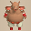 Porgon</td>
    </tr>
    <tr>
      <td colspan="10" class="tableDivider"></td>
    </tr>
    <tr>
      <td rowspan="2" class="centeredText highlightFog">67</td>
      <td rowspan="2" class="highlightShop"></td>
      <td rowspan="2" class=""></td>
      <td rowspan="2" class=""></td>
      <td class="danger"> Tengu Monk A</td>
      <td> Deathead</td>
      <td> Gigataur</td>
      <td class="danger"> Abyss Dragon</td>
      <td class="items"> Swordmaster</td>
      <td rowspan="2" class="highlightBehemoth"></td>
    </tr>
    <tr>
      <td> Detonachin</td>
      <td> Infernous</td>
      <td class="danger"> Okina Monk A</td>
      <td> Lordly Samurai</td>
      <td class="danger"> Porgon</td>
    </tr>
    <tr>
      <td colspan="10" class="tableDivider"></td>
    </tr>
    <tr>
      <td rowspan="2" class="centeredText highlightFog">68</td>
      <td rowspan="2" class=""></td>
      <td rowspan="2" class=""></td>
      <td rowspan="2" class=""></td>
      <td class="danger"> Tengu Monk A</td>
      <td> Deathead</td>
      <td> Gigataur</td>
      <td class="danger"> Abyss Dragon</td>
      <td class="items"> Swordmaster</td>
      <td rowspan="2" class="highlightBehemoth"></td>
    </tr>
    <tr>
      <td> Detonachin</td>
      <td> Infernous</td>
      <td class="danger"> Okina Monk A</td>
      <td> Lordly Samurai</td>
      <td class="danger"> Porgon</td>
    </tr>
    <tr>
      <td colspan="10" class="tableDivider"></td>
    </tr>
    <tr>
      <td rowspan="2" class="centeredText highlightFog">69</td>
      <td rowspan="2" class=""></td>
      <td rowspan="2" class=""></td>
      <td rowspan="2" class=""></td>
      <td class="danger"> Tengu Monk A</td>
      <td> Deathead</td>
      <td> Gigataur</td>
      <td class="danger"> Abyss Dragon</td>
      <td class="items"> Swordmaster</td>
      <td rowspan="2" class="highlightBehemoth"></td>
    </tr>
    <tr>
      <td> Detonachin</td>
      <td> Infernous</td>
      <td class="danger"> Okina Monk A</td>
      <td> Lordly Samurai</td>
      <td class="danger"> Porgon</td>
    </tr>
    <tr>
      <td colspan="10" class="tableDivider"></td>
    </tr>
    <tr>
      <td rowspan="3" class="centeredText highlightFog">70</td>
      <td rowspan="3" class=""></td>
      <td rowspan="3" class=""></td>
      <td rowspan="3" class=""></td>
      <td class="danger"> Tengu Monk A</td>
      <td> Deathead</td>
      <td> Gigataur</td>
      <td class="danger"> Abyss Dragon</td>
      <td class="items"> Swordmaster</td>
      <td rowspan="3" class="highlightBehemoth"></td>
    </tr>
    <tr>
      <td> Detonachin</td>
      <td> Infernous</td>
      <td class="danger"> Okina Monk A</td>
      <td class="danger"> Ultra Gazer</td>
      <td> Lordly Samurai</td>
    </tr>
    <tr>
      <td class="danger"> Porgon</td>
      <td class="highlightGray"></td>
      <td class="highlightGray"></td>
      <td class="highlightGray"></td>
      <td class="highlightGray"></td>
    </tr>
    <tr>
      <td colspan="10" class="tableDivider"></td>
    </tr>
    <tr>
      <td rowspan="2" class="centeredText highlightFog">71</td>
      <td rowspan="2" class=""></td>
      <td rowspan="2" class=""></td>
      <td rowspan="2" class=""></td>
      <td class="danger"> Tengu Monk A</td>
      <td> Gigataur</td>
      <td> Detonachin</td>
      <td> Infernous</td>
      <td class="danger"> Okina Monk A</td>
      <td rowspan="2" class="highlightBehemoth"></td>
    </tr>
    <tr>
      <td> Lordly Samurai</td>
      <td class="danger"> Porgon</td>
      <td class="highlightGray"></td>
      <td class="highlightGray"></td>
      <td class="highlightGray"></td>
    </tr>
    <tr>
      <td colspan="10" class="tableDivider"></td>
    </tr>
    <tr>
      <td rowspan="2" class="centeredText highlightFog">72</td>
      <td rowspan="2" class=""></td>
      <td rowspan="2" class=""></td>
      <td rowspan="2" class=""></td>
      <td class="danger"> Tengu Monk A</td>
      <td> Gigataur</td>
      <td> Detonachin</td>
      <td> Infernous</td>
      <td class="danger"> Okina Monk A</td>
      <td rowspan="2" class="highlightBehemoth"></td>
    </tr>
    <tr>
      <td> Lordly Samurai</td>
      <td class="danger"> Porgon</td>
      <td class="highlightGray"></td>
      <td class="highlightGray"></td>
      <td class="highlightGray"></td>
    </tr>
    <tr>
      <td colspan="10" class="tableDivider"></td>
    </tr>
    <tr>
      <td rowspan="2" class="centeredText highlightFog">73</td>
      <td rowspan="2" class=""></td>
      <td rowspan="2" class=""></td>
      <td rowspan="2" class=""></td>
      <td class="danger"> Tengu Monk A</td>
      <td> Gigataur</td>
      <td> Detonachin</td>
      <td> Infernous</td>
      <td class="danger"> Okina Monk A</td>
      <td rowspan="2" class="highlightBehemoth"></td>
    </tr>
    <tr>
      <td> Lordly Samurai</td>
      <td class="danger"> Porgon</td>
      <td class="highlightGray"></td>
      <td class="highlightGray"></td>
      <td class="highlightGray"></td>
    </tr>
    <tr>
      <td colspan="10" class="tableDivider"></td>
    </tr>
    <tr>
      <td rowspan="2" class="centeredText highlightFog">74</td>
      <td rowspan="2" class=""></td>
      <td rowspan="2" class=""></td>
      <td rowspan="2" class=""></td>
      <td class="danger"> Tengu Monk A</td>
      <td> Gigataur</td>
      <td> Detonachin</td>
      <td> Infernous</td>
      <td class="danger"> Okina Monk A</td>
      <td rowspan="2" class="highlightBehemoth"></td>
    </tr>
    <tr>
      <td> Lordly Samurai</td>
      <td class="danger"> Porgon</td>
      <td class="highlightGray"></td>
      <td class="highlightGray"></td>
      <td class="highlightGray"></td>
    </tr>
    <tr>
      <td colspan="10" class="tableDivider"></td>
    </tr>
    <tr>
      <td rowspan="2" class="centeredText highlightFog">75</td>
      <td rowspan="2" class=""></td>
      <td rowspan="2" class=""></td>
      <td rowspan="2" class=""></td>
      <td class="danger"> Tengu Monk A</td>
      <td> Gigataur</td>
      <td> Detonachin</td>
      <td> Infernous</td>
      <td class="danger"> Okina Monk A</td>
      <td rowspan="2" class="highlightBehemoth"></td>
    </tr>
    <tr>
      <td class="danger"> Gitan Mamel</td>
      <td> Lordly Samurai</td>
      <td class="danger"> Porgon</td>
      <td class="highlightGray"></td>
      <td class="highlightGray"></td>
    </tr>
    <tr>
      <td colspan="10" class="tableDivider"></td>
    </tr>
    <tr>
      <td rowspan="2" class="centeredText highlightFog">76</td>
      <td rowspan="2" class=""></td>
      <td rowspan="2" class=""></td>
      <td rowspan="2" class=""></td>
      <td class="danger"> Tengu Monk A</td>
      <td> Gigataur</td>
      <td> Detonachin</td>
      <td> Infernous</td>
      <td class="danger"> Okina Monk A</td>
      <td rowspan="2" class="highlightBehemoth"></td>
    </tr>
    <tr>
      <td> Lordly Samurai</td>
      <td class="danger"> Porgon</td>
      <td class="items">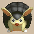 Grampadillo</td>
      <td class="highlightGray"></td>
      <td class="highlightGray"></td>
    </tr>
    <tr>
      <td colspan="10" class="tableDivider"></td>
    </tr>
    <tr>
      <td rowspan="2" class="centeredText highlightFog">77</td>
      <td rowspan="2" class=""></td>
      <td rowspan="2" class=""></td>
      <td rowspan="2" class=""></td>
      <td class="danger"> Tengu Monk A</td>
      <td> Gigataur</td>
      <td> Detonachin</td>
      <td> Infernous</td>
      <td class="danger"> Okina Monk A</td>
      <td rowspan="2" class="highlightBehemoth"></td>
    </tr>
    <tr>
      <td> Lordly Samurai</td>
      <td class="danger"> Porgon</td>
      <td class="items"> Grampadillo</td>
      <td class="highlightGray"></td>
      <td class="highlightGray"></td>
    </tr>
    <tr>
      <td colspan="10" class="tableDivider"></td>
    </tr>
    <tr>
      <td rowspan="2" class="centeredText highlightFog">78</td>
      <td rowspan="2" class=""></td>
      <td rowspan="2" class=""></td>
      <td rowspan="2" class=""></td>
      <td class="danger"> Tengu Monk A</td>
      <td> Gigataur</td>
      <td> Detonachin</td>
      <td> Infernous</td>
      <td class="danger"> Okina Monk A</td>
      <td rowspan="2" class="highlightBehemoth"></td>
    </tr>
    <tr>
      <td> Lordly Samurai</td>
      <td class="danger"> Porgon</td>
      <td class="items"> Grampadillo</td>
      <td class="highlightGray"></td>
      <td class="highlightGray"></td>
    </tr>
    <tr>
      <td colspan="10" class="tableDivider"></td>
    </tr>
    <tr>
      <td rowspan="2" class="centeredText highlightFog">79</td>
      <td rowspan="2" class="highlightShop"></td>
      <td rowspan="2" class=""></td>
      <td rowspan="2" class=""></td>
      <td class="danger"> Tengu Monk A</td>
      <td> Gigataur</td>
      <td> Detonachin</td>
      <td> Infernous</td>
      <td class="danger"> Okina Monk A</td>
      <td rowspan="2" class="highlightBehemoth"></td>
    </tr>
    <tr>
      <td> Lordly Samurai</td>
      <td class="danger"> Porgon</td>
      <td class="items"> Grampadillo</td>
      <td class="highlightGray"></td>
      <td class="highlightGray"></td>
    </tr>
    <tr>
      <td colspan="10" class="tableDivider"></td>
    </tr>
    <tr>
      <td rowspan="2" class="centeredText highlightFog">80</td>
      <td rowspan="2" class=""></td>
      <td rowspan="2" class=""></td>
      <td rowspan="2" class=""></td>
      <td class="danger"> Tengu Monk A</td>
      <td> Gigataur</td>
      <td> Detonachin</td>
      <td> Infernous</td>
      <td class="danger"> Okina Monk A</td>
      <td rowspan="2" class="highlightBehemoth"></td>
    </tr>
    <tr>
      <td class="danger"> Ultra Gazer</td>
      <td> Lordly Samurai</td>
      <td class="danger"> Porgon</td>
      <td class="items"> Grampadillo</td>
      <td class="highlightGray"></td>
    </tr>
    <tr>
      <td colspan="10" class="tableDivider"></td>
    </tr>
    <tr>
      <td rowspan="2" class="centeredText highlightFog">81</td>
      <td rowspan="2" class=""></td>
      <td rowspan="2" class=""></td>
      <td rowspan="2" class=""></td>
      <td class="danger"> Tengu Monk A</td>
      <td> Gigataur</td>
      <td class="danger"> Okina Monk A</td>
      <td class="stats"> Polygon Stunna</td>
      <td class="danger"> Porgon</td>
      <td rowspan="2" class="highlightBehemoth"></td>
    </tr>
    <tr>
      <td class="items"> Grampadillo</td>
      <td class="highlightGray"></td>
      <td class="highlightGray"></td>
      <td class="highlightGray"></td>
      <td class="highlightGray"></td>
    </tr>
    <tr>
      <td colspan="10" class="tableDivider"></td>
    </tr>
    <tr>
      <td rowspan="2" class="centeredText highlightFog">82</td>
      <td rowspan="2" class=""></td>
      <td rowspan="2" class=""></td>
      <td rowspan="2" class=""></td>
      <td class="danger"> Tengu Monk A</td>
      <td> Gigataur</td>
      <td class="danger"> Okina Monk A</td>
      <td class="stats"> Polygon Stunna</td>
      <td class="danger"> Porgon</td>
      <td rowspan="2" class="highlightBehemoth"></td>
    </tr>
    <tr>
      <td class="items"> Grampadillo</td>
      <td class="highlightGray"></td>
      <td class="highlightGray"></td>
      <td class="highlightGray"></td>
      <td class="highlightGray"></td>
    </tr>
    <tr>
      <td colspan="10" class="tableDivider"></td>
    </tr>
    <tr>
      <td rowspan="2" class="centeredText highlightFog">83</td>
      <td rowspan="2" class=""></td>
      <td rowspan="2" class=""></td>
      <td rowspan="2" class=""></td>
      <td class="danger"> Tengu Monk A</td>
      <td> Gigataur</td>
      <td class="danger"> Okina Monk A</td>
      <td class="stats"> Polygon Stunna</td>
      <td class="danger"> Porgon</td>
      <td rowspan="2" class="highlightBehemoth"></td>
    </tr>
    <tr>
      <td class="items"> Grampadillo</td>
      <td class="highlightGray"></td>
      <td class="highlightGray"></td>
      <td class="highlightGray"></td>
      <td class="highlightGray"></td>
    </tr>
    <tr>
      <td colspan="10" class="tableDivider"></td>
    </tr>
    <tr>
      <td rowspan="2" class="centeredText highlightFog">84</td>
      <td rowspan="2" class=""></td>
      <td rowspan="2" class=""></td>
      <td rowspan="2" class=""></td>
      <td class="danger"> Tengu Monk A</td>
      <td> Gigataur</td>
      <td class="danger"> Okina Monk A</td>
      <td class="stats"> Polygon Stunna</td>
      <td class="danger"> Porgon</td>
      <td rowspan="2" class="highlightBehemoth"></td>
    </tr>
    <tr>
      <td class="items"> Grampadillo</td>
      <td class="highlightGray"></td>
      <td class="highlightGray"></td>
      <td class="highlightGray"></td>
      <td class="highlightGray"></td>
    </tr>
    <tr>
      <td colspan="10" class="tableDivider"></td>
    </tr>
    <tr>
      <td rowspan="2" class="centeredText highlightFog">85</td>
      <td rowspan="2" class="highlightShop"></td>
      <td rowspan="2" class=""></td>
      <td rowspan="2" class=""></td>
      <td class="danger"> Tengu Monk A</td>
      <td> Gigataur</td>
      <td class="danger"> Okina Monk A</td>
      <td class="danger"> Gitan Mamel</td>
      <td class="danger"> Porgon</td>
      <td rowspan="2" class="highlightBehemoth"></td>
    </tr>
    <tr>
      <td class="items"> Grampadillo</td>
      <td class="highlightGray"></td>
      <td class="highlightGray"></td>
      <td class="highlightGray"></td>
      <td class="highlightGray"></td>
    </tr>
    <tr>
      <td colspan="10" class="tableDivider"></td>
    </tr>
    <tr>
      <td rowspan="2" class="centeredText highlightFog">86</td>
      <td rowspan="2" class=""></td>
      <td rowspan="2" class=""></td>
      <td rowspan="2" class=""></td>
      <td class="danger"> Tengu Monk A</td>
      <td> Gigataur</td>
      <td class="danger"> Okina Monk A</td>
      <td class="stats"> Polygon Stunna</td>
      <td class="danger"> Porgon</td>
      <td rowspan="2" class="highlightBehemoth"></td>
    </tr>
    <tr>
      <td class="items"> Grampadillo</td>
      <td class="danger"> Tiger Launcher</td>
      <td class="highlightGray"></td>
      <td class="highlightGray"></td>
      <td class="highlightGray"></td>
    </tr>
    <tr>
      <td colspan="10" class="tableDivider"></td>
    </tr>
    <tr>
      <td rowspan="2" class="centeredText highlightFog">87</td>
      <td rowspan="2" class=""></td>
      <td rowspan="2" class=""></td>
      <td rowspan="2" class=""></td>
      <td class="danger"> Tengu Monk A</td>
      <td> Gigataur</td>
      <td class="danger"> Okina Monk A</td>
      <td class="stats"> Polygon Stunna</td>
      <td class="danger"> Porgon</td>
      <td rowspan="2" class="highlightBehemoth"></td>
    </tr>
    <tr>
      <td class="items"> Grampadillo</td>
      <td class="danger"> Tiger Launcher</td>
      <td class="highlightGray"></td>
      <td class="highlightGray"></td>
      <td class="highlightGray"></td>
    </tr>
    <tr>
      <td colspan="10" class="tableDivider"></td>
    </tr>
    <tr>
      <td rowspan="2" class="centeredText highlightFog">88</td>
      <td rowspan="2" class=""></td>
      <td rowspan="2" class=""></td>
      <td rowspan="2" class=""></td>
      <td class="danger"> Tengu Monk A</td>
      <td> Gigataur</td>
      <td class="danger"> Okina Monk A</td>
      <td class="stats"> Polygon Stunna</td>
      <td class="danger"> Porgon</td>
      <td rowspan="2" class="highlightBehemoth"></td>
    </tr>
    <tr>
      <td class="items"> Grampadillo</td>
      <td class="danger"> Tiger Launcher</td>
      <td class="highlightGray"></td>
      <td class="highlightGray"></td>
      <td class="highlightGray"></td>
    </tr>
    <tr>
      <td colspan="10" class="tableDivider"></td>
    </tr>
    <tr>
      <td rowspan="2" class="centeredText highlightFog">89</td>
      <td rowspan="2" class=""></td>
      <td rowspan="2" class=""></td>
      <td rowspan="2" class=""></td>
      <td class="danger"> Tengu Monk A</td>
      <td> Gigataur</td>
      <td class="danger"> Okina Monk A</td>
      <td class="stats"> Polygon Stunna</td>
      <td class="danger"> Porgon</td>
      <td rowspan="2" class="highlightBehemoth"></td>
    </tr>
    <tr>
      <td class="items"> Grampadillo</td>
      <td class="danger"> Tiger Launcher</td>
      <td class="highlightGray"></td>
      <td class="highlightGray"></td>
      <td class="highlightGray"></td>
    </tr>
    <tr>
      <td colspan="10" class="tableDivider"></td>
    </tr>
    <tr>
      <td rowspan="2" class="centeredText highlightFog">90</td>
      <td rowspan="2" class=""></td>
      <td rowspan="2" class=""></td>
      <td rowspan="2" class=""></td>
      <td class="danger"> Tengu Monk A</td>
      <td> Gigataur</td>
      <td class="danger"> Okina Monk A</td>
      <td class="danger"> Ultra Gazer</td>
      <td class="danger"> Porgon</td>
      <td rowspan="2" class="highlightBehemoth"></td>
    </tr>
    <tr>
      <td class="items"> Grampadillo</td>
      <td class="danger"> Tiger Launcher</td>
      <td class="highlightGray"></td>
      <td class="highlightGray"></td>
      <td class="highlightGray"></td>
    </tr>
    <tr>
      <td colspan="10" class="tableDivider"></td>
    </tr>
    <tr>
      <td rowspan="2" class="centeredText highlightFog">91</td>
      <td rowspan="2" class=""></td>
      <td rowspan="2" class=""></td>
      <td rowspan="2" class=""></td>
      <td class="danger"> Tengu Monk A</td>
      <td> Gigataur</td>
      <td class="danger"> Okina Monk A</td>
      <td class="stats"> Polygon Stunna</td>
      <td class="danger"> Porgon</td>
      <td rowspan="2" class="highlightBehemoth"></td>
    </tr>
    <tr>
      <td class="items"> Grampadillo</td>
      <td class="danger"> Tiger Launcher</td>
      <td class="highlightGray"></td>
      <td class="highlightGray"></td>
      <td class="highlightGray"></td>
    </tr>
    <tr>
      <td colspan="10" class="tableDivider"></td>
    </tr>
    <tr>
      <td rowspan="2" class="centeredText highlightFog">92</td>
      <td rowspan="2" class=""></td>
      <td rowspan="2" class=""></td>
      <td rowspan="2" class=""></td>
      <td class="danger"> Tengu Monk A</td>
      <td> Gigataur</td>
      <td class="danger"> Okina Monk A</td>
      <td class="stats"> Polygon Stunna</td>
      <td class="danger"> Porgon</td>
      <td rowspan="2" class="highlightBehemoth"></td>
    </tr>
    <tr>
      <td class="items"> Grampadillo</td>
      <td class="danger"> Tiger Launcher</td>
      <td class="highlightGray"></td>
      <td class="highlightGray"></td>
      <td class="highlightGray"></td>
    </tr>
    <tr>
      <td colspan="10" class="tableDivider"></td>
    </tr>
    <tr>
      <td rowspan="2" class="centeredText highlightFog">93</td>
      <td rowspan="2" class=""></td>
      <td rowspan="2" class=""></td>
      <td rowspan="2" class=""></td>
      <td class="danger"> Tengu Monk A</td>
      <td> Gigataur</td>
      <td class="danger"> Okina Monk A</td>
      <td class="stats"> Polygon Stunna</td>
      <td class="danger"> Porgon</td>
      <td rowspan="2" class="highlightBehemoth"></td>
    </tr>
    <tr>
      <td class="items"> Grampadillo</td>
      <td class="danger"> Tiger Launcher</td>
      <td class="highlightGray"></td>
      <td class="highlightGray"></td>
      <td class="highlightGray"></td>
    </tr>
    <tr>
      <td colspan="10" class="tableDivider"></td>
    </tr>
    <tr>
      <td rowspan="2" class="centeredText highlightFog">94</td>
      <td rowspan="2" class=""></td>
      <td rowspan="2" class=""></td>
      <td rowspan="2" class=""></td>
      <td class="danger"> Tengu Monk A</td>
      <td> Gigataur</td>
      <td class="danger"> Okina Monk A</td>
      <td class="stats"> Polygon Stunna</td>
      <td class="danger"> Porgon</td>
      <td rowspan="2" class="highlightBehemoth"></td>
    </tr>
    <tr>
      <td class="items"> Grampadillo</td>
      <td class="danger"> Tiger Launcher</td>
      <td class="highlightGray"></td>
      <td class="highlightGray"></td>
      <td class="highlightGray"></td>
    </tr>
    <tr>
      <td colspan="10" class="tableDivider"></td>
    </tr>
    <tr>
      <td rowspan="2" class="centeredText highlightFog">95</td>
      <td rowspan="2" class="highlightShop"></td>
      <td rowspan="2" class=""></td>
      <td rowspan="2" class=""></td>
      <td class="danger"> Tengu Monk A</td>
      <td> Gigataur</td>
      <td class="danger"> Okina Monk A</td>
      <td class="stats"> Polygon Stunna</td>
      <td class="danger"> Porgon</td>
      <td rowspan="2" class="highlightBehemoth"></td>
    </tr>
    <tr>
      <td class="items"> Grampadillo</td>
      <td class="danger"> Tiger Launcher</td>
      <td class="highlightGray"></td>
      <td class="highlightGray"></td>
      <td class="highlightGray"></td>
    </tr>
    <tr>
      <td colspan="10" class="tableDivider"></td>
    </tr>
    <tr>
      <td rowspan="2" class="centeredText highlightFog">96</td>
      <td rowspan="2" class=""></td>
      <td rowspan="2" class=""></td>
      <td rowspan="2" class=""></td>
      <td class="danger"> Tengu Monk A</td>
      <td> Gigataur</td>
      <td class="danger"> Okina Monk A</td>
      <td class="danger"> Porgon</td>
      <td class="items"> Grampadillo</td>
      <td rowspan="2" class="highlightBehemoth"></td>
    </tr>
    <tr>
      <td class="danger"> Tiger Launcher</td>
      <td class="highlightGray"></td>
      <td class="highlightGray"></td>
      <td class="highlightGray"></td>
      <td class="highlightGray"></td>
    </tr>
    <tr>
      <td colspan="10" class="tableDivider"></td>
    </tr>
    <tr>
      <td rowspan="2" class="centeredText highlightFog">97</td>
      <td rowspan="2" class="highlightShop"></td>
      <td rowspan="2" class=""></td>
      <td rowspan="2" class="highlightGold"></td>
      <td class="danger"> Tengu Monk A</td>
      <td> Gigataur</td>
      <td class="danger"> Okina Monk A</td>
      <td class="danger"> Porgon</td>
      <td class="items"> Grampadillo</td>
      <td rowspan="2" class="highlightBehemoth"></td>
    </tr>
    <tr>
      <td class="danger"> Tiger Launcher</td>
      <td class="highlightGray"></td>
      <td class="highlightGray"></td>
      <td class="highlightGray"></td>
      <td class="highlightGray"></td>
    </tr>
    <tr>
      <td colspan="10" class="tableDivider"></td>
    </tr>
    <tr>
      <td rowspan="2" class="centeredText highlightFog">98</td>
      <td rowspan="2" class="highlightShop"></td>
      <td rowspan="2" class=""></td>
      <td rowspan="2" class=""></td>
      <td class="danger"> Tengu Monk A</td>
      <td> Gigataur</td>
      <td class="danger"> Okina Monk A</td>
      <td class="danger"> Porgon</td>
      <td class="items"> Grampadillo</td>
      <td rowspan="2" class="highlightBehemoth"></td>
    </tr>
    <tr>
      <td class="danger"> Tiger Launcher</td>
      <td class="highlightGray"></td>
      <td class="highlightGray"></td>
      <td class="highlightGray"></td>
      <td class="highlightGray"></td>
    </tr>
    <tr>
      <td colspan="10" class="tableDivider"></td>
    </tr>
    <tr>
      <td rowspan="2" class="centeredText highlightFog">99</td>
      <td rowspan="2" class=""></td>
      <td rowspan="2" class=""></td>
      <td rowspan="2" class=""></td>
      <td class="danger"> Tengu Monk A</td>
      <td> Gigataur</td>
      <td class="danger"> Okina Monk A</td>
      <td class="danger"> Porgon</td>
      <td class="items"> Grampadillo</td>
      <td rowspan="2" class=""></td>
    </tr>
    <tr>
      <td class="danger"> Tiger Launcher</td>
      <td class="highlightGray"></td>
      <td class="highlightGray"></td>
      <td class="highlightGray"></td>
      <td class="highlightGray"></td>
    </tr>
  </tbody>
</table>

# Behemoths

<button id="hideMonTblImgBtn" onClick={()=>{var mon_imgs = document.querySelectorAll('#behemothTable img');mon_imgs.forEach(e => e.classList.toggle('hidden'));}}>Toggle Monster Images</button>

<table id="behemothTable" class="monsterTable">
  <thead>
    <tr>
      <th>F</th>
      <th colspan="5">Behemoth Monsters</th>
    </tr>
  </thead>
  <tbody>
    <tr>
      <td rowspan="3" class="centeredText">2-19 21-39 41-98</td>
      <td> Mamel</td>
      <td class="caution"> Death Reaper</td>
      <td> Minotaur</td>
      <td> Megataur</td>
      <td class="caution"> Gigataur</td>
    </tr>
    <tr>
      <td> Shagga</td>
      <td> Nashagga</td>
      <td class="caution"> Lashagga</td>
      <td class="danger"> Bashagga</td>
      <td class="caution"> Bowboy</td>
    </tr>
    <tr>
      <td> Pop Tank</td>
      <td> Ghost Radish</td>
      <td> Explochin</td>
      <td> Schubell</td>
      <td class="highlightGray"></td>
    </tr>
  </tbody>
</table>

# Items

※ This section is currently incomplete.

<h4 id="item-table-key" class="heading4Blue"> Item Table Key</h4>

|ID|Explanation|
|-|-|
|F|Floor|
|S|Shop|
|P|Peddler|
|M|Monster drop|
|B|Buried|
|H|Thiefwalrus|
|I|Island|
|T|Transmutation Pot|
|U|Surprise Pot|
|W|Tunnel of Wishes|

<h4 id="weapon" class="heading4Blue"> Weapon</h4>

<table class="dungeonItemTable">
  <tr>
    <th colspan="11" class="highlightLightblue">Weapon</th>
  </tr>
  <tr>
    <th>Name</th>
    <th>F</th>
    <th>S</th>
    <th>P</th>
    <th>M</th>
    <th>B</th>
    <th>H</th>
    <th>I</th>
    <th>T</th>
    <th>U</th>
    <th>W</th>
  </tr>
  <tr>
    <td class="leftText">Wooden Sword</td>
    <td></td>
    <td>X</td>
    <td></td>
    <td></td>
    <td></td>
    <td></td>
    <td></td>
    <td></td>
    <td></td>
    <td></td>
  </tr>
  <tr>
    <td class="leftText">Bronze Sword</td>
    <td></td>
    <td>X</td>
    <td></td>
    <td></td>
    <td></td>
    <td></td>
    <td></td>
    <td></td>
    <td></td>
    <td></td>
  </tr>
  <tr>
    <td class="leftText">Katana</td>
    <td></td>
    <td>X</td>
    <td></td>
    <td></td>
    <td></td>
    <td></td>
    <td></td>
    <td></td>
    <td></td>
    <td></td>
  </tr>
  <tr>
    <td class="leftText">Doutanuki</td>
    <td></td>
    <td>X</td>
    <td></td>
    <td></td>
    <td></td>
    <td></td>
    <td></td>
    <td></td>
    <td></td>
    <td></td>
  </tr>
  <tr>
    <td class="leftText">Manji Kabura</td>
    <td></td>
    <td>X</td>
    <td></td>
    <td></td>
    <td></td>
    <td></td>
    <td></td>
    <td></td>
    <td></td>
    <td></td>
  </tr>
  <tr>
    <td class="leftText">Kajin Fuuma</td>
    <td></td>
    <td></td>
    <td></td>
    <td></td>
    <td></td>
    <td></td>
    <td></td>
    <td></td>
    <td></td>
    <td></td>
  </tr>
  <tr>
    <td class="leftText">Kabura Sutegi</td>
    <td></td>
    <td></td>
    <td></td>
    <td></td>
    <td></td>
    <td></td>
    <td></td>
    <td></td>
    <td></td>
    <td></td>
  </tr>
  <tr>
    <td class="leftText">Golden Sword</td>
    <td></td>
    <td>X</td>
    <td></td>
    <td></td>
    <td></td>
    <td></td>
    <td></td>
    <td></td>
    <td></td>
    <td></td>
  </tr>
  <tr>
    <td class="leftText">Kama Itachi</td>
    <td></td>
    <td>X</td>
    <td></td>
    <td></td>
    <td></td>
    <td></td>
    <td></td>
    <td></td>
    <td></td>
    <td></td>
  </tr>
  <tr>
    <td class="leftText">Axe of the Minotaur</td>
    <td></td>
    <td></td>
    <td></td>
    <td></td>
    <td></td>
    <td></td>
    <td></td>
    <td></td>
    <td></td>
    <td></td>
  </tr>
  <tr>
    <td class="leftText">Accurate Sword</td>
    <td></td>
    <td></td>
    <td></td>
    <td></td>
    <td></td>
    <td></td>
    <td></td>
    <td></td>
    <td></td>
    <td></td>
  </tr>
  <tr>
    <td class="leftText">Swift Sword</td>
    <td></td>
    <td>X</td>
    <td></td>
    <td></td>
    <td></td>
    <td></td>
    <td></td>
    <td></td>
    <td></td>
    <td></td>
  </tr>
  <tr>
    <td class="leftText">Watersplitter</td>
    <td></td>
    <td>X</td>
    <td></td>
    <td></td>
    <td></td>
    <td></td>
    <td></td>
    <td></td>
    <td></td>
    <td></td>
  </tr>
  <tr>
    <td class="leftText">Primal Axe</td>
    <td></td>
    <td>X</td>
    <td></td>
    <td></td>
    <td></td>
    <td></td>
    <td></td>
    <td></td>
    <td></td>
    <td></td>
  </tr>
  <tr>
    <td class="leftText">Dragonkiller</td>
    <td></td>
    <td></td>
    <td></td>
    <td></td>
    <td></td>
    <td></td>
    <td></td>
    <td></td>
    <td></td>
    <td></td>
  </tr>
  <tr>
    <td class="leftText">Crescent Blade</td>
    <td></td>
    <td>X</td>
    <td></td>
    <td></td>
    <td></td>
    <td></td>
    <td></td>
    <td></td>
    <td></td>
    <td></td>
  </tr>
  <tr>
    <td class="leftText">Sky Sword</td>
    <td></td>
    <td>X</td>
    <td></td>
    <td></td>
    <td></td>
    <td></td>
    <td></td>
    <td></td>
    <td></td>
    <td></td>
  </tr>
  <tr>
    <td class="leftText">Sickle of Salvation</td>
    <td></td>
    <td></td>
    <td></td>
    <td></td>
    <td></td>
    <td></td>
    <td></td>
    <td></td>
    <td></td>
    <td></td>
  </tr>
  <tr>
    <td class="leftText">Drain Slayer</td>
    <td></td>
    <td></td>
    <td></td>
    <td></td>
    <td></td>
    <td></td>
    <td></td>
    <td></td>
    <td></td>
    <td></td>
  </tr>
  <tr>
    <td class="leftText">Cyclops Bane</td>
    <td></td>
    <td></td>
    <td></td>
    <td></td>
    <td></td>
    <td></td>
    <td></td>
    <td></td>
    <td></td>
    <td></td>
  </tr>
  <tr>
    <td class="leftText">Steel Severer</td>
    <td></td>
    <td>X</td>
    <td></td>
    <td></td>
    <td></td>
    <td></td>
    <td></td>
    <td></td>
    <td></td>
    <td></td>
  </tr>
  <tr>
    <td class="leftText">Whopping Harisen</td>
    <td></td>
    <td></td>
    <td></td>
    <td></td>
    <td></td>
    <td></td>
    <td></td>
    <td></td>
    <td></td>
    <td></td>
  </tr>
  <tr>
    <td class="leftText">Healing Sword</td>
    <td></td>
    <td></td>
    <td></td>
    <td></td>
    <td></td>
    <td></td>
    <td></td>
    <td></td>
    <td></td>
    <td></td>
  </tr>
  <tr>
    <td class="leftText">Peach Club</td>
    <td></td>
    <td></td>
    <td></td>
    <td></td>
    <td></td>
    <td></td>
    <td></td>
    <td></td>
    <td></td>
    <td></td>
  </tr>
  <tr>
    <td class="leftText">Spender's Club</td>
    <td></td>
    <td></td>
    <td></td>
    <td></td>
    <td></td>
    <td></td>
    <td></td>
    <td></td>
    <td></td>
    <td></td>
  </tr>
  <tr>
    <td class="leftText">Ferrous Greatsword</td>
    <td></td>
    <td>X</td>
    <td></td>
    <td></td>
    <td></td>
    <td></td>
    <td></td>
    <td></td>
    <td></td>
    <td></td>
  </tr>
  <tr>
    <td class="leftText">Steak Knife</td>
    <td></td>
    <td>X</td>
    <td></td>
    <td></td>
    <td></td>
    <td></td>
    <td></td>
    <td></td>
    <td></td>
    <td></td>
  </tr>
  <tr>
    <td class="leftText">Jagged Sword</td>
    <td></td>
    <td>X</td>
    <td></td>
    <td></td>
    <td></td>
    <td></td>
    <td></td>
    <td></td>
    <td></td>
    <td></td>
  </tr>
  <tr>
    <td class="leftText">Quad-edge</td>
    <td></td>
    <td>X</td>
    <td></td>
    <td></td>
    <td></td>
    <td></td>
    <td></td>
    <td></td>
    <td></td>
    <td></td>
  </tr>
  <tr>
    <td class="leftText">Auspicious Kumade</td>
    <td></td>
    <td>X</td>
    <td></td>
    <td></td>
    <td></td>
    <td></td>
    <td></td>
    <td></td>
    <td></td>
    <td></td>
  </tr>
  <tr>
    <td class="leftText">Pickaxe</td>
    <td></td>
    <td></td>
    <td></td>
    <td></td>
    <td></td>
    <td></td>
    <td></td>
    <td></td>
    <td></td>
    <td></td>
  </tr>
  <tr>
    <td class="leftText">Golden Pickaxe</td>
    <td></td>
    <td></td>
    <td></td>
    <td></td>
    <td></td>
    <td></td>
    <td></td>
    <td></td>
    <td></td>
    <td></td>
  </tr>
  <tr>
    <td class="leftText">Wooden Mallet</td>
    <td></td>
    <td></td>
    <td></td>
    <td></td>
    <td></td>
    <td></td>
    <td></td>
    <td></td>
    <td></td>
    <td></td>
  </tr>
  <tr>
    <td class="leftText">Epic Hammer</td>
    <td></td>
    <td></td>
    <td></td>
    <td></td>
    <td></td>
    <td></td>
    <td></td>
    <td></td>
    <td></td>
    <td></td>
  </tr>
  <tr>
    <td class="leftText">Trapseeker</td>
    <td></td>
    <td></td>
    <td></td>
    <td></td>
    <td></td>
    <td></td>
    <td></td>
    <td></td>
    <td></td>
    <td></td>
  </tr>
  <tr>
    <td class="leftText">Bonito Block</td>
    <td></td>
    <td></td>
    <td></td>
    <td></td>
    <td></td>
    <td></td>
    <td></td>
    <td></td>
    <td></td>
    <td></td>
  </tr>
  <tr>
    <td class="leftText">Yamanba's Cleaver</td>
    <td></td>
    <td></td>
    <td></td>
    <td></td>
    <td></td>
    <td></td>
    <td></td>
    <td></td>
    <td></td>
    <td></td>
  </tr>
  <tr>
    <td class="leftText">Break-Off Blade</td>
    <td></td>
    <td></td>
    <td></td>
    <td></td>
    <td></td>
    <td></td>
    <td></td>
    <td></td>
    <td></td>
    <td></td>
  </tr>
</table>

<h4 id="shield" class="heading4Blue"> Shield</h4>

<table class="dungeonItemTable">
  <tr>
    <th colspan="11" class="highlightLightblue">Shield</th>
  </tr>
  <tr>
    <th>Name</th>
    <th>F</th>
    <th>S</th>
    <th>P</th>
    <th>M</th>
    <th>B</th>
    <th>H</th>
    <th>I</th>
    <th>T</th>
    <th>U</th>
    <th>W</th>
  </tr>
  <tr>
    <td class="leftText">Wooden Shield</td>
    <td></td>
    <td></td>
    <td></td>
    <td></td>
    <td></td>
    <td></td>
    <td></td>
    <td></td>
    <td></td>
    <td></td>
  </tr>
  <tr>
    <td class="leftText">Bronze Shield</td>
    <td></td>
    <td>X</td>
    <td></td>
    <td></td>
    <td></td>
    <td></td>
    <td></td>
    <td></td>
    <td></td>
    <td></td>
  </tr>
  <tr>
    <td class="leftText">Iron Shield</td>
    <td></td>
    <td>X</td>
    <td></td>
    <td></td>
    <td></td>
    <td></td>
    <td></td>
    <td></td>
    <td></td>
    <td></td>
  </tr>
  <tr>
    <td class="leftText">Wolfshead</td>
    <td></td>
    <td>X</td>
    <td></td>
    <td></td>
    <td></td>
    <td></td>
    <td></td>
    <td></td>
    <td></td>
    <td></td>
  </tr>
  <tr>
    <td class="leftText">Fuuma Shield</td>
    <td></td>
    <td></td>
    <td></td>
    <td></td>
    <td></td>
    <td></td>
    <td></td>
    <td></td>
    <td></td>
    <td></td>
  </tr>
  <tr>
    <td class="leftText">Rasen Fuuma</td>
    <td></td>
    <td></td>
    <td></td>
    <td></td>
    <td></td>
    <td></td>
    <td></td>
    <td></td>
    <td></td>
    <td></td>
  </tr>
  <tr>
    <td class="leftText">Golden Shield</td>
    <td></td>
    <td>X</td>
    <td></td>
    <td></td>
    <td></td>
    <td></td>
    <td></td>
    <td></td>
    <td></td>
    <td></td>
  </tr>
  <tr>
    <td class="leftText">Counter Shield</td>
    <td></td>
    <td></td>
    <td></td>
    <td></td>
    <td></td>
    <td></td>
    <td></td>
    <td></td>
    <td></td>
    <td></td>
  </tr>
  <tr>
    <td class="leftText">Watchful Shield</td>
    <td></td>
    <td></td>
    <td></td>
    <td></td>
    <td></td>
    <td></td>
    <td></td>
    <td></td>
    <td></td>
    <td></td>
  </tr>
  <tr>
    <td class="leftText">Dragon Shield</td>
    <td></td>
    <td>X</td>
    <td></td>
    <td></td>
    <td></td>
    <td></td>
    <td></td>
    <td></td>
    <td></td>
    <td></td>
  </tr>
  <tr>
    <td class="leftText">Blast Shield</td>
    <td></td>
    <td>X</td>
    <td></td>
    <td></td>
    <td></td>
    <td></td>
    <td></td>
    <td></td>
    <td></td>
    <td></td>
  </tr>
  <tr>
    <td class="leftText">Targe of the Minotaur</td>
    <td></td>
    <td>X</td>
    <td></td>
    <td></td>
    <td></td>
    <td></td>
    <td></td>
    <td></td>
    <td></td>
    <td></td>
  </tr>
  <tr>
    <td class="leftText">Walrus Stopper</td>
    <td></td>
    <td>X</td>
    <td></td>
    <td></td>
    <td></td>
    <td></td>
    <td></td>
    <td></td>
    <td></td>
    <td></td>
  </tr>
  <tr>
    <td class="leftText">Froggo Stopper</td>
    <td></td>
    <td>X</td>
    <td></td>
    <td></td>
    <td></td>
    <td></td>
    <td></td>
    <td></td>
    <td></td>
    <td></td>
  </tr>
  <tr>
    <td class="leftText">Hat Stopper</td>
    <td></td>
    <td>X</td>
    <td></td>
    <td></td>
    <td></td>
    <td></td>
    <td></td>
    <td></td>
    <td></td>
    <td></td>
  </tr>
  <tr>
    <td class="leftText">Nigiri Stopper</td>
    <td></td>
    <td>X</td>
    <td></td>
    <td></td>
    <td></td>
    <td></td>
    <td></td>
    <td></td>
    <td></td>
    <td></td>
  </tr>
  <tr>
    <td class="leftText">Spearscale Shield</td>
    <td></td>
    <td>X</td>
    <td></td>
    <td></td>
    <td></td>
    <td></td>
    <td></td>
    <td></td>
    <td></td>
    <td></td>
  </tr>
  <tr>
    <td class="leftText">Kappa's Dish</td>
    <td></td>
    <td></td>
    <td></td>
    <td></td>
    <td></td>
    <td></td>
    <td></td>
    <td></td>
    <td></td>
    <td></td>
  </tr>
  <tr>
    <td class="leftText">Gazer Shield</td>
    <td></td>
    <td></td>
    <td></td>
    <td></td>
    <td></td>
    <td></td>
    <td></td>
    <td></td>
    <td></td>
    <td></td>
  </tr>
  <tr>
    <td class="leftText">Shield of Negation</td>
    <td></td>
    <td>X</td>
    <td></td>
    <td></td>
    <td></td>
    <td></td>
    <td></td>
    <td></td>
    <td></td>
    <td></td>
  </tr>
  <tr>
    <td class="leftText">Unmoving Wall</td>
    <td></td>
    <td></td>
    <td></td>
    <td></td>
    <td></td>
    <td></td>
    <td></td>
    <td></td>
    <td></td>
    <td></td>
  </tr>
  <tr>
    <td class="leftText">Zabuton</td>
    <td></td>
    <td></td>
    <td></td>
    <td></td>
    <td></td>
    <td></td>
    <td></td>
    <td></td>
    <td></td>
    <td></td>
  </tr>
  <tr>
    <td class="leftText">Spender's Shield</td>
    <td></td>
    <td>X</td>
    <td></td>
    <td></td>
    <td></td>
    <td></td>
    <td></td>
    <td></td>
    <td></td>
    <td></td>
  </tr>
  <tr>
    <td class="leftText">Ferrous Kite</td>
    <td></td>
    <td>X</td>
    <td></td>
    <td></td>
    <td></td>
    <td></td>
    <td></td>
    <td></td>
    <td></td>
    <td></td>
  </tr>
  <tr>
    <td class="leftText">Steak Plate</td>
    <td></td>
    <td>X</td>
    <td></td>
    <td></td>
    <td></td>
    <td></td>
    <td></td>
    <td></td>
    <td></td>
    <td></td>
  </tr>
  <tr>
    <td class="leftText">Gutsy Shield</td>
    <td></td>
    <td>X</td>
    <td></td>
    <td></td>
    <td></td>
    <td></td>
    <td></td>
    <td></td>
    <td></td>
    <td></td>
  </tr>
  <tr>
    <td class="leftText">Hunky-dory Shield</td>
    <td></td>
    <td>X</td>
    <td></td>
    <td></td>
    <td></td>
    <td></td>
    <td></td>
    <td></td>
    <td></td>
    <td></td>
  </tr>
  <tr>
    <td class="leftText">Bodhi Shield</td>
    <td></td>
    <td></td>
    <td></td>
    <td></td>
    <td></td>
    <td></td>
    <td></td>
    <td></td>
    <td></td>
    <td></td>
  </tr>
  <tr>
    <td class="leftText">Shield of Sating</td>
    <td></td>
    <td>X</td>
    <td></td>
    <td></td>
    <td></td>
    <td></td>
    <td></td>
    <td></td>
    <td></td>
    <td></td>
  </tr>
  <tr>
    <td class="leftText">Auspicious Omamori</td>
    <td></td>
    <td>X</td>
    <td></td>
    <td></td>
    <td></td>
    <td></td>
    <td></td>
    <td></td>
    <td></td>
    <td></td>
  </tr>
  <tr>
    <td class="leftText">Shield of Presage</td>
    <td></td>
    <td></td>
    <td></td>
    <td></td>
    <td></td>
    <td></td>
    <td></td>
    <td></td>
    <td></td>
    <td></td>
  </tr>
  <tr>
    <td class="leftText">Yamanba's Potlid</td>
    <td></td>
    <td>X</td>
    <td></td>
    <td></td>
    <td></td>
    <td></td>
    <td></td>
    <td></td>
    <td></td>
    <td></td>
  </tr>
  <tr>
    <td class="leftText">Break-Off Shield</td>
    <td></td>
    <td></td>
    <td></td>
    <td></td>
    <td></td>
    <td></td>
    <td></td>
    <td></td>
    <td></td>
    <td></td>
  </tr>
</table>

<h4 id="bracelet" class="heading4Blue"> Bracelet</h4>

<table class="dungeonItemTable">
  <tr>
    <th colspan="11" class="highlightLightblue">Bracelet</th>
  </tr>
  <tr>
    <th>Name</th>
    <th>F</th>
    <th>S</th>
    <th>P</th>
    <th>M</th>
    <th>B</th>
    <th>H</th>
    <th>I</th>
    <th>T</th>
    <th>U</th>
    <th>W</th>
  </tr>
  <tr>
    <td class="leftText">Healing Bracelet</td>
    <td></td>
    <td>X</td>
    <td></td>
    <td></td>
    <td></td>
    <td></td>
    <td></td>
    <td></td>
    <td></td>
    <td></td>
  </tr>
  <tr>
    <td class="leftText">Strength Bracelet</td>
    <td></td>
    <td>X</td>
    <td></td>
    <td></td>
    <td></td>
    <td></td>
    <td></td>
    <td></td>
    <td></td>
    <td></td>
  </tr>
  <tr>
    <td class="leftText">Bellyexpand Bracelet</td>
    <td></td>
    <td>X</td>
    <td></td>
    <td></td>
    <td></td>
    <td></td>
    <td></td>
    <td></td>
    <td></td>
    <td></td>
  </tr>
  <tr>
    <td class="leftText">Bellyshrink Bracelet</td>
    <td></td>
    <td></td>
    <td></td>
    <td></td>
    <td></td>
    <td></td>
    <td></td>
    <td></td>
    <td></td>
    <td></td>
  </tr>
  <tr>
    <td class="leftText">Fortune Bracelet</td>
    <td></td>
    <td>X</td>
    <td></td>
    <td></td>
    <td></td>
    <td></td>
    <td></td>
    <td></td>
    <td></td>
    <td></td>
  </tr>
  <tr>
    <td class="leftText">Cleansing Bracelet</td>
    <td></td>
    <td>X</td>
    <td></td>
    <td></td>
    <td></td>
    <td></td>
    <td></td>
    <td></td>
    <td></td>
    <td></td>
  </tr>
  <tr>
    <td class="leftText">Focusing Bracelet</td>
    <td></td>
    <td>X</td>
    <td></td>
    <td></td>
    <td></td>
    <td></td>
    <td></td>
    <td></td>
    <td></td>
    <td></td>
  </tr>
  <tr>
    <td class="leftText">Rousing Bracelet</td>
    <td></td>
    <td>X</td>
    <td></td>
    <td></td>
    <td></td>
    <td></td>
    <td></td>
    <td></td>
    <td></td>
    <td></td>
  </tr>
  <tr>
    <td class="leftText">Rustproof Bracelet</td>
    <td></td>
    <td>X</td>
    <td></td>
    <td></td>
    <td></td>
    <td></td>
    <td></td>
    <td></td>
    <td></td>
    <td></td>
  </tr>
  <tr>
    <td class="leftText">Cursebreak Bracelet</td>
    <td></td>
    <td>X</td>
    <td></td>
    <td></td>
    <td></td>
    <td></td>
    <td></td>
    <td></td>
    <td></td>
    <td></td>
  </tr>
  <tr>
    <td class="leftText">Affixing Bracelet</td>
    <td></td>
    <td>X</td>
    <td></td>
    <td></td>
    <td></td>
    <td></td>
    <td></td>
    <td></td>
    <td></td>
    <td></td>
  </tr>
  <tr>
    <td class="leftText">Far-throwing Bracelet</td>
    <td></td>
    <td></td>
    <td></td>
    <td></td>
    <td></td>
    <td></td>
    <td></td>
    <td></td>
    <td></td>
    <td></td>
  </tr>
  <tr>
    <td class="leftText">Bad-aim Bracelet</td>
    <td></td>
    <td></td>
    <td></td>
    <td></td>
    <td></td>
    <td></td>
    <td></td>
    <td></td>
    <td></td>
    <td></td>
  </tr>
  <tr>
    <td class="leftText">Sure-aim Bracelet</td>
    <td></td>
    <td></td>
    <td></td>
    <td></td>
    <td></td>
    <td></td>
    <td></td>
    <td></td>
    <td></td>
    <td></td>
  </tr>
  <tr>
    <td class="leftText">Bouncy Bracelet</td>
    <td></td>
    <td>X</td>
    <td></td>
    <td></td>
    <td></td>
    <td></td>
    <td></td>
    <td></td>
    <td></td>
    <td></td>
  </tr>
  <tr>
    <td class="leftText">Rapid-fire Bracelet</td>
    <td></td>
    <td>X</td>
    <td></td>
    <td></td>
    <td></td>
    <td></td>
    <td></td>
    <td></td>
    <td></td>
    <td></td>
  </tr>
  <tr>
    <td class="leftText">Daredevil Bracelet</td>
    <td></td>
    <td>X</td>
    <td></td>
    <td></td>
    <td></td>
    <td></td>
    <td></td>
    <td></td>
    <td></td>
    <td></td>
  </tr>
  <tr>
    <td class="leftText">Dreaded Bracelet</td>
    <td></td>
    <td></td>
    <td></td>
    <td></td>
    <td></td>
    <td></td>
    <td></td>
    <td></td>
    <td></td>
    <td></td>
  </tr>
  <tr>
    <td class="leftText">Leaping Bracelet</td>
    <td></td>
    <td></td>
    <td></td>
    <td></td>
    <td></td>
    <td></td>
    <td></td>
    <td></td>
    <td></td>
    <td></td>
  </tr>
  <tr>
    <td class="leftText">Blasting Bracelet</td>
    <td></td>
    <td>X</td>
    <td></td>
    <td></td>
    <td></td>
    <td></td>
    <td></td>
    <td></td>
    <td></td>
    <td></td>
  </tr>
  <tr>
    <td class="leftText">Clairvoyant Bracelet</td>
    <td></td>
    <td></td>
    <td></td>
    <td></td>
    <td></td>
    <td></td>
    <td></td>
    <td></td>
    <td></td>
    <td></td>
  </tr>
  <tr>
    <td class="leftText">Monster-find Bracelet</td>
    <td></td>
    <td>X</td>
    <td></td>
    <td></td>
    <td></td>
    <td></td>
    <td></td>
    <td></td>
    <td></td>
    <td></td>
  </tr>
  <tr>
    <td class="leftText">Item-find Bracelet</td>
    <td></td>
    <td>X</td>
    <td></td>
    <td></td>
    <td></td>
    <td></td>
    <td></td>
    <td></td>
    <td></td>
    <td></td>
  </tr>
  <tr>
    <td class="leftText">Passage-find Bracelet</td>
    <td></td>
    <td></td>
    <td></td>
    <td></td>
    <td></td>
    <td></td>
    <td></td>
    <td></td>
    <td></td>
    <td></td>
  </tr>
  <tr>
    <td class="leftText">Waterwalk Bracelet</td>
    <td></td>
    <td>X</td>
    <td></td>
    <td></td>
    <td></td>
    <td></td>
    <td></td>
    <td></td>
    <td></td>
    <td></td>
  </tr>
  <tr>
    <td class="leftText">Floating Bracelet</td>
    <td></td>
    <td></td>
    <td></td>
    <td></td>
    <td></td>
    <td></td>
    <td></td>
    <td></td>
    <td></td>
    <td></td>
  </tr>
  <tr>
    <td class="leftText">Wallpass Bracelet</td>
    <td></td>
    <td>X</td>
    <td></td>
    <td></td>
    <td></td>
    <td></td>
    <td></td>
    <td></td>
    <td></td>
    <td></td>
  </tr>
  <tr>
    <td class="leftText">Tiptoe Bracelet</td>
    <td></td>
    <td></td>
    <td></td>
    <td></td>
    <td></td>
    <td></td>
    <td></td>
    <td></td>
    <td></td>
    <td></td>
  </tr>
  <tr>
    <td class="leftText">Passerby Bracelet</td>
    <td></td>
    <td>X</td>
    <td></td>
    <td></td>
    <td></td>
    <td></td>
    <td></td>
    <td></td>
    <td></td>
    <td></td>
  </tr>
  <tr>
    <td class="leftText">Item-losing Bracelet</td>
    <td></td>
    <td></td>
    <td></td>
    <td></td>
    <td></td>
    <td></td>
    <td></td>
    <td></td>
    <td></td>
    <td></td>
  </tr>
  <tr>
    <td class="leftText">Gitan-losing Bracelet</td>
    <td></td>
    <td></td>
    <td></td>
    <td></td>
    <td></td>
    <td></td>
    <td></td>
    <td></td>
    <td></td>
    <td></td>
  </tr>
  <tr>
    <td class="leftText">Monstercall Bracelet</td>
    <td></td>
    <td></td>
    <td></td>
    <td></td>
    <td></td>
    <td></td>
    <td></td>
    <td></td>
    <td></td>
    <td></td>
  </tr>
  <tr>
    <td class="leftText">Trapmore Bracelet</td>
    <td></td>
    <td></td>
    <td></td>
    <td></td>
    <td></td>
    <td></td>
    <td></td>
    <td></td>
    <td></td>
    <td></td>
  </tr>
  <tr>
    <td class="leftText">Haggling Bracelet</td>
    <td></td>
    <td></td>
    <td></td>
    <td></td>
    <td></td>
    <td></td>
    <td></td>
    <td></td>
    <td></td>
    <td></td>
  </tr>
  <tr>
    <td class="leftText">Trapper's Bracelet</td>
    <td></td>
    <td></td>
    <td></td>
    <td></td>
    <td></td>
    <td></td>
    <td></td>
    <td></td>
    <td></td>
    <td></td>
  </tr>
  <tr>
    <td class="leftText">Appraiser's Bracelet</td>
    <td></td>
    <td></td>
    <td></td>
    <td></td>
    <td></td>
    <td></td>
    <td></td>
    <td></td>
    <td></td>
    <td></td>
  </tr>
  <tr>
    <td class="leftText">Cannonboost Bracelet</td>
    <td></td>
    <td>X</td>
    <td></td>
    <td></td>
    <td></td>
    <td></td>
    <td></td>
    <td></td>
    <td></td>
    <td></td>
  </tr>
</table>

<h4 id="projectile" class="heading4Blue">  Projectile</h4>

<table class="dungeonItemTable">
  <tr>
    <th colspan="11" class="highlightLightblue">Projectile</th>
  </tr>
  <tr>
    <th>Name</th>
    <th>F</th>
    <th>S</th>
    <th>P</th>
    <th>M</th>
    <th>B</th>
    <th>H</th>
    <th>I</th>
    <th>T</th>
    <th>U</th>
    <th>W</th>
  </tr>
  <tr>
    <td class="leftText">Wooden Arrow</td>
    <td></td>
    <td></td>
    <td></td>
    <td></td>
    <td></td>
    <td></td>
    <td></td>
    <td></td>
    <td></td>
    <td></td>
  </tr>
  <tr>
    <td class="leftText">Iron Arrow</td>
    <td></td>
    <td>X</td>
    <td></td>
    <td></td>
    <td></td>
    <td></td>
    <td></td>
    <td></td>
    <td></td>
    <td></td>
  </tr>
  <tr>
    <td class="leftText">Silver Arrow</td>
    <td></td>
    <td>X</td>
    <td></td>
    <td></td>
    <td></td>
    <td></td>
    <td></td>
    <td></td>
    <td></td>
    <td></td>
  </tr>
  <tr>
    <td class="leftText">Poison Arrow</td>
    <td></td>
    <td></td>
    <td></td>
    <td></td>
    <td></td>
    <td></td>
    <td></td>
    <td></td>
    <td></td>
    <td></td>
  </tr>
  <tr>
    <td class="leftText">Truestrike Arrow</td>
    <td></td>
    <td>X</td>
    <td></td>
    <td></td>
    <td></td>
    <td></td>
    <td></td>
    <td></td>
    <td></td>
    <td></td>
  </tr>
  <tr>
    <td class="leftText">Rock</td>
    <td></td>
    <td></td>
    <td></td>
    <td></td>
    <td></td>
    <td></td>
    <td></td>
    <td></td>
    <td></td>
    <td></td>
  </tr>
  <tr>
    <td class="leftText">Porky's Rock</td>
    <td></td>
    <td></td>
    <td></td>
    <td></td>
    <td></td>
    <td></td>
    <td></td>
    <td></td>
    <td></td>
    <td></td>
  </tr>
</table>

<h4 id="food-(items)" class="heading4Blue"> Food</h4>

<table class="dungeonItemTable">
  <tr>
    <th colspan="11" class="highlightLightblue">Food</th>
  </tr>
  <tr>
    <th>Name</th>
    <th>F</th>
    <th>S</th>
    <th>P</th>
    <th>M</th>
    <th>B</th>
    <th>H</th>
    <th>I</th>
    <th>T</th>
    <th>U</th>
    <th>W</th>
  </tr>
  <tr>
    <td class="leftText">Onigiri</td>
    <td></td>
    <td>X</td>
    <td></td>
    <td></td>
    <td></td>
    <td></td>
    <td></td>
    <td></td>
    <td></td>
    <td></td>
  </tr>
  <tr>
    <td class="leftText">Large Onigiri</td>
    <td></td>
    <td>X</td>
    <td></td>
    <td></td>
    <td></td>
    <td></td>
    <td></td>
    <td></td>
    <td></td>
    <td></td>
  </tr>
  <tr>
    <td class="leftText">Huge Onigiri</td>
    <td></td>
    <td>X</td>
    <td></td>
    <td></td>
    <td></td>
    <td></td>
    <td></td>
    <td></td>
    <td></td>
    <td></td>
  </tr>
  <tr>
    <td class="leftText">Rotten Onigiri</td>
    <td></td>
    <td></td>
    <td></td>
    <td></td>
    <td></td>
    <td></td>
    <td></td>
    <td></td>
    <td></td>
    <td></td>
  </tr>
  <tr>
    <td class="leftText">Grilled Onigiri</td>
    <td></td>
    <td></td>
    <td></td>
    <td></td>
    <td></td>
    <td></td>
    <td></td>
    <td></td>
    <td></td>
    <td></td>
  </tr>
  <tr>
    <td class="leftText">Special Onigiri</td>
    <td></td>
    <td></td>
    <td></td>
    <td></td>
    <td></td>
    <td></td>
    <td></td>
    <td></td>
    <td></td>
    <td></td>
  </tr>
  <tr>
    <td class="leftText">Sumo Onigiri</td>
    <td></td>
    <td></td>
    <td></td>
    <td></td>
    <td></td>
    <td></td>
    <td></td>
    <td></td>
    <td></td>
    <td></td>
  </tr>
  <tr>
    <td class="leftText">Sweet Potato</td>
    <td></td>
    <td>X</td>
    <td></td>
    <td></td>
    <td></td>
    <td></td>
    <td></td>
    <td></td>
    <td></td>
    <td></td>
  </tr>
  <tr>
    <td class="leftText">Yakitori</td>
    <td></td>
    <td></td>
    <td></td>
    <td></td>
    <td></td>
    <td></td>
    <td></td>
    <td></td>
    <td></td>
    <td></td>
  </tr>
  <tr>
    <td class="leftText">Rotten Peach Bun</td>
    <td></td>
    <td></td>
    <td></td>
    <td></td>
    <td></td>
    <td></td>
    <td></td>
    <td></td>
    <td></td>
    <td></td>
  </tr>
</table>

<h4 id="grass" class="heading4Blue"> Grass</h4>

<table class="dungeonItemTable">
  <tr>
    <th colspan="11" class="highlightLightblue">Grass</th>
  </tr>
  <tr>
    <th>Name</th>
    <th>F</th>
    <th>S</th>
    <th>P</th>
    <th>M</th>
    <th>B</th>
    <th>H</th>
    <th>I</th>
    <th>T</th>
    <th>U</th>
    <th>W</th>
  </tr>
  <tr>
    <td class="leftText">Weeds</td>
    <td></td>
    <td></td>
    <td></td>
    <td></td>
    <td></td>
    <td></td>
    <td></td>
    <td></td>
    <td></td>
    <td></td>
  </tr>
  <tr>
    <td class="leftText">Herb</td>
    <td></td>
    <td>X</td>
    <td></td>
    <td></td>
    <td></td>
    <td></td>
    <td></td>
    <td></td>
    <td></td>
    <td></td>
  </tr>
  <tr>
    <td class="leftText">Otogirisou</td>
    <td></td>
    <td>X</td>
    <td></td>
    <td></td>
    <td></td>
    <td></td>
    <td></td>
    <td></td>
    <td></td>
    <td></td>
  </tr>
  <tr>
    <td class="leftText">Healing Grass</td>
    <td></td>
    <td>X</td>
    <td></td>
    <td></td>
    <td></td>
    <td></td>
    <td></td>
    <td></td>
    <td></td>
    <td></td>
  </tr>
  <tr>
    <td class="leftText">Life Grass</td>
    <td></td>
    <td>X</td>
    <td></td>
    <td></td>
    <td></td>
    <td></td>
    <td></td>
    <td></td>
    <td></td>
    <td></td>
  </tr>
  <tr>
    <td class="leftText">Fragrant Grass</td>
    <td></td>
    <td>X</td>
    <td></td>
    <td></td>
    <td></td>
    <td></td>
    <td></td>
    <td></td>
    <td></td>
    <td></td>
  </tr>
  <tr>
    <td class="leftText">Revival Grass</td>
    <td></td>
    <td>X</td>
    <td></td>
    <td></td>
    <td></td>
    <td></td>
    <td></td>
    <td></td>
    <td></td>
    <td></td>
  </tr>
  <tr>
    <td class="leftText">Bellyexpand Seed</td>
    <td></td>
    <td>X</td>
    <td></td>
    <td></td>
    <td></td>
    <td></td>
    <td></td>
    <td></td>
    <td></td>
    <td></td>
  </tr>
  <tr>
    <td class="leftText">Bellyshrink Seed</td>
    <td></td>
    <td></td>
    <td></td>
    <td></td>
    <td></td>
    <td></td>
    <td></td>
    <td></td>
    <td></td>
    <td></td>
  </tr>
  <tr>
    <td class="leftText">Dragon Grass</td>
    <td></td>
    <td></td>
    <td></td>
    <td></td>
    <td></td>
    <td></td>
    <td></td>
    <td></td>
    <td></td>
    <td></td>
  </tr>
  <tr>
    <td class="leftText">Leaping Grass</td>
    <td></td>
    <td>X</td>
    <td></td>
    <td></td>
    <td></td>
    <td></td>
    <td></td>
    <td></td>
    <td></td>
    <td></td>
  </tr>
  <tr>
    <td class="leftText">Antidote Grass</td>
    <td></td>
    <td>X</td>
    <td></td>
    <td></td>
    <td></td>
    <td></td>
    <td></td>
    <td></td>
    <td></td>
    <td></td>
  </tr>
  <tr>
    <td class="leftText">Strength Grass</td>
    <td></td>
    <td>X</td>
    <td></td>
    <td></td>
    <td></td>
    <td></td>
    <td></td>
    <td></td>
    <td></td>
    <td></td>
  </tr>
  <tr>
    <td class="leftText">Poison Grass</td>
    <td></td>
    <td></td>
    <td></td>
    <td></td>
    <td></td>
    <td></td>
    <td></td>
    <td></td>
    <td></td>
    <td></td>
  </tr>
  <tr>
    <td class="leftText">Confusion Grass</td>
    <td></td>
    <td>X</td>
    <td></td>
    <td></td>
    <td></td>
    <td></td>
    <td></td>
    <td></td>
    <td></td>
    <td></td>
  </tr>
  <tr>
    <td class="leftText">Sedating Grass</td>
    <td></td>
    <td>X</td>
    <td></td>
    <td></td>
    <td></td>
    <td></td>
    <td></td>
    <td></td>
    <td></td>
    <td></td>
  </tr>
  <tr>
    <td class="leftText">Berserk Seed</td>
    <td></td>
    <td></td>
    <td></td>
    <td></td>
    <td></td>
    <td></td>
    <td></td>
    <td></td>
    <td></td>
    <td></td>
  </tr>
  <tr>
    <td class="leftText">Blinding Grass</td>
    <td></td>
    <td>X</td>
    <td></td>
    <td></td>
    <td></td>
    <td></td>
    <td></td>
    <td></td>
    <td></td>
    <td></td>
  </tr>
  <tr>
    <td class="leftText">Seewell Grass</td>
    <td></td>
    <td></td>
    <td></td>
    <td></td>
    <td></td>
    <td></td>
    <td></td>
    <td></td>
    <td></td>
    <td></td>
  </tr>
  <tr>
    <td class="leftText">Swift Grass</td>
    <td></td>
    <td>X</td>
    <td></td>
    <td></td>
    <td></td>
    <td></td>
    <td></td>
    <td></td>
    <td></td>
    <td></td>
  </tr>
  <tr>
    <td class="leftText">Power-up Grass</td>
    <td></td>
    <td>X</td>
    <td></td>
    <td></td>
    <td></td>
    <td></td>
    <td></td>
    <td></td>
    <td></td>
    <td></td>
  </tr>
  <tr>
    <td class="leftText">Invincible Grass</td>
    <td></td>
    <td>X</td>
    <td></td>
    <td></td>
    <td></td>
    <td></td>
    <td></td>
    <td></td>
    <td></td>
    <td></td>
  </tr>
  <tr>
    <td class="leftText">Fortune Grass</td>
    <td></td>
    <td>X</td>
    <td></td>
    <td></td>
    <td></td>
    <td></td>
    <td></td>
    <td></td>
    <td></td>
    <td></td>
  </tr>
  <tr>
    <td class="leftText">Angel Seed</td>
    <td></td>
    <td></td>
    <td></td>
    <td></td>
    <td></td>
    <td></td>
    <td></td>
    <td></td>
    <td></td>
    <td></td>
  </tr>
  <tr>
    <td class="leftText">Feeble Grass</td>
    <td></td>
    <td></td>
    <td></td>
    <td></td>
    <td></td>
    <td></td>
    <td></td>
    <td></td>
    <td></td>
    <td></td>
  </tr>
  <tr>
    <td class="leftText">Unlucky Seed</td>
    <td></td>
    <td></td>
    <td></td>
    <td></td>
    <td></td>
    <td></td>
    <td></td>
    <td></td>
    <td></td>
    <td></td>
  </tr>
  <tr>
    <td class="leftText">Ill-fated Seed</td>
    <td></td>
    <td></td>
    <td></td>
    <td></td>
    <td></td>
    <td></td>
    <td></td>
    <td></td>
    <td></td>
    <td></td>
  </tr>
</table>

<h4 id="scroll" class="heading4Blue"> Scroll</h4>

<table class="dungeonItemTable">
  <tr>
    <th colspan="11" class="highlightLightblue">Scroll</th>
  </tr>
  <tr>
    <th>Name</th>
    <th>F</th>
    <th>S</th>
    <th>P</th>
    <th>M</th>
    <th>B</th>
    <th>H</th>
    <th>I</th>
    <th>T</th>
    <th>U</th>
    <th>W</th>
  </tr>
  <tr>
    <td class="leftText">Confusion Scroll</td>
    <td></td>
    <td>X</td>
    <td></td>
    <td></td>
    <td></td>
    <td></td>
    <td></td>
    <td></td>
    <td></td>
    <td></td>
  </tr>
  <tr>
    <td class="leftText">Slumber Scroll</td>
    <td></td>
    <td>X</td>
    <td></td>
    <td></td>
    <td></td>
    <td></td>
    <td></td>
    <td></td>
    <td></td>
    <td></td>
  </tr>
  <tr>
    <td class="leftText">Jitters Scroll</td>
    <td></td>
    <td>X</td>
    <td></td>
    <td></td>
    <td></td>
    <td></td>
    <td></td>
    <td></td>
    <td></td>
    <td></td>
  </tr>
  <tr>
    <td class="leftText">Windblade Scroll</td>
    <td></td>
    <td>X</td>
    <td></td>
    <td></td>
    <td></td>
    <td></td>
    <td></td>
    <td></td>
    <td></td>
    <td></td>
  </tr>
  <tr>
    <td class="leftText">Expulsion Scroll</td>
    <td></td>
    <td></td>
    <td></td>
    <td></td>
    <td></td>
    <td></td>
    <td></td>
    <td></td>
    <td></td>
    <td></td>
  </tr>
  <tr>
    <td class="leftText">Exorcism Scroll</td>
    <td></td>
    <td>X</td>
    <td></td>
    <td></td>
    <td></td>
    <td></td>
    <td></td>
    <td></td>
    <td></td>
    <td></td>
  </tr>
  <tr>
    <td class="leftText">Identifier Scroll</td>
    <td></td>
    <td>X</td>
    <td></td>
    <td></td>
    <td></td>
    <td></td>
    <td></td>
    <td></td>
    <td></td>
    <td></td>
  </tr>
  <tr>
    <td class="leftText">Heavenly Scroll</td>
    <td></td>
    <td>X</td>
    <td></td>
    <td></td>
    <td></td>
    <td></td>
    <td></td>
    <td></td>
    <td></td>
    <td></td>
  </tr>
  <tr>
    <td class="leftText">Earthly Scroll</td>
    <td></td>
    <td>X</td>
    <td></td>
    <td></td>
    <td></td>
    <td></td>
    <td></td>
    <td></td>
    <td></td>
    <td></td>
  </tr>
  <tr>
    <td class="leftText">Plating Scroll</td>
    <td></td>
    <td>X</td>
    <td></td>
    <td></td>
    <td></td>
    <td></td>
    <td></td>
    <td></td>
    <td></td>
    <td></td>
  </tr>
  <tr>
    <td class="leftText">Slot-adding Scroll</td>
    <td></td>
    <td>X</td>
    <td></td>
    <td></td>
    <td></td>
    <td></td>
    <td></td>
    <td></td>
    <td></td>
    <td></td>
  </tr>
  <tr>
    <td class="leftText">Rune-eraser Scroll</td>
    <td></td>
    <td>X</td>
    <td></td>
    <td></td>
    <td></td>
    <td></td>
    <td></td>
    <td></td>
    <td></td>
    <td></td>
  </tr>
  <tr>
    <td class="leftText">Silver-seal Scroll</td>
    <td></td>
    <td>X</td>
    <td></td>
    <td></td>
    <td></td>
    <td></td>
    <td></td>
    <td></td>
    <td></td>
    <td></td>
  </tr>
  <tr>
    <td class="leftText">Silverpurge Scroll</td>
    <td></td>
    <td>X</td>
    <td></td>
    <td></td>
    <td></td>
    <td></td>
    <td></td>
    <td></td>
    <td></td>
    <td></td>
  </tr>
  <tr>
    <td class="leftText">Pot-upsize Scroll</td>
    <td></td>
    <td>X</td>
    <td></td>
    <td></td>
    <td></td>
    <td></td>
    <td></td>
    <td></td>
    <td></td>
    <td></td>
  </tr>
  <tr>
    <td class="leftText">Extraction Scroll</td>
    <td></td>
    <td>X</td>
    <td></td>
    <td></td>
    <td></td>
    <td></td>
    <td></td>
    <td></td>
    <td></td>
    <td></td>
  </tr>
  <tr>
    <td class="leftText">Onigiri Scroll</td>
    <td></td>
    <td>X</td>
    <td></td>
    <td></td>
    <td></td>
    <td></td>
    <td></td>
    <td></td>
    <td></td>
    <td></td>
  </tr>
  <tr>
    <td class="leftText">Curse Scroll</td>
    <td></td>
    <td></td>
    <td></td>
    <td></td>
    <td></td>
    <td></td>
    <td></td>
    <td></td>
    <td></td>
    <td></td>
  </tr>
  <tr>
    <td class="leftText">Mapping Scroll</td>
    <td></td>
    <td>X</td>
    <td></td>
    <td></td>
    <td></td>
    <td></td>
    <td></td>
    <td></td>
    <td></td>
    <td></td>
  </tr>
  <tr>
    <td class="leftText">Map-loss Scroll</td>
    <td></td>
    <td></td>
    <td></td>
    <td></td>
    <td></td>
    <td></td>
    <td></td>
    <td></td>
    <td></td>
    <td></td>
  </tr>
  <tr>
    <td class="leftText">Trap-eraser Scroll</td>
    <td></td>
    <td>X</td>
    <td></td>
    <td></td>
    <td></td>
    <td></td>
    <td></td>
    <td></td>
    <td></td>
    <td></td>
  </tr>
  <tr>
    <td class="leftText">Trap Scroll</td>
    <td></td>
    <td></td>
    <td></td>
    <td></td>
    <td></td>
    <td></td>
    <td></td>
    <td></td>
    <td></td>
    <td></td>
  </tr>
  <tr>
    <td class="leftText">Water-drain Scroll</td>
    <td></td>
    <td>X</td>
    <td></td>
    <td></td>
    <td></td>
    <td></td>
    <td></td>
    <td></td>
    <td></td>
    <td></td>
  </tr>
  <tr>
    <td class="leftText">Monstercall Scroll</td>
    <td></td>
    <td></td>
    <td></td>
    <td></td>
    <td></td>
    <td></td>
    <td></td>
    <td></td>
    <td></td>
    <td></td>
  </tr>
  <tr>
    <td class="leftText">Wall-less Scroll</td>
    <td></td>
    <td></td>
    <td></td>
    <td></td>
    <td></td>
    <td></td>
    <td></td>
    <td></td>
    <td></td>
    <td></td>
  </tr>
  <tr>
    <td class="leftText">Gathering Scroll</td>
    <td></td>
    <td></td>
    <td></td>
    <td></td>
    <td></td>
    <td></td>
    <td></td>
    <td></td>
    <td></td>
    <td></td>
  </tr>
  <tr>
    <td class="leftText">Collection Scroll</td>
    <td></td>
    <td>X</td>
    <td></td>
    <td></td>
    <td></td>
    <td></td>
    <td></td>
    <td></td>
    <td></td>
    <td></td>
  </tr>
  <tr>
    <td class="leftText">Gambler's Scroll</td>
    <td></td>
    <td>X</td>
    <td></td>
    <td></td>
    <td></td>
    <td></td>
    <td></td>
    <td></td>
    <td></td>
    <td></td>
  </tr>
  <tr>
    <td class="leftText">Muzzle Scroll</td>
    <td></td>
    <td></td>
    <td></td>
    <td></td>
    <td></td>
    <td></td>
    <td></td>
    <td></td>
    <td></td>
    <td></td>
  </tr>
  <tr>
    <td class="leftText">Carry-ban Scroll</td>
    <td></td>
    <td></td>
    <td></td>
    <td></td>
    <td></td>
    <td></td>
    <td></td>
    <td></td>
    <td></td>
    <td></td>
  </tr>
  <tr>
    <td class="leftText">Swift Foe Scroll</td>
    <td></td>
    <td></td>
    <td></td>
    <td></td>
    <td></td>
    <td></td>
    <td></td>
    <td></td>
    <td></td>
    <td></td>
  </tr>
  <tr>
    <td class="leftText">Fixer Scroll</td>
    <td></td>
    <td>X</td>
    <td></td>
    <td></td>
    <td></td>
    <td></td>
    <td></td>
    <td></td>
    <td></td>
    <td></td>
  </tr>
  <tr>
    <td class="leftText">Escape Scroll</td>
    <td></td>
    <td></td>
    <td></td>
    <td></td>
    <td></td>
    <td></td>
    <td></td>
    <td></td>
    <td></td>
    <td></td>
  </tr>
  <tr>
    <td class="leftText">Eradication Scroll</td>
    <td></td>
    <td></td>
    <td></td>
    <td></td>
    <td></td>
    <td></td>
    <td></td>
    <td></td>
    <td></td>
    <td></td>
  </tr>
  <tr>
    <td class="leftText">Sanctuary Scroll</td>
    <td></td>
    <td>X</td>
    <td></td>
    <td></td>
    <td></td>
    <td></td>
    <td></td>
    <td></td>
    <td></td>
    <td></td>
  </tr>
  <tr>
    <td class="leftText">Blank Scroll</td>
    <td></td>
    <td>X</td>
    <td></td>
    <td></td>
    <td></td>
    <td></td>
    <td></td>
    <td></td>
    <td></td>
    <td></td>
  </tr>
  <tr>
    <td class="leftText">Wet Scroll</td>
    <td></td>
    <td></td>
    <td></td>
    <td></td>
    <td></td>
    <td></td>
    <td></td>
    <td></td>
    <td></td>
    <td></td>
  </tr>
</table>

<h4 id="staff" class="heading4Blue"> Staff</h4>

<table class="dungeonItemTable">
  <tr>
    <th colspan="11" class="highlightLightblue">Staff</th>
  </tr>
  <tr>
    <th>Name</th>
    <th>F</th>
    <th>S</th>
    <th>P</th>
    <th>M</th>
    <th>B</th>
    <th>H</th>
    <th>I</th>
    <th>T</th>
    <th>U</th>
    <th>W</th>
  </tr>
  <tr>
    <td class="leftText">Ordinary Staff</td>
    <td></td>
    <td></td>
    <td></td>
    <td></td>
    <td></td>
    <td></td>
    <td></td>
    <td></td>
    <td></td>
    <td></td>
  </tr>
  <tr>
    <td class="leftText">Paralyzing Staff</td>
    <td></td>
    <td>X</td>
    <td></td>
    <td></td>
    <td></td>
    <td></td>
    <td></td>
    <td></td>
    <td></td>
    <td></td>
  </tr>
  <tr>
    <td class="leftText">Sealing Staff</td>
    <td></td>
    <td></td>
    <td></td>
    <td></td>
    <td></td>
    <td></td>
    <td></td>
    <td></td>
    <td></td>
    <td></td>
  </tr>
  <tr>
    <td class="leftText">Disguising Staff</td>
    <td></td>
    <td>X</td>
    <td></td>
    <td></td>
    <td></td>
    <td></td>
    <td></td>
    <td></td>
    <td></td>
    <td></td>
  </tr>
  <tr>
    <td class="leftText">Empathetic Staff</td>
    <td></td>
    <td>X</td>
    <td></td>
    <td></td>
    <td></td>
    <td></td>
    <td></td>
    <td></td>
    <td></td>
    <td></td>
  </tr>
  <tr>
    <td class="leftText">Narrow-escape Staff</td>
    <td></td>
    <td>X</td>
    <td></td>
    <td></td>
    <td></td>
    <td></td>
    <td></td>
    <td></td>
    <td></td>
    <td></td>
  </tr>
  <tr>
    <td class="leftText">Knockback Staff</td>
    <td></td>
    <td>X</td>
    <td></td>
    <td></td>
    <td></td>
    <td></td>
    <td></td>
    <td></td>
    <td></td>
    <td></td>
  </tr>
  <tr>
    <td class="leftText">Switching Staff</td>
    <td></td>
    <td>X</td>
    <td></td>
    <td></td>
    <td></td>
    <td></td>
    <td></td>
    <td></td>
    <td></td>
    <td></td>
  </tr>
  <tr>
    <td class="leftText">Vaulting Staff</td>
    <td></td>
    <td>X</td>
    <td></td>
    <td></td>
    <td></td>
    <td></td>
    <td></td>
    <td></td>
    <td></td>
    <td></td>
  </tr>
  <tr>
    <td class="leftText">Skull Mage's Staff</td>
    <td></td>
    <td></td>
    <td></td>
    <td></td>
    <td></td>
    <td></td>
    <td></td>
    <td></td>
    <td></td>
    <td></td>
  </tr>
  <tr>
    <td class="leftText">Thunderbolt Staff</td>
    <td></td>
    <td>X</td>
    <td></td>
    <td></td>
    <td></td>
    <td></td>
    <td></td>
    <td></td>
    <td></td>
    <td></td>
  </tr>
  <tr>
    <td class="leftText">Burrowing Staff</td>
    <td></td>
    <td>X</td>
    <td></td>
    <td></td>
    <td></td>
    <td></td>
    <td></td>
    <td></td>
    <td></td>
    <td></td>
  </tr>
  <tr>
    <td class="leftText">Earthmound Staff</td>
    <td></td>
    <td>X</td>
    <td></td>
    <td></td>
    <td></td>
    <td></td>
    <td></td>
    <td></td>
    <td></td>
    <td></td>
  </tr>
  <tr>
    <td class="leftText">Balance Staff</td>
    <td></td>
    <td>X</td>
    <td></td>
    <td></td>
    <td></td>
    <td></td>
    <td></td>
    <td></td>
    <td></td>
    <td></td>
  </tr>
  <tr>
    <td class="leftText">Guiding Staff</td>
    <td></td>
    <td>X</td>
    <td></td>
    <td></td>
    <td></td>
    <td></td>
    <td></td>
    <td></td>
    <td></td>
    <td></td>
  </tr>
  <tr>
    <td class="leftText">Swift Staff</td>
    <td></td>
    <td>X</td>
    <td></td>
    <td></td>
    <td></td>
    <td></td>
    <td></td>
    <td></td>
    <td></td>
    <td></td>
  </tr>
  <tr>
    <td class="leftText">Sluggish Staff</td>
    <td></td>
    <td>X</td>
    <td></td>
    <td></td>
    <td></td>
    <td></td>
    <td></td>
    <td></td>
    <td></td>
    <td></td>
  </tr>
  <tr>
    <td class="leftText">Fortune Staff</td>
    <td></td>
    <td></td>
    <td></td>
    <td></td>
    <td></td>
    <td></td>
    <td></td>
    <td></td>
    <td></td>
    <td></td>
  </tr>
  <tr>
    <td class="leftText">Unlucky Staff</td>
    <td></td>
    <td>X</td>
    <td></td>
    <td></td>
    <td></td>
    <td></td>
    <td></td>
    <td></td>
    <td></td>
    <td></td>
  </tr>
  <tr>
    <td class="leftText">Peach Staff</td>
    <td></td>
    <td></td>
    <td></td>
    <td></td>
    <td></td>
    <td></td>
    <td></td>
    <td></td>
    <td></td>
    <td></td>
  </tr>
</table>

<h4 id="pot" class="heading4Blue"> Pot</h4>

<table class="dungeonItemTable">
  <tr>
    <th colspan="11" class="highlightLightblue">Pot</th>
  </tr>
  <tr>
    <th>Name</th>
    <th>F</th>
    <th>S</th>
    <th>P</th>
    <th>M</th>
    <th>B</th>
    <th>H</th>
    <th>I</th>
    <th>T</th>
    <th>U</th>
    <th>W</th>
  </tr>
  <tr>
    <td class="leftText">Preservation Pot</td>
    <td></td>
    <td>X</td>
    <td></td>
    <td></td>
    <td></td>
    <td></td>
    <td></td>
    <td></td>
    <td></td>
    <td></td>
  </tr>
  <tr>
    <td class="leftText">Identifier Pot</td>
    <td></td>
    <td></td>
    <td></td>
    <td></td>
    <td></td>
    <td></td>
    <td></td>
    <td></td>
    <td></td>
    <td></td>
  </tr>
  <tr>
    <td class="leftText">Transmutation Pot</td>
    <td></td>
    <td>X</td>
    <td></td>
    <td></td>
    <td></td>
    <td></td>
    <td></td>
    <td></td>
    <td></td>
    <td></td>
  </tr>
  <tr>
    <td class="leftText">Cashing Pot</td>
    <td></td>
    <td>X</td>
    <td></td>
    <td></td>
    <td></td>
    <td></td>
    <td></td>
    <td></td>
    <td></td>
    <td></td>
  </tr>
  <tr>
    <td class="leftText">Synthesis Pot</td>
    <td></td>
    <td>X</td>
    <td></td>
    <td></td>
    <td></td>
    <td></td>
    <td></td>
    <td></td>
    <td></td>
    <td></td>
  </tr>
  <tr>
    <td class="leftText">Exorcism Pot</td>
    <td></td>
    <td>X</td>
    <td></td>
    <td></td>
    <td></td>
    <td></td>
    <td></td>
    <td></td>
    <td></td>
    <td></td>
  </tr>
  <tr>
    <td class="leftText">Curse Pot</td>
    <td></td>
    <td></td>
    <td></td>
    <td></td>
    <td></td>
    <td></td>
    <td></td>
    <td></td>
    <td></td>
    <td></td>
  </tr>
  <tr>
    <td class="leftText">Upgrading Pot</td>
    <td></td>
    <td></td>
    <td></td>
    <td></td>
    <td></td>
    <td></td>
    <td></td>
    <td></td>
    <td></td>
    <td></td>
  </tr>
  <tr>
    <td class="leftText">Degrading Pot</td>
    <td></td>
    <td></td>
    <td></td>
    <td></td>
    <td></td>
    <td></td>
    <td></td>
    <td></td>
    <td></td>
    <td></td>
  </tr>
  <tr>
    <td class="leftText">Bottomless Pot</td>
    <td></td>
    <td></td>
    <td></td>
    <td></td>
    <td></td>
    <td></td>
    <td></td>
    <td></td>
    <td></td>
    <td></td>
  </tr>
  <tr>
    <td class="leftText">Warehouse Pot</td>
    <td></td>
    <td>X</td>
    <td></td>
    <td></td>
    <td></td>
    <td></td>
    <td></td>
    <td></td>
    <td></td>
    <td></td>
  </tr>
  <tr>
    <td class="leftText">Handtrapper Pot</td>
    <td></td>
    <td></td>
    <td></td>
    <td></td>
    <td></td>
    <td></td>
    <td></td>
    <td></td>
    <td></td>
    <td></td>
  </tr>
  <tr>
    <td class="leftText">Unbreakable Pot</td>
    <td></td>
    <td></td>
    <td></td>
    <td></td>
    <td></td>
    <td></td>
    <td></td>
    <td></td>
    <td></td>
    <td></td>
  </tr>
  <tr>
    <td class="leftText">Ordinary Pot</td>
    <td></td>
    <td></td>
    <td></td>
    <td></td>
    <td></td>
    <td></td>
    <td></td>
    <td></td>
    <td></td>
    <td></td>
  </tr>
  <tr>
    <td class="leftText">Hiding Pot</td>
    <td></td>
    <td>X</td>
    <td></td>
    <td></td>
    <td></td>
    <td></td>
    <td></td>
    <td></td>
    <td></td>
    <td></td>
  </tr>
  <tr>
    <td class="leftText">Rejuvenation Pot</td>
    <td></td>
    <td>X</td>
    <td></td>
    <td></td>
    <td></td>
    <td></td>
    <td></td>
    <td></td>
    <td></td>
    <td></td>
  </tr>
  <tr>
    <td class="leftText">Walrus Pot</td>
    <td></td>
    <td></td>
    <td></td>
    <td></td>
    <td></td>
    <td></td>
    <td></td>
    <td></td>
    <td></td>
    <td></td>
  </tr>
  <tr>
    <td class="leftText">Water Gun Pot</td>
    <td></td>
    <td>X</td>
    <td></td>
    <td></td>
    <td></td>
    <td></td>
    <td></td>
    <td></td>
    <td></td>
    <td></td>
  </tr>
  <tr>
    <td class="leftText">Hilarious Pot</td>
    <td></td>
    <td></td>
    <td></td>
    <td></td>
    <td></td>
    <td></td>
    <td></td>
    <td></td>
    <td></td>
    <td></td>
  </tr>
  <tr>
    <td class="leftText">Monster Pot</td>
    <td></td>
    <td>X</td>
    <td></td>
    <td></td>
    <td></td>
    <td></td>
    <td></td>
    <td></td>
    <td></td>
    <td></td>
  </tr>
  <tr>
    <td class="leftText">Surprise Pot</td>
    <td></td>
    <td></td>
    <td></td>
    <td></td>
    <td></td>
    <td></td>
    <td></td>
    <td></td>
    <td></td>
    <td></td>
  </tr>
</table>

<h4 id="incense" class="heading4Blue"> Incense</h4>

<table class="dungeonItemTable">
  <tr>
    <th colspan="11" class="highlightLightblue">Incense</th>
  </tr>
  <tr>
    <th>Name</th>
    <th>F</th>
    <th>S</th>
    <th>P</th>
    <th>M</th>
    <th>B</th>
    <th>H</th>
    <th>I</th>
    <th>T</th>
    <th>U</th>
    <th>W</th>
  </tr>
  <tr>
    <td class="leftText">Heat-ban Incense</td>
    <td></td>
    <td>X</td>
    <td></td>
    <td></td>
    <td></td>
    <td></td>
    <td></td>
    <td></td>
    <td></td>
    <td></td>
  </tr>
  <tr>
    <td class="leftText">Evasive Incense</td>
    <td></td>
    <td>X</td>
    <td></td>
    <td></td>
    <td></td>
    <td></td>
    <td></td>
    <td></td>
    <td></td>
    <td></td>
  </tr>
  <tr>
    <td class="leftText">Cautious Incense</td>
    <td></td>
    <td>X</td>
    <td></td>
    <td></td>
    <td></td>
    <td></td>
    <td></td>
    <td></td>
    <td></td>
    <td></td>
  </tr>
  <tr>
    <td class="leftText">Reflective Incense</td>
    <td></td>
    <td>X</td>
    <td></td>
    <td></td>
    <td></td>
    <td></td>
    <td></td>
    <td></td>
    <td></td>
    <td></td>
  </tr>
  <tr>
    <td class="leftText">Aggressive Incense</td>
    <td></td>
    <td>X</td>
    <td></td>
    <td></td>
    <td></td>
    <td></td>
    <td></td>
    <td></td>
    <td></td>
    <td></td>
  </tr>
  <tr>
    <td class="leftText">Defensive Incense</td>
    <td></td>
    <td>X</td>
    <td></td>
    <td></td>
    <td></td>
    <td></td>
    <td></td>
    <td></td>
    <td></td>
    <td></td>
  </tr>
  <tr>
    <td class="leftText">Blurry Incense</td>
    <td></td>
    <td>X</td>
    <td></td>
    <td></td>
    <td></td>
    <td></td>
    <td></td>
    <td></td>
    <td></td>
    <td></td>
  </tr>
  <tr>
    <td class="leftText">Weighted Incense</td>
    <td></td>
    <td>X</td>
    <td></td>
    <td></td>
    <td></td>
    <td></td>
    <td></td>
    <td></td>
    <td></td>
    <td></td>
  </tr>
  <tr>
    <td class="leftText">Unwanting Incense</td>
    <td></td>
    <td>X</td>
    <td></td>
    <td></td>
    <td></td>
    <td></td>
    <td></td>
    <td></td>
    <td></td>
    <td></td>
  </tr>
</table>
