

  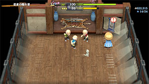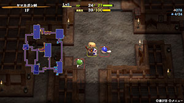

# Overview

<table class="dungeonOverview">
  <tr>
    <th>Unlock</th>
    <td class="highlightYellow">Clear Serpentcoil Island → Progress Secret Ninja Village events. 　・Unlocking Synthesis and Peach Staff is also part of the requirement.</td>
  </tr>
  <tr>
    <th>Entrance</th>
    <td class="highlightYellow">Secret Ninja Village (Thatched Residence)</td>
  </tr>
</table>

<table class="dungeonTable">
  <tr>
    <th>Floors</th>
    <td colspan="3">25F</td>
  </tr>
  <tr>
    <th>Bring Items</th>
    <td>No</td>
    <th>Stairs</th>
    <td>Ascending</td>
  </tr>
  <tr>
    <th>Companions</th>
    <td>Yes (Ver 1.1.0+)</td>
    <th>Roamers</th>
    <td>Yes (Ver 1.1.0+)</td>
  </tr>
  <tr>
    <th>Rescues</th>
    <td>3</td>
    <th>Starting Level</th>
    <td>Lv1</td>
  </tr>
  <tr>
    <th>Starting Item</th>
    <td colspan="3">Large Onigiri</td>
  </tr>
  <tr>
    <th>Unidentified</th>
    <td colspan="3">Equipment, Pots, Grass, Scrolls, Staves</td>
  </tr>
  <tr>
    <th>Shops</th>
    <td>Yes</td>
    <th>Monster Houses</th>
    <td>Yes (Regular, Sudden, Special)</td>
  </tr>
  <tr>
    <th>Behemoths</th>
    <td>Yes</td>
    <th>Wishing Shrines</th>
    <td>Yes</td>
  </tr>
  <tr>
    <th>Kron's Challenge</th>
    <td>Yes</td>
    <th>Fever Time</th>
    <td>Yes</td>
  </tr>
  <tr>
    <th>Initial Enemies</th>
    <td>4~6</td>
    <th>Spawn Rate</th>
    <td>30 Turns</td>
  </tr>
  <tr>
    <th>Wind (1st Gust)</th>
    <td>900 Turns</td>
    <th>Reward</th>
    <td></td>
  </tr>
</table>

Postgame dungeon that's kind of like a bite-sized version of a classic unidentified items dungeon. All items besides incenses are found unidentified, and all floors except for 13F have dark hallways. In addition to a pretty relentless monster table, there's also a tougher boss fight waiting at the end. Overall, this dungeon has gained some notoriety online due to its difficulty for reasons listed below. If you're struggling to clear the dungeon, rest assured that you're definitely not alone.

# Navigation

<ul class="quickLinksUL">
  <li><a href="#strategy">Strategy</a>
    <ul>
      <li><a href="#dungeon-characteristics">Dungeon Characteristics</a></li>
      <li><a href="#important-items">Important Items</a></li>
      <li><a href="#travel-companions">Travel Companions</a></li>
      <li><a href="#farming-techniques">Farming Techniques</a></li>
    </ul>
  </li>
  <li><a href="#floor-guide">Floor Guide</a>
    <ul>
      <li><a href="#general-advice">General Advice</a></li>
      <li><a href="#1-4f">1-4F</a></li>
      <li><a href="#5-9f">5-9F</a></li>
      <li><a href="#10-13f">10-13F</a></li>
      <li><a href="#14-16f">14-16F</a></li>
      <li><a href="#17-20f">17-20F</a></li>
      <li><a href="#21-24f">21-24F</a></li>
      <li><a href="#boss-(25f)">Boss (25F)</a></li>
    </ul>
  </li>
  <li><a href="#monsters">Monsters</a></li>
  <li><a href="#behemoths">Behemoths</a></li>
  <li><a href="#items">Items</a>
    <ul>
      <li><a href="#weapon">Weapon</a></li>
      <li><a href="#shield">Shield</a></li>
      <li><a href="#bracelet">Bracelet</a></li>
      <li><a href="#projectile">Projectile</a></li>
      <li><a href="#food-(items)">Food</a></li>
      <li><a href="#grass">Grass</a></li>
      <li><a href="#scroll">Scroll</a></li>
      <li><a href="#stave">Staff</a></li>
      <li><a href="#pot">Pot</a></li>
      <li><a href="#incense">Incense</a></li>
    </ul>
  </li>
</ul>

# Strategy

<h3 id="dungeon-characteristics" class="heading3Yellow">Dungeon Characteristics</h3>

This dungeon is said to be difficult for the following reasons:

- Monsters like Curse Girl (10-15F) that almost feel out-of-depth for when they appear.
    - Tough monsters continuously appearing like this makes it difficult to conserve resources.
- Mixers are not in the monster table, so you're unlikely to be able to upgrade equipment.
- Froggo, Thiefwalrus, and Mudkin are also missing, so you can't farm items or exp easily.
- The boss is generally challenging, so if you lack items, rushing stairs often just ensures a loss.
    - He can summon clones or ninja underlings and can leap away from the player.
- Despite the above, monsters constantly destroy items on the ground throughout the dungeon.
    - Fire Ninja D (5-9F), Field Knave (8-11F), Pot Knave (14-16F), Fire Ninja C (21-24F), etc.
- When the item destruction finally eases up, monsters can be too tough to check rooms.
- Monster Houses seem to have a higher chance of being generated than some other dungeons.
    - Special Monster Houses can also be generated here.

That said, the monster table does allow for some farming techniques on a few floor ranges.

- 1-3F - Nigiri Baby can be used to obtain lots of Large Onigiri.
- 7-9F - Collect arrows from Bowboy monsters using sand pillars built by Earth Ninja D.
- 6-12F - Have Karakuroid create Poison Arrow Traps, and collect Poison Arrows.
- 13F - Use arrows collected earlier to hunt Curse Girls until Lv20 for the fastest HP regen speed.
    - 13F is the only floor besides the boss floor to not have dark hallways, making it safe to linger.

However, since these floors are early game, whether you can do them or not often depends on luck. It becomes difficult to perform Nigiri Morph Factory if you don't find a decent shield at the start, and Karakuroid has 20 attack power so you'll have a hard time collecting Poison Arrows too. Most foes on other floors either destroy items or are tough, making it questionable to explore.

Other notable things:

- The item table doesn't include many negative effect items, so it's fine to use items to ID them.
    - At worst, you might become afflicted with a status condition after eating a grass item.
- Wishing Shrines are on the common side, so you might get lucky with a good wish selection.

So overall, this dungeon emphasizes run-away play more than a standard style of gameplay. This is in contrast to Kiki Island, which is a more standard 25F unidentified items dungeon.

<h4 id="update-info-(game-version-1.1.0)" class="heading4Yellow">Update Info (Game version 1.1.0)</h4>

Update 1.1.0 added more NPCs to the dungeon, including Travel Companions like Asuka and Hibiki. Teaming up with these companion characters significantly reduces the difficulty.

<h3 id="important-items" class="heading3Purple">Important Items</h3>

<h4 id="weapon-&-shield" class="heading4Purple">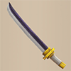 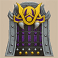 Weapon & Shield</h4>

<b><u>Yamanba's Cleaver, Yamanba's Potlid</u></b> High base value, and the Cursed Might rune raises Shiren's strength when the equipment is cursed. There are plenty of Curse Girl family monsters in this dungeon, so it's easy to activate the rune. Despite the confusing in-game description, the item is not always cursed when generated. Resonance effect increases strength by an additional 4 points.

<b><u>Gutsy Shield</u></b> High base value, and the Guts rune grants a 30% chance for you to survive a fatal hit with 1 HP.

<b><u>Ferrous Greatsword, Ferrous Kite</u></b> Voracious Hit boosts damage dealt by x1.5, and Voracious Block reduces damage received by 30%. However, the -2 Fullness per hit cost is a bit high for general use, so save it for the boss. Resonance effect decreases Fullness depletion per hit to -1.

<b><u>Whopping Harisen</u></b> The Knockback rune grants a 50% chance to deal 1 tile of knockback when an attack connects. Since most monsters lack a ranged attack, this effect lets you avoid damage pretty often. Resonates with Zabuton, which grants a 10% chance to inflict Laughing status.

<b><u>Sickle of Salvation</u></b> The Anti-Ghost rune lets you one-shot Ghost Samurai on Masked Samurai (10-15F) floors. Also helpful against Skull Mage (20-24F) and Skull Wizard (23-24F).

<b><u>Trapseeker</u></b> The player's trap-checking range expands from a 1x1 tile area to a 3x2 tile area. Nice to have when searching for Removal Trap, Poison Arrow Trap, or other useful traps.

<b><u>Steel Severer</u></b> Effective against Karakuroid (6-12F), N'dulu (16-19F), and Zapdon (20-24F).

<b><u>Hunky-dory Shield</u></b> Low base value, but the Full Armor rune halves damage received when current HP is equal to Max HP. This shield can end up reducing more damage over time than slightly stronger shields.

<b><u>Counter Shield</u></b> Counter damage helps defeat monsters faster, resulting in receiving fewer hits from enemies. This form of damage reduction is more noticeable towards the end of the dungeon.

<h4 id="bracelets" class="heading4Purple"> Bracelets</h4>

<b><u>Monster-find Bracelet</u></b> Reveals the locations of monsters on the map, and lets you see incoming enemies in dark hallways. You'll be able to spot shops and Monster Houses at a glance while this is equipped.

<b><u>Item-find Bracelet</u></b> Reveals the locations of items on the map, giving you an idea of the floor's layout. Increases your chances of claiming items before Fire Ninjas or Field Knaves destroy them.

<b><u>Rapid-fire Bracelet</u></b> Arrows are easy to collect, and 2 arrows in 1 turn often deals more damage than 1 normal attack. Lets you shoot 2 Poison Arrows to further reduce a stronger monster's attack power in a single turn. The only drawback is that checking for incoming enemies in dark hallways becomes slower.

<h4 id="projectiles" class="heading4Purple">  Projectiles</h4>

<b><u>Wooden Arrow, Iron Arrow</u></b> Tougher monsters appear starting from 10F, so shoot arrows in hallways to avoid surprise attacks. Enemies who nullify projectiles like Fierous or Mixer don't appear, so it's an effective technique.

<b><u>Poison Arrow</u></b> A single Poison Arrow reduces a monster's Attack Power by 50%, making it feasible to trade hits. It's useful even when a monster is adjacent in a hallway since the damage reduction is so significant, and it can also be used against Karakuroid to make it easier to create more Poison Arrow Traps. In addition, Poison Arrows are effective against the boss, so collect as many as possible.

<b><u>Rock</u></b> Lets you collect arrows from traps even if the arrow trap isn't located next to a wall. Can be used as Nigiri Morph Factory fodder, but rocks are also great against Behemoth Monsters.

<h4 id="scrolls" class="heading4Purple"> Scrolls</h4>

<b><u>Fixer Scroll</u></b> Fully restores HP and also solves one additional problem depending on your situation. It can be read when you're surrounded by 2 or more enemies to paralyze all adjacent enemies. Your shield is likely to get cursed by Curse Girl, but don't waste a Fixer Scroll to lift the curse, since Mixers don't appear and this scroll has far better uses like fully replenishing Fullness.

<b><u>Collection Scroll</u></b> Reading this guarantees you get the items you wished for in some Tunnel of Wishes areas. Applies to Fire Ninja D (5-9F), Field Knave (8-11F), Pot Knave (14-16F), and Fire Ninja C (21-24F) floors.

<b><u>Sanctuary Scroll</u></b> The effect is nullified during boss fights, but it can be useful for a Monster House. However, beware of Fire Ninja and Water Ninja's special attacks, as they will destroy the scroll.

<b><u>Blank Scroll</u></b> If Eradication Scroll is recorded in your notebook from playing Domain of Staves and Scrolls, write Eradication Scroll on a Blank Scroll to banish a monster like Field Knave or Swordsman. If you also find a Cashing Pot, insert an Eradication Scroll to obtain a Gitan bag worth 4,000 Gitan, which can be thrown at the boss to instantly defeat it - provided the thrown Gitan bag doesn't miss.

<h4 id="staves" class="heading4Purple"> Staves</h4>

<b><u>Disguising Staff</u></b> The effect only lasts 8 turns, but that's a good amount of time when it comes to distracting the boss. Swing it at one of the regular ninjas, and depending on Seki's positioning, she'll focus on the boss.

<b><u>Switching Staff, Knockback Staff</u></b> Swing this at the decoy during the boss fight after using a Disguising Staff to create distance, making it more likely that the decoy will survive for the full duration (8 turns).

<b><u>Sluggish Staff, Paralyzing Staff, Narrow-escape Staff</u></b> Staves that excel at dealing with single targets, including leveled up Curse Girls or such. Sluggish Staff can be used on Karakuroid 2 times to safely have it create traps.

<b><u>Peach Staff</u></b> Instantly defeats the monster hit by the magic bullet, transforming them into a Peach Bun. Equip a Break-Off Blade or Break-Off Shield before using a Peach Bun to lock-in stats without degrading. Some of the best targets to use Peach Staff on include:

- Hat Urchin (2-4F) - Steal staves from enemies, which never fails.
- Death Reaper (2-4F) or Hell Reaper (6-9F) - Swift status while you have Morphed status.
    - Beware of Water Ninja's ability while you have Morphed status.
- Bowboy (7-9F) - Shoot arrows at a wall to collect lots of arrows.
- Karakuroid (6-12F) - Create Poison Arrow Traps or other useful traps, Swift status.
    - Beware of Water Ninja's ability while you have Morphed status.
- Masked Samurai (10-15F) - Revive as Ghost Samurai if you happen to be defeated.
- N'dulu (16-19F) - Press ZL to give yourself Hiding status whenever you'd like.
- Polygon Shaka (16-21F) - Ability deals ratio damage equal to 40% of the target's HP.
    - Great against the boss (3 turns to deal 266 damage → 160 damage → 96 damage).
- Tengu Monk C (21-24F) - Press ZL to give yourself and adjacent companions Swift status.

<b><u>Burrowing Staff</u></b> Can be used to create shortcuts / paths to evade Behemoths, or one-shot Ghost Samurai.

<b><u>Earthmound Staff</u></b> Create a pillar next to an arrow trap to collect arrows when the trap isn't near a wall and you lack rocks. Also makes it easier to collect arrows from Bowboy, since there's no need to wait for Earth Ninja D. Can be used to clear a single room Monster House if you wall Shiren in and shoot arrows.

<h4 id="pots-&-incenses" class="heading4Purple">  Pots & Incenses</h4>

<b><u>Preservation Pot</u></b> Uncommon compared to other dungeons, but expanding your inventory is fantastic as always. Insert an unneeded & unidentified item to try and identify pots - don't wait for a shop or Identifier Scroll. No change to the item → NOT Identifier, Transmutation, Cashing, Exorcism, Bottomless, or Warehouse. At that point, if you can't take out the item, it's either an Ordinary Pot or Synthesis Pot in this dungeon. Exorcism is often confused for Ordinary or Synthesis, but watch to see if the "?" symbol vanishes. (To be clear, if it's an Exorcism Pot, the "?" symbol on the inserted item will vanish).

<b><u>Synthesis Pot</u></b> Mixers don't appear, so this pot and Heavenly or Earthly scrolls are the only methods to upgrade gear. These pots seem to be less common here than in the main story dungeon (Serpentcoil Island), so don't count on consistently finding even 1 Synthesis Pot in any given run. Many players don't even bother carrying synthesis ingredients here.

<b><u>Cashing Pot</u></b> Thrown Gitan deals damage equal to 20% of the bag's value, and this also applies to the boss. Items like Gazer Shield, Walrus Stopper, and Froggo Stopper can be inserted to create high value bags, and there isn't a downside since the monsters those shields counter don't appear in this dungeon. You'll need a total of 3,400 Gitan worth of Gitan bags to defeat the boss using this strategy.

<b><u>Water Gun Pot</u></b> Novice players often believe this item to be lackluster, but it's actually great in this dungeon. Water is effective against Death Reaper, Karakuroid, Masked Samurai, Swordsman, Zapdon, and Taur families. Not only that, but it can also be used to instantly defeat a Ghost Samurai since it deals 5 damage.

<b><u>Bottomless Pot</u></b> Yamakagashi Pass has ascending stairs, meaning Pitfall Traps do not send you to the next floor. It cannot be used to steal, so Bottomless Pots are strictly a negative item in this dungeon.

<b><u>Blurry Incense</u></b> Can be used to restrict a Field Knave (8-11F) or Pot Knave (14-16F)'s ability to spot items in rooms. It can also be helpful during the boss fight since it masks your location from regular ninjas, but keep in mind that the boss can overwrite the incense effect with its own incense.

<b><u>Cautious Incense</u></b> The effect protects against Swordsman (15-21F)'s equipment disarming special attack, but it doesn't protect against Pot Knave (14-16F) throwing Weeds into open pots. It only lasts 150 turns (or 300 turns with Fragrant Grass), so be quick.

<h4 id="food" class="heading4Purple"> Food</h4>

<b><u>Sweet Potato</u></b> Replenishes 50 Fullness, and warps companions and monsters in the same room elsewhere. Can be found on the ground, and doesn't rot when splashed by water or stepping on a Rotting Trap. Useful even during Sumo status, but don't forget that it does nothing on single room Monster House floors. Also, keep in mind that eating a Sweet Potato instantly removes any active incense effect, except for an incense effect that is active during a boss fight.

<b><u>Special Onigiri</u></b> Replenishes 30 Fullness, and grants a bonus effect if you eat it when your HP is full. Most to least useful bonus: Knowledgeable status &gt; Strength +1 &gt; Satiated status &gt; Tiptoe status. Can also be inserted into a Cashing Pot to create a Gitan bag that's worth 2,000 Gitan.

<h3 id="travel-companions" class="heading3Pink">Travel Companions</h3>

If you just want to clear the dungeon and don't care about self-imposed restrictions for fun, recruiting companions is the fastest and most effective way to lower the dungeon's difficulty. Companions make it a bit harder to perform Nigiri Morph Factory or use Sanctuary Scrolls, but they always dodge gear disarmed by Swordsman monsters when behind you.

<h4 id="asuka" class="heading4Pink"> Asuka</h4>

Throw a high base value weapon and shield at her like the Ferrous or Doutanuki sets. Break-Off Blade and Break-Off Shield will degrade like usual even when equipped by Asuka. Defensive options that help Asuka handle specific monster special attacks include:

- Golden Shield - Water Ninja
- Kappa's Dish - Metal Ninja, Bowboy
- Unmoving Wall - Skull Mage

<h4 id="hibiki" class="heading4Pink"> Hibiki</h4>

Strong up close, and also has a ranged attack that inflicts a status condition. Possible status effects include Confused, Blind, or Deluded status.

<h3 id="farming-techniques" class="heading3Green">Farming Techniques</h3>

<h4 id="cave-mamel-hunting-(1-3f)" class="heading4Green"> Cave Mamel Hunting (1-3F)</h4>

Pit Mamel (1-3F) can be leveled up to a Cave Mamel and hunted for 2,000 experience points. Level up options include items like Disguising Staff, Confusion or Blinding grass, Jitters Scroll, etc. If you test a staff against a Pit Mamel and discover that it's a Peach Staff, save the Pit Mamel Bun, since you can throw it at a monster and use Ghost Samurai to create a Cave Mamel on 10-15F.

<h4 id="nigiri-morph-factory-(1-3f)" class="heading4Green"> Nigiri Morph Factory (1-3F)</h4>

Nigiri Baby (1-3F) can be used to turn unneeded items into Large Onigiri if you find a shield. If you find rocks or arrows, turn individual rocks or arrows into onigiri instead of the entire stack. You can do so by stepping on single rocks or arrows and exchanging them with inventory items. It's worth trying Nigiri Morph Factory even if you don't have a shield - walk around in a large room. Increasing Max Fullness to 150+ activates Sumo status, which is a massive help here. Keep 3\~4 Large Onigiri on hand for the journey after increasing Max Fullness.

<h4 id="staff-stealing-(2-4f)" class="heading4Green"> Staff Stealing (2-4F)</h4>

If you find a Peach Staff, wave it at Hat Urchin (2-4F) and eat the Hat Urchin Bun to steal staves. Unlike Swordsman Bun or Bag Knave Bun, Hat Urchin Bun's ability has a 100% success rate, so you'll quickly be able to fill up your inventory with staves - look for Disguising Staff in particular. Peach Buns will rot when you get splashed by water, so be careful around Water Ninja D (5-9F).

<h4 id="onigiri-grilling-(2-9f)" class="heading4Green">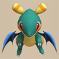 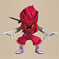 Onigiri Grilling (2-9F)</h4>

Firepuff (2-4F)'s special attack deals fire damage, so onigiri in your inventory will become grilled. Grilled Onigiri replenishes 75 fullness and restores 40 HP - Not bad as an early game healing item. Don't worry too much if you step on a Rotting Trap, since Fire Ninja D (5-9F) can also grill onigiri.

<h4 id="ninja-hunting-(5-9f)" class="heading4Green"> 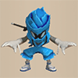 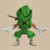 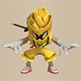 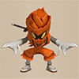 Ninja Hunting (5-9F)</h4>

Ninja family monsters (5-9F) have a slightly higher item drop rate than most other enemies. Therefore, linger and hunt ninjas until the wind blows to both level up and obtain additional drops. On average, you can probably expect to get around 1\~2 extra items per floor.

<h4 id="poison-arrows-(6-12f)" class="heading4Green">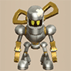 Poison Arrows (6-12F)</h4>

Karakuroid (6-12F) has the ability to create a random trap, which includes Poison Arrow Trap. Repeatedly throw Rocks or Porky's Rocks onto a Poison Arrow Trap to safely collect Poison Arrows. If you don't have rocks, have Karakuroid create traps along the wall, then throw an item at the wall so that the item lands on the Poison Arrow Trap. Karakuroid Bun lets you create traps, too. Karakuroid has 20 attack, so don't expect to tank hits without Poison Arrows or Sluggish Staff.

<h4 id="wooden-arrows-/-iron-arrows-(7-9f)" class="heading4Green">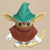 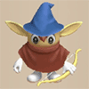 Wooden Arrows / Iron Arrows (7-9F)</h4>

Bowboy (7-9F) appears alongside Earth Ninja D (5-9F), so use a sand pillar to collect arrows. Bowboy always uses its special attack when you're lined up and within range of its arrows. If desired, have Bowboy defeat an enemy to level up into a Crossbowboy for Iron Arrows instead. You can hold ZR and press A to quickly pick up arrows instead of opening the menu every time. Picking up items doesn't regen HP, so don't forget to walk or step in place to heal as needed.

<h4 id="weeds-factory-(8-11f,-14-16f)" class="heading4Green">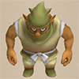 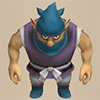 Weeds Factory (8-11F, 14-16F)</h4>

Field Knave (8-11F) and Pot Knave (14-16F) can be used to turn single arrows or rocks into Weeds. The Weeds can then be eaten to replenish 2 Fullness each, which adds up to be significant if repeated. This technique is likely only worthwhile if you're out of food and are at risk of starving.

<h4 id="curse-girl-/-cursister-hunting-(10-15f)" class="heading4Green">  Curse Girl / Cursister Hunting (10-15F)</h4>

Curse Girl (10-15F) and Masked Samurai (10-15F) are the only 2 monsters on 13F. Curse Girl (65 HP, 28 atk) gives 180 exp, and Cursister (115 HP, 38 atk) gives 380 exp. Masked Samurai (47 HP, 18 atk) gives 48 exp, and Raging Samurai (100 HP, 45 atk) gives 400 exp. It can be worthwhile to linger and hunt lots of these monsters to reach Lv20 if you have arrows, but pay attention to how much damage you're taking, and weigh the risks of missed attacks. Don't use up all of your Poison Arrows on this floor, though.

# Floor Guide

### General Advice

#### No Travel Companions

Linger and farm until the wind blows between 1-13F, then switch to rushing to the stairs from 14F. The monster table is only safe-ish until 9F, but you'll likely run out of resources if you dive that early. Keep an eye out for items that help during the boss fight, even as early as 1F.

#### Travel Companions Allowed

Travel companions are extremely strong - there's almost no need to plan or farm if you use them. Feel free to explore each floor at your leisure, since there are few enemies that have ranged attacks. Companions always dodge flying equipment, so you won't lose your shield from a dark hallway Swordsman. The only drawback is that if your companion gets separated or collapses, you might suddenly struggle. Beware of Skull Mage family monsters in particular, since their magic can separate the party.

Items to help protect companions inside a Monster House include:

- Disguising Staff
- Invincible Grass (throw at companion)
- Sweet Potato (risky, since the companion will also warp elsewhere)
- Narrow-escape Staff (swing at companion if stairs isn't in the Monster House)
- Confusion Scroll
- Blurry Incense

### 1-4F

Monsters aren't too tough aside from Firepuff (2-4F) dealing a fixed 10 damage with its flame. Take your time and check every room for items, and attempt to identify any unidentified items. Death Reaper (2-4F) has Swift 1 action speed, so don't try to retreat when your HP is low.

Have a Nigiri Baby (1-3F) turn arrows and unneeded items into Large Onigiri, then depending on playstyle, either eat the onigiri to raise max fullness to 150+ for Sumo status, or grill the onigiri using Firepuff to stock up on Grilled Onigiri which heals 40 HP when eaten.

If you get lucky and find a Peach Staff, wave it at a Hat Urchin (2-4F) to collect staves. Disguising Staff is fantastic during the boss fight in particular.

#### Monster Stats (1-4F)

|Floor|Monster|HP|Atk|Def|Exp|Type|
|-|-|-|-|-|-|-|
|1-2|Mamel|8|3|4|2|Normal|
|1-3|Pit Mamel|11|5|8|5|Normal|
|1-3|Nigiri Baby|17|8|2|11|Normal|
|2-4|Firepuff|20|7|7|13|Dragon/Floating|
|2-4|Hat Urchin|16|5|3|10|Cyclops|
|2-4|Death Reaper|22|6|5|9|Ghost/Floating|

### 5-9F

The monster table swaps to mostly elemental ninjas, and enemy attack power is notably higher. Karakuroid (6-12F) has Swift 1 action speed, and Hell Reaper (6-9F) has Swift 2 action speed, so things can get difficult from 6F if you haven't found a decent shield yet - use items as needed.

Collect Poison Arrows from Poison Arrow Traps using Karakuroid on 6-7F if possible. The combination of Bowboy (7-9F) and Earth Ninja D (5-9F) makes it easy to collect arrows, since you can simply hide behind a pillar created by Earth Ninja D with Bowboy on the other side.

Field Knave (8-11F) makes it difficult to claim items found on the ground. If you have a Sealing Staff and Blank Scroll, consider throwing an Eradication Scroll at Field Knave. Don't forget to grill any Rotten Onigiri before Fire Ninja D (5-9F) exits the monster table.

#### Monster Stats (5-9F)

|Floor|Monster|HP|Atk|Def|Exp|Type|
|-|-|-|-|-|-|-|
|5-9|Fire Ninja D|28|18|5|30|Normal|
|5-9|Tree Ninja D|25|14|10|27|Normal|
|5-9|Earth Ninja D|38|11|20|30|Normal|
|5-9|Metal Ninja D|27|13|11|35|Normal|
|5-9|Water Ninja D|24|15|9|31|Normal|
|6-9|Hell Reaper|45|12|15|30|Ghost/Floating|
|6-12|Karakuroid|40|20|13|30|Metal|
|7-9|Bowboy|45|17|18|60|Normal|
|8-11|Field Knave|50|15|16|120|Normal|

### 10-13F

Ninjas, Hell Reaper, and Bowboy swap out with Masked Samurai (10-15F) and Curse Girl (10-15F). Curse Girl has the attack power of a monster closer to Serpentcoil Island 15F, so use arrows. Mixers don't appear in this dungeon, so you have little reason to worry about her shield curse. If you want to change shields later, have a Swordsman (15-21F) disarm your cursed shield.

Don't let Ghost Samurai (4 HP) roam around, as higher level monsters here are strong. Lv2 stats: Cursister (115 HP, 38 atk), Steamroid (100 HP, 45 atk), Raging Samurai (100 HP, 45 atk). It's recommended to hunt Curse Girl (180 exp) or Cursister (380 exp) on 13F using arrows, since 13F is the only floor without dark hallways - Cursister can curse your weapon, though.

13F is the final safe-ish floor - if you decide to linger, aim for Lv20 for the fastest HP regen speed. Beyond 13F, enemies like Swordsman, Nigiri Morph, Polygon Shaka, and Pot Knave begin to appear, so you usually risk losing more resources than you gain if you try to check rooms or linger.

#### Monster Stats (10-13F)

|Floor|Monster|HP|Atk|Def|Exp|Type|
|-|-|-|-|-|-|-|
|6-12|Karakuroid|40|20|13|30|Metal|
|8-11|Field Knave|50|15|16|120|Normal|
|10-15|Curse Girl|65|28|28|180|Normal|
|10-15|Masked Samurai|47|18|18|48|Normal|

### 14-16F

Pot Knave (14-16F) throws Weeds into open pots or incenses in your inventory. If you're adjacent in a room, shoot an arrow at a wall and step away to have them focus on the item. Despite having a somewhat trickier ability, they also have higher attack power than Curse Girl. Of course, these monsters will also transform items on the ground into Weeds.

Curse Girl and Masked Samurai exit the table after 15F, but Pot Knave is still around on 16F. Polygon Shaka (16-21F) decreases Fullness by 5, and warps in front of Shiren when in a room. Swordsman (15-21F) disarms your shield even if cursed, sending it flying 10 tiles behind you. Beware if there are Pot Knaves nearby, since they will turn your disarmed shield into Weeds.

N'dulu (16-19F) disguises itself as an item, and does a surprise attack when you use the item. Disguised N'dulu in your inventory will automatically be identified when you advance floors. Avoid relying on items you found on the current floor when you're in danger.

#### Monster Stats (14-16F)

|Floor|Monster|HP|Atk|Def|Exp|Type|
|-|-|-|-|-|-|-|
|10-15|Curse Girl|65|28|28|180|Normal|
|10-15|Masked Samurai|47|18|18|48|Normal|
|14-16|Pot Knave|65|35|25|300|Normal|
|15-21|Swordsman|77|30|25|122|Normal|
|16-19|N'dulu|70|40|31|230|Metal|
|16-21|Polygon Shaka|70|34|33|360|Draining|

### 17-20F

Behemoth Gates have a chance of being generated on 17-19F. 1 Rock or Porky's Rock is enough to one-shot them from any direction, as rocks arc over their barrier. Don't try to make the gate vanish for an item drop unless you have a Monster-find Bracelet. Possible Behemoth Monsters include Pit Mamel, Mid Chintala, and Pumphantasm.

Metalhead (17-23F) can attack from up to 2 tiles ahead, including through hallway corners. Some players intentionally get hit by Skull Mage (20-24F)'s magic to either warp or gain Swift status, but keep in mind that you won't be able to warp if you currently have Sumo status.

#### Monster Stats (17-20F)

|Floor|Monster|HP|Atk|Def|Exp|Type|
|-|-|-|-|-|-|-|
|15-21|Swordsman|77|30|25|122|Normal|
|16-19|N'dulu|70|40|31|230|Metal|
|16-21|Polygon Shaka|70|34|33|360|Draining|
|17-23|Metalhead|66|30|19|61|Cyclops|
|20-24|Zapdon|80|43|35|105|Metal|
|20-24|Minotaur|70|31|20|90|Beast|
|20-24|Skull Mage|77|31|21|210|Ghost|

### 21-24F

The hardest floor range, featuring Lv2 Monks and Ninjas alongside other monsters. Exploring is very risky, so it's best to rush to the stairs unless you lack items for the boss. Lv2 Monks have stats in the range of 106\~130 HP, 40\~47 attack, and 35\~41 defense. Lv2 Ninjas have stats in the range of 70\~85 HP, 37\~45 attack (Earth is 21 atk), and 21\~28 defense.

Skull Wizard (23-24F) inflicts Confused status from a distance among other effects. Nigiri Morph (21-24F) transforms an inventory item into Large Onigiri, and never fails. Remember that you can one-shot Nigiri Morph by throwing an onigiri at it, as long as it hits. You shouldn't need onigiri at this point unless you're making use of Sumo status.

Insert scrolls into Preservation Pots to protect them from Water Ninja C (21-25F)'s special attack. Water Ninja C appears during the boss fight too, so don't remove scrolls from pots on 24F.

#### Monster Stats (21-24F)

|Floor|Monster|HP|Atk|Def|Exp|Type|
|-|-|-|-|-|-|-|
|15-21|Swordsman|77|30|25|122|Normal|
|16-21|Polygon Shaka|70|34|33|360|Draining|
|17-23|Metalhead|66|30|19|61|Cyclops|
|20-24|Zapdon|80|43|35|105|Metal|
|20-24|Minotaur|70|31|20|90|Beast|
|20-24|Skull Mage|77|31|21|210|Ghost|
|21-24|Okina Monk C|120|46|40|800|Normal|
|21-24|Tengu Monk C|130|45|37|800|Normal|
|21-24|Okame Monk C|110|40|41|800|Normal|
|21-24|Hannya Monk C|106|47|35|800|Normal|
|21-24|Kitsune Monk C|125|43|38|680|Normal|
|21-24|Nigiri Morph|88|35|30|255|Normal|
|21-25|Fire Ninja C|75|45|21|100|Normal|
|21-25|Tree Ninja C|70|37|24|88|Normal|
|21-25|Earth Ninja C|85|21|28|90|Normal|
|21-25|Metal Ninja C|85|42|29|93|Normal|
|21-25|Water Ninja C|80|37|26|95|Normal|
|24|Cursister|115|38|38|380|Normal|
|23-24|Skull Wizard|88|35|24|250|Ghost|

### Boss (25F)

  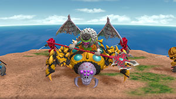

Madara (666 HP, 37 atk, 34 def) is a Normal type monster, so he has no weaknesses. Status conditions can be inflicted, but they get cured in roughly 2\~4 turns depending on the status. Sanctuary Scroll and Knockback Staff do not work, Paralyzing Staff and Narrow-escape Staff do work. The boss has the ability to activate an incense effect in response to various actions the player takes. Example: Shoot a Poison Arrow at Madara → Madara spreads the effect of Evasive Incense.

Special attacks:

- Breathe Smoke - Activates an incense effect based on the player's actions.
    - Evasive - Player deals damage to Madara with an arrow.
    - Defensive - Player uses an Aggressive Incense.
    - Reflective - Player uses a staff or scroll against Madara.
- Jump - Madara leaps away from the player.
    - He seems to use this special more often when his HP gets low.
- Smoke Bomb - Madara creates a clone (Roughly 60 HP?).
    - He seems to use this special more often when his HP gets low.
    - 2\~3 arrows should be enough to defeat the clone.
- Howl - Summons 3 ninjas from the floor's monster table.

Other notes:

- The fight begins with 6 other Lv2 Ninjas on the field.
    - Disguising Staff lasts 8 turns and is the best option for distracting all enemies on the field.
    - Narrow-escape Staff, Paralyzing Staff, or Peach Staff can be used to quickly disable underlings.
        - Other decent options include Fixer Scroll, Confusion Scroll, or Blurry Incense.
- The player is joined by companion Seki (Lv20), who is an immense help.
    - Seki has swift speed and focuses on Madara, and deals roughly 40 damage per hit.
    - She takes 1 step back after a normal attack, making her very reliable in 1 vs 1 situations.
- Swift Grass, Power-up Grass, and Invincible Grass are fantastic.
    - Don't bother using Aggressive Incense, since it'll likely just get overwritten.
- Empathetic Staff can be used to supplement damage if your damage output is low.

#### Monster Stats (25F)

|Floor|Monster|HP|Atk|Def|Exp|Type|
|-|-|-|-|-|-|-|
|25|Madara|666|37|34|0|Normal|
|21-25|Fire Ninja C|75|45|21|100|Normal|
|21-25|Tree Ninja C|70|37|24|88|Normal|
|21-25|Earth Ninja C|85|21|28|90|Normal|
|21-25|Metal Ninja C|85|42|29|93|Normal|
|21-25|Water Ninja C|80|37|26|95|Normal|

# Monsters

<button id="hideMonTblImgBtn" onClick={()=>{var mon_imgs = document.querySelectorAll('#monsterTable img');mon_imgs.forEach(e => e.classList.toggle('hidden'));}}>Toggle Monster Images</button>

See [Monsters](/system/monsters) for individual monster details.

- F - Dark hallways, Boss Floor
- S - Shop is possible
- M - Monster House is possible
- W - Wishing Shrine is possible
- B - Behemoth Gate is possible

Monster Colors = Farming, Useful, Lowers Stats, Targets Items, Dangerous

<table id="monsterTable" class="monsterTable">
  <thead>
    <tr>
      <th>F</th>
      <th>S</th>
      <th>M</th>
      <th>W</th>
      <th colspan="5">Monsters</th>
      <th>B</th>
    </tr>
  </thead>
  <tbody>
    <tr>
      <td class="centeredText highlightFog">1</td>
      <td class=""></td>
      <td class=""></td>
      <td class="highlightGold"></td>
      <td class="items"> Nigiri Baby</td>
      <td> Mamel</td>
      <td class="useful"> Pit Mamel</td>
      <td class="highlightGray"></td>
      <td class="highlightGray"></td>
      <td class=""></td>
    </tr>
    <tr>
      <td colspan="10" class="tableDivider"></td>
    </tr>
    <tr>
      <td rowspan="2" class="centeredText highlightFog">2</td>
      <td rowspan="2" class=""></td>
      <td rowspan="2" class=""></td>
      <td rowspan="2" class=""></td>
      <td class="items"> Nigiri Baby</td>
      <td> Death Reaper</td>
      <td class="useful"> Hat Urchin</td>
      <td> Mamel</td>
      <td> Firepuff</td>
      <td rowspan="2" class=""></td>
    </tr>
    <tr>
      <td class="useful"> Pit Mamel</td>
      <td class="highlightGray"></td>
      <td class="highlightGray"></td>
      <td class="highlightGray"></td>
      <td class="highlightGray"></td>
    </tr>
    <tr>
      <td colspan="10" class="tableDivider"></td>
    </tr>
    <tr>
      <td class="centeredText highlightFog">3</td>
      <td class="highlightShop"></td>
      <td class=""></td>
      <td class=""></td>
      <td class="items"> Nigiri Baby</td>
      <td> Death Reaper</td>
      <td class="useful"> Hat Urchin</td>
      <td> Firepuff</td>
      <td class="useful"> Pit Mamel</td>
      <td class=""></td>
    </tr>
    <tr>
      <td colspan="10" class="tableDivider"></td>
    </tr>
    <tr>
      <td class="centeredText highlightFog">4</td>
      <td class="highlightShop"></td>
      <td class="highlightMH"></td>
      <td class=""></td>
      <td> Death Reaper</td>
      <td class="useful"> Hat Urchin</td>
      <td> Firepuff</td>
      <td class="highlightGray"></td>
      <td class="highlightGray"></td>
      <td class=""></td>
    </tr>
    <tr>
      <td colspan="10" class="tableDivider"></td>
    </tr>
    <tr>
      <td class="centeredText highlightFog">5</td>
      <td class=""></td>
      <td class=""></td>
      <td class="highlightGold"></td>
      <td class="items"> Fire Ninja D</td>
      <td class="items"> Water Ninja D</td>
      <td> Tree Ninja D</td>
      <td> Metal Ninja D</td>
      <td> Earth Ninja D</td>
      <td class=""></td>
    </tr>
    <tr>
      <td colspan="10" class="tableDivider"></td>
    </tr>
    <tr>
      <td rowspan="2" class="centeredText highlightFog">6</td>
      <td rowspan="2" class=""></td>
      <td rowspan="2" class="highlightMH"></td>
      <td rowspan="2" class="highlightGold"></td>
      <td class="useful"> Karakuroid</td>
      <td>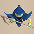 Hell Reaper</td>
      <td class="items"> Fire Ninja D</td>
      <td class="items"> Water Ninja D</td>
      <td> Tree Ninja D</td>
      <td rowspan="2" class=""></td>
    </tr>
    <tr>
      <td> Metal Ninja D</td>
      <td> Earth Ninja D</td>
      <td class="highlightGray"></td>
      <td class="highlightGray"></td>
      <td class="highlightGray"></td>
    </tr>
    <tr>
      <td colspan="10" class="tableDivider"></td>
    </tr>
    <tr>
      <td rowspan="2" class="centeredText highlightFog">7</td>
      <td rowspan="2" class=""></td>
      <td rowspan="2" class=""></td>
      <td rowspan="2" class="highlightGold"></td>
      <td class="useful"> Karakuroid</td>
      <td class="useful"> Bowboy</td>
      <td> Hell Reaper</td>
      <td class="items"> Fire Ninja D</td>
      <td class="items"> Water Ninja D</td>
      <td rowspan="2" class=""></td>
    </tr>
    <tr>
      <td> Tree Ninja D</td>
      <td> Metal Ninja D</td>
      <td> Earth Ninja D</td>
      <td class="highlightGray"></td>
      <td class="highlightGray"></td>
    </tr>
    <tr>
      <td colspan="10" class="tableDivider"></td>
    </tr>
    <tr>
      <td rowspan="2" class="centeredText highlightFog">8</td>
      <td rowspan="2" class="highlightShop"></td>
      <td rowspan="2" class=""></td>
      <td rowspan="2" class="highlightGold"></td>
      <td class="items"> Field Knave</td>
      <td class="useful"> Karakuroid</td>
      <td class="useful"> Bowboy</td>
      <td> Hell Reaper</td>
      <td class="items"> Fire Ninja D</td>
      <td rowspan="2" class=""></td>
    </tr>
    <tr>
      <td class="items"> Water Ninja D</td>
      <td> Tree Ninja D</td>
      <td> Metal Ninja D</td>
      <td> Earth Ninja D</td>
      <td class="highlightGray"></td>
    </tr>
    <tr>
      <td colspan="10" class="tableDivider"></td>
    </tr>
    <tr>
      <td rowspan="2" class="centeredText highlightFog">9</td>
      <td rowspan="2" class=""></td>
      <td rowspan="2" class=""></td>
      <td rowspan="2" class=""></td>
      <td class="items"> Field Knave</td>
      <td class="useful"> Karakuroid</td>
      <td class="useful"> Bowboy</td>
      <td> Hell Reaper</td>
      <td class="items"> Fire Ninja D</td>
      <td rowspan="2" class=""></td>
    </tr>
    <tr>
      <td class="items"> Water Ninja D</td>
      <td> Tree Ninja D</td>
      <td> Metal Ninja D</td>
      <td> Earth Ninja D</td>
      <td class="highlightGray"></td>
    </tr>
    <tr>
      <td colspan="10" class="tableDivider"></td>
    </tr>
    <tr>
      <td class="centeredText highlightFog">10</td>
      <td class="highlightShop"></td>
      <td class="highlightMH"></td>
      <td class=""></td>
      <td class="items"> Field Knave</td>
      <td class="useful"> Karakuroid</td>
      <td class="danger"> Curse Girl</td>
      <td> Masked Samurai</td>
      <td class="highlightGray"></td>
      <td class=""></td>
    </tr>
    <tr>
      <td colspan="10" class="tableDivider"></td>
    </tr>
    <tr>
      <td class="centeredText highlightFog">11</td>
      <td class=""></td>
      <td class="highlightMH"></td>
      <td class="highlightGold"></td>
      <td class="items"> Field Knave</td>
      <td class="useful"> Karakuroid</td>
      <td class="danger"> Curse Girl</td>
      <td> Masked Samurai</td>
      <td class="highlightGray"></td>
      <td class=""></td>
    </tr>
    <tr>
      <td colspan="10" class="tableDivider"></td>
    </tr>
    <tr>
      <td class="centeredText highlightFog">12</td>
      <td class=""></td>
      <td class=""></td>
      <td class=""></td>
      <td class="useful"> Karakuroid</td>
      <td class="danger"> Curse Girl</td>
      <td> Masked Samurai</td>
      <td class="highlightGray"></td>
      <td class="highlightGray"></td>
      <td class=""></td>
    </tr>
    <tr>
      <td colspan="10" class="tableDivider"></td>
    </tr>
    <tr>
      <td class="centeredText">13</td>
      <td class=""></td>
      <td class=""></td>
      <td class=""></td>
      <td class="danger"> Curse Girl</td>
      <td> Masked Samurai</td>
      <td class="highlightGray"></td>
      <td class="highlightGray"></td>
      <td class="highlightGray"></td>
      <td class=""></td>
    </tr>
    <tr>
      <td colspan="10" class="tableDivider"></td>
    </tr>
    <tr>
      <td class="centeredText highlightFog">14</td>
      <td class="highlightShop"></td>
      <td class=""></td>
      <td class=""></td>
      <td class="items"> Pot Knave</td>
      <td class="danger"> Curse Girl</td>
      <td> Masked Samurai</td>
      <td class="highlightGray"></td>
      <td class="highlightGray"></td>
      <td class=""></td>
    </tr>
    <tr>
      <td colspan="10" class="tableDivider"></td>
    </tr>
    <tr>
      <td class="centeredText highlightFog">15</td>
      <td class="highlightShop"></td>
      <td class=""></td>
      <td class="highlightGold"></td>
      <td class="items"> Pot Knave</td>
      <td class="danger"> Curse Girl</td>
      <td> Masked Samurai</td>
      <td class="items"> Swordsman</td>
      <td class="highlightGray"></td>
      <td class=""></td>
    </tr>
    <tr>
      <td colspan="10" class="tableDivider"></td>
    </tr>
    <tr>
      <td class="centeredText highlightFog">16</td>
      <td class="highlightShop"></td>
      <td class=""></td>
      <td class=""></td>
      <td class="items"> Pot Knave</td>
      <td class="stats"> Polygon Shaka</td>
      <td class="items"> Swordsman</td>
      <td class="danger"> N'dulu</td>
      <td class="highlightGray"></td>
      <td class=""></td>
    </tr>
    <tr>
      <td colspan="10" class="tableDivider"></td>
    </tr>
    <tr>
      <td class="centeredText highlightFog">17</td>
      <td class=""></td>
      <td class="highlightMH"></td>
      <td class=""></td>
      <td class="stats"> Polygon Shaka</td>
      <td class="items"> Swordsman</td>
      <td> Metalhead</td>
      <td class="danger"> N'dulu</td>
      <td class="highlightGray"></td>
      <td class="highlightBehemoth"></td>
    </tr>
    <tr>
      <td colspan="10" class="tableDivider"></td>
    </tr>
    <tr>
      <td class="centeredText highlightFog">18</td>
      <td class=""></td>
      <td class=""></td>
      <td class=""></td>
      <td class="stats"> Polygon Shaka</td>
      <td class="items"> Swordsman</td>
      <td> Metalhead</td>
      <td class="danger"> N'dulu</td>
      <td class="highlightGray"></td>
      <td class="highlightBehemoth"></td>
    </tr>
    <tr>
      <td colspan="10" class="tableDivider"></td>
    </tr>
    <tr>
      <td class="centeredText highlightFog">19</td>
      <td class=""></td>
      <td class=""></td>
      <td class=""></td>
      <td class="stats"> Polygon Shaka</td>
      <td class="items"> Swordsman</td>
      <td> Metalhead</td>
      <td class="danger"> N'dulu</td>
      <td class="highlightGray"></td>
      <td class="highlightBehemoth"></td>
    </tr>
    <tr>
      <td colspan="10" class="tableDivider"></td>
    </tr>
    <tr>
      <td rowspan="2" class="centeredText highlightFog">20</td>
      <td rowspan="2" class=""></td>
      <td rowspan="2" class=""></td>
      <td rowspan="2" class="highlightGold"></td>
      <td class="stats"> Polygon Shaka</td>
      <td> Skull Mage</td>
      <td class="items"> Swordsman</td>
      <td> Minotaur</td>
      <td> Metalhead</td>
      <td rowspan="2" class=""></td>
    </tr>
    <tr>
      <td> Zapdon</td>
      <td class="highlightGray"></td>
      <td class="highlightGray"></td>
      <td class="highlightGray"></td>
      <td class="highlightGray"></td>
    </tr>
    <tr>
      <td colspan="10" class="tableDivider"></td>
    </tr>
    <tr>
      <td rowspan="4" class="centeredText highlightFog">21</td>
      <td rowspan="4" class=""></td>
      <td rowspan="4" class=""></td>
      <td rowspan="4" class=""></td>
      <td class="items"> Nigiri Morph</td>
      <td class="stats"> Polygon Shaka</td>
      <td> Skull Mage</td>
      <td class="items"> Swordsman</td>
      <td> Minotaur</td>
      <td rowspan="4" class=""></td>
    </tr>
    <tr>
      <td> Metalhead</td>
      <td> Zapdon</td>
      <td class="items"> Fire Ninja C</td>
      <td class="items"> Water Ninja C</td>
      <td> Tree Ninja C</td>
    </tr>
    <tr>
      <td> Metal Ninja C</td>
      <td> Earth Ninja C</td>
      <td> Hannya Monk C</td>
      <td> Okame Monk C</td>
      <td class="danger"> Tengu Monk C</td>
    </tr>
    <tr>
      <td> Kitsune Monk C</td>
      <td class="danger"> Okina Monk C</td>
      <td class="highlightGray"></td>
      <td class="highlightGray"></td>
      <td class="highlightGray"></td>
    </tr>
    <tr>
      <td colspan="10" class="tableDivider"></td>
    </tr>
    <tr>
      <td rowspan="3" class="centeredText highlightFog">22</td>
      <td rowspan="3" class="highlightShop"></td>
      <td rowspan="3" class=""></td>
      <td rowspan="3" class=""></td>
      <td class="items"> Nigiri Morph</td>
      <td> Skull Mage</td>
      <td> Minotaur</td>
      <td> Metalhead</td>
      <td> Zapdon</td>
      <td rowspan="3" class=""></td>
    </tr>
    <tr>
      <td class="items"> Fire Ninja C</td>
      <td class="items"> Water Ninja C</td>
      <td> Tree Ninja C</td>
      <td> Metal Ninja C</td>
      <td> Earth Ninja C</td>
    </tr>
    <tr>
      <td> Hannya Monk C</td>
      <td> Okame Monk C</td>
      <td class="danger"> Tengu Monk C</td>
      <td> Kitsune Monk C</td>
      <td class="danger"> Okina Monk C</td>
    </tr>
    <tr>
      <td colspan="10" class="tableDivider"></td>
    </tr>
    <tr>
      <td rowspan="4" class="centeredText highlightFog">23</td>
      <td rowspan="4" class=""></td>
      <td rowspan="4" class=""></td>
      <td rowspan="4" class=""></td>
      <td class="items"> Nigiri Morph</td>
      <td> Skull Mage</td>
      <td> Skull Wizard</td>
      <td> Minotaur</td>
      <td> Metalhead</td>
      <td rowspan="4" class=""></td>
    </tr>
    <tr>
      <td> Zapdon</td>
      <td class="items"> Fire Ninja C</td>
      <td class="items"> Water Ninja C</td>
      <td> Tree Ninja C</td>
      <td> Metal Ninja C</td>
    </tr>
    <tr>
      <td> Earth Ninja C</td>
      <td> Hannya Monk C</td>
      <td> Okame Monk C</td>
      <td class="danger"> Tengu Monk C</td>
      <td> Kitsune Monk C</td>
    </tr>
    <tr>
      <td class="danger"> Okina Monk C</td>
      <td class="highlightGray"></td>
      <td class="highlightGray"></td>
      <td class="highlightGray"></td>
      <td class="highlightGray"></td>
    </tr>
    <tr>
      <td colspan="10" class="tableDivider"></td>
    </tr>
    <tr>
      <td rowspan="4" class="centeredText highlightFog">24</td>
      <td rowspan="4" class=""></td>
      <td rowspan="4" class=""></td>
      <td rowspan="4" class=""></td>
      <td class="items"> Nigiri Morph</td>
      <td class="items"> Cursister</td>
      <td> Skull Mage</td>
      <td> Skull Wizard</td>
      <td> Minotaur</td>
      <td rowspan="4" class=""></td>
    </tr>
    <tr>
      <td> Zapdon</td>
      <td class="items"> Fire Ninja C</td>
      <td class="items"> Water Ninja C</td>
      <td> Tree Ninja C</td>
      <td> Metal Ninja C</td>
    </tr>
    <tr>
      <td> Earth Ninja C</td>
      <td> Hannya Monk C</td>
      <td> Okame Monk C</td>
      <td class="danger"> Tengu Monk C</td>
      <td> Kitsune Monk C</td>
    </tr>
    <tr>
      <td class="danger"> Okina Monk C</td>
      <td class="highlightGray"></td>
      <td class="highlightGray"></td>
      <td class="highlightGray"></td>
      <td class="highlightGray"></td>
    </tr>
    <tr>
      <td colspan="10" class="tableDivider"></td>
    </tr>
    <tr>
      <td rowspan="2" class="highlightOrange2 centeredText">25</td>
      <td rowspan="2" class=""></td>
      <td rowspan="2" class=""></td>
      <td rowspan="2" class=""></td>
      <td class="danger">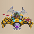 Madara</td>
      <td class="items"> Fire Ninja C</td>
      <td class="items"> Water Ninja C</td>
      <td> Tree Ninja C</td>
      <td> Metal Ninja C</td>
      <td rowspan="2" class=""></td>
    </tr>
    <tr>
      <td> Earth Ninja C</td>
      <td class="highlightGray"></td>
      <td class="highlightGray"></td>
      <td class="highlightGray"></td>
      <td class="highlightGray"></td>
    </tr>
  </tbody>
</table>

# Behemoths

<button id="hideMonTblImgBtn" onClick={()=>{var mon_imgs = document.querySelectorAll('#behemothTable img');mon_imgs.forEach(e => e.classList.toggle('hidden'));}}>Toggle Monster Images</button>

<table id="behemothTable" class="monsterTable">
  <thead>
    <tr>
      <th>F</th>
      <th colspan="5">Behemoth Monsters</th>
    </tr>
  </thead>
  <tbody>
    <tr>
      <td rowspan="1" class="centeredText">17-19</td>
      <td> Pit Mamel</td>
      <td> Mid Chintala</td>
      <td class="danger"> Pumphantasm</td>
    </tr>
  </tbody>
</table>

# Items

※ This section is currently incomplete.

<h4 id="item-table-key" class="heading4Blue"> Item Table Key</h4>

|ID|Explanation|
|-|-|
|F|Floor|
|S|Shop|
|P|Peddler|
|M|Monster drop|
|B|Buried|
|H|Thiefwalrus|
|I|Island|
|T|Transmutation Pot|
|U|Surprise Pot|
|W|Tunnel of Wishes|

<h4 id="weapon" class="heading4Blue"> Weapon</h4>

<table class="dungeonItemTable">
  <tr>
    <th colspan="11" class="highlightLightblue">Weapon</th>
  </tr>
  <tr>
    <th>Name</th>
    <th>F</th>
    <th>S</th>
    <th>P</th>
    <th>M</th>
    <th>B</th>
    <th>H</th>
    <th>I</th>
    <th>T</th>
    <th>U</th>
    <th>W</th>
  </tr>
  <tr>
    <td class="leftText">Wooden Sword</td>
    <td></td>
    <td></td>
    <td></td>
    <td></td>
    <td></td>
    <td></td>
    <td></td>
    <td></td>
    <td></td>
    <td></td>
  </tr>
  <tr>
    <td class="leftText">Bronze Sword</td>
    <td>X</td>
    <td></td>
    <td></td>
    <td></td>
    <td></td>
    <td></td>
    <td></td>
    <td></td>
    <td></td>
    <td></td>
  </tr>
  <tr>
    <td class="leftText">Katana</td>
    <td>X</td>
    <td></td>
    <td></td>
    <td></td>
    <td></td>
    <td></td>
    <td></td>
    <td></td>
    <td></td>
    <td></td>
  </tr>
  <tr>
    <td class="leftText">Doutanuki</td>
    <td></td>
    <td></td>
    <td></td>
    <td></td>
    <td></td>
    <td></td>
    <td></td>
    <td></td>
    <td></td>
    <td></td>
  </tr>
  <tr>
    <td class="leftText">Manji Kabura</td>
    <td>X</td>
    <td></td>
    <td></td>
    <td></td>
    <td></td>
    <td></td>
    <td></td>
    <td></td>
    <td></td>
    <td></td>
  </tr>
  <tr>
    <td class="leftText">Kajin Fuuma</td>
    <td></td>
    <td></td>
    <td></td>
    <td></td>
    <td></td>
    <td></td>
    <td></td>
    <td></td>
    <td></td>
    <td></td>
  </tr>
  <tr>
    <td class="leftText">Kabura Sutegi</td>
    <td></td>
    <td></td>
    <td></td>
    <td></td>
    <td></td>
    <td></td>
    <td></td>
    <td></td>
    <td></td>
    <td></td>
  </tr>
  <tr>
    <td class="leftText">Golden Sword</td>
    <td></td>
    <td></td>
    <td></td>
    <td></td>
    <td></td>
    <td></td>
    <td></td>
    <td></td>
    <td></td>
    <td></td>
  </tr>
  <tr>
    <td class="leftText">Kama Itachi</td>
    <td></td>
    <td></td>
    <td></td>
    <td></td>
    <td>X</td>
    <td></td>
    <td></td>
    <td></td>
    <td></td>
    <td></td>
  </tr>
  <tr>
    <td class="leftText">Axe of the Minotaur</td>
    <td></td>
    <td></td>
    <td></td>
    <td></td>
    <td></td>
    <td></td>
    <td></td>
    <td></td>
    <td></td>
    <td></td>
  </tr>
  <tr>
    <td class="leftText">Accurate Sword</td>
    <td></td>
    <td></td>
    <td></td>
    <td></td>
    <td></td>
    <td></td>
    <td></td>
    <td></td>
    <td></td>
    <td></td>
  </tr>
  <tr>
    <td class="leftText">Swift Sword</td>
    <td></td>
    <td>X</td>
    <td></td>
    <td></td>
    <td></td>
    <td></td>
    <td></td>
    <td>X</td>
    <td></td>
    <td></td>
  </tr>
  <tr>
    <td class="leftText">Watersplitter</td>
    <td>X</td>
    <td></td>
    <td></td>
    <td></td>
    <td>X</td>
    <td></td>
    <td></td>
    <td></td>
    <td></td>
    <td></td>
  </tr>
  <tr>
    <td class="leftText">Primal Axe</td>
    <td></td>
    <td></td>
    <td></td>
    <td></td>
    <td></td>
    <td></td>
    <td></td>
    <td></td>
    <td></td>
    <td></td>
  </tr>
  <tr>
    <td class="leftText">Dragonkiller</td>
    <td>X</td>
    <td></td>
    <td></td>
    <td></td>
    <td></td>
    <td></td>
    <td></td>
    <td></td>
    <td></td>
    <td></td>
  </tr>
  <tr>
    <td class="leftText">Crescent Blade</td>
    <td></td>
    <td></td>
    <td></td>
    <td></td>
    <td></td>
    <td></td>
    <td></td>
    <td></td>
    <td></td>
    <td></td>
  </tr>
  <tr>
    <td class="leftText">Sky Sword</td>
    <td></td>
    <td></td>
    <td></td>
    <td></td>
    <td></td>
    <td></td>
    <td></td>
    <td></td>
    <td></td>
    <td></td>
  </tr>
  <tr>
    <td class="leftText">Sickle of Salvation</td>
    <td>X</td>
    <td></td>
    <td></td>
    <td></td>
    <td></td>
    <td></td>
    <td></td>
    <td></td>
    <td></td>
    <td></td>
  </tr>
  <tr>
    <td class="leftText">Drain Slayer</td>
    <td></td>
    <td></td>
    <td></td>
    <td>X</td>
    <td></td>
    <td></td>
    <td></td>
    <td>X</td>
    <td></td>
    <td></td>
  </tr>
  <tr>
    <td class="leftText">Cyclops Bane</td>
    <td></td>
    <td></td>
    <td></td>
    <td></td>
    <td></td>
    <td></td>
    <td></td>
    <td>X</td>
    <td></td>
    <td></td>
  </tr>
  <tr>
    <td class="leftText">Steel Severer</td>
    <td></td>
    <td></td>
    <td></td>
    <td></td>
    <td></td>
    <td></td>
    <td></td>
    <td>X</td>
    <td></td>
    <td></td>
  </tr>
  <tr>
    <td class="leftText">Whopping Harisen</td>
    <td></td>
    <td></td>
    <td></td>
    <td></td>
    <td></td>
    <td></td>
    <td></td>
    <td></td>
    <td></td>
    <td></td>
  </tr>
  <tr>
    <td class="leftText">Healing Sword</td>
    <td></td>
    <td></td>
    <td></td>
    <td></td>
    <td></td>
    <td></td>
    <td></td>
    <td></td>
    <td></td>
    <td></td>
  </tr>
  <tr>
    <td class="leftText">Peach Club</td>
    <td></td>
    <td></td>
    <td></td>
    <td></td>
    <td></td>
    <td></td>
    <td></td>
    <td></td>
    <td></td>
    <td></td>
  </tr>
  <tr>
    <td class="leftText">Spender's Club</td>
    <td></td>
    <td></td>
    <td></td>
    <td></td>
    <td></td>
    <td></td>
    <td></td>
    <td></td>
    <td></td>
    <td></td>
  </tr>
  <tr>
    <td class="leftText">Ferrous Greatsword</td>
    <td>X</td>
    <td></td>
    <td></td>
    <td>X</td>
    <td></td>
    <td></td>
    <td></td>
    <td></td>
    <td></td>
    <td></td>
  </tr>
  <tr>
    <td class="leftText">Steak Knife</td>
    <td>X</td>
    <td>X</td>
    <td></td>
    <td></td>
    <td></td>
    <td></td>
    <td></td>
    <td></td>
    <td></td>
    <td></td>
  </tr>
  <tr>
    <td class="leftText">Jagged Sword</td>
    <td>X</td>
    <td>X</td>
    <td></td>
    <td></td>
    <td></td>
    <td></td>
    <td></td>
    <td></td>
    <td></td>
    <td></td>
  </tr>
  <tr>
    <td class="leftText">Quad-edge</td>
    <td>X</td>
    <td></td>
    <td></td>
    <td></td>
    <td></td>
    <td></td>
    <td></td>
    <td></td>
    <td></td>
    <td></td>
  </tr>
  <tr>
    <td class="leftText">Auspicious Kumade</td>
    <td></td>
    <td></td>
    <td></td>
    <td></td>
    <td></td>
    <td></td>
    <td></td>
    <td></td>
    <td></td>
    <td></td>
  </tr>
  <tr>
    <td class="leftText">Pickaxe</td>
    <td>X</td>
    <td></td>
    <td></td>
    <td></td>
    <td></td>
    <td></td>
    <td></td>
    <td></td>
    <td></td>
    <td></td>
  </tr>
  <tr>
    <td class="leftText">Golden Pickaxe</td>
    <td></td>
    <td></td>
    <td></td>
    <td></td>
    <td></td>
    <td></td>
    <td></td>
    <td></td>
    <td></td>
    <td></td>
  </tr>
  <tr>
    <td class="leftText">Wooden Mallet</td>
    <td>X</td>
    <td></td>
    <td></td>
    <td></td>
    <td></td>
    <td></td>
    <td></td>
    <td></td>
    <td></td>
    <td></td>
  </tr>
  <tr>
    <td class="leftText">Epic Hammer</td>
    <td></td>
    <td></td>
    <td></td>
    <td></td>
    <td></td>
    <td></td>
    <td></td>
    <td></td>
    <td></td>
    <td></td>
  </tr>
  <tr>
    <td class="leftText">Trapseeker</td>
    <td>X</td>
    <td></td>
    <td></td>
    <td></td>
    <td></td>
    <td></td>
    <td></td>
    <td></td>
    <td></td>
    <td></td>
  </tr>
  <tr>
    <td class="leftText">Bonito Block</td>
    <td></td>
    <td></td>
    <td></td>
    <td></td>
    <td></td>
    <td></td>
    <td></td>
    <td></td>
    <td></td>
    <td></td>
  </tr>
  <tr>
    <td class="leftText">Yamanba's Cleaver</td>
    <td>X</td>
    <td></td>
    <td></td>
    <td></td>
    <td></td>
    <td></td>
    <td></td>
    <td></td>
    <td></td>
    <td></td>
  </tr>
  <tr>
    <td class="leftText">Break-Off Blade</td>
    <td></td>
    <td></td>
    <td></td>
    <td></td>
    <td></td>
    <td></td>
    <td></td>
    <td></td>
    <td></td>
    <td></td>
  </tr>
</table>

<h4 id="shield" class="heading4Blue"> Shield</h4>

<table class="dungeonItemTable">
  <tr>
    <th colspan="11" class="highlightLightblue">Shield</th>
  </tr>
  <tr>
    <th>Name</th>
    <th>F</th>
    <th>S</th>
    <th>P</th>
    <th>M</th>
    <th>B</th>
    <th>H</th>
    <th>I</th>
    <th>T</th>
    <th>U</th>
    <th>W</th>
  </tr>
  <tr>
    <td class="leftText">Wooden Shield</td>
    <td>X</td>
    <td></td>
    <td></td>
    <td></td>
    <td></td>
    <td></td>
    <td></td>
    <td></td>
    <td></td>
    <td></td>
  </tr>
  <tr>
    <td class="leftText">Bronze Shield</td>
    <td>X</td>
    <td></td>
    <td></td>
    <td></td>
    <td></td>
    <td></td>
    <td></td>
    <td></td>
    <td></td>
    <td></td>
  </tr>
  <tr>
    <td class="leftText">Iron Shield</td>
    <td></td>
    <td>X</td>
    <td></td>
    <td></td>
    <td>X</td>
    <td></td>
    <td></td>
    <td></td>
    <td></td>
    <td></td>
  </tr>
  <tr>
    <td class="leftText">Wolfshead</td>
    <td>X</td>
    <td></td>
    <td></td>
    <td></td>
    <td></td>
    <td></td>
    <td></td>
    <td></td>
    <td></td>
    <td></td>
  </tr>
  <tr>
    <td class="leftText">Fuuma Shield</td>
    <td></td>
    <td></td>
    <td></td>
    <td></td>
    <td></td>
    <td></td>
    <td></td>
    <td></td>
    <td></td>
    <td></td>
  </tr>
  <tr>
    <td class="leftText">Rasen Fuuma</td>
    <td></td>
    <td></td>
    <td></td>
    <td></td>
    <td></td>
    <td></td>
    <td></td>
    <td></td>
    <td></td>
    <td></td>
  </tr>
  <tr>
    <td class="leftText">Golden Shield</td>
    <td></td>
    <td></td>
    <td></td>
    <td></td>
    <td></td>
    <td></td>
    <td></td>
    <td></td>
    <td></td>
    <td></td>
  </tr>
  <tr>
    <td class="leftText">Counter Shield</td>
    <td>X</td>
    <td></td>
    <td></td>
    <td></td>
    <td></td>
    <td></td>
    <td></td>
    <td></td>
    <td></td>
    <td></td>
  </tr>
  <tr>
    <td class="leftText">Watchful Shield</td>
    <td>X</td>
    <td></td>
    <td></td>
    <td></td>
    <td></td>
    <td></td>
    <td></td>
    <td></td>
    <td></td>
    <td></td>
  </tr>
  <tr>
    <td class="leftText">Dragon Shield</td>
    <td></td>
    <td></td>
    <td></td>
    <td></td>
    <td></td>
    <td></td>
    <td></td>
    <td></td>
    <td></td>
    <td></td>
  </tr>
  <tr>
    <td class="leftText">Blast Shield</td>
    <td>X</td>
    <td></td>
    <td></td>
    <td>X</td>
    <td></td>
    <td></td>
    <td></td>
    <td></td>
    <td></td>
    <td></td>
  </tr>
  <tr>
    <td class="leftText">Targe of the Minotaur</td>
    <td></td>
    <td></td>
    <td></td>
    <td></td>
    <td></td>
    <td></td>
    <td></td>
    <td></td>
    <td></td>
    <td></td>
  </tr>
  <tr>
    <td class="leftText">Walrus Stopper</td>
    <td>X</td>
    <td></td>
    <td></td>
    <td></td>
    <td></td>
    <td></td>
    <td></td>
    <td></td>
    <td></td>
    <td></td>
  </tr>
  <tr>
    <td class="leftText">Froggo Stopper</td>
    <td></td>
    <td></td>
    <td></td>
    <td></td>
    <td></td>
    <td></td>
    <td></td>
    <td></td>
    <td></td>
    <td></td>
  </tr>
  <tr>
    <td class="leftText">Hat Stopper</td>
    <td></td>
    <td></td>
    <td></td>
    <td></td>
    <td></td>
    <td></td>
    <td></td>
    <td></td>
    <td></td>
    <td></td>
  </tr>
  <tr>
    <td class="leftText">Nigiri Stopper</td>
    <td>X</td>
    <td></td>
    <td></td>
    <td></td>
    <td></td>
    <td></td>
    <td></td>
    <td></td>
    <td></td>
    <td></td>
  </tr>
  <tr>
    <td class="leftText">Spearscale Shield</td>
    <td></td>
    <td></td>
    <td></td>
    <td></td>
    <td></td>
    <td></td>
    <td></td>
    <td></td>
    <td></td>
    <td></td>
  </tr>
  <tr>
    <td class="leftText">Kappa's Dish</td>
    <td></td>
    <td></td>
    <td></td>
    <td></td>
    <td></td>
    <td></td>
    <td></td>
    <td></td>
    <td></td>
    <td></td>
  </tr>
  <tr>
    <td class="leftText">Gazer Shield</td>
    <td></td>
    <td></td>
    <td></td>
    <td></td>
    <td></td>
    <td></td>
    <td></td>
    <td></td>
    <td></td>
    <td></td>
  </tr>
  <tr>
    <td class="leftText">Shield of Negation</td>
    <td></td>
    <td>X</td>
    <td></td>
    <td></td>
    <td></td>
    <td></td>
    <td></td>
    <td></td>
    <td></td>
    <td></td>
  </tr>
  <tr>
    <td class="leftText">Unmoving Wall</td>
    <td></td>
    <td>X</td>
    <td></td>
    <td></td>
    <td></td>
    <td></td>
    <td></td>
    <td></td>
    <td></td>
    <td></td>
  </tr>
  <tr>
    <td class="leftText">Zabuton</td>
    <td></td>
    <td>X</td>
    <td></td>
    <td></td>
    <td></td>
    <td></td>
    <td></td>
    <td></td>
    <td></td>
    <td></td>
  </tr>
  <tr>
    <td class="leftText">Spender's Shield</td>
    <td>X</td>
    <td></td>
    <td></td>
    <td></td>
    <td></td>
    <td></td>
    <td></td>
    <td></td>
    <td></td>
    <td></td>
  </tr>
  <tr>
    <td class="leftText">Ferrous Kite</td>
    <td></td>
    <td>X</td>
    <td></td>
    <td></td>
    <td></td>
    <td></td>
    <td></td>
    <td></td>
    <td></td>
    <td></td>
  </tr>
  <tr>
    <td class="leftText">Steak Plate</td>
    <td>X</td>
    <td></td>
    <td></td>
    <td></td>
    <td></td>
    <td></td>
    <td></td>
    <td></td>
    <td></td>
    <td></td>
  </tr>
  <tr>
    <td class="leftText">Gutsy Shield</td>
    <td>X</td>
    <td>X</td>
    <td></td>
    <td></td>
    <td></td>
    <td></td>
    <td></td>
    <td></td>
    <td></td>
    <td></td>
  </tr>
  <tr>
    <td class="leftText">Hunky-dory Shield</td>
    <td>X</td>
    <td></td>
    <td></td>
    <td></td>
    <td></td>
    <td></td>
    <td></td>
    <td></td>
    <td></td>
    <td></td>
  </tr>
  <tr>
    <td class="leftText">Bodhi Shield</td>
    <td></td>
    <td></td>
    <td></td>
    <td></td>
    <td></td>
    <td></td>
    <td></td>
    <td></td>
    <td></td>
    <td></td>
  </tr>
  <tr>
    <td class="leftText">Shield of Sating</td>
    <td>X</td>
    <td>X</td>
    <td></td>
    <td></td>
    <td></td>
    <td></td>
    <td></td>
    <td></td>
    <td></td>
    <td></td>
  </tr>
  <tr>
    <td class="leftText">Auspicious Omamori</td>
    <td>X</td>
    <td></td>
    <td></td>
    <td></td>
    <td></td>
    <td></td>
    <td></td>
    <td></td>
    <td></td>
    <td></td>
  </tr>
  <tr>
    <td class="leftText">Shield of Presage</td>
    <td></td>
    <td>X</td>
    <td></td>
    <td></td>
    <td></td>
    <td></td>
    <td></td>
    <td></td>
    <td></td>
    <td></td>
  </tr>
  <tr>
    <td class="leftText">Yamanba's Potlid</td>
    <td>X</td>
    <td></td>
    <td></td>
    <td></td>
    <td></td>
    <td></td>
    <td></td>
    <td></td>
    <td></td>
    <td></td>
  </tr>
  <tr>
    <td class="leftText">Break-Off Shield</td>
    <td>X</td>
    <td></td>
    <td></td>
    <td></td>
    <td></td>
    <td></td>
    <td></td>
    <td></td>
    <td></td>
    <td></td>
  </tr>
</table>

<h4 id="bracelet" class="heading4Blue"> Bracelet</h4>

<table class="dungeonItemTable">
  <tr>
    <th colspan="11" class="highlightLightblue">Bracelet</th>
  </tr>
  <tr>
    <th>Name</th>
    <th>F</th>
    <th>S</th>
    <th>P</th>
    <th>M</th>
    <th>B</th>
    <th>H</th>
    <th>I</th>
    <th>T</th>
    <th>U</th>
    <th>W</th>
  </tr>
  <tr>
    <td class="leftText">Healing Bracelet</td>
    <td></td>
    <td></td>
    <td></td>
    <td></td>
    <td></td>
    <td></td>
    <td></td>
    <td></td>
    <td></td>
    <td></td>
  </tr>
  <tr>
    <td class="leftText">Strength Bracelet</td>
    <td></td>
    <td></td>
    <td></td>
    <td></td>
    <td></td>
    <td></td>
    <td></td>
    <td></td>
    <td></td>
    <td>X</td>
  </tr>
  <tr>
    <td class="leftText">Bellyexpand Bracelet</td>
    <td></td>
    <td></td>
    <td></td>
    <td></td>
    <td></td>
    <td></td>
    <td></td>
    <td></td>
    <td></td>
    <td></td>
  </tr>
  <tr>
    <td class="leftText">Bellyshrink Bracelet</td>
    <td></td>
    <td></td>
    <td></td>
    <td></td>
    <td></td>
    <td></td>
    <td></td>
    <td></td>
    <td></td>
    <td></td>
  </tr>
  <tr>
    <td class="leftText">Fortune Bracelet</td>
    <td></td>
    <td></td>
    <td></td>
    <td></td>
    <td></td>
    <td></td>
    <td></td>
    <td></td>
    <td></td>
    <td></td>
  </tr>
  <tr>
    <td class="leftText">Cleansing Bracelet</td>
    <td>X</td>
    <td></td>
    <td></td>
    <td></td>
    <td>X</td>
    <td></td>
    <td></td>
    <td></td>
    <td></td>
    <td></td>
  </tr>
  <tr>
    <td class="leftText">Focusing Bracelet</td>
    <td></td>
    <td></td>
    <td></td>
    <td></td>
    <td></td>
    <td></td>
    <td></td>
    <td></td>
    <td></td>
    <td></td>
  </tr>
  <tr>
    <td class="leftText">Rousing Bracelet</td>
    <td></td>
    <td></td>
    <td></td>
    <td></td>
    <td></td>
    <td></td>
    <td></td>
    <td></td>
    <td></td>
    <td></td>
  </tr>
  <tr>
    <td class="leftText">Rustproof Bracelet</td>
    <td>X</td>
    <td>X</td>
    <td></td>
    <td></td>
    <td></td>
    <td></td>
    <td></td>
    <td></td>
    <td></td>
    <td></td>
  </tr>
  <tr>
    <td class="leftText">Cursebreak Bracelet</td>
    <td></td>
    <td></td>
    <td></td>
    <td></td>
    <td></td>
    <td></td>
    <td></td>
    <td></td>
    <td></td>
    <td></td>
  </tr>
  <tr>
    <td class="leftText">Affixing Bracelet</td>
    <td></td>
    <td></td>
    <td></td>
    <td></td>
    <td></td>
    <td></td>
    <td></td>
    <td></td>
    <td></td>
    <td></td>
  </tr>
  <tr>
    <td class="leftText">Far-throwing Bracelet</td>
    <td></td>
    <td></td>
    <td></td>
    <td></td>
    <td></td>
    <td></td>
    <td></td>
    <td></td>
    <td></td>
    <td></td>
  </tr>
  <tr>
    <td class="leftText">Bad-aim Bracelet</td>
    <td></td>
    <td></td>
    <td></td>
    <td></td>
    <td></td>
    <td></td>
    <td></td>
    <td></td>
    <td></td>
    <td></td>
  </tr>
  <tr>
    <td class="leftText">Sure-aim Bracelet</td>
    <td></td>
    <td></td>
    <td></td>
    <td></td>
    <td></td>
    <td></td>
    <td></td>
    <td></td>
    <td></td>
    <td></td>
  </tr>
  <tr>
    <td class="leftText">Bouncy Bracelet</td>
    <td></td>
    <td></td>
    <td></td>
    <td></td>
    <td></td>
    <td></td>
    <td></td>
    <td></td>
    <td></td>
    <td></td>
  </tr>
  <tr>
    <td class="leftText">Rapid-fire Bracelet</td>
    <td></td>
    <td></td>
    <td></td>
    <td></td>
    <td></td>
    <td></td>
    <td></td>
    <td></td>
    <td></td>
    <td>X</td>
  </tr>
  <tr>
    <td class="leftText">Daredevil Bracelet</td>
    <td></td>
    <td></td>
    <td></td>
    <td></td>
    <td></td>
    <td></td>
    <td></td>
    <td></td>
    <td></td>
    <td></td>
  </tr>
  <tr>
    <td class="leftText">Dreaded Bracelet</td>
    <td></td>
    <td></td>
    <td></td>
    <td></td>
    <td></td>
    <td></td>
    <td></td>
    <td></td>
    <td></td>
    <td></td>
  </tr>
  <tr>
    <td class="leftText">Leaping Bracelet</td>
    <td></td>
    <td></td>
    <td></td>
    <td></td>
    <td></td>
    <td></td>
    <td></td>
    <td></td>
    <td></td>
    <td></td>
  </tr>
  <tr>
    <td class="leftText">Blasting Bracelet</td>
    <td></td>
    <td></td>
    <td></td>
    <td></td>
    <td></td>
    <td></td>
    <td></td>
    <td></td>
    <td></td>
    <td></td>
  </tr>
  <tr>
    <td class="leftText">Clairvoyant Bracelet</td>
    <td></td>
    <td></td>
    <td></td>
    <td></td>
    <td></td>
    <td></td>
    <td></td>
    <td></td>
    <td></td>
    <td></td>
  </tr>
  <tr>
    <td class="leftText">Monster-find Bracelet</td>
    <td>X</td>
    <td></td>
    <td></td>
    <td></td>
    <td></td>
    <td></td>
    <td></td>
    <td></td>
    <td></td>
    <td>X</td>
  </tr>
  <tr>
    <td class="leftText">Item-find Bracelet</td>
    <td>X</td>
    <td></td>
    <td></td>
    <td></td>
    <td></td>
    <td></td>
    <td></td>
    <td></td>
    <td></td>
    <td></td>
  </tr>
  <tr>
    <td class="leftText">Passage-find Bracelet</td>
    <td>X</td>
    <td></td>
    <td></td>
    <td></td>
    <td></td>
    <td></td>
    <td></td>
    <td></td>
    <td></td>
    <td></td>
  </tr>
  <tr>
    <td class="leftText">Waterwalk Bracelet</td>
    <td></td>
    <td></td>
    <td></td>
    <td></td>
    <td></td>
    <td></td>
    <td></td>
    <td></td>
    <td></td>
    <td></td>
  </tr>
  <tr>
    <td class="leftText">Floating Bracelet</td>
    <td></td>
    <td></td>
    <td></td>
    <td></td>
    <td></td>
    <td></td>
    <td></td>
    <td></td>
    <td></td>
    <td></td>
  </tr>
  <tr>
    <td class="leftText">Wallpass Bracelet</td>
    <td></td>
    <td></td>
    <td></td>
    <td></td>
    <td></td>
    <td></td>
    <td></td>
    <td></td>
    <td></td>
    <td></td>
  </tr>
  <tr>
    <td class="leftText">Tiptoe Bracelet</td>
    <td></td>
    <td></td>
    <td></td>
    <td></td>
    <td></td>
    <td></td>
    <td></td>
    <td></td>
    <td></td>
    <td></td>
  </tr>
  <tr>
    <td class="leftText">Passerby Bracelet</td>
    <td></td>
    <td></td>
    <td></td>
    <td></td>
    <td></td>
    <td></td>
    <td></td>
    <td></td>
    <td></td>
    <td></td>
  </tr>
  <tr>
    <td class="leftText">Item-losing Bracelet</td>
    <td></td>
    <td></td>
    <td></td>
    <td></td>
    <td></td>
    <td></td>
    <td></td>
    <td></td>
    <td></td>
    <td></td>
  </tr>
  <tr>
    <td class="leftText">Gitan-losing Bracelet</td>
    <td></td>
    <td></td>
    <td></td>
    <td></td>
    <td></td>
    <td></td>
    <td></td>
    <td></td>
    <td></td>
    <td></td>
  </tr>
  <tr>
    <td class="leftText">Monstercall Bracelet</td>
    <td></td>
    <td></td>
    <td></td>
    <td></td>
    <td></td>
    <td></td>
    <td></td>
    <td></td>
    <td></td>
    <td></td>
  </tr>
  <tr>
    <td class="leftText">Trapmore Bracelet</td>
    <td></td>
    <td></td>
    <td></td>
    <td></td>
    <td></td>
    <td></td>
    <td></td>
    <td></td>
    <td></td>
    <td></td>
  </tr>
  <tr>
    <td class="leftText">Haggling Bracelet</td>
    <td></td>
    <td></td>
    <td></td>
    <td></td>
    <td></td>
    <td></td>
    <td></td>
    <td></td>
    <td></td>
    <td>X</td>
  </tr>
  <tr>
    <td class="leftText">Trapper's Bracelet</td>
    <td></td>
    <td></td>
    <td></td>
    <td></td>
    <td></td>
    <td></td>
    <td></td>
    <td></td>
    <td></td>
    <td></td>
  </tr>
  <tr>
    <td class="leftText">Appraiser's Bracelet</td>
    <td></td>
    <td></td>
    <td></td>
    <td></td>
    <td></td>
    <td></td>
    <td></td>
    <td></td>
    <td></td>
    <td></td>
  </tr>
  <tr>
    <td class="leftText">Cannonboost Bracelet</td>
    <td></td>
    <td></td>
    <td></td>
    <td></td>
    <td></td>
    <td></td>
    <td></td>
    <td></td>
    <td></td>
    <td></td>
  </tr>
</table>

<h4 id="projectile" class="heading4Blue">   Projectile</h4>

<table class="dungeonItemTable">
  <tr>
    <th colspan="11" class="highlightLightblue">Projectile</th>
  </tr>
  <tr>
    <th>Name</th>
    <th>F</th>
    <th>S</th>
    <th>P</th>
    <th>M</th>
    <th>B</th>
    <th>H</th>
    <th>I</th>
    <th>T</th>
    <th>U</th>
    <th>W</th>
  </tr>
  <tr>
    <td class="leftText">Wooden Arrow</td>
    <td>X</td>
    <td></td>
    <td></td>
    <td>X</td>
    <td></td>
    <td></td>
    <td></td>
    <td>X</td>
    <td></td>
    <td></td>
  </tr>
  <tr>
    <td class="leftText">Iron Arrow</td>
    <td>X</td>
    <td></td>
    <td></td>
    <td>X</td>
    <td></td>
    <td></td>
    <td></td>
    <td></td>
    <td></td>
    <td></td>
  </tr>
  <tr>
    <td class="leftText">Silver Arrow</td>
    <td>X</td>
    <td></td>
    <td></td>
    <td></td>
    <td></td>
    <td></td>
    <td></td>
    <td>X</td>
    <td></td>
    <td></td>
  </tr>
  <tr>
    <td class="leftText">Poison Arrow</td>
    <td></td>
    <td></td>
    <td></td>
    <td></td>
    <td></td>
    <td></td>
    <td></td>
    <td></td>
    <td></td>
    <td></td>
  </tr>
  <tr>
    <td class="leftText">Truestrike Arrow</td>
    <td>X</td>
    <td>X</td>
    <td></td>
    <td>X</td>
    <td></td>
    <td></td>
    <td></td>
    <td></td>
    <td></td>
    <td></td>
  </tr>
  <tr>
    <td class="leftText">Rock</td>
    <td>X</td>
    <td></td>
    <td></td>
    <td></td>
    <td></td>
    <td></td>
    <td></td>
    <td>X</td>
    <td></td>
    <td></td>
  </tr>
  <tr>
    <td class="leftText">Porky's Rock</td>
    <td>X</td>
    <td></td>
    <td></td>
    <td></td>
    <td></td>
    <td></td>
    <td></td>
    <td></td>
    <td></td>
    <td></td>
  </tr>
</table>

<h4 id="food-(items)" class="heading4Blue"> Food</h4>

<table class="dungeonItemTable">
  <tr>
    <th colspan="11" class="highlightLightblue">Food</th>
  </tr>
  <tr>
    <th>Name</th>
    <th>F</th>
    <th>S</th>
    <th>P</th>
    <th>M</th>
    <th>B</th>
    <th>H</th>
    <th>I</th>
    <th>T</th>
    <th>U</th>
    <th>W</th>
  </tr>
  <tr>
    <td class="leftText">Onigiri</td>
    <td>X</td>
    <td></td>
    <td></td>
    <td></td>
    <td></td>
    <td></td>
    <td></td>
    <td>X</td>
    <td></td>
    <td></td>
  </tr>
  <tr>
    <td class="leftText">Large Onigiri</td>
    <td>X</td>
    <td>X</td>
    <td></td>
    <td></td>
    <td></td>
    <td></td>
    <td></td>
    <td>X</td>
    <td></td>
    <td></td>
  </tr>
  <tr>
    <td class="leftText">Huge Onigiri</td>
    <td></td>
    <td>X</td>
    <td></td>
    <td></td>
    <td></td>
    <td></td>
    <td></td>
    <td></td>
    <td></td>
    <td></td>
  </tr>
  <tr>
    <td class="leftText">Rotten Onigiri</td>
    <td></td>
    <td></td>
    <td></td>
    <td></td>
    <td></td>
    <td></td>
    <td></td>
    <td></td>
    <td></td>
    <td></td>
  </tr>
  <tr>
    <td class="leftText">Grilled Onigiri</td>
    <td></td>
    <td></td>
    <td></td>
    <td></td>
    <td></td>
    <td></td>
    <td></td>
    <td></td>
    <td></td>
    <td></td>
  </tr>
  <tr>
    <td class="leftText">Special Onigiri</td>
    <td>X</td>
    <td>X</td>
    <td></td>
    <td>X</td>
    <td></td>
    <td></td>
    <td></td>
    <td></td>
    <td></td>
    <td></td>
  </tr>
  <tr>
    <td class="leftText">Sumo Onigiri</td>
    <td></td>
    <td></td>
    <td></td>
    <td></td>
    <td></td>
    <td></td>
    <td></td>
    <td></td>
    <td></td>
    <td></td>
  </tr>
  <tr>
    <td class="leftText">Sweet Potato</td>
    <td>X</td>
    <td>X</td>
    <td></td>
    <td></td>
    <td>X</td>
    <td></td>
    <td></td>
    <td></td>
    <td></td>
    <td></td>
  </tr>
  <tr>
    <td class="leftText">Yakitori</td>
    <td></td>
    <td></td>
    <td></td>
    <td></td>
    <td></td>
    <td></td>
    <td></td>
    <td></td>
    <td></td>
    <td></td>
  </tr>
  <tr>
    <td class="leftText">Rotten Peach Bun</td>
    <td></td>
    <td></td>
    <td></td>
    <td></td>
    <td></td>
    <td></td>
    <td></td>
    <td></td>
    <td></td>
    <td></td>
  </tr>
</table>

<h4 id="grass" class="heading4Blue"> Grass</h4>

<table class="dungeonItemTable">
  <tr>
    <th colspan="11" class="highlightLightblue">Grass</th>
  </tr>
  <tr>
    <th>Name</th>
    <th>F</th>
    <th>S</th>
    <th>P</th>
    <th>M</th>
    <th>B</th>
    <th>H</th>
    <th>I</th>
    <th>T</th>
    <th>U</th>
    <th>W</th>
  </tr>
  <tr>
    <td class="leftText">Weeds</td>
    <td></td>
    <td></td>
    <td></td>
    <td></td>
    <td></td>
    <td></td>
    <td></td>
    <td></td>
    <td></td>
    <td></td>
  </tr>
  <tr>
    <td class="leftText">Herb</td>
    <td>X</td>
    <td></td>
    <td></td>
    <td></td>
    <td></td>
    <td></td>
    <td></td>
    <td></td>
    <td></td>
    <td></td>
  </tr>
  <tr>
    <td class="leftText">Otogirisou</td>
    <td>X</td>
    <td></td>
    <td></td>
    <td></td>
    <td></td>
    <td></td>
    <td></td>
    <td>X</td>
    <td></td>
    <td></td>
  </tr>
  <tr>
    <td class="leftText">Healing Grass</td>
    <td></td>
    <td></td>
    <td></td>
    <td></td>
    <td></td>
    <td></td>
    <td></td>
    <td></td>
    <td></td>
    <td></td>
  </tr>
  <tr>
    <td class="leftText">Life Grass</td>
    <td>X</td>
    <td>X</td>
    <td></td>
    <td></td>
    <td></td>
    <td></td>
    <td></td>
    <td></td>
    <td></td>
    <td></td>
  </tr>
  <tr>
    <td class="leftText">Fragrant Grass</td>
    <td>X</td>
    <td></td>
    <td></td>
    <td></td>
    <td></td>
    <td></td>
    <td></td>
    <td></td>
    <td></td>
    <td></td>
  </tr>
  <tr>
    <td class="leftText">Revival Grass</td>
    <td>X</td>
    <td></td>
    <td></td>
    <td></td>
    <td></td>
    <td></td>
    <td></td>
    <td></td>
    <td></td>
    <td></td>
  </tr>
  <tr>
    <td class="leftText">Bellyexpand Seed</td>
    <td>X</td>
    <td></td>
    <td></td>
    <td></td>
    <td></td>
    <td></td>
    <td></td>
    <td></td>
    <td></td>
    <td></td>
  </tr>
  <tr>
    <td class="leftText">Bellyshrink Seed</td>
    <td></td>
    <td></td>
    <td></td>
    <td></td>
    <td></td>
    <td></td>
    <td></td>
    <td></td>
    <td></td>
    <td></td>
  </tr>
  <tr>
    <td class="leftText">Dragon Grass</td>
    <td>X</td>
    <td>X</td>
    <td></td>
    <td></td>
    <td></td>
    <td></td>
    <td></td>
    <td></td>
    <td></td>
    <td></td>
  </tr>
  <tr>
    <td class="leftText">Leaping Grass</td>
    <td>X</td>
    <td></td>
    <td></td>
    <td></td>
    <td></td>
    <td></td>
    <td></td>
    <td></td>
    <td></td>
    <td></td>
  </tr>
  <tr>
    <td class="leftText">Antidote Grass</td>
    <td>X</td>
    <td>X</td>
    <td></td>
    <td></td>
    <td></td>
    <td></td>
    <td></td>
    <td></td>
    <td></td>
    <td></td>
  </tr>
  <tr>
    <td class="leftText">Strength Grass</td>
    <td>X</td>
    <td></td>
    <td></td>
    <td>X</td>
    <td></td>
    <td></td>
    <td></td>
    <td></td>
    <td></td>
    <td></td>
  </tr>
  <tr>
    <td class="leftText">Poison Grass</td>
    <td>X</td>
    <td></td>
    <td></td>
    <td></td>
    <td></td>
    <td></td>
    <td></td>
    <td></td>
    <td></td>
    <td></td>
  </tr>
  <tr>
    <td class="leftText">Confusion Grass</td>
    <td>X</td>
    <td>X</td>
    <td></td>
    <td>X</td>
    <td></td>
    <td></td>
    <td></td>
    <td></td>
    <td></td>
    <td></td>
  </tr>
  <tr>
    <td class="leftText">Sedating Grass</td>
    <td>X</td>
    <td></td>
    <td></td>
    <td></td>
    <td></td>
    <td></td>
    <td></td>
    <td></td>
    <td></td>
    <td></td>
  </tr>
  <tr>
    <td class="leftText">Berserk Seed</td>
    <td></td>
    <td></td>
    <td></td>
    <td></td>
    <td></td>
    <td></td>
    <td></td>
    <td></td>
    <td></td>
    <td></td>
  </tr>
  <tr>
    <td class="leftText">Blinding Grass</td>
    <td>X</td>
    <td></td>
    <td></td>
    <td></td>
    <td></td>
    <td></td>
    <td></td>
    <td></td>
    <td></td>
    <td></td>
  </tr>
  <tr>
    <td class="leftText">Seewell Grass</td>
    <td></td>
    <td></td>
    <td></td>
    <td></td>
    <td></td>
    <td></td>
    <td></td>
    <td></td>
    <td></td>
    <td></td>
  </tr>
  <tr>
    <td class="leftText">Swift Grass</td>
    <td>X</td>
    <td></td>
    <td></td>
    <td></td>
    <td></td>
    <td></td>
    <td></td>
    <td></td>
    <td></td>
    <td></td>
  </tr>
  <tr>
    <td class="leftText">Power-up Grass</td>
    <td>X</td>
    <td></td>
    <td></td>
    <td></td>
    <td></td>
    <td></td>
    <td></td>
    <td></td>
    <td></td>
    <td></td>
  </tr>
  <tr>
    <td class="leftText">Invincible Grass</td>
    <td>X</td>
    <td></td>
    <td></td>
    <td></td>
    <td></td>
    <td></td>
    <td></td>
    <td></td>
    <td></td>
    <td></td>
  </tr>
  <tr>
    <td class="leftText">Fortune Grass</td>
    <td>X</td>
    <td></td>
    <td></td>
    <td></td>
    <td></td>
    <td></td>
    <td></td>
    <td></td>
    <td></td>
    <td></td>
  </tr>
  <tr>
    <td class="leftText">Angel Seed</td>
    <td></td>
    <td></td>
    <td></td>
    <td></td>
    <td></td>
    <td></td>
    <td></td>
    <td></td>
    <td></td>
    <td></td>
  </tr>
  <tr>
    <td class="leftText">Feeble Grass</td>
    <td></td>
    <td></td>
    <td></td>
    <td></td>
    <td></td>
    <td></td>
    <td></td>
    <td></td>
    <td></td>
    <td></td>
  </tr>
  <tr>
    <td class="leftText">Unlucky Seed</td>
    <td></td>
    <td></td>
    <td></td>
    <td></td>
    <td></td>
    <td></td>
    <td></td>
    <td></td>
    <td></td>
    <td></td>
  </tr>
  <tr>
    <td class="leftText">Ill-fated Seed</td>
    <td></td>
    <td></td>
    <td></td>
    <td></td>
    <td></td>
    <td></td>
    <td></td>
    <td></td>
    <td></td>
    <td></td>
  </tr>
</table>

<h4 id="scroll" class="heading4Blue"> Scroll</h4>

<table class="dungeonItemTable">
  <tr>
    <th colspan="11" class="highlightLightblue">Scroll</th>
  </tr>
  <tr>
    <th>Name</th>
    <th>F</th>
    <th>S</th>
    <th>P</th>
    <th>M</th>
    <th>B</th>
    <th>H</th>
    <th>I</th>
    <th>T</th>
    <th>U</th>
    <th>W</th>
  </tr>
  <tr>
    <td class="leftText">Confusion Scroll</td>
    <td>X</td>
    <td></td>
    <td></td>
    <td></td>
    <td></td>
    <td></td>
    <td></td>
    <td></td>
    <td></td>
    <td></td>
  </tr>
  <tr>
    <td class="leftText">Slumber Scroll</td>
    <td>X</td>
    <td>X</td>
    <td></td>
    <td></td>
    <td></td>
    <td></td>
    <td></td>
    <td></td>
    <td></td>
    <td></td>
  </tr>
  <tr>
    <td class="leftText">Jitters Scroll</td>
    <td></td>
    <td></td>
    <td></td>
    <td></td>
    <td>X</td>
    <td></td>
    <td></td>
    <td></td>
    <td></td>
    <td></td>
  </tr>
  <tr>
    <td class="leftText">Windblade Scroll</td>
    <td>X</td>
    <td></td>
    <td></td>
    <td></td>
    <td></td>
    <td></td>
    <td></td>
    <td></td>
    <td></td>
    <td></td>
  </tr>
  <tr>
    <td class="leftText">Expulsion Scroll</td>
    <td></td>
    <td></td>
    <td></td>
    <td></td>
    <td></td>
    <td></td>
    <td></td>
    <td></td>
    <td></td>
    <td></td>
  </tr>
  <tr>
    <td class="leftText">Exorcism Scroll</td>
    <td>X</td>
    <td></td>
    <td></td>
    <td></td>
    <td></td>
    <td></td>
    <td></td>
    <td></td>
    <td></td>
    <td></td>
  </tr>
  <tr>
    <td class="leftText">Identifier Scroll</td>
    <td>X</td>
    <td>X</td>
    <td></td>
    <td></td>
    <td></td>
    <td></td>
    <td></td>
    <td>X</td>
    <td></td>
    <td></td>
  </tr>
  <tr>
    <td class="leftText">Heavenly Scroll</td>
    <td></td>
    <td>X</td>
    <td></td>
    <td></td>
    <td></td>
    <td></td>
    <td></td>
    <td>X</td>
    <td></td>
    <td></td>
  </tr>
  <tr>
    <td class="leftText">Earthly Scroll</td>
    <td></td>
    <td></td>
    <td></td>
    <td>X</td>
    <td>X</td>
    <td></td>
    <td></td>
    <td></td>
    <td></td>
    <td></td>
  </tr>
  <tr>
    <td class="leftText">Plating Scroll</td>
    <td>X</td>
    <td></td>
    <td></td>
    <td>X</td>
    <td></td>
    <td></td>
    <td></td>
    <td></td>
    <td></td>
    <td></td>
  </tr>
  <tr>
    <td class="leftText">Slot-adding Scroll</td>
    <td></td>
    <td></td>
    <td></td>
    <td></td>
    <td></td>
    <td></td>
    <td></td>
    <td></td>
    <td></td>
    <td></td>
  </tr>
  <tr>
    <td class="leftText">Rune-eraser Scroll</td>
    <td></td>
    <td></td>
    <td></td>
    <td></td>
    <td></td>
    <td></td>
    <td></td>
    <td>X</td>
    <td></td>
    <td></td>
  </tr>
  <tr>
    <td class="leftText">Silver-seal Scroll</td>
    <td></td>
    <td></td>
    <td></td>
    <td></td>
    <td></td>
    <td></td>
    <td></td>
    <td></td>
    <td></td>
    <td></td>
  </tr>
  <tr>
    <td class="leftText">Silverpurge Scroll</td>
    <td></td>
    <td>X</td>
    <td></td>
    <td></td>
    <td></td>
    <td></td>
    <td></td>
    <td></td>
    <td></td>
    <td></td>
  </tr>
  <tr>
    <td class="leftText">Pot-upsize Scroll</td>
    <td></td>
    <td></td>
    <td></td>
    <td></td>
    <td></td>
    <td></td>
    <td></td>
    <td></td>
    <td></td>
    <td></td>
  </tr>
  <tr>
    <td class="leftText">Extraction Scroll</td>
    <td></td>
    <td></td>
    <td></td>
    <td></td>
    <td></td>
    <td></td>
    <td></td>
    <td></td>
    <td></td>
    <td></td>
  </tr>
  <tr>
    <td class="leftText">Onigiri Scroll</td>
    <td>X</td>
    <td>X</td>
    <td></td>
    <td></td>
    <td></td>
    <td></td>
    <td></td>
    <td></td>
    <td></td>
    <td></td>
  </tr>
  <tr>
    <td class="leftText">Curse Scroll</td>
    <td></td>
    <td></td>
    <td></td>
    <td></td>
    <td></td>
    <td></td>
    <td></td>
    <td></td>
    <td></td>
    <td></td>
  </tr>
  <tr>
    <td class="leftText">Mapping Scroll</td>
    <td></td>
    <td></td>
    <td></td>
    <td></td>
    <td>X</td>
    <td></td>
    <td></td>
    <td></td>
    <td></td>
    <td></td>
  </tr>
  <tr>
    <td class="leftText">Map-loss Scroll</td>
    <td></td>
    <td></td>
    <td></td>
    <td></td>
    <td></td>
    <td></td>
    <td></td>
    <td></td>
    <td></td>
    <td></td>
  </tr>
  <tr>
    <td class="leftText">Trap-eraser Scroll</td>
    <td></td>
    <td>X</td>
    <td></td>
    <td>X</td>
    <td></td>
    <td></td>
    <td></td>
    <td></td>
    <td></td>
    <td></td>
  </tr>
  <tr>
    <td class="leftText">Trap Scroll</td>
    <td></td>
    <td></td>
    <td></td>
    <td></td>
    <td></td>
    <td></td>
    <td></td>
    <td></td>
    <td></td>
    <td></td>
  </tr>
  <tr>
    <td class="leftText">Water-drain Scroll</td>
    <td>X</td>
    <td></td>
    <td></td>
    <td></td>
    <td></td>
    <td></td>
    <td></td>
    <td></td>
    <td></td>
    <td></td>
  </tr>
  <tr>
    <td class="leftText">Monstercall Scroll</td>
    <td></td>
    <td></td>
    <td></td>
    <td></td>
    <td></td>
    <td></td>
    <td></td>
    <td></td>
    <td></td>
    <td></td>
  </tr>
  <tr>
    <td class="leftText">Wall-less Scroll</td>
    <td></td>
    <td></td>
    <td></td>
    <td></td>
    <td></td>
    <td></td>
    <td></td>
    <td></td>
    <td></td>
    <td></td>
  </tr>
  <tr>
    <td class="leftText">Gathering Scroll</td>
    <td></td>
    <td></td>
    <td></td>
    <td></td>
    <td></td>
    <td></td>
    <td></td>
    <td></td>
    <td></td>
    <td></td>
  </tr>
  <tr>
    <td class="leftText">Collection Scroll</td>
    <td>X</td>
    <td></td>
    <td></td>
    <td></td>
    <td></td>
    <td></td>
    <td></td>
    <td></td>
    <td></td>
    <td></td>
  </tr>
  <tr>
    <td class="leftText">Gambler's Scroll</td>
    <td></td>
    <td></td>
    <td></td>
    <td></td>
    <td></td>
    <td></td>
    <td></td>
    <td></td>
    <td></td>
    <td></td>
  </tr>
  <tr>
    <td class="leftText">Muzzle Scroll</td>
    <td></td>
    <td></td>
    <td></td>
    <td></td>
    <td></td>
    <td></td>
    <td></td>
    <td></td>
    <td></td>
    <td></td>
  </tr>
  <tr>
    <td class="leftText">Carry-ban Scroll</td>
    <td></td>
    <td></td>
    <td></td>
    <td></td>
    <td></td>
    <td></td>
    <td></td>
    <td></td>
    <td></td>
    <td></td>
  </tr>
  <tr>
    <td class="leftText">Swift Foe Scroll</td>
    <td></td>
    <td></td>
    <td></td>
    <td></td>
    <td></td>
    <td></td>
    <td></td>
    <td></td>
    <td></td>
    <td></td>
  </tr>
  <tr>
    <td class="leftText">Fixer Scroll</td>
    <td>X</td>
    <td></td>
    <td></td>
    <td>X</td>
    <td></td>
    <td></td>
    <td></td>
    <td></td>
    <td></td>
    <td></td>
  </tr>
  <tr>
    <td class="leftText">Escape Scroll</td>
    <td>X</td>
    <td></td>
    <td></td>
    <td></td>
    <td></td>
    <td></td>
    <td></td>
    <td></td>
    <td></td>
    <td></td>
  </tr>
  <tr>
    <td class="leftText">Eradication Scroll</td>
    <td></td>
    <td></td>
    <td></td>
    <td></td>
    <td></td>
    <td></td>
    <td></td>
    <td></td>
    <td></td>
    <td></td>
  </tr>
  <tr>
    <td class="leftText">Sanctuary Scroll</td>
    <td>X</td>
    <td></td>
    <td></td>
    <td></td>
    <td>X</td>
    <td></td>
    <td></td>
    <td></td>
    <td></td>
    <td></td>
  </tr>
  <tr>
    <td class="leftText">Blank Scroll</td>
    <td>X</td>
    <td></td>
    <td></td>
    <td></td>
    <td></td>
    <td></td>
    <td></td>
    <td></td>
    <td></td>
    <td></td>
  </tr>
  <tr>
    <td class="leftText">Wet Scroll</td>
    <td></td>
    <td></td>
    <td></td>
    <td></td>
    <td></td>
    <td></td>
    <td></td>
    <td></td>
    <td></td>
    <td></td>
  </tr>
</table>

<h4 id="staff" class="heading4Blue"> Staff</h4>

<table class="dungeonItemTable">
  <tr>
    <th colspan="11" class="highlightLightblue">Staff</th>
  </tr>
  <tr>
    <th>Name</th>
    <th>F</th>
    <th>S</th>
    <th>P</th>
    <th>M</th>
    <th>B</th>
    <th>H</th>
    <th>I</th>
    <th>T</th>
    <th>U</th>
    <th>W</th>
  </tr>
  <tr>
    <td class="leftText">Ordinary Staff</td>
    <td></td>
    <td></td>
    <td></td>
    <td></td>
    <td></td>
    <td></td>
    <td></td>
    <td></td>
    <td></td>
    <td></td>
  </tr>
  <tr>
    <td class="leftText">Paralyzing Staff</td>
    <td>X</td>
    <td></td>
    <td></td>
    <td></td>
    <td></td>
    <td></td>
    <td></td>
    <td></td>
    <td></td>
    <td></td>
  </tr>
  <tr>
    <td class="leftText">Sealing Staff</td>
    <td>X</td>
    <td></td>
    <td></td>
    <td></td>
    <td></td>
    <td></td>
    <td></td>
    <td></td>
    <td></td>
    <td></td>
  </tr>
  <tr>
    <td class="leftText">Disguising Staff</td>
    <td>X</td>
    <td>X</td>
    <td></td>
    <td></td>
    <td></td>
    <td></td>
    <td></td>
    <td></td>
    <td></td>
    <td></td>
  </tr>
  <tr>
    <td class="leftText">Empathetic Staff</td>
    <td></td>
    <td></td>
    <td></td>
    <td></td>
    <td></td>
    <td></td>
    <td></td>
    <td></td>
    <td></td>
    <td></td>
  </tr>
  <tr>
    <td class="leftText">Narrow-escape Staff</td>
    <td>X</td>
    <td>X</td>
    <td></td>
    <td></td>
    <td></td>
    <td></td>
    <td></td>
    <td></td>
    <td></td>
    <td></td>
  </tr>
  <tr>
    <td class="leftText">Knockback Staff</td>
    <td>X</td>
    <td></td>
    <td></td>
    <td></td>
    <td></td>
    <td></td>
    <td></td>
    <td></td>
    <td></td>
    <td></td>
  </tr>
  <tr>
    <td class="leftText">Switching Staff</td>
    <td>X</td>
    <td></td>
    <td></td>
    <td></td>
    <td></td>
    <td></td>
    <td></td>
    <td></td>
    <td></td>
    <td></td>
  </tr>
  <tr>
    <td class="leftText">Vaulting Staff</td>
    <td>X</td>
    <td></td>
    <td></td>
    <td></td>
    <td></td>
    <td></td>
    <td></td>
    <td></td>
    <td></td>
    <td></td>
  </tr>
  <tr>
    <td class="leftText">Skull Mage's Staff</td>
    <td></td>
    <td></td>
    <td></td>
    <td></td>
    <td></td>
    <td></td>
    <td></td>
    <td></td>
    <td></td>
    <td></td>
  </tr>
  <tr>
    <td class="leftText">Thunderbolt Staff</td>
    <td>X</td>
    <td></td>
    <td></td>
    <td></td>
    <td></td>
    <td></td>
    <td></td>
    <td></td>
    <td></td>
    <td></td>
  </tr>
  <tr>
    <td class="leftText">Burrowing Staff</td>
    <td></td>
    <td></td>
    <td></td>
    <td></td>
    <td></td>
    <td></td>
    <td></td>
    <td></td>
    <td></td>
    <td></td>
  </tr>
  <tr>
    <td class="leftText">Earthmound Staff</td>
    <td></td>
    <td>X</td>
    <td></td>
    <td></td>
    <td></td>
    <td></td>
    <td></td>
    <td></td>
    <td></td>
    <td></td>
  </tr>
  <tr>
    <td class="leftText">Balance Staff</td>
    <td></td>
    <td></td>
    <td></td>
    <td></td>
    <td></td>
    <td></td>
    <td></td>
    <td></td>
    <td></td>
    <td></td>
  </tr>
  <tr>
    <td class="leftText">Guiding Staff</td>
    <td></td>
    <td></td>
    <td></td>
    <td></td>
    <td></td>
    <td></td>
    <td></td>
    <td></td>
    <td></td>
    <td></td>
  </tr>
  <tr>
    <td class="leftText">Swift Staff</td>
    <td></td>
    <td></td>
    <td></td>
    <td></td>
    <td></td>
    <td></td>
    <td></td>
    <td></td>
    <td></td>
    <td></td>
  </tr>
  <tr>
    <td class="leftText">Sluggish Staff</td>
    <td>X</td>
    <td>X</td>
    <td></td>
    <td></td>
    <td></td>
    <td></td>
    <td></td>
    <td></td>
    <td></td>
    <td></td>
  </tr>
  <tr>
    <td class="leftText">Fortune Staff</td>
    <td></td>
    <td></td>
    <td></td>
    <td></td>
    <td></td>
    <td></td>
    <td></td>
    <td></td>
    <td></td>
    <td></td>
  </tr>
  <tr>
    <td class="leftText">Unlucky Staff</td>
    <td></td>
    <td></td>
    <td></td>
    <td></td>
    <td></td>
    <td></td>
    <td></td>
    <td></td>
    <td></td>
    <td></td>
  </tr>
  <tr>
    <td class="leftText">Peach Staff</td>
    <td></td>
    <td></td>
    <td></td>
    <td></td>
    <td>X</td>
    <td></td>
    <td></td>
    <td></td>
    <td></td>
    <td></td>
  </tr>
</table>

<h4 id="pot" class="heading4Blue"> Pot</h4>

<table class="dungeonItemTable">
  <tr>
    <th colspan="11" class="highlightLightblue">Pot</th>
  </tr>
  <tr>
    <th>Name</th>
    <th>F</th>
    <th>S</th>
    <th>P</th>
    <th>M</th>
    <th>B</th>
    <th>H</th>
    <th>I</th>
    <th>T</th>
    <th>U</th>
    <th>W</th>
  </tr>
  <tr>
    <td class="leftText">Preservation Pot</td>
    <td>X</td>
    <td></td>
    <td></td>
    <td></td>
    <td>X</td>
    <td></td>
    <td></td>
    <td></td>
    <td></td>
    <td></td>
  </tr>
  <tr>
    <td class="leftText">Identifier Pot</td>
    <td></td>
    <td></td>
    <td></td>
    <td></td>
    <td></td>
    <td></td>
    <td></td>
    <td></td>
    <td></td>
    <td></td>
  </tr>
  <tr>
    <td class="leftText">Transmutation Pot</td>
    <td>X</td>
    <td></td>
    <td></td>
    <td></td>
    <td></td>
    <td></td>
    <td></td>
    <td></td>
    <td></td>
    <td>X</td>
  </tr>
  <tr>
    <td class="leftText">Cashing Pot</td>
    <td>X</td>
    <td></td>
    <td></td>
    <td></td>
    <td></td>
    <td></td>
    <td></td>
    <td></td>
    <td></td>
    <td></td>
  </tr>
  <tr>
    <td class="leftText">Synthesis Pot</td>
    <td>X</td>
    <td></td>
    <td></td>
    <td></td>
    <td></td>
    <td></td>
    <td></td>
    <td></td>
    <td></td>
    <td></td>
  </tr>
  <tr>
    <td class="leftText">Exorcism Pot</td>
    <td></td>
    <td></td>
    <td></td>
    <td></td>
    <td></td>
    <td></td>
    <td></td>
    <td></td>
    <td></td>
    <td></td>
  </tr>
  <tr>
    <td class="leftText">Curse Pot</td>
    <td></td>
    <td></td>
    <td></td>
    <td></td>
    <td></td>
    <td></td>
    <td></td>
    <td></td>
    <td></td>
    <td></td>
  </tr>
  <tr>
    <td class="leftText">Upgrading Pot</td>
    <td></td>
    <td></td>
    <td></td>
    <td></td>
    <td></td>
    <td></td>
    <td></td>
    <td></td>
    <td></td>
    <td></td>
  </tr>
  <tr>
    <td class="leftText">Degrading Pot</td>
    <td></td>
    <td></td>
    <td></td>
    <td></td>
    <td></td>
    <td></td>
    <td></td>
    <td></td>
    <td></td>
    <td></td>
  </tr>
  <tr>
    <td class="leftText">Bottomless Pot</td>
    <td>X</td>
    <td></td>
    <td></td>
    <td></td>
    <td></td>
    <td></td>
    <td></td>
    <td></td>
    <td></td>
    <td>X</td>
  </tr>
  <tr>
    <td class="leftText">Warehouse Pot</td>
    <td></td>
    <td></td>
    <td></td>
    <td></td>
    <td></td>
    <td></td>
    <td></td>
    <td></td>
    <td></td>
    <td></td>
  </tr>
  <tr>
    <td class="leftText">Handtrapper Pot</td>
    <td></td>
    <td></td>
    <td></td>
    <td></td>
    <td></td>
    <td></td>
    <td></td>
    <td></td>
    <td></td>
    <td></td>
  </tr>
  <tr>
    <td class="leftText">Unbreakable Pot</td>
    <td></td>
    <td></td>
    <td></td>
    <td></td>
    <td></td>
    <td></td>
    <td></td>
    <td></td>
    <td></td>
    <td></td>
  </tr>
  <tr>
    <td class="leftText">Ordinary Pot</td>
    <td></td>
    <td></td>
    <td></td>
    <td></td>
    <td></td>
    <td></td>
    <td></td>
    <td></td>
    <td></td>
    <td></td>
  </tr>
  <tr>
    <td class="leftText">Hiding Pot</td>
    <td>X</td>
    <td></td>
    <td></td>
    <td></td>
    <td></td>
    <td></td>
    <td></td>
    <td></td>
    <td></td>
    <td></td>
  </tr>
  <tr>
    <td class="leftText">Rejuvenation Pot</td>
    <td>X</td>
    <td></td>
    <td></td>
    <td></td>
    <td></td>
    <td></td>
    <td></td>
    <td></td>
    <td></td>
    <td></td>
  </tr>
  <tr>
    <td class="leftText">Walrus Pot</td>
    <td>X</td>
    <td></td>
    <td></td>
    <td></td>
    <td></td>
    <td></td>
    <td></td>
    <td></td>
    <td></td>
    <td></td>
  </tr>
  <tr>
    <td class="leftText">Water Gun Pot</td>
    <td></td>
    <td></td>
    <td></td>
    <td></td>
    <td></td>
    <td></td>
    <td></td>
    <td></td>
    <td></td>
    <td></td>
  </tr>
  <tr>
    <td class="leftText">Hilarious Pot</td>
    <td></td>
    <td></td>
    <td></td>
    <td></td>
    <td></td>
    <td></td>
    <td></td>
    <td></td>
    <td></td>
    <td></td>
  </tr>
  <tr>
    <td class="leftText">Monster Pot</td>
    <td></td>
    <td></td>
    <td></td>
    <td></td>
    <td></td>
    <td></td>
    <td></td>
    <td></td>
    <td></td>
    <td></td>
  </tr>
  <tr>
    <td class="leftText">Surprise Pot</td>
    <td></td>
    <td></td>
    <td></td>
    <td></td>
    <td></td>
    <td></td>
    <td></td>
    <td></td>
    <td></td>
    <td></td>
  </tr>
</table>

<h4 id="incense" class="heading4Blue"> Incense</h4>

<table class="dungeonItemTable">
  <tr>
    <th colspan="11" class="highlightLightblue">Incense</th>
  </tr>
  <tr>
    <th>Name</th>
    <th>F</th>
    <th>S</th>
    <th>P</th>
    <th>M</th>
    <th>B</th>
    <th>H</th>
    <th>I</th>
    <th>T</th>
    <th>U</th>
    <th>W</th>
  </tr>
  <tr>
    <td class="leftText">Heat-ban Incense</td>
    <td></td>
    <td></td>
    <td></td>
    <td></td>
    <td></td>
    <td></td>
    <td></td>
    <td></td>
    <td></td>
    <td></td>
  </tr>
  <tr>
    <td class="leftText">Evasive Incense</td>
    <td></td>
    <td></td>
    <td></td>
    <td></td>
    <td></td>
    <td></td>
    <td></td>
    <td></td>
    <td></td>
    <td></td>
  </tr>
  <tr>
    <td class="leftText">Cautious Incense</td>
    <td></td>
    <td></td>
    <td></td>
    <td></td>
    <td></td>
    <td></td>
    <td></td>
    <td></td>
    <td></td>
    <td></td>
  </tr>
  <tr>
    <td class="leftText">Reflective Incense</td>
    <td>X</td>
    <td>X</td>
    <td></td>
    <td></td>
    <td></td>
    <td></td>
    <td></td>
    <td></td>
    <td></td>
    <td></td>
  </tr>
  <tr>
    <td class="leftText">Aggressive Incense</td>
    <td>X</td>
    <td></td>
    <td></td>
    <td></td>
    <td>X</td>
    <td></td>
    <td></td>
    <td></td>
    <td></td>
    <td></td>
  </tr>
  <tr>
    <td class="leftText">Defensive Incense</td>
    <td></td>
    <td>X</td>
    <td></td>
    <td></td>
    <td></td>
    <td></td>
    <td></td>
    <td></td>
    <td></td>
    <td></td>
  </tr>
  <tr>
    <td class="leftText">Blurry Incense</td>
    <td>X</td>
    <td>X</td>
    <td></td>
    <td></td>
    <td></td>
    <td></td>
    <td></td>
    <td></td>
    <td></td>
    <td></td>
  </tr>
  <tr>
    <td class="leftText">Weighted Incense</td>
    <td>X</td>
    <td>X</td>
    <td></td>
    <td></td>
    <td></td>
    <td></td>
    <td></td>
    <td></td>
    <td></td>
    <td></td>
  </tr>
  <tr>
    <td class="leftText">Unwanting Incense</td>
    <td></td>
    <td></td>
    <td></td>
    <td>X</td>
    <td></td>
    <td></td>
    <td></td>
    <td></td>
    <td></td>
    <td></td>
  </tr>
</table>
